# Loom — Architecture

> **Mission**
>
> **Make intelligent, long-running, human-in-the-loop software as durable, inspectable, and reproducible as a database transaction — without giving up the flexibility of code.**
>
> Loom treats an agentic workflow as a *process* that unfolds over time, not a request that returns once. Every decision it makes is recorded as an immutable fact, so any execution can be paused for a human, resumed on another machine, replayed bit-for-bit for debugging, forked to explore alternatives, and evaluated against its own history. The intelligence is yours to write in plain TypeScript; Loom provides the durable spine that makes it trustworthy in production.

---

## Table of contents

1. [The problem](#1-the-problem)
2. [Core principles](#2-core-principles)
3. [The big picture](#3-the-big-picture)
4. [The execution model](#4-the-execution-model)
5. [Subsystems](#5-subsystems)
6. [Package map](#6-package-map)
7. [Decision records — reasoning & advantages](#7-decision-records--reasoning--advantages)
8. [Trade-offs & non-goals](#8-trade-offs--non-goals)

---

## 1. The problem

Modern applications increasingly embed *intelligence* — LLM calls, tool use, multi-agent coordination — inside flows that:

- **run for a long time** (seconds to days), often pausing for a human to approve a risky action;
- **call non-deterministic, expensive, and fallible services** (models, APIs, other agents);
- **must survive process restarts, deploys, and crashes** without losing or double-executing work;
- **need to be explained** after the fact ("*why* did the agent do that?");
- **want to explore alternatives** ("what if we tried the other remediation?").

The dominant tools force a bad trade. A **request/response framework** is easy to write but forgets everything the moment a process dies and cannot pause for a human. A **heavyweight workflow engine** is durable but pushes you into a restrictive DSL, an external server, and a deployment model that fights your UI. Neither gives you deterministic *replay* — the ability to reconstruct exactly what happened — which is precisely what you need when an AI does something surprising.

Loom's thesis: **the durable event log is the moat.** If every meaningful thing that happens is appended to an ordered, immutable log, then durability, resumability, replay, branching, evaluation, and time-travel debugging are all just *different lenses on the same log*. Build that spine well, keep the authoring surface plain TypeScript, and everything else composes.

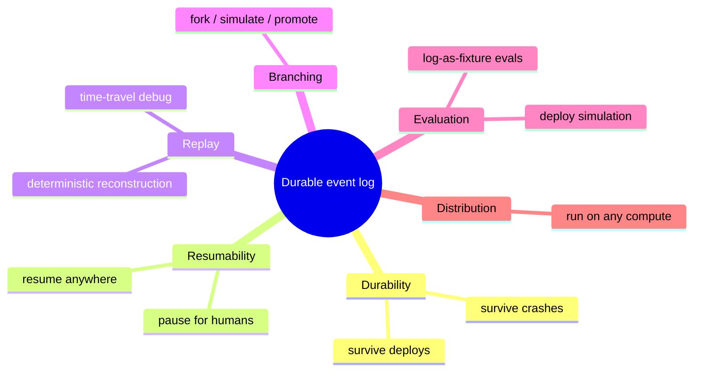

---

## 2. Core principles

These are the non-negotiable rules the whole codebase is designed around. Every architectural decision in §7 traces back to one or more of them.

### P1 — The log is the source of truth (event sourcing)

Execution state is never stored directly. It is **derived** by folding an append-only sequence of events. The current state of any execution is `fold(events)`. This makes state reconstructable, auditable, and diffable, and it is what unlocks replay, resume, and fork.

### P2 — Replay is deterministic and pure

Reconstructing state from events is a **pure fold** — the same events always produce the same state, with no side effects, no clock, no randomness. Determinism is a hard constraint, not a nicety: a resume on a fresh machine, a fork, and a replay-for-debugging must all reconstruct *identical* state. This is why the replay engine is a pure function and why library code avoids `Date.now()`/`Math.random()` on paths that must be reproducible (hashing is used instead).

### P3 — Suspension is a first-class, normal outcome

A workflow pausing to wait for a human (or a timer, or an external signal) is not an error or a special mode — it is an ordinary result of running. `ctx.suspend()` writes a durable checkpoint and returns control to the caller; a later `resume()` continues from exactly that point. The runtime is built so that "suspended" is as routine as "completed."

### P4 — The intelligence stays as plain code

Loom does **not** invent a workflow DSL. A flow's orchestration is an ordinary `async` TypeScript function (`(ctx, input) => …`) that calls `ctx.run(step)`, `ctx.suspend()`, and `ctx.parallel()`. Your business logic, prompts, and agent loops are just functions. Loom wraps them with durability; it does not replace them. *Sugar, not a cage.*

### P5 — Wiring is static and replay-safe

Everything that determines *what runs* — flow registration, effect registration, middleware, surfaces — is wired **statically at build/boot time**, from explicit imports. No runtime filesystem globbing, no environment-conditional registration. A resume, a remote worker, or a replay must be able to reconstruct an identical set of flows and effects, which is only possible if wiring is deterministic. (Folder conventions are honored via **build-time codegen**, not runtime discovery.)

### P6 — Composition over inheritance; sugar over replacement

Reusable abstractions are **functions and small objects you compose**, never base classes you must `extends`. Every helper returns or consumes the same primitives the core already produces (`WorkflowRuntime`, `EventStore`, `defineConfig`). You can always drop down a layer. Nothing hides the thing that makes your app valuable.

### P7 — Pure cores, thin edges

Each capability is a **pure, unit-testable core** (a fold, a format, a validate, a codegen, a plan) wrapped by a thin I/O shell (CLI argv, HTTP handler, filesystem). This keeps logic testable without spawning processes and keeps the surface area honest.

### P8 — The core is isomorphic; the edges are pluggable

The durable runtime has **no environment assumptions**. Storage, compute placement, LLM providers, and renderers are all interfaces (`EventStore`, `WorkerRuntime`, `LlmProvider`, renderers). The same flow runs in-process in a test, in a browser tab, on a Node server with SQLite, or on Cloud Run — because the core depends only on interfaces, and adapters supply the edges.

### P9 — Non-determinism is allowed, but only when logged *(Loom 2.0)*

A runtime may route between models, elevate to a stronger one, learn, or optimize — but every such choice is emitted as a durable decision event (`DECISION_RECORDED`) and served from the log on replay, exactly as completed effects are. Replay therefore stays a pure fold (**P2 is untouched**): a given execution reconstructs bit-for-bit forever, even as *outcomes improve run-to-run*. This evolves P2 to admit intelligence without regressing determinism. See [ADR 0016](adr/0016-loom-2.0-execution-runtime-and-decision-seam.md).

### P10 — Minimal kernel; intelligence lives in an advisory plane *(Loom 2.0)*

The durable core stays small and boring (execution + event log + determinism + effect isolation). Everything "smart" — scheduling, reasoning, memory, prediction, optimization — is an **optional, composable module** in an ephemeral advisory plane that can affect *outcomes* only through logged decisions (P9) or *latency* only through off-log warming, and is **never a hidden input to the fold**. You never pay for a runtime you did not opt into; the simple path (`ctx.run`) stays a one-liner and the zero-overhead default is preserved. See [ADR 0016](adr/0016-loom-2.0-execution-runtime-and-decision-seam.md).

### P11 — AI-native DX: natural language compiles to code, not runtime *(Loom 2.0)*

Natural language is a **build-time** convenience, never a runtime input. `@loom/appgen` is **brownfield-aware**: it scans the existing app (`scanApp` → `AppModel`), plans a *delta* from an intent via a deterministic, offline directive parser (`planChangesDeterministic` → `ChangeSpec`, the only stage that reads NL), then applies it with surgical, formatting-preserving edits (`applyChanges`) — new flows from templates, existing ones edited only where a handler still hashes to the generated stub. The output is ordinary `flow$`/`step$` wired through `defineConfig` in the folder convention. There is no runtime interpretation of NL: the only "understanding" step is the swappable planner producing a spec, and codegen is pure and template-based (**P4/P5 preserved**). The plan stage is **provider-agnostic** — `loom appgen --model <spec>` reasons with the model of your choice (`anthropic:` / `openai:` / `gemini:` via `@loom/llm`, or a local `.gguf` via the optional [`@loom/appgen-model`](../tools/appgen-model)), and always falls back to the deterministic parser. See [ADR 0042](adr/0042-ai-native-brownfield-appgen.md), [ADR 0050](adr/0050-appgen-model-provider-agnostic.md), and [ADR 0016](adr/0016-loom-2.0-execution-runtime-and-decision-seam.md).

---

## 3. The big picture

At the coarsest level, Loom is three concentric rings: **authoring** (what you write), the **durable core** (the spine), and **pluggable edges** (where it runs, what it talks to, how it renders).

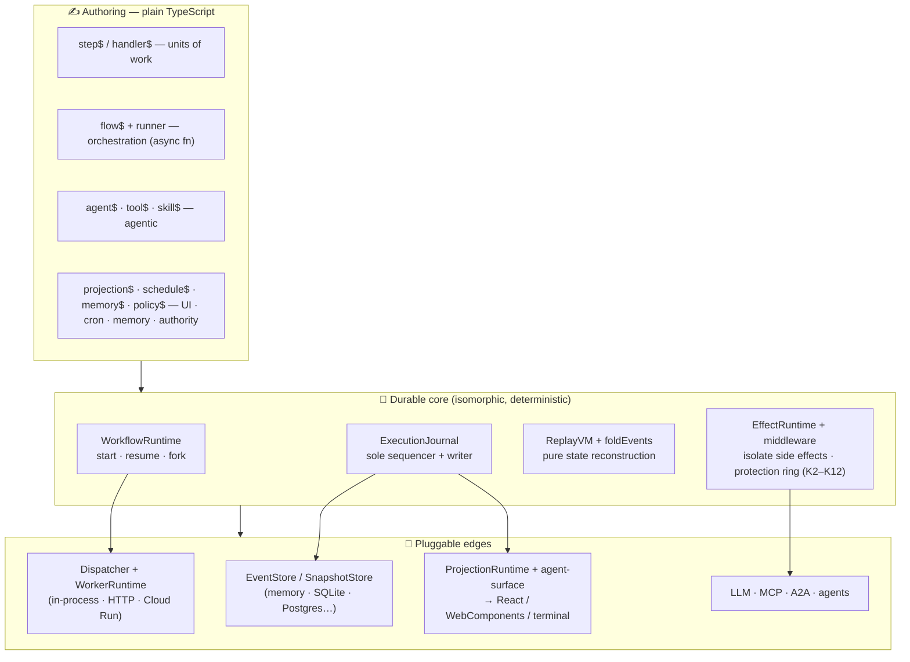

**Reading the diagram:** you author flows/steps/agents as functions. `WorkflowRuntime` runs them; the `ExecutionJournal` turns every meaningful moment into a sequenced, durably-written event; the `ReplayVM` folds those events into state. Side effects are quarantined behind `EffectRuntime`. Everything below the core is an interface with swappable adapters — that's what makes the same code run in a test, a browser, or the cloud.

---

## 4. The execution model

### 4.1 One event log per execution

Every execution is an ordered list of **events** (`EventEnvelope`), each with a monotonically increasing `sequence`. The current state is `foldEvents(events)`:

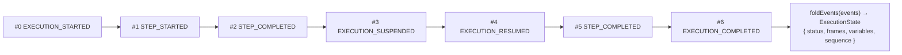

The fold is a pure, deterministic left-fold: each event type has a handler `(state, event) => state`. Nothing else defines state. (For performance, the fold uses copy-on-write structural sharing — see [ADR 0015](adr/0015-dsa-performance-optimizations.md).)

### 4.2 The durable write pipeline

The **`ExecutionJournal`** is the single most important invariant in the system: it is the *sole* sequence allocator and the *only* thing that appends to the store. This is what guarantees a per-execution total order with no multi-writer races.

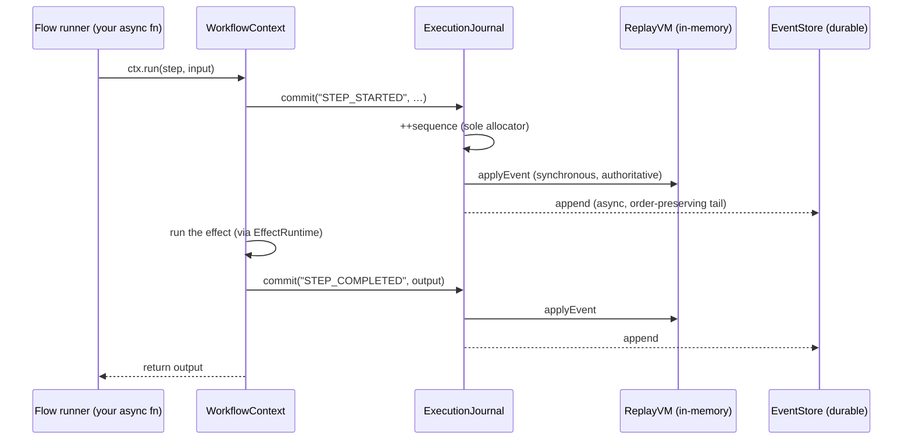

Key properties:
- **Synchronous fold, async durable write.** The in-memory `ReplayVM` is updated synchronously so the flow always sees authoritative state; the durable append is chained on an order-preserving promise tail. A write rejection aborts the run and surfaces at the next barrier.
- **Single allocator.** Because only the journal allocates sequences and appends, there is never a gap or a duplicate — the foundation of replay correctness.

### 4.3 Suspend & resume

When a flow calls `ctx.suspend({ on, correlationKey, timeout })`, the runtime commits `EXECUTION_SUSPENDED`, persists a snapshot, and returns control to the caller. The execution now lives entirely in durable storage. A later `resume(executionId, { eventType, payload })` reloads state and continues **from the checkpoint** — the payload becomes the return value of the original `suspend()` call.

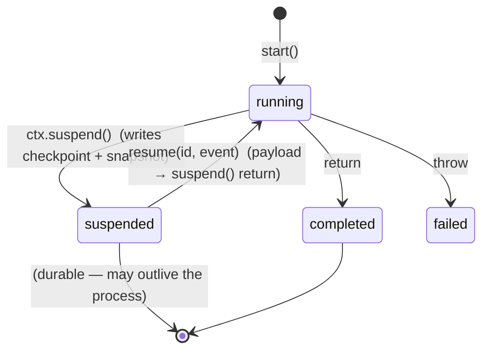

Crucially, on resume the flow function **re-runs from the top**, but every already-completed step is served from the log (its `STEP_COMPLETED` event is replayed, the effect is *not* re-executed) — so effects happen exactly once and the suspend point is reached deterministically. This is P2 (deterministic replay) doing the heavy lifting.

### 4.3.1 Step identity & the interpreter pattern

Replay's substitution is keyed by **step id** (`frames[stepId]`) — not by log position. That single fact is both the freedom and the obligation of dynamic flows ([ADR 0061](adr/0061-step-identity-interpreter-guardrails.md)):

> The sequence of durable-step identities an execution produces must be a **pure function of logged inputs** (flow input, step outputs, decisions, resume payloads). A step invoked more than once with different intent must mint a deterministic distinct id — `` `${id}#${index}` `` for loops, `` `${id}#retry:${n}` `` for deliberate re-tries (saga uses `#compensate:${i}`). Reusing an id returns/substitutes the **first recorded outcome** — completed output and typed failures alike ([ADR 0060](adr/0060-typed-failure-channels.md)).

The freedom: a statically compiled **interpreter flow** may issue `ctx.run` inside loops bounded by runtime-loaded data (a blueprint, a runbook) and remain fully replayable — the id sequence re-derives identically from the logged input, crash recovery re-executes only the frames that never completed, and `flowContentHash` (K11.1) is unaffected because dynamic steps are deliberately outside the structural hash. Dynamic steps bind a static `toolId` to a registered effect; the effect registry, not the compiler manifest, is their load-bearing map.

The obligation: a loop that *reuses* one id is silently wrong — iteration 2+ is served iteration 1's memoized output. The compiler's `analyzeLoopIdentity` pass flags loop-scoped `ctx.run`/`ctx.execute` whose id cannot vary per iteration (surfaced through `@loom/verify`'s determinism rule and the compiler manifest's `loopIdentity` warnings), and the kernel's interpreter crash-matrix test pins the contract.

Typed failures ([ADR 0060](adr/0060-typed-failure-channels.md)) are the failure twin of the memoized success — recorded once, substituted forever:

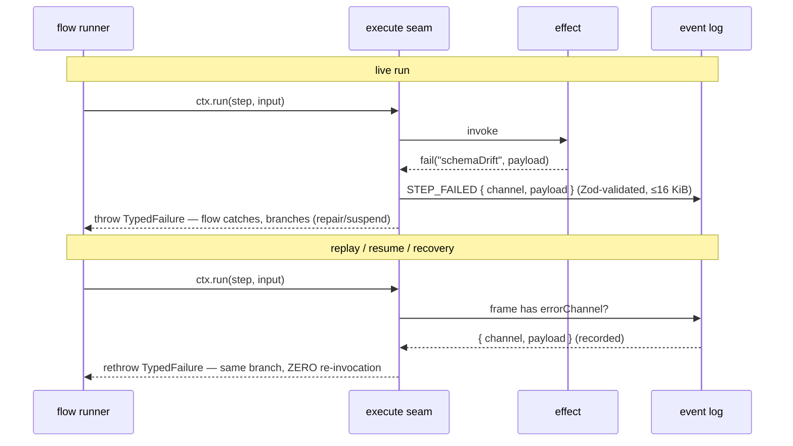

### 4.4 Recovery & snapshots

A crash mid-flight is just another resume. On redispatch the worker folds the durable state and decides idempotently: still `running` → resume; already `completed`/`suspended` → return as-is. No step re-runs.

To keep replay cheap on long executions, snapshots checkpoint the folded state so a resume folds only the *tail* after the latest snapshot instead of the whole log. Snapshots are written at suspend and fork, and — when configured with `snapshotEvery: N` — every *N* committed events, bounding recovery to `O(N)` regardless of log length ([ADR 0015](adr/0015-dsa-performance-optimizations.md)).

### 4.5 Branching (fork / simulate / promote)

Because state is `fold(events)`, a **fork** is just copying the event prefix `[0..sequence]` into a new execution id and resuming it differently. The parent is untouched; branches are independent executions that can run concurrently. Promotion is a **pointer move** in a `BranchRegistry` (git-style refs) — there is no merge.

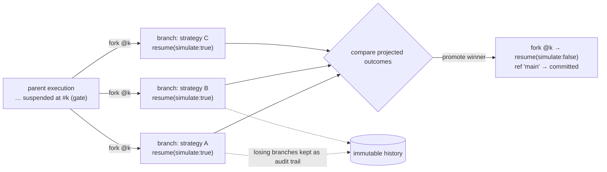

This is the same mechanism behind time-travel debugging and deploy-simulation: replay a prefix, then diverge.

---

## 5. Subsystems

### 5.1 Core runtime (`@loom/core`, `@loom/workflow-runtime`, `@loom/replay-vm`, `@loom/event-runtime`, `@loom/snapshot-runtime`)

- **`@loom/core`** — the authoring builders (`step$`, `handler$`, `flow$`, `tool$`, `agent$`, `projection$`, …) and shared types. Pure declarations, no runtime.
- **`@loom/workflow-runtime`** — `WorkflowRuntime` (`start`/`resume`/`fork`/`loadState`), the `ExecutionJournal`, and `WorkflowContext` (`ctx.run`/`suspend`/`parallel`/`emit`/`ui`).
- **`@loom/replay-vm`** — `foldEvents` + `ReplayVM`: the pure, deterministic state reconstruction engine (P2).
- **`@loom/event-runtime`** — the `EventStore` interface + in-memory and SQLite implementations, plus the `BranchRegistry` for git-style refs.
- **`@loom/snapshot-runtime`** — the `SnapshotStore` interface + implementations for bounded-tail replay.

### 5.2 Effects & middleware (`@loom/effect-runtime`, `@loom/middleware`)

All side effects — tool calls, LLM calls, human waits, agent-to-agent calls — go through the **`EffectRuntime`**, keyed by `toolId`. This is the isolation boundary that makes replay possible: during replay, completed effects are served from the log, not re-executed. It is also the **authority boundary** (Loom 2.0 K2): given an optional `CapabilityAuthorizer` (e.g. a least-privilege `GrantTable`), the `EffectRuntime` authorizes every invocation and *denies* ungranted effects — the effect never runs, an `EFFECT_DENIED` fact is logged (P9), and a `CapabilityDeniedError` fails the step. This is the one protection ring a library can enforce; it is opt-in, so omitting an authorizer keeps the permissive default. The imperative `GrantTable` has a **declarative companion**, `policy$`: a `PolicyAuthorizer` enforces `policy$` definitions (deny-wins allow/deny effect lists + glob matchers on effect id / tenant / step) through the *same* ring. Policies attach to a flow (`flow$({ policies })`), an agent (`agent$({ policies })`, bound to the flow it runs), or app-globally (`defineConfig({ security: { policies } })`), and compose **under** any authorizer — defense-in-depth: a policy can tighten a grant, never widen it ([ADR 0048](adr/0048-declarative-policy-enforcement.md)).

**Middleware** wraps effect execution with cross-cutting concerns (retries with backoff, resource metering, and later logging/idempotency/tracing) as a composable `(ctx, input, next) => …` chain — the same shape as HTTP middleware, applied to effects ([ADR 0006](adr/0006-config-and-effect-middleware.md)). `meteringMiddleware` (Loom 2.0 K3) meters each effect's tokens/cost/time as a durable `RESOURCE_METERED` fact and enforces per-execution budgets by admission control (over-budget ⇒ the next effect is denied) — the scarce resource for intelligent software being tokens/$/latency, not CPU. `safetyMiddleware` (Loom 2.1 K6) is the same shape applied to *behavior*: pluggable validators check an effect's input before it runs and its output before it propagates, and a violation is a durable `SAFETY_BLOCKED` fact that fails the step — so the kernel governs not just *who* may act and *how much* it costs, but *whether the action/output is safe* ([ADR 0017](adr/0017-k6-behavioral-safety-ring.md)). `claimCheckMiddleware` ([ADR 0054](adr/0054-claim-check-middleware.md)) keeps the log itself lean: an effect result over an inline cap is stored content-addressed and the log records `{ ref, size, digest }` **as the value** — the fold never resolves it, so replay never touches the content store and bulk telemetry stays out of the authoritative log (the digest, a per-tool declared pure projection, is what orchestration may branch on). Stream-typed results (`streamResult`, ADR 0059) extend the same contract to payloads too large for memory: the tool streams into the content store inside the effect and the envelope is still the recorded value.

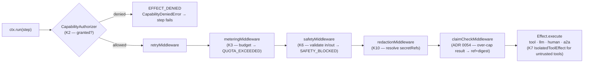

Every middleware after `retryMiddleware` is opt-in; the authorizer, metering, safety, and redaction rings are each *omittable* and byte-identical to the permissive path when unwired (P10). The full ring set is catalogued in §5.7.

### 5.3 Projections & UI (`@loom/projection-runtime`, `@loom/agent-surface`, `@loom/blueprint-runtime`, renderers)

State for humans is a **read model**, folded from the same events by the `ProjectionRuntime` — completely decoupled from durability. Flows push UI updates via `ctx.ui.set/merge/append` (the **agent-surface** patch protocol — Loom's native surface mechanism, *not* the external Google A2UI wire protocol despite the historical name), which fold into **surfaces**. Surfaces render through pluggable renderers (React, terminal) — **bring-your-own-renderer**. For interop, `@loom/plugin-a2ui` projects a surface onto the real **A2UI (Agent-to-UI) wire protocol v1.0** so any A2UI-compliant client can render it — egress, the inbound `action` leg, and the `callFunction` bidirectional RPC (the agent invokes a named client function; its result re-enters as a recorded fact, keyed by a deterministic `callId`), kernel untouched ([ADR 0069](adr/0069-a2ui-egress-adapter.md), [ADR 0070](adr/0070-a2ui-callfunction-bidirectional-rpc.md)). The durable log never depends on the UI.

A projection can be declared with **`projection$`** and discovered by `loom gen`. When the compiler builds one, it extracts the whole `handlers` fold-map into its own `import()` chunk and records the handled event-type keys — so the fold code loads **on demand**, event-type-gated: a projection whose events never fire never loads its code (the same lazy-chunk mechanism as `handler$`/`instructions$`, [ADR 0049](adr/0049-projection-on-demand-fold-code.md)). At the config level, `defineConfig({ agentSurface: true })` registers **one agent surface per `agent$`** (`surfaceId = agent.id`) so each agent drives its own panel, and `a2a: true` derives each agent's discoverable A2A card — both from the same `agent$` definitions, no hand-wired cards/surfaces.

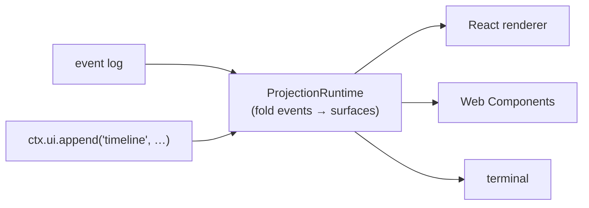

### 5.4 Agentic layer (`@loom/agent`, `@loom/plugin-a2a`, `@loom/llm`, `@loom/plugin-mcp`, `@loom/reasoning`, `@loom/capability`, `@loom/intent`, `@loom/planner`, `@loom/memory`, `@loom/knowledge`)

The intelligence pipeline, all composable and all running *inside* durable flows:
- **`@loom/llm`** — provider-agnostic model abstraction (`LlmProvider`), with `AnthropicProvider`, `OpenAiProvider`, and `GeminiProvider` shipped (and a VCR provider for tests); any provider drops in.
- **`@loom/agent`** — a ReAct-style tool-using loop; a `SkillRegistry` selects `skill$` skills whose instruction bodies load lazily.
- **`@loom/plugin-mcp`** — Model Context Protocol client for external tools.
- **`@loom/plugin-a2a`** — Agent-to-Agent protocol (client + server): call external agents (ADK, LangGraph, CrewAI) and expose Loom flows to them; `LoomAgentExecutor` adapts a flow into a stateless A2A task ([ADR 0007](adr/0007-manifest-and-a2a-adapter.md)). `defineConfig({ a2a: true })` auto-advertises every `agent$` as a discoverable card (no hand-built card table).
- **`@loom/reasoning`** — the decision seam's policy side (M3, [ADR 0016](adr/0016-loom-2.0-execution-runtime-and-decision-seam.md)): model routing, elevation and confidence, plus the exploration strategies (`ucb1`, `epsilonGreedy`) a learned router draws from ([ADR 0078](adr/0078-exploration-in-the-routing-seam.md)). Every choice it makes goes through `ctx.decide`, so it is advisory at author time and a recorded fact at run time.
- **`@loom/capability`** — flows exposed as intent-addressable capabilities.
- **`@loom/intent`** — routes natural-language intent to a capability.
- **`@loom/planner`** — turns a goal into an ordered capability plan.
- **`@loom/memory`** — scoped, TTL/size-bounded agent memory, over a pluggable `MemoryStore` (in-memory by default; `SqliteMemoryStore`/`PostgresMemoryStore` make it survive a restart and add relevance `search`, which `TieredMemory.recallRelevant` turns into a recorded decision). An entry carries an optional caller-assigned `id` that every backend must round-trip, and the optional `remove` deletes by it — the verb a MUTABLE corpus needs, since `search` ranks within one key while a document is a subset of it ([ADR 0091](adr/0091-corpus-lifecycle-and-the-knowledge-package.md), `MEMORY_STORE_SPI_VERSION` 2.1.0 — 2.1.0 bounds the QUERY: a term-based backend derives its terms with `queryTerms`, deduplicated and capped, because OR-ing one word 20,000 times cannot change which entries match and took SQLite 32.7 seconds to say so).
- **`@loom/knowledge`** — document corpora over a memory tier ([ADR 0091](adr/0091-corpus-lifecycle-and-the-knowledge-package.md)): `KnowledgeBase` upserts and `sync`s DOCUMENTS onto the PASSAGES they are searched in (so a revision supersedes its predecessor rather than duplicating it), `groundedRequest` assembles a prompt that keeps retrieved passages in the one position `guardRequest` accepts, and `checkCitations` rejects a citation to a document that was never retrieved. It owns no storage and no ranking — both are the `MemoryStore`'s. A corpus may have several writers (`source`): a reconcile only ever deletes its own documents, so what an agent learned from feedback survives the nightly sync of an authored corpus.
- **`@loom/orchestrator`** — composable `decideApproval` (risk gate) + `dispatchPlan` primitives ([ADR 0013](adr/0013-orchestrator-primitives.md)).

### 5.5 Compute & distribution (`@loom/dispatcher`, `@loom/worker-runtime*`, `@loom/plugin-worker-remote`, `@loom/plugin-worker-server`, `@loom/plugin-cloudrun`, `@loom/graph-executor`, `@loom/scheduler`)

Placement is a seam between the orchestrator and the runtime, so executions can run **anywhere** without touching the core ([ADRs 0001–0005](adr/)):

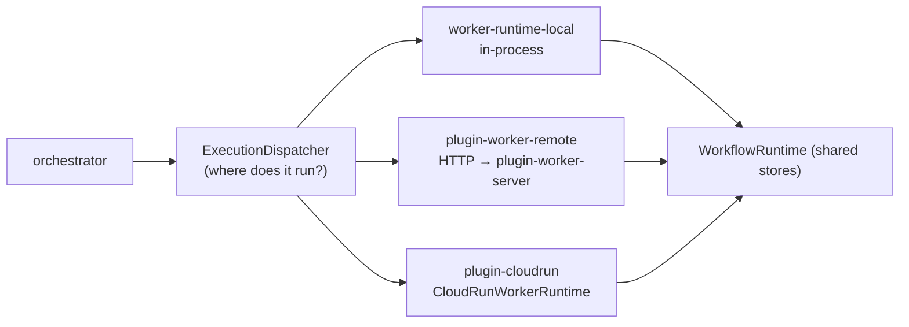

- An **`ExecutionPackage`** carries *resume coordinates* (identity + sequence), never code or closures — the worker ships its own code bundle. Because code can't be serialized, workers reference flows/effects *by id* from a statically-wired registry (P5).
- **`@loom/graph-executor`** fans a graph of nodes into **per-node executions** (one writer each), joined via the `BranchRegistry` — never multi-writer on one execution ([ADR 0005](adr/0005-distributed-graph-fork-join.md)).
- **`@loom/scheduler`** is an *ephemeral* cooperative scheduler (priority, bounded concurrency, cancellation) for the agentic layer — replay-safe and not part of durable state.

### 5.6 DX tooling (`@loom/cli`, `@loom/appgen`, `@loom/eval`, `@loom/deploy-sim`, `@loom/testing`, `@loom/scaffold`, `@loom/compiler`)

Every one of these is *a different lens on the durable log*:
- **`@loom/eval`** — replay a recorded log as a test fixture; diff/score runs ([ADR 0008](adr/0008-evals-and-deploy-simulation.md)).
- **`@loom/deploy-sim`** — replay historical logs against *new* flow definitions to catch breaking changes before promoting.
- **`@loom/testing`** — `createTestApp`, `waitForPhase`, `captureGolden`, and a VCR LLM provider ([ADR 0009](adr/0009-testing-kit.md)).
- **`@loom/cli`** (`loom`) — `logs` (tail the log), `debug` (time-travel to any sequence), `eval`, `check`, `gen`/`new` (build-time codegen — `gen` discovers all seven convention folders: flows, agents, tools, skills, schedules, memories, projections, [ADR 0011](adr/0011-folder-convention-codegen.md)), `appgen` (brownfield NL → code, model-of-your-choice), `deploy check`, `inspect` (web timeline + slider) ([ADRs 0010–0014](adr/)).
- **`@loom/appgen`** (+ optional `@loom/appgen-model`) — brownfield-aware NL → code: scan → plan (provider-agnostic, [ADR 0050](adr/0050-appgen-model-provider-agnostic.md)) → surgical apply → validate; the NL stage is isolated and the output is plain, statically-wired code (P11).
- **`@loom/compiler`** — optional Vite plugin/CLI: `handler$`/`instructions$`/`projection$` extraction into lazy chunks, flow-graph analysis, resumability metadata.

### 5.7 Kernel-hardening rings (K1–K12, T1–T2)

The rings noted inline above (K2/K3/K6) are part of a larger set that makes Loom *earn* the word "kernel." Each ring is opt-in and byte-identical to Loom 1.x when unwired (P10), and each new durable verdict is folded like any other event (P9). The full set is implemented:

- **K1** — versioned syscall ABI (`KERNEL_ABI`, `packages/workflow-runtime/src/abi.ts`); **K2** — capability grants / authority ring (`EFFECT_DENIED`); **K3** — resource metering & quotas (`RESOURCE_METERED`/`QUOTA_EXCEEDED`); **K4** — fault supervision (`SupervisingDispatcher`, restart/backoff + circuit breaker); **K5** — event-schema ABI governance (`EVENT_SCHEMA_VERSION`, `knownEventTypes()`); **K6** — behavioral safety (`safetyMiddleware`, `SAFETY_BLOCKED`).
- **K7** — data-plane isolation & brokered egress (`@loom/isolate`, child-process boundary, `EGRESS_DENIED`); **K8** — cancellation, deadlines & bounded effects; **K9** — effect-delivery contract: idempotency keys, in-doubt parking (`EFFECT_INDOUBT`), fencing; **K10** — log lifecycle: retention, crypto-shredding (`PAYLOAD_SHREDDED`), redaction & at-rest encryption (`@loom/plugin-crypto`), and the K10.6 pin seam (`PinPredicate` + pinned content GC — findings' evidence outlives raw-telemetry TTL and run archival, ADR 0055); **K11** — flow-code versioning for in-flight executions (`flowContentHash`, `EXECUTION_MIGRATED`) plus K11.5 contract-versioned state migration on `resumeAs` (the recorded `migratedInput` replaces the folded input, ADR 0056); **K12** — identity, tenancy & delegated authority (`APPROVAL_GRANTED`).
- **T1** — durable timers & scheduled executions (`ctx.sleep`/`sleepUntil`, `TIMER_FIRED`, `schedule$` cron); **T2** — wire-level kernel ABI (`@loom/wire-abi`, a JSON-RPC projection of K1 for language neutrality).

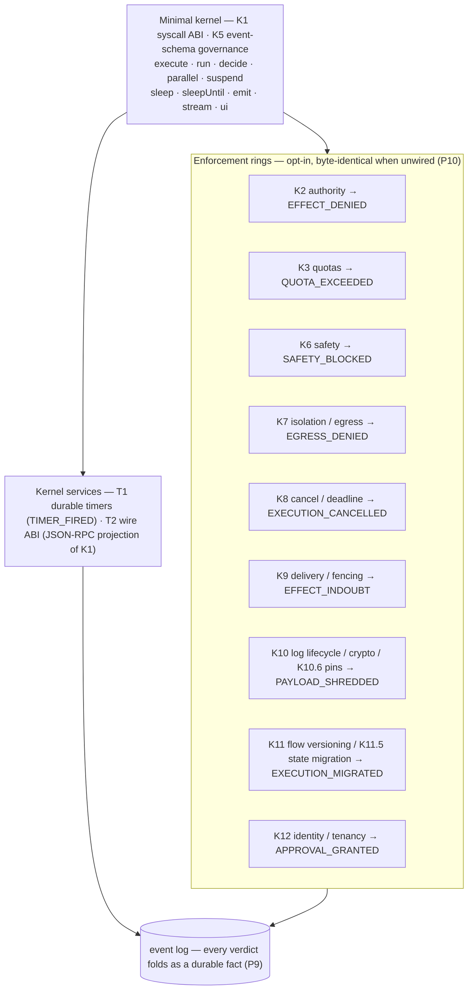

Each ring is a distinct plane — *authority* (K2/K12), *resource* (K3), *behavior* (K6), *data* (K7/K10), and *lifecycle* (K8/K9/K11) — and each verdict is an ordinary folded event, so the log is the audit trail with no extra machinery. See **[04 — Kernel Hardening](loom-2.0/04-kernel-hardening.md)** for the ring-by-ring detail, the **[API reference → Kernel hardening & security](api-reference.org#kernel-hardening)** for each ring's export surface, and [ADRs 0016–0026](adr/).

### 5.8 The three-direction arc — simulation testing, coordination, multi-tenant isolation

Three frontiers built as opt-in packages over the stable syscall surface (ADRs 0036–0041). The
throughline is **P10**: only ONE of the six touched a kernel contract — an additive
`EXECUTION_DENIED` event (`EVENT_SCHEMA_VERSION 1.12.0`); `KERNEL_ABI` is unchanged at 1.1.0. Two
plan-proposed kernel changes (a `CHILD_COMPLETED` event and a `ctx.compensate` syscall) were found
**unnecessary** and dropped — the work composes from existing primitives.

- **Deterministic Simulation Testing** — `@loom/dst`: a seeded virtual clock + fault-injecting store
  (generalizing `crashingEventStore`: crash / appendReject / msgLoss / msgDup, explore→record /
  replay modes) drive the real kernel under adversarial schedules; five invariants + `checkProperty`
  search→shrink→`replaySchedule`. Test/dev-only ⇒ zero production overhead by construction.
- **Multi-tenant isolation** — `@loom/plugin-audit-chain` (fold-invisible hash chain + optional HMAC, tamper
  detection via `verifyChain`), `@loom/fair-scheduler` (weighted round-robin across tenants behind
  the concurrency cap; drop-in `Scheduler`), and **execution-lifecycle authorization** (a pluggable
  `ExecutionAuthorizer` gating start/resume/cancel/query at the trust boundary → durable
  `EXECUTION_DENIED`).
- **Post-hoc inspection** — `@loom/replay-inspector` ([ADR 0071](adr/0071-read-only-replay-inspector.md)):
  snapshot-anchored state reconstruction at any log position, transition diffs, and projection
  slices, all under the version the execution is *pinned* to. Read-only by type
  (`Pick<EventStore, "read" | "readFrom" | "readRange">` — `append` and even `subscribe` are out
  of scope), so it cannot perturb what it inspects. Two findings came out of building it: the
  durable pin is `variables._flowHash`, **not** `ExecutionState.workflowVersion` (which
  `foldState` seeds from currently-registered code), and projection state has no snapshot
  representation, so a projection fold always replays from zero.
- **Coordination primitives** — `@loom/live-query` (loadState + `EventStore.subscribe`),
  `@loom/orchestration` (spawn child workflows and durably await them via decide/suspend/resume + a
  completion-correlating supervisor — `awaitChild` for one, `awaitChildren` for a concurrent
  wait-all `ChildResult[]`, `awaitAll` for all-or-nothing; child failure propagates as a typed
  `childFailed` that composes up the tree), and `@loom/saga` (register compensators, run them in
  reverse on failure as replay-safe `ctx.run` steps).

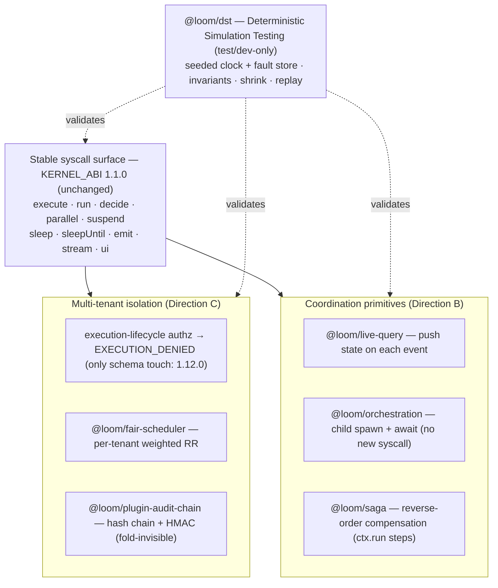

DST is the throughline the other two lean on: audit-chain integrity, and saga's no-double-compensation, are each proven by a DST property under seeded crashes. See [ADRs 0036–0041](adr/) and the maturity badges in **[docs/spec/maturity.md](spec/maturity.md)**.

---

## 6. Package map

The workspace is split by tier (ADR 0043): **`packages/`** holds the kernel (mechanism/ABI), the
SPI-contract packages, and the advisory modules; **`tools/`** holds first-party *dev-tooling* —
leaf packages consumed only at build/test/authoring time (`cli`, `compiler`, `appgen`,
`appgen-model`, `deploy-sim`, `scaffold`, `eval`, `testing`, `dst`, `bench-throughput`,
`create-loom-app`);
**`plugins/`** holds the first-party *adapters* — concrete backends for a specific external system — as `@loom/plugin-*`
(`sqlite`, `postgres`, `crypto`, `content`, `durable-state`, `read-model`, `sentinel`,
`audit-chain`, `cloudrun`, `worker-remote`, `worker-server`, `mcp`, `a2a`, `renderer-react`,
`renderer-terminal`). A **CI layering guard** forbids any
kernel/SPI package from depending on a `plugins/*` adapter, so the kernel names no vendor and ships
no native driver. Concrete backends are supplied as **presets** (`sqliteStorage()`, …) or adapters
passed to `defineConfig` — a third-party plugin (`loom-plugin-*`) wires identically. Plugin
authoring is supported by `@loom/plugin-kit` (typed presets) and `@loom/conformance` (SPI
conformance kits). See [`plugins.md`](plugins.md) and [ADR 0043](adr/0043-plugin-packaging-and-1p-3p-separation.md).

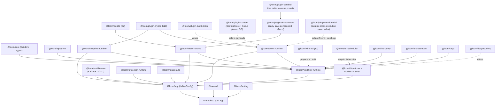

| Group | Packages |
|---|---|
| **Core runtime** | `core`, `workflow-runtime`, `replay-vm`, `event-runtime`, `snapshot-runtime` |
| **Composition** | `app` (`defineConfig`), `registry`, `sdk` (the public re-export barrel) |
| **Effects** | `effect-runtime`, `middleware` |
| **Projection / UI** | `projection-runtime`, `agent-surface`, `blueprint-runtime`, `plugin-a2ui`, `plugin-renderer-react`, `plugin-renderer-terminal` |
| **Agentic** | `agent`, `llm`, `reasoning`, `capability`, `intent`, `planner`, `memory`, `knowledge`, `orchestrator`, `plugin-a2a`, `plugin-mcp`, `plugin-mcp-app`, `plugin-sandbox`, `plugin-sentinel` (the perpetual-agent pattern as one preset) |
| **Compute / distribution** | `dispatcher`, `worker-runtime`, `worker-runtime-local`, `graph-executor`, `scheduler`, `plugin-worker-remote`, `plugin-worker-server`, `plugin-cloudrun` |
| **Storage backends** | `plugin-sqlite`, `plugin-postgres`, `plugin-durable-state`, `plugin-read-model` |
| **Governance / verification** | `spec` (the kernel manifest + layering guard), `conformance` (SPI kits), `verify`, `replay-inspector` (ADR 0071) |
| **Kernel hardening / security** | `effect-runtime` (K2 authz + K12 delegation), `middleware` (K3 metering, K6 safety, K10 redaction, K12 nested budgets), `isolate` (K7 data-plane isolation & egress), `plugin-crypto` (K10 encryption & crypto-shredding), `event-runtime`/`snapshot-runtime` (K12 tenant scoping), `wire-abi` (T2), `telemetry` (K10-R6 egress scrubbing) |
| **Data protection & compliance** | `classify` (K10-R1 `secret`/`sensitive`/`internal`/`externalized` markers + the ADR 0085 `tainted()` integrity axis), `compliance` (T3 subject index + export + erasure, tenant-scoped), `plugin-content` (ADR 0046 content-store seam) — see [data classification](data-classification.md) & [compliance](compliance.md) |
| **Intelligence / DX** | `analytics`, `learning` (off-policy evaluation + the 3P `Policy` seam, ADR 0080), `appgen` (provider-agnostic planner), `appgen-model` (optional local `.gguf` option), `cli`, `eval`, `deploy-sim`, `testing`, `scaffold`, `compiler`, `bench-throughput`, `telemetry` |
| **Three-direction arc** | `dst` (simulation testing), `plugin-audit-chain` + `fair-scheduler` + execution-authz in `workflow-runtime` (multi-tenant isolation), `live-query` + `orchestration` + `saga` (coordination) — ADRs 0036–0041 |

> **Adapter packages carry the `plugin-` prefix and live in [`plugins/`](../plugins/), not `packages/`** — the 1P/3P separation of [ADR 0043](adr/0043-plugin-packaging-and-1p-3p-separation.md). A CI guard fails the build if a kernel or SPI package takes a dependency on one. See [the plugin guide](plugins.md) for the full first-party inventory.

> **Loom 2.0.** The packages in **bold-new** groups above — `reasoning`, `plugin-postgres`, `analytics`, `appgen` — plus deepenings of `workflow-runtime`, `effect-runtime`, `middleware`, `dispatcher`, `memory`, `capability`, and `agent`, constitute the **execution-kernel evolution**. Its full data structures, algorithms, and diagrams live in [`docs/loom-2.0/`](loom-2.0/00-overview.md); the decision record is [ADR 0016](adr/0016-loom-2.0-execution-runtime-and-decision-seam.md).

---

## 7. Decision records — reasoning & advantages

Each subsection is a decision, *why* it was made, and what it buys you. The distributed-compute and DX decisions are captured in full in [`docs/adr/`](adr/); this section explains the *foundational* choices and links the ADRs.

### D1 — Event sourcing as the substrate

- **Context.** Long-running, human-in-the-loop, non-deterministic AI flows must survive crashes and be explainable.
- **Decision.** Never store execution state directly; store an append-only log of events and derive state by folding (P1).
- **Reasoning.** A single source of truth that is immutable and ordered turns hard problems (durability, audit, resume, replay) into consequences of one design. State-in-place storage would require bespoke solutions for each.
- **Advantages.** Free audit trail; time-travel to any point; resume from any checkpoint; the *same* log powers evals, deploy-sim, and debugging. Storage is append-only, which is cheap and contention-free.

### D2 — Deterministic, pure replay

- **Context.** A resume, a fork, and a debug-replay must reconstruct identical state; AI outputs are non-deterministic.
- **Decision.** The fold is a pure function; effects are quarantined behind `EffectRuntime` and served from the log during replay (P2).
- **Reasoning.** If reconstruction had side effects or read a clock, two replays could diverge and the whole model would collapse. Purity is what makes "replay" trustworthy.
- **Advantages.** Exactly-once effects across resumes/crashes; reproducible debugging ("run it again, get the same thing"); logs become deterministic test fixtures ([ADR 0008](adr/0008-evals-and-deploy-simulation.md)).

### D3 — The `ExecutionJournal` is the sole sequencer/writer

- **Context.** Concurrent commits could race on sequence numbers and corrupt order.
- **Decision.** One journal per execution owns sequence allocation and is the only appender; the in-memory fold is synchronous, the durable write is an async ordered tail.
- **Reasoning.** A single allocator makes gaps/duplicates structurally impossible; separating the sync fold from the async write keeps the flow fast while preserving order and surfacing storage failures at barriers.
- **Advantages.** Correct order with no locks; a backend never needs a read-then-write to allocate a sequence (so network stores like Postgres plug in cleanly); write failures abort deterministically.

### D4 — Orchestration is a plain async function, not a DSL (P4)

- **Context.** Workflow engines usually impose a graph DSL or decorators.
- **Decision.** A flow's runner is `(ctx, input) => Promise` using ordinary control flow; `ctx.run`/`suspend`/`parallel` are the only durability touch-points.
- **Reasoning.** Developers already know `async`/`await`, `if`, `for`. A DSL adds a learning curve, limits expressiveness, and fights the type system. Loom adds durability *around* normal code instead of replacing it.
- **Advantages.** Full language power and type inference; trivial to test as functions; near-zero conceptual overhead; your logic isn't trapped in a proprietary format.

### D5 — Static, build-time wiring; conventions via codegen (P5)

- **Context.** Convenience features (folder routing, auto-registration) tempt you toward runtime discovery.
- **Decision.** All registration is static from explicit imports; the folder convention is honored by **`loom gen`** emitting a static `loom.gen.ts`, not by runtime globbing ([ADR 0011](adr/0011-folder-convention-codegen.md)).
- **Reasoning.** A remote worker or a replay must reconstruct an *identical* set of flows/effects. Runtime discovery makes that environment-dependent and breaks determinism.
- **Advantages.** Replay-safe distribution; no "works on my machine" registration drift; codegen output is inspectable and diffable.

### D6 — `defineConfig` as the composition root; middleware seam

- **Context.** Wiring a runtime, effects, projections, and A2A transport was ~35 lines copy-pasted per app.
- **Decision.** `defineConfig(LoomConfig): LoomApp` assembles everything from a static config; effects gain a composable middleware chain ([ADR 0006](adr/0006-config-and-effect-middleware.md)).
- **Reasoning.** One declarative root removes boilerplate without hiding the primitives (it *returns* the runtime/stores). Middleware is the idiomatic place for retries/logging/idempotency.
- **Advantages.** Apps shrink dramatically; cross-cutting concerns are opt-in and testable; the empty-middleware case is byte-identical to before (no behavior change).

### D7 — Projections decoupled from durability; bring-your-own-renderer

- **Context.** UI concerns tend to leak into persistence.
- **Decision.** Read models are folded independently by the `ProjectionRuntime`; flows emit UI via the agent-surface patch protocol; renderers (React/WC/terminal) are pluggable (P8).
- **Reasoning.** The durable log must not depend on how (or whether) anything is rendered. Separating projection from persistence lets the same backend drive any front end — proven by the same app rendered in React, Web Components, and Angular.
- **Advantages.** UI-framework independence; headless operation; live surfaces without coupling; the log stays clean.

### D8 — Pluggable compute via a placement seam

- **Context.** Executions should be able to run in-process, over HTTP, or on Cloud Run without changing the core.
- **Decision.** Insert `ExecutionDispatcher` + `WorkerRuntime` SPI between orchestrator and runtime; an `ExecutionPackage` carries resume coordinates (never code); workers reference flows by id ([ADRs 0001–0004](adr/)).
- **Reasoning.** Closures can't be serialized, and the core must stay cloud-agnostic. Shipping *coordinates* (not code) and resolving flows by id from a static registry keeps the public SDK unchanged while enabling remote execution. Suspension is a normal outcome across a network boundary.
- **Advantages.** The same flow runs locally or on Cloud Run; stateless workers recover from crashes by folding shared stores; the public SDK is untouched.

### D9 — Distributed fan-out via per-branch executions

- **Context.** Parallel graph nodes must not violate the single-writer invariant (D3).
- **Decision.** `graph-executor` gives each node its **own** `executionId` (one writer each) and joins lineage through the `BranchRegistry` ([ADR 0005](adr/0005-distributed-graph-fork-join.md)).
- **Reasoning.** Multiple writers on one execution would break sequence ordering. Per-node executions preserve D3 while still enabling concurrency.
- **Advantages.** Safe distributed fan-out/join; each node independently durable, resumable, and replayable.

### D10 — Git-style branching (fork/simulate/promote), no merge

- **Context.** Teams want to explore alternative agent decisions and compare outcomes.
- **Decision.** Fork = copy the event prefix into a new execution and resume differently; promote = a ref pointer move; **no merge** ([ADR 0005](adr/), examples `incident-war-room`, `schema-migration-planner`).
- **Reasoning.** Because state is `fold(events)`, branching is nearly free and needs no new persistence model. Merging divergent AI executions has no sound semantics, so it's deliberately omitted; promotion is a decision, recorded.
- **Advantages.** Cheap "what-if" exploration; losing branches kept as an immutable audit trail; the winning path is committed for real via one more fork with `simulate:false`.

### D11 — Tooling is lenses on the log, not new infrastructure

- **Context.** Evals, deploy-safety, logs, and time-travel debugging are usually separate systems.
- **Decision.** Build them all as pure functions over the event log: `eval` replays it, `deploy-sim` diffs it against new flows, `logs` tails it, `debug`/`inspect` fold it at any sequence ([ADRs 0008, 0010–0014](adr/)).
- **Reasoning.** The log already contains everything. A pure fold at a chosen sequence *is* time-travel; replaying a stored log *is* an eval. Reusing one engine (`foldAt`) keeps them consistent.
- **Advantages.** Minimal new surface area; all tools agree because they share the fold; CI gates (eval, deploy check) fall out for free.

### D12 — Algorithms tuned on the hot paths, contract unchanged

- **Context.** The fold runs on every commit/resume; a few tooling paths were quadratic.
- **Decision.** Copy-on-write fold, periodic snapshots, bulk fork copy, and O(N) tooling passes — with the public SDK untouched ([ADR 0015](adr/0015-dsa-performance-optimizations.md)).
- **Reasoning.** The most-executed operation deserves the tightest constant; correctness is pinned by tests for each invariant.
- **Advantages.** ~7.7× faster wide-flow folds, bounded recovery, no JS re-serialization on fork, and no breaking changes.

---

## 8. Trade-offs & non-goals

Being honest about the edges:

- **Not a general job queue.** Loom optimizes long-lived, stateful, human-in-the-loop *processes*. For fire-and-forget high-throughput jobs, a queue is simpler.
- **No branch *merge*.** Branching is fork/simulate/promote by design (D10). Merging divergent executions is intentionally out of scope.
- **Determinism constrains the core.** Library code on replay paths avoids wall-clock/randomness; non-determinism belongs *inside effects* (which are logged), not in orchestration.
- **Static wiring over dynamic discovery.** You register flows/effects explicitly (or via `loom gen`). This is a deliberate cost paid for replay-safety (P5).
- **Compiler is optional.** `handler$` extraction and resumability metadata are a build-time *enhancement*; the runtime works without it.
- **Snapshots trade writes for replay speed.** `snapshotEvery` is a knob: smaller N = faster recovery, more writes.

---

### See also

- **[Getting Started](getting-started.md)** — from zero to a running, suspend/resume flow in minutes.
- **[Usage](usage.md)** — build a real app step by step.
- **[User Guide](user-guide.md)** — every feature area with examples.
- **[Data classification](data-classification.md)** — field-sensitivity markers (`secret()`/`sensitive()`/`internal()`/`externalized()`) that drive encryption, redaction, and egress scrubbing (K10-R1/R6).
- **[Compliance](compliance.md)** — data-subject rights: subject index, export (Art. 15/20), and erasure (Art. 17), tenant-scoped (T3).
- **[ADRs](adr/)** — the full decision history (0001–0100; 0016–0026 cover the Loom 2.0 execution-kernel evolution and the K7–K12/T1–T2 hardening series; 0036–0041 the three-direction arc; 0042 the AI-native brownfield `appgen`; 0043–0044 the plugin packaging + 1P/3P separation; 0046 the content-store seam; 0047 the `tools/*` dev-tooling tier; 0051–0057 the perpetual-agents series — schedule-driven agents with durable carry state, claim-checked effect data, pinned retention, state migration on resume, and the multi-gate suspend fix; 0058–0059 the db-copilot infrastructure follow-on — durable cross-execution read models and streaming content ingestion; 0060–0065 the GenUI dynamic-execution series — typed failure channels, the step-identity/interpreter contract, batched content resolution, MCP dynamic dispatch with schema-hash pinning, the QuickJS sandbox plugin, and the group-commit deferral; 0066 the transient-effect-invocation façade (`invokeTransient`); 0067 the reactive-graph-resumability rejection; 0068 the projection-selector subscription (`subscribeSelector`); 0069–0070 the agent-surface rename and the A2UI egress adapter with `callFunction` bidirectional RPC; 0071 the read-only replay inspector; 0072 MCP Apps placement — ingress fidelity, an MCP server, and `ui://` egress as one static content-pinned template, with the host role rejected; 0073 the effect-mode boundary (`journaled` vs `ambient`) that keeps user-driven enrichment reads out of the log; 0074–0075 storage scale-out decorators and shard rebalancing; 0076–0077 two boundaries that looked enforced and were not (wildcard classification paths, typed resume payloads); 0078–0080 the learning substrate — exploration in the routing seam, `context`/`policy.propensity` on `DECISION_RECORDED` (EVENT_SCHEMA 1.18.0), and `@loom/learning` with the third-party `Policy` SPI; 0081–0082 the Companion workload's two kernel promotions, both refused; 0083 the second-consumer rule, an outward gate on first-party surface; 0084 effect classes — a declared, statically-checked ceiling on what a flow may reach, beside K2's runtime floor; 0085 the integrity axis — untrusted content as a value wrapper, refused in every prompt instruction position; 0086 runner-body reach analysis, which closed the 'reachable = declared steps' bound and proved two suspension-safety checks wrong once they could fire; 0087 the durable agent loop — `agentLoop$` as a runner body, so a turn is a frame and skills/memory/routing go through the decision seam; 0088 blueprint conformance — `validateBlueprint`/`catalogCoverage` over a declared widget catalogue; 0089 the sandbox worker pool; 0090 knowledge is retrieval over memory, not a construct — durable MemoryStore backends, `search` as one optional verb, and the refusals that keep knowledge in application code; 0091 the correction to 0090's premise — a corpus is MUTABLE, so entry identity plus `remove` (MemoryStore SPI 2.0.0) and `@loom/knowledge` for the document↔passage mapping, while the `knowledge$` construct stays rejected; 0092 adaptive operator profiles — placement only, with the expiry that would have made a fold impure moved into an event and the resolved profile journaled by VALUE; 0093 row-granular `purge` on the read-model store SPI (1.1.0), so erasing one subject costs one subject rather than a whole-model rebuild; 0094 node identity across a structural change — `preservesNodes` over id sets, because the second consumer's components are a flat list rather than a tree; 0095 the binding-semantics pin — a composed surface's content address freezes a binding's NAME, so what that name MEANT is declared (`version`) and compared (`checkVersionPins`) rather than assumed; 0096 the Blueprint as loom's stable rendering IR — `BLUEPRINT_IR_VERSION` beside a shape manifest that `tsc` checks against the types and a test pins by digest per version, and a kind-aware terminal renderer whose default registry covers the catalogue; 0097 Blueprint IR 2.0.0 — grid cells, loom-owned binding status, widget source, binding sensitivity, with a reader-side normaliser for 1.0.0 artifacts; 0098 Blueprint IR 2.1.0 — optional grid-cell placement (`row`/`rowSpan`/`column`) and a `title` on every layout, a minor bump that reads 2.0.0 artifacts as they are; 0099 Blueprint IR 2.2.0 — an optional `role` on every layout, the open container axis `Widget.kind` is for widgets, which loom's own renderers ignore; 0100 Blueprint IR 2.3.0 — an `empty` binding state, so a widget whose upstream answered with nothing shows "no data" rather than an error, degrading to the loading row on an older reader).
- **[Presentation](presentation/loom-deck.md)** — the deck.
