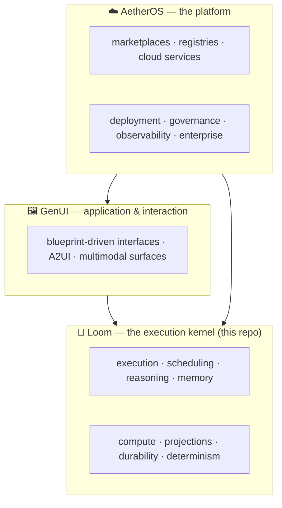
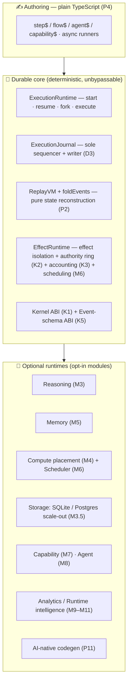
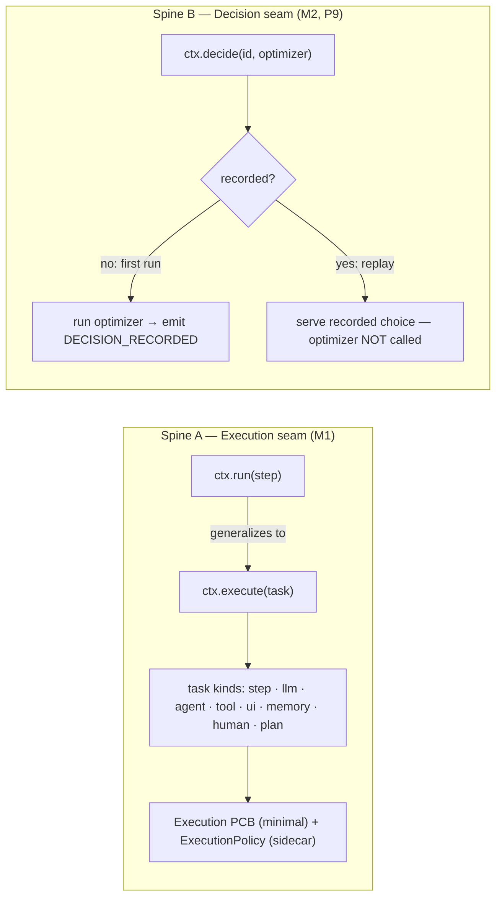
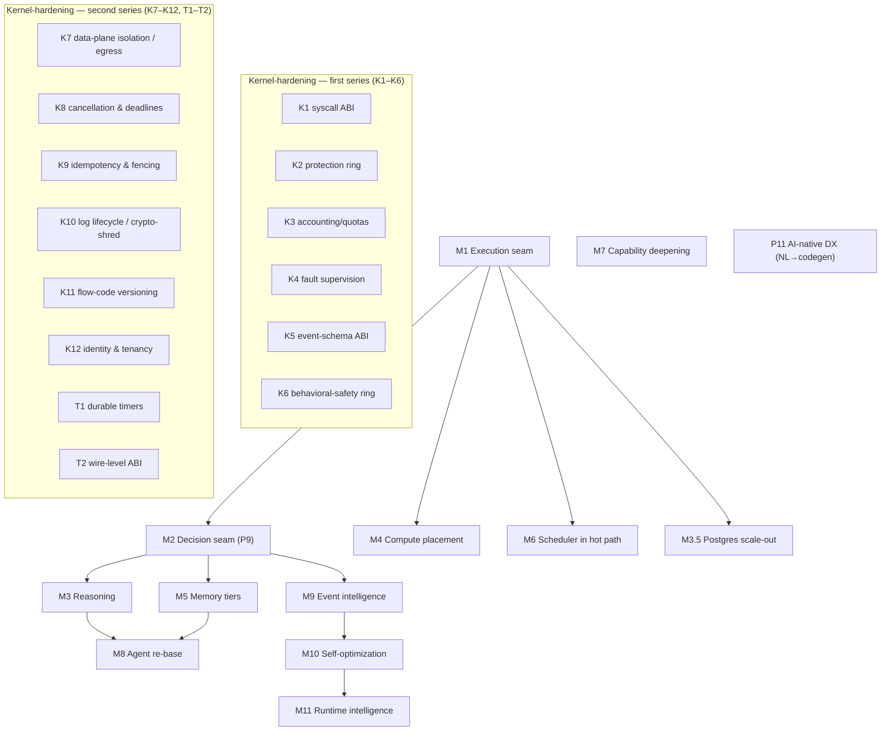
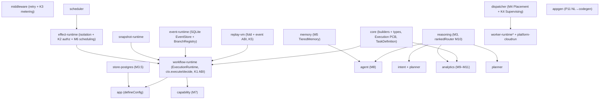

# Loom 2.0 — The Execution Kernel for Intelligent Software

> **Mission (2.0)**
>
> Turn Loom from a *durable workflow runtime* into the **execution kernel for intelligent software** —
> the layer that is to AI applications what an OS kernel is to programs: durable, schedulable,
> resumable, observable, distributed, pluggable, and **deterministic**. Applications become thin
> layers over the kernel.

This directory is the deep-dive documentation for the Loom 2.0 evolution. It complements — and does
not replace — the 1.0 documentation (`../architecture.md`, `../getting-started.md`, `../usage.md`,
`../user-guide.md`), all of which remain valid: **every 2.0 change is additive and opt-in**, so
existing apps compile and replay unchanged. The full decision record is
[ADR 0016](../adr/0016-loom-2.0-execution-runtime-and-decision-seam.md).

---

## Table of contents

| Doc | Covers |
|---|---|
| **00 — Overview** (this file) | Big picture, principles, the two spines, milestone map, kernel scorecard, package map |
| [01 — Execution & Decision seams](01-execution-and-decision-seams.md) | M1 `ctx.execute` + `Execution` PCB · M2 `ctx.decide` + `DECISION_RECORDED` · K1 kernel ABI |
| [02 — Reasoning & Memory](02-reasoning-and-memory.md) | M3 model routing / confidence elevation · M5 tiered memory + logged recall |
| [03 — Compute, Scheduling & Storage](03-compute-scheduling-storage.md) | M4 placement · M6 scheduler-in-hot-path · K4 supervision · M3.5 Postgres scale-out |
| [04 — Kernel hardening](04-kernel-hardening.md) | K1 ABI · K2 protection · K3 accounting/quotas · K4 supervision · K5 event-schema ABI · K6 behavioral-safety ring |
| [05 — Capabilities, Agents, Intelligence & DX](05-capabilities-agents-intelligence-dx.md) | M7 capabilities · M8 agents · M9–M11 intelligence · P11 NL→codegen |
| [10 — Event-schema reference](10-event-schema-reference.md) | The complete on-disk event ABI: every event type, payload, and fold |

---

## 1. The layering

Loom 2.0 is deliberately the **kernel** layer of a three-layer stack, each evolving independently:

Anything that is a *marketplace*, *registry*, or *cloud service* belongs to AetherOS, not the kernel;
anything that is *interface/interaction* belongs to GenUI. The kernel stays small (principle **P10**).

## 2. The concentric model

At the coarsest level Loom is three rings: **authoring** (plain TypeScript you write), the **durable
core** (the privileged, unbypassable spine), and **pluggable runtimes** (the optional modules).

## 3. Principles (P1–P11)

P1–P8 are the 1.0 principles (see [`../architecture.md` §2](../architecture.md)); Loom 2.0 **adds two**
that *extend* them and never regress:

| # | Principle | Note |
|---|---|---|
| P1 | The log is the source of truth (event sourcing) | state = `fold(events)` |
| P2 | Replay is deterministic and pure | the moat — never compromised |
| P3 | Suspension is a first-class, normal outcome | `ctx.suspend()` |
| P4 | The intelligence stays as plain code | sugar, not a cage |
| P5 | Wiring is static and replay-safe | no runtime discovery |
| P6 | Composition over inheritance | functions + small objects |
| P7 | Pure cores, thin edges | testable cores |
| P8 | The core is isomorphic; edges are pluggable | interfaces everywhere |
| **P9** | **Non-determinism is allowed, but only when logged** *(2.0)* | routing/optimizing/learning ⇒ a durable `DECISION_RECORDED`; replay stays pure |
| **P10** | **Minimal kernel; intelligence lives in an advisory plane** *(2.0)* | smart = latency-only (off-log) or outcome-affecting (logged); never a hidden input to the fold |

**P9** is what makes the intelligent phases safe: a runtime may route, elevate, learn, or optimize,
but every such choice becomes a durable fact, so a given run replays bit-for-bit forever while
outcomes improve run-to-run. **P10** keeps the kernel small — you never pay for a runtime you didn't
opt into, and the simple path (`ctx.run`) stays a one-liner.

## 4. The two spines

Everything in 2.0 hangs off two new core seams. See
[01 — Execution & Decision seams](01-execution-and-decision-seams.md) for the full treatment.

Spine B is the twin of how `ctx.run` short-circuits completed steps — it is the substrate for
reasoning routing/elevation (M3), memory recall (M5), self-optimization (M10), and runtime
intelligence (M11).

## 5. Milestone map

| Milestone | Package(s) | Doc |
|---|---|---|
| M1 Execution seam | `core`, `workflow-runtime` | [01](01-execution-and-decision-seams.md) |
| M2 Decision seam | `workflow-runtime`, `replay-vm` | [01](01-execution-and-decision-seams.md) |
| M3 Reasoning | `reasoning`, `intent`, `planner` | [02](02-reasoning-and-memory.md) |
| M3.5 Scale-out storage | `store-postgres` | [03](03-compute-scheduling-storage.md) |
| M4 Compute placement | `dispatcher` | [03](03-compute-scheduling-storage.md) |
| M5 Memory tiers | `memory` | [02](02-reasoning-and-memory.md) |
| M6 Scheduler in hot path | `effect-runtime`, `scheduler` | [03](03-compute-scheduling-storage.md) |
| M7 Capability deepening | `capability` | [05](05-capabilities-agents-intelligence-dx.md) |
| M8 Agent re-base | `agent` | [05](05-capabilities-agents-intelligence-dx.md) |
| M9–M11 Intelligence | `analytics`, `reasoning` | [05](05-capabilities-agents-intelligence-dx.md) |
| P11 AI-native DX | `appgen` | [05](05-capabilities-agents-intelligence-dx.md) |
| K1 syscall ABI | `workflow-runtime` | [04](04-kernel-hardening.md) |
| K2 protection ring | `effect-runtime` | [04](04-kernel-hardening.md) |
| K3 accounting/quotas | `middleware`, `effect-runtime` | [04](04-kernel-hardening.md) |
| K4 fault supervision | `dispatcher` | [03](03-compute-scheduling-storage.md) / [04](04-kernel-hardening.md) |
| K5 event-schema ABI | `replay-vm` | [04](04-kernel-hardening.md) / [10](10-event-schema-reference.md) |
| K6 behavioral-safety ring | `middleware`, `replay-vm` | [04](04-kernel-hardening.md) / [ADR 0017](../adr/0017-k6-behavioral-safety-ring.md) |
| K7 data-plane isolation & egress | `isolate` | [04 §9](04-kernel-hardening.md#9-the-second-hardening-series--k7k12-t1t2-implemented) / [ADR 0019](../adr/0019-k7-data-plane-isolation-and-egress-control.md) |
| K8 cancellation & deadlines | `effect-runtime`, `workflow-runtime` | [ADR 0020](../adr/0020-k8-cancellation-deadlines-bounded-effects.md) |
| K9 idempotency & fencing | `effect-runtime`, `replay-vm` | [ADR 0021](../adr/0021-k9-effect-delivery-contract-idempotency-fencing.md) |
| K10 log lifecycle / crypto-shred | `store-crypto` | [11](11-encryption-at-rest.md) / [ADR 0022](../adr/0022-k10-log-lifecycle-retention-redaction-encryption.md) |
| K11 flow-code versioning | `compiler`, `workflow-runtime` | [ADR 0023](../adr/0023-k11-flow-code-versioning-in-flight-executions.md) |
| K12 identity & tenancy | `effect-runtime`, `workflow-runtime` | [ADR 0024](../adr/0024-k12-identity-tenancy-delegated-authority.md) |
| T1 durable timers | `workflow-runtime` | [ADR 0025](../adr/0025-t1-durable-timers-and-scheduled-executions.md) |
| T2 wire-level ABI | `wire-abi` | [ADR 0026](../adr/0026-t2-wire-level-kernel-abi.md) |
| M12 learning seam | `analytics`, `reasoning`, `replay-vm` | [ADR 0018](../adr/0018-learning-seam-outcome-recorded.md) |

## 6. Does it earn "kernel"? — the readiness scorecard

A framework becomes a **kernel** when it owns a privileged, unbypassable core that multiplexes many
"processes" over shared resources behind a stable contract, and enforces isolation. Loom 2.0 has the
part a kernel cannot fake (a deterministic, unbypassable execution+log core) plus the enforcement
rings:

| Kernel responsibility | Loom mechanism | Milestone |
|---|---|---|
| Process abstraction + lifecycle | `Execution` PCB; `start`/`resume`/`fork`/`cancel`/`suspend` | M1 |
| Multiplexing & scheduling | single-writer sharding; scheduler in the effect path | D3, M6 |
| Memory management | tiered memory + policies | M5 |
| Driver / device model | `EventStore`/`WorkerRuntime`/`LlmProvider`/renderers/routes | P8 |
| Determinism / reproducibility | event-sourced pure replay + decision seam | P2, P9 |
| **Syscall / ABI boundary** | `KERNEL_SYSCALLS` (versioned, conformance-pinned) | **K1** |
| **Protection / authority** | `EffectRuntime` denies ungranted effects (`GrantTable`) | **K2** |
| **Resource accounting & quotas** | `meteringMiddleware` (tokens/$/latency + admission) | **K3** |
| **Fault supervision** | `SupervisingDispatcher` (restart/backoff + circuit breaker) | **K4** |
| **On-disk ABI governance** | `EVENT_SCHEMA_VERSION` + pinned `knownEventTypes()` | **K5** |
| **Behavioral / output safety** | `safetyMiddleware` validates effect input/output; a block is a durable `SAFETY_BLOCKED` fact | **K6** |
| **Data-plane isolation** | `@loom/isolate` runs untrusted tool code behind a child-process boundary with brokered egress (`EGRESS_DENIED`) | **K7** |
| **Preemption / bounded work** | cancellation, enforced deadlines & bounded effects (a non-cooperative kill path) | **K8** |
| **Exactly-enough delivery** | idempotency keys, in-doubt parking (`EFFECT_INDOUBT`), fencing tokens | **K9** |
| **Data lifecycle / erasure** | retention, crypto-shredding (`PAYLOAD_SHREDDED`), redaction & at-rest encryption | **K10** |
| **Code/version isolation** | `flowContentHash` pins or migrates in-flight executions (`EXECUTION_MIGRATED`), never silently | **K11** |
| **Identity & tenancy** | principal chain, verified approvals (`APPROVAL_GRANTED`), delegated authority, tenant-scoped stores | **K12** |
| **Timer service** | durable `ctx.sleep`/`sleepUntil` + scheduled executions (`TIMER_FIRED`, `schedule$` cron) | **T1** |
| **Language neutrality** | `@loom/wire-abi` — a versioned JSON-RPC projection of the K1 syscall surface | **T2** |
| **Latency (advisory)** | off-log pre-warming of cold resources (K7 child, LLM connection, scheduled flows) — never a fold input (P10) | M6 / [pre-warm](../adr/0027-advisory-pre-warming.md) |
| Observability | the log as the substrate; analytics/runtime intelligence | M9–M11 |
| Learning (closed loop) | `OUTCOME_RECORDED` → `rankFromOutcomes` → `rankedRouter`; outcomes feed back into routing (all logged, P9) | M12 |

## 7. Package map (2.0)

**New in 2.0:** `store-postgres`, `reasoning`, `analytics`, `appgen`. **Deepened:** `workflow-runtime`
(execute/decide/ABI), `effect-runtime` (authz/metering-context/scheduling), `middleware` (metering),
`dispatcher` (placement/supervision), `memory` (tiers), `capability` (versioning/deps/authz),
`agent` (reasoning re-base), `intent`/`planner` (reasoning re-base).

---

### See also
- [ADR 0016 — the full decision record](../adr/0016-loom-2.0-execution-runtime-and-decision-seam.md)
- [`../architecture.md`](../architecture.md) — the 1.0 architecture (still valid; P9/P10 added to §2)
- [`../benchmarks.md`](../benchmarks.md) — the no-regression performance gates
