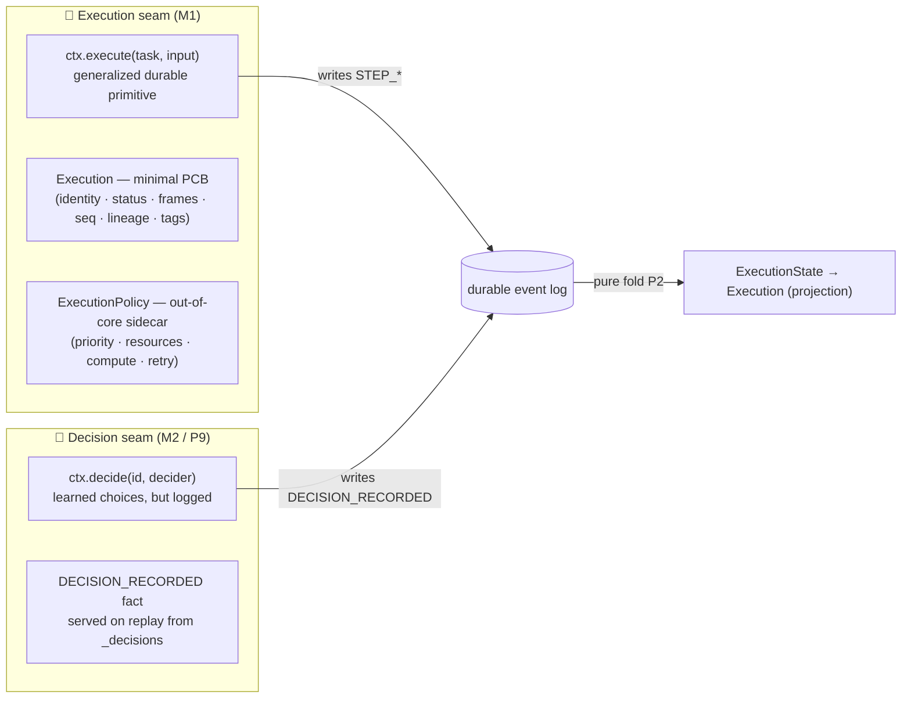
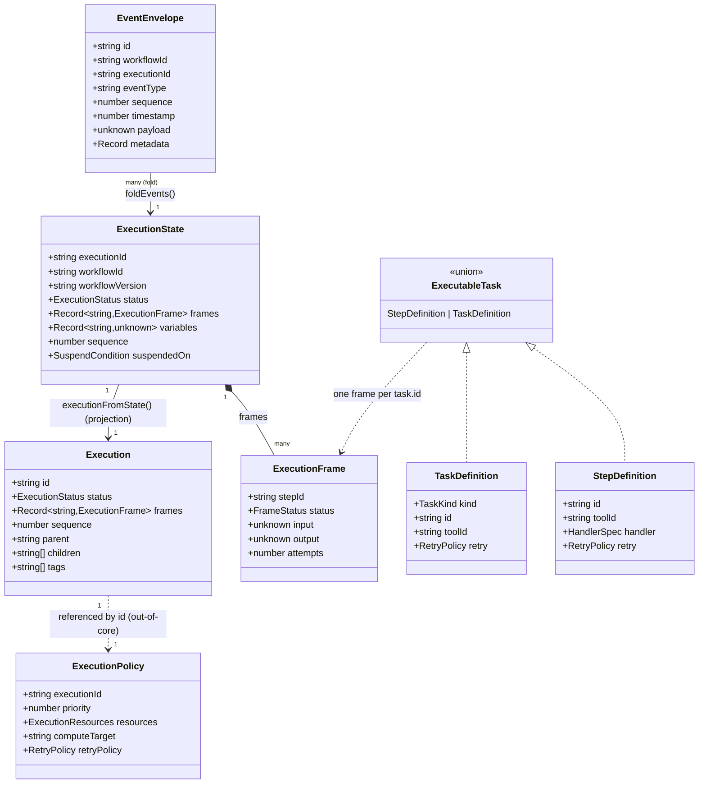
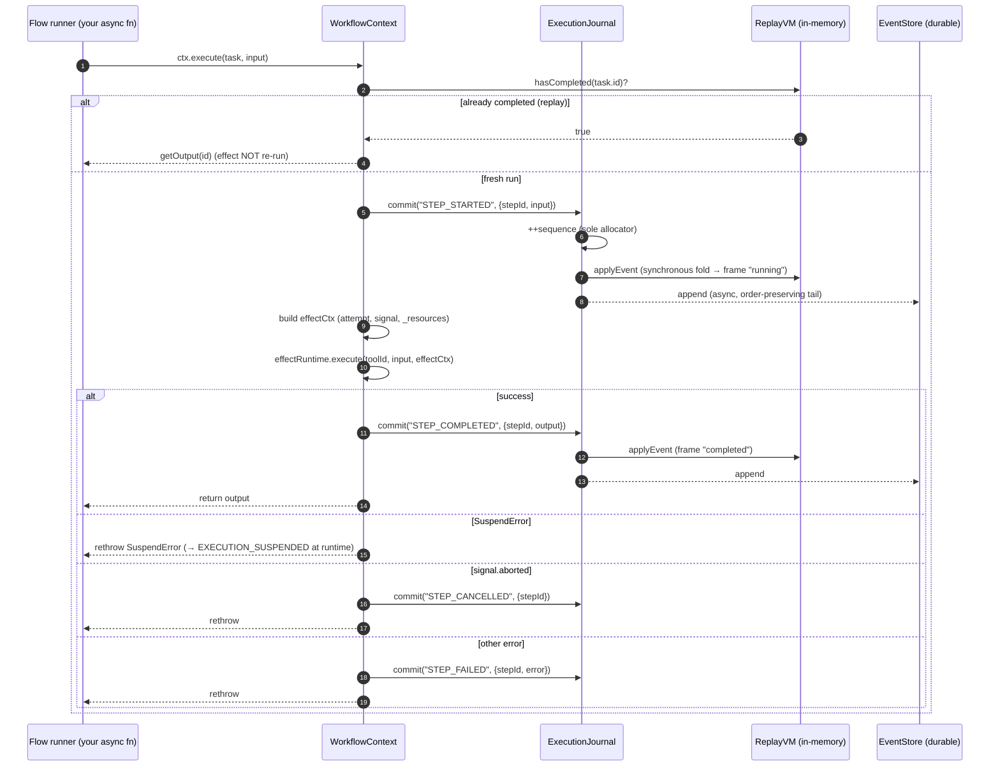
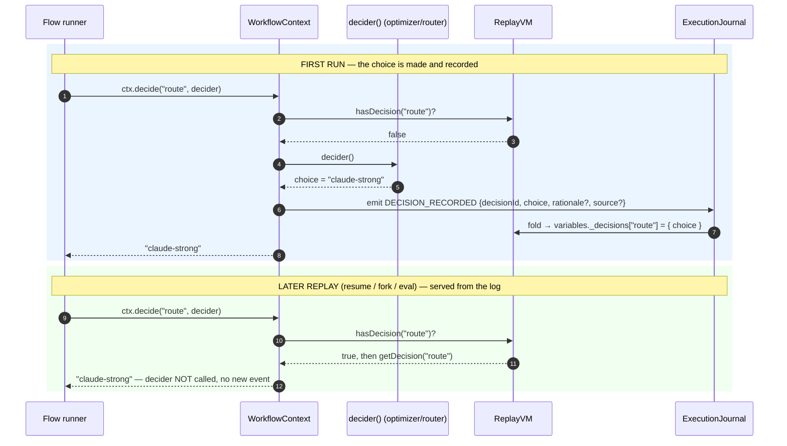
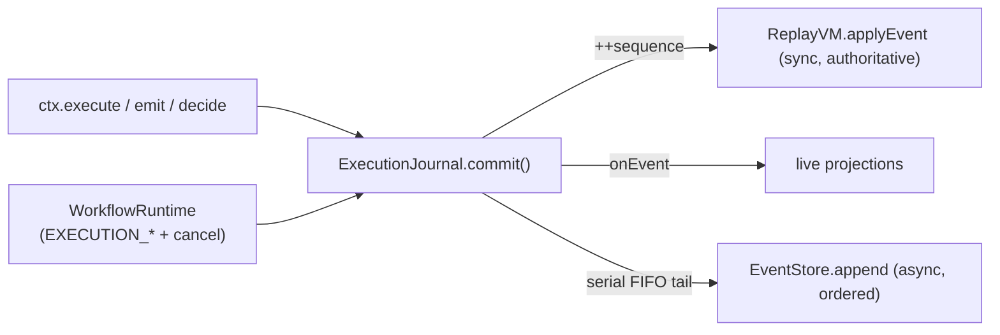

# Loom 2.0 — Execution & Decision Seams (M1, M2, K1)

> See **[docs/loom-2.0/00-overview.md](00-overview.md)** for the milestone map, and
> **[10-event-schema-reference.md](10-event-schema-reference.md)** for the complete on-disk
> event-schema ABI that everything below writes into.

> **What this document covers**
>
> - **M1 — the Execution seam.** Generalizing "a workflow of *steps*" into "an execution
>   of *tasks*", the minimal kernel-owned `Execution` process-control-block, and the
>   `ctx.execute` primitive that `ctx.run` is now a thin alias of.
> - **M2 — the Decision seam (P9).** `ctx.decide` — *learned decisions, but logged* — the
>   mechanism that lets outcomes improve run-to-run while replay stays a pure fold.
> - **K1 — the kernel ABI.** The named, versioned syscall surface (`KERNEL_ABI`) between
>   userspace flows and the durable kernel.

---

## Table of contents

1. [Overview: from workflows-of-steps to executions-of-tasks](#1-overview-from-workflows-of-steps-to-executions-of-tasks)
2. [Data structures](#2-data-structures)
3. [`ctx.execute` — the generalized durable primitive](#3-ctxexecute--the-generalized-durable-primitive)
4. [The Decision seam (P9) — `ctx.decide`](#4-the-decision-seam-p9--ctxdecide)
5. [The kernel ABI (K1)](#5-the-kernel-abi-k1)
6. [Invariants](#6-invariants)

---

## 1. Overview: from workflows-of-steps to executions-of-tasks

Loom 1.x modeled durable work as a **workflow of steps**: a flow runner called
`ctx.run(step)`, each `step` resolved to an effect by `toolId`, the effect ran once, and
its `STEP_COMPLETED` fact was served from the log on replay. That model is correct and
fast — but the vocabulary ("step") is narrower than the reality of intelligent software,
where a durable unit might be an LLM call, an agent loop, a tool invocation, a UI patch, a
memory read/write, a human wait, or a plan expansion.

Loom 2.0 **generalizes the noun without changing the verb**. The durable unit is now a
**task** (`TaskKind = "step" | "llm" | "agent" | "tool" | "ui" | "memory" | "human" | "plan"`),
and a `StepDefinition` *is* the canonical `"step"` task. The generalization is deliberately
skin-deep where it matters most:

- Every task kind still resolves through the `EffectRuntime` **by `toolId`** — `kind` is
  advisory metadata for scheduling, reasoning, and observability, never a new dispatch path.
- The wire events **stay `STEP_*`** (`STEP_STARTED` / `STEP_COMPLETED` / …), so logs written
  before Loom 2.0 fold byte-identically. This is additive-by-design (see [K5](10-event-schema-reference.md)).
- `ctx.run(step)` is now **exactly** `ctx.execute(step)` — a one-line alias with zero
  behaviour change (`packages/workflow-runtime/src/WorkflowContext.ts:97`).

Loom 2.0 has **two spines**, each a thin seam over the existing durable core:



The design goal is **P10 — a minimal kernel**: the durable core stays small and boring
(execution + event log + determinism + effect isolation). Scheduling, priority, compute
placement, and reasoning live *beside* the execution in an opt-in `ExecutionPolicy` referenced
by id — never embedded in the kernel-owned handle. And the Decision seam is exactly what lets
**P9** hold: non-determinism is *allowed*, but only when logged.

---

## 2. Data structures

All types below are the real declarations. The kernel-owned handle (`Execution`) and the
sidecar (`ExecutionPolicy`) live in `packages/core/src/types/execution.ts`; the task
vocabulary lives in `packages/core/src/types/definitions.ts`; the durable folded state
(`ExecutionState`, `ExecutionFrame`) and the wire envelope (`EventEnvelope`) are the
pre-existing durable types that Loom 2.0 builds on.

### 2.1 `Execution` — the minimal process-control-block

A kernel-owned handle to a running execution. Deliberately small (**P10**): identity,
lifecycle status, per-task frames, the durable sequence, lineage, and free-form tags —
**nothing else**. It is a **pure projection** of `ExecutionState`, never persisted.

```ts
// packages/core/src/types/execution.ts:52
export interface Execution {
  id: string;
  status: ExecutionStatus;
  frames: Record<string, ExecutionFrame>;
  sequence: number;
  /** Parent execution id when this was forked/spawned from another. */
  parent?: string;
  /** Child execution ids (fan-out / spawned sub-executions). */
  children?: string[];
  /** Free-form labels for routing, filtering and observability. */
  tags?: string[];
}
```

It is derived by `executionFromState` — a pure, I/O-free function. Lineage (`parent`,
`children`) and `tags` are *supplied by the caller* because they live beside the fold, in the
`BranchRegistry` / `ExecutionPolicy`, not in the event log:

```ts
// packages/core/src/types/execution.ts:77
export function executionFromState(
  state: ExecutionState,
  opts: ExecutionFromStateOpts = {}
): Execution {
  return {
    id: state.executionId,
    status: state.status,
    frames: state.frames,
    sequence: state.sequence,
    ...(opts.parent !== undefined && { parent: opts.parent }),
    ...(opts.children !== undefined && { children: opts.children }),
    ...(opts.tags !== undefined && { tags: opts.tags }),
  };
}
```

### 2.2 `ExecutionPolicy` — the out-of-core sidecar

Carried **beside** an `Execution` (referenced by `executionId`), never embedded in it. Owned
by the scheduler / compute / reasoning modules; the kernel treats it as opaque. **Every field
is optional** — omitting the policy entirely reproduces today's behaviour exactly (**P10 — you
never pay for a runtime you didn't opt into**).

```ts
// packages/core/src/types/execution.ts:98
export interface ExecutionResources {
  cpu?: number;
  memoryMb?: number;
  gpu?: boolean;
}

export interface ExecutionPolicy {
  /** The execution this policy applies to. */
  executionId?: string;
  /** Scheduling priority (lower = sooner); maps to @loom/scheduler Priority. */
  priority?: number;
  resources?: ExecutionResources;
  /** Named compute placement target (e.g. "local" | "cloudrun:svc"). */
  computeTarget?: string;
  /** Memory scope/namespace for the Memory runtime. */
  memoryScope?: string;
  /** Placement affinity hint. */
  affinity?: string;
  /** Durable retry policy (distinct from the in-effect retry middleware). */
  retryPolicy?: RetryPolicy;
  /** Free-form labels mirrored onto the Execution. */
  tags?: string[];
}
```

The split is the whole point: **`Execution` is what the kernel needs to run and replay;
`ExecutionPolicy` is what advisory modules need to *place and prioritize*.** Keeping them
separate is what stops "smart" concerns from becoming a hidden input to the fold.

### 2.3 Task vocabulary — `TaskKind`, `TaskDefinition`, `ExecutableTask`

```ts
// packages/core/src/types/definitions.ts:84
export type TaskKind = "step" | "llm" | "agent" | "tool" | "ui" | "memory" | "human" | "plan";

export interface TaskDefinition<TIn = unknown, TOut = unknown> {
  readonly _tag: "TaskDefinition";
  kind: TaskKind;
  id: string;
  name?: string;
  // Effect to resolve for this task; defaults to `id` when omitted (same rule as steps).
  toolId?: string;
  inputSchema?: ZodSchema<TIn>;
  outputSchema?: ZodSchema<TOut>;
  retry?: RetryPolicy;
  timeoutMs?: number;
}

// A StepDefinition (the 'step' kind, unchanged) OR a generalized TaskDefinition.
// Both expose `id` + optional `toolId`, so execute treats them uniformly.
export type ExecutableTask<TIn = unknown, TOut = unknown> =
  | StepDefinition<TIn, TOut>
  | TaskDefinition<TIn, TOut>;
```

The canonical `"step"` task is the pre-existing `StepDefinition` — a `TaskDefinition` never
displaces it:

```ts
// packages/core/src/types/definitions.ts:64
export interface StepDefinition<TIn = unknown, TOut = unknown> {
  readonly _tag: "StepDefinition";
  id: string;
  name: string;
  toolId?: string;
  handler?: HandlerSpec<TIn, TOut>;
  inputSchema: ZodSchema<TIn>;
  outputSchema: ZodSchema<TOut>;
  retry?: RetryPolicy;
  timeoutMs?: number;
}

// packages/core/src/types/definitions.ts:33
export interface RetryPolicy {
  maxAttempts: number;
  backoffMs?: number;
  backoffMultiplier?: number;
}
```

The only fields `execute` actually reads off an `ExecutableTask` are `id` and (optionally)
`toolId` — which is exactly why a `StepDefinition` and a `TaskDefinition` are handled
uniformly.

### 2.4 Durable folded state — `ExecutionState`, `ExecutionFrame`

The authoritative durable state, produced only by `foldEvents`. `Execution` (§2.1) is a
projection *of this*.

```ts
// packages/core/src/types/execution.ts:13
export interface ExecutionFrame {
  stepId: string;
  status: FrameStatus; // "pending" | "running" | "completed" | "failed" | "skipped" | "cancelled"
  input?: unknown;
  output?: unknown;
  error?: unknown;
  startedAt?: number;
  completedAt?: number;
  attempts: number;
}

// packages/core/src/types/execution.ts:30
export interface ExecutionState {
  executionId: string;
  workflowId: string;
  workflowVersion: string;
  status: ExecutionStatus; // "pending" | "running" | "suspended" | "completed" | "failed" | "cancelled"
  frames: Record<string, ExecutionFrame>;
  variables: Record<string, unknown>;
  sequence: number;
  suspendedOn?: SuspendCondition;
  startedAt: number;
  updatedAt: number;
}
```

The `variables` bag is where Loom 2.0's advisory facts accumulate, all under reserved keys:
`_decisions` (the Decision seam, §4), `_denials` (K2 capability audit), `_resources` (K3
metering). These are documented per-event in [10-event-schema-reference.md](10-event-schema-reference.md).

### 2.5 The wire envelope — `EventEnvelope`

Every durable fact is an `EventEnvelope` with a monotonically increasing per-execution
`sequence`. The fold reads only `eventType`, `payload`, `sequence`, and `timestamp`; it reads
neither `id` nor `executionId` (which is precisely why a fork can re-stamp those two fields and
still fold to a byte-identical state).

```ts
// packages/core/src/types/event.ts:1
export interface EventEnvelope {
  id: string;
  workflowId: string;
  executionId: string;
  eventType: string;
  sequence: number;
  timestamp: number;
  payload: unknown;
  metadata?: Record<string, unknown>;
}
```

### 2.6 How they relate



---

## 3. `ctx.execute` — the generalized durable primitive

`ctx.execute(task, input)` is the single durable-work primitive
(`packages/workflow-runtime/src/WorkflowContext.ts:48`). It:

1. **Replay short-circuit.** If the VM already has a *completed* frame for `task.id`
   (`vm.hasCompleted(id)`), return the recorded output (`vm.getOutput(id)`) **without running
   the effect**. This is exactly-once semantics and the heart of deterministic resume: on a
   re-run, every already-completed task is served from the log.
2. **Emit `STEP_STARTED`** with `{ stepId: id, input }` — folded into a `running` frame whose
   `attempts` increments.
3. **Build the effect context** (`effectCtx`): `executionId`, `stepId`, `workflowId`, the
   current `attempt` (read from the folded frame), an `emit` closure, the optional cancellation
   `signal`, and the K3 running `resources` totals (read from `variables._resources`) so
   metering/quota middleware can enforce budgets deterministically.
4. **Resolve the effect id**: `toolId = task.toolId ?? id` — the same defaulting rule for steps
   and tasks.
5. **Run the effect** via `this.effectRuntime.execute(toolId, input, effectCtx)`.
6. **Emit the terminal fact**:
   - success → `STEP_COMPLETED { stepId, output }`, then return the output;
   - `SuspendError` → **re-thrown untouched** (suspension is not a step failure — it bubbles to
     the runtime, which commits `EXECUTION_SUSPENDED`);
   - `signal.aborted` → `STEP_CANCELLED { stepId }` then re-throw (the cancel is truthful in the
     log; `EXECUTION_CANCELLED` owns execution-level status);
   - any other throw → `STEP_FAILED { stepId, error }` then re-throw.

`ctx.run` is the alias (`WorkflowContext.ts:97`):

```ts
run<TIn, TOut>(step: StepDefinition<TIn, TOut>, input: TIn): Promise<TOut> {
  return this.execute<TIn, TOut>(step, input);
}
```

### 3.1 Sequence diagram — a task run through the durable pipeline



The synchronous-fold / async-write split is owned by the `ExecutionJournal` (§6.1). The VM is
updated synchronously so the flow always observes authoritative state; the durable append is
chained onto an order-preserving FIFO promise tail and awaited at barriers (`drain()`).

---

## 4. The Decision seam (P9) — `ctx.decide`

The Decision seam is the mechanism behind **P9: non-determinism is allowed, but only when
logged.** A runtime may route between models, elevate to a stronger one, learn, or optimize —
but every such choice is emitted as a durable `DECISION_RECORDED` fact and **served from the log
on replay**, exactly as completed effects are.

`ctx.decide` is the deliberate **twin of `execute`'s replay short-circuit**
(`packages/workflow-runtime/src/WorkflowContext.ts:105`):

```ts
async decide<T>(
  decisionId: string,
  decider: () => T | Promise<T>,
  opts?: { rationale?: unknown; source?: string }
): Promise<T> {
  if (this.vm.hasDecision(decisionId)) {
    return this.vm.getDecision(decisionId) as T;   // replay: serve recorded choice
  }
  const choice = await decider();                  // first run: consult the optimizer once
  this.emit("DECISION_RECORDED", {
    decisionId,
    choice,
    ...(opts?.rationale !== undefined && { rationale: opts.rationale }),
    ...(opts?.source !== undefined && { source: opts.source }),
  });
  return choice;
}
```

The short-circuit reads `variables._decisions` via the VM
(`packages/replay-vm/src/ReplayVM.ts:26`): `hasDecision(id)` checks presence,
`getDecision(id)` returns the recorded `.choice`.

### 4.1 "Learned decisions, but logged" — why replay stays deterministic

The subtlety is that the `decider` is an **advisory input that may change between runs** — a
router that today prefers a cheap model and tomorrow prefers a stronger one; a bandit that has
since learned. If the decider were consulted on *every* replay, two folds of the same log could
diverge, and P2 (deterministic replay) would collapse.

The seam breaks that coupling cleanly:

- **First run** — the decider runs *once*, its result is committed as `DECISION_RECORDED`, and
  from that moment the choice is a **durable fact in the log**, not a live call.
- **Every replay** (resume, fork, debug, eval) — `hasDecision` is `true`, so the decider is
  **never re-consulted**; the recorded choice is served straight from `_decisions`.

Therefore **a given execution reconstructs bit-for-bit forever, even as outcomes improve
run-to-run.** New executions get the optimizer's *current* best choice; old executions keep
theirs. Replay remains a **pure fold** (P2 untouched), because the only thing the fold ever sees
is the recorded fact. This is P9 evolving P2 to admit intelligence without regressing
determinism — and it is why the advisory plane can affect *outcomes* only through logged
decisions (P10).

### 4.2 Sequence diagram — first-run vs replay



Note the asymmetry that keeps the fold pure: `decider` is called **exactly zero times on
replay**. The optimizer can freely re-train between the two runs and it changes nothing about
how the old log folds.

---

## 5. The kernel ABI (K1)

The `ExecutionContext` (`ctx`) is the stable, versioned **"syscall" surface** — the narrow,
guaranteed boundary between userspace (flows, agents) and the durable kernel. `packages/workflow-runtime/src/abi.ts`
**names and versions** that boundary so apps can depend on it and CI can catch drift.

```ts
// packages/workflow-runtime/src/abi.ts:15
export const KERNEL_ABI_VERSION = "1.1.0";
```

### 5.1 Compatibility guarantee

- **Adding a syscall bumps the MINOR version.**
- **Removing or renaming a syscall, or changing its meaning, is a MAJOR break** and must be
  deliberate — a conformance test pins the `KERNEL_SYSCALLS` table so it cannot happen silently.

Everything *below* the syscall boundary (event schema, stores, scheduler) is the kernel's own
concern; everything *above* builds only against these calls. `KERNEL_ABI` bundles the version
and the table:

```ts
// packages/workflow-runtime/src/abi.ts:45
export const KERNEL_ABI: KernelAbi = {
  version: KERNEL_ABI_VERSION,
  syscalls: KERNEL_SYSCALLS,
};
```

### 5.2 The syscall table

Each entry is a `KernelSyscall { name, kind, since, summary }`, where `kind` is `"call"` (a
method) or `"accessor"` (a property object, e.g. `ui`). Order is not significant — **names are
the contract**.

| Syscall | Kind | Since | Summary |
|---|---|---|---|
| `execute` | call | 1.0.0 | run any task to durable completion (the generalized primitive) |
| `run` | call | 1.0.0 | run a step — the `"step"` task alias of `execute` |
| `decide` | call | 1.0.0 | record an advisory/optimizer choice durably; served on replay (P9) |
| `parallel` | call | 1.0.0 | run tasks concurrently, input-order-preserving |
| `suspend` | call | 1.0.0 | pause durably until an external signal, then resume from here |
| `sleep` | call | 1.1.0 | suspend durably for a duration; the wake is a logged `TIMER_FIRED` fact (T1) |
| `sleepUntil` | call | 1.1.0 | suspend durably until an absolute time recorded in the log (T1) |
| `emit` | call | 1.0.0 | append a durable domain event |
| `stream` | call | 1.0.0 | emit an incremental delta event |
| `ui` | accessor | 1.0.0 | drive durable, replayable UI surfaces (A2UI) |

_(Source of truth: `KERNEL_SYSCALLS` at `packages/workflow-runtime/src/abi.ts:29`.)_

Two syscalls are new in Loom 2.0's conceptual model but ship at ABI `1.0.0`: `execute` (the
generalization `run` now aliases) and `decide` (the Decision seam). Because `run` is preserved
and the wire events stay `STEP_*`, no existing flow or log is affected — the ABI is a superset.

The durable-timer seam (T1) then added `sleep` and `sleepUntil` as a clean **MINOR** bump to
`1.1.0` — additive syscalls, so every 1.0.0 flow keeps working unchanged.

---

## 6. Invariants

### 6.1 Single-writer journal (D3)

There is **exactly one `ExecutionJournal` per live execution**, and it is the *sole* sequence
allocator and the *only* thing that calls `eventStore.append`
(`packages/workflow-runtime/src/ExecutionJournal.ts:22`). `commit()` is **synchronous**: it
allocates the next sequence (`++this.seq`), folds the envelope into the VM
(`vm.applyEvent` — authoritative), fires the live-projection `onEvent`, enqueues the durable
write onto a serial FIFO promise tail, and fires the snapshot-cadence hook. `drain()` is the
flush barrier callers `await` at durability points (completion, suspend-before-snapshot,
failure); a durable-write rejection is captured once (`firstWriteError`), aborts the run, and
surfaces as a `StorageWriteError` at the next barrier. A single allocator makes sequence gaps
and duplicates **structurally impossible** — the foundation of replay correctness.



### 6.2 Additive event wire-format (K5)

Loom 2.0 adds *concepts* (tasks, decisions, capabilities, metering) without adding new
task-lifecycle wire events: `execute` still emits `STEP_STARTED` / `STEP_COMPLETED` /
`STEP_FAILED` / `STEP_CANCELLED`, so **logs written before Loom 2.0 fold byte-identically**. The
genuinely new event types (`DECISION_RECORDED`, `EFFECT_DENIED`, `RESOURCE_METERED`,
`QUOTA_EXCEEDED`) are **purely additive** and fold into reserved `variables` keys, never
changing how a pre-existing event folds. Governance (`EVENT_SCHEMA_VERSION`, additive-only,
`knownEventTypes()` pin) is specified in full in [10-event-schema-reference.md](10-event-schema-reference.md).

### 6.3 Determinism (P2, evolved by P9)

Reconstructing state from events is a **pure left-fold** — the same events always produce the
same state, with no clock, no randomness, no side effects (`packages/replay-vm/src/foldEvents.ts`).
The Decision seam is what lets P9 hold *on top of* P2: the only thing the fold ever sees is the
**recorded** decision fact, so even an execution that internally consulted a learning optimizer
replays bit-for-bit forever. Effects, decisions, metering, and denials are all served from the
log on replay; nothing "smart" is ever a hidden input to the fold (P10).

---

### See also

- **[00-overview.md](00-overview.md)** — the Loom 2.0 milestone map (M1–M2, K1–K12, T1–T2, P9–P11).
- **[10-event-schema-reference.md](10-event-schema-reference.md)** — the complete on-disk
  event-schema ABI: every event type, its payload, the state fields it folds into, and the
  governance rule.
- **[../architecture.md](../architecture.md)** — the foundational Loom architecture (P1–P8, the
  durable core, subsystems).
- **[../adr/0016-loom-2.0-execution-runtime-and-decision-seam.md](../adr/0016-loom-2.0-execution-runtime-and-decision-seam.md)** —
  the decision record for the Execution runtime and Decision seam (P9, P10).
