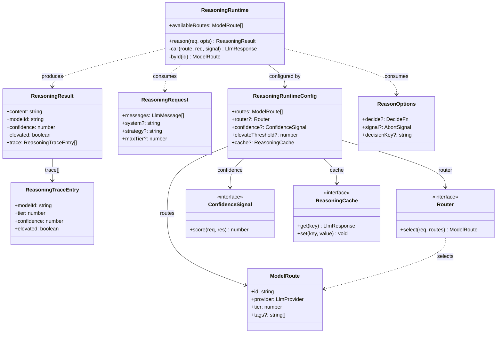
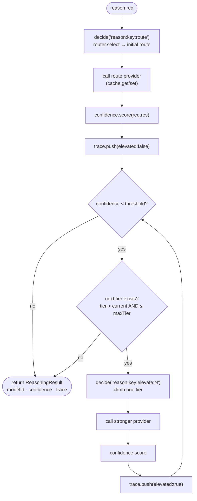
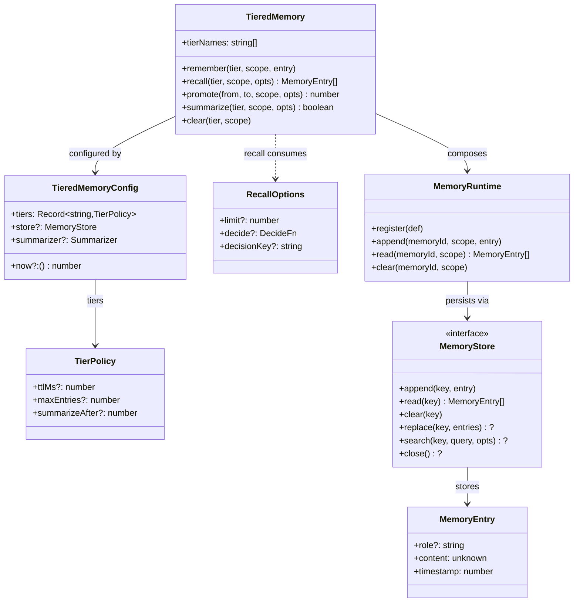
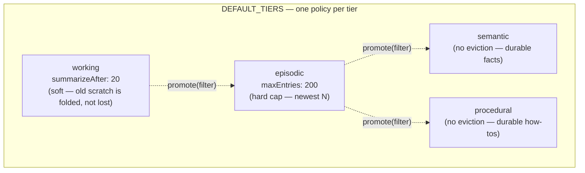
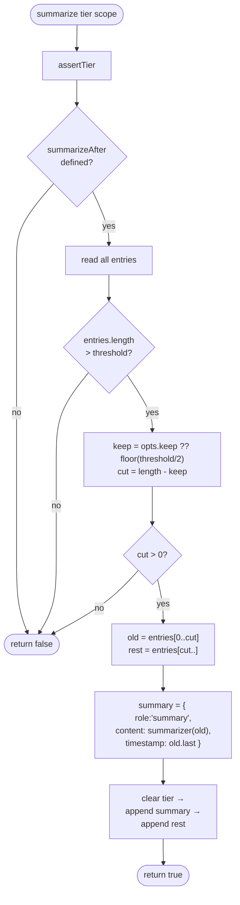
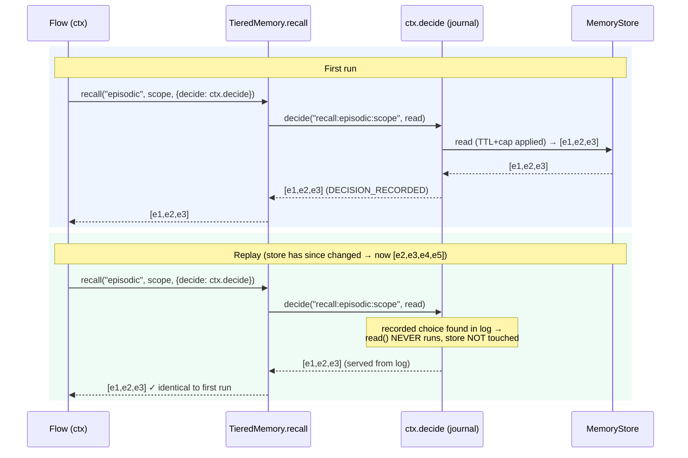

# Loom 2.0 — Reasoning & Memory

> **Where the advisory plane earns its keep.**
>
> The durable kernel is deliberately dumb: it runs steps, appends events, and folds them back into state. Everything "smart" — which model to call, whether to elevate, what to remember, what to recall — lives in an **ephemeral advisory plane** that can only touch outcomes through the [decision seam](01-execution-and-decision-seams.md). This document covers the two flagship advisory modules of Loom 2.0: the **Reasoning Runtime** (M3) and **tiered Memory** (M5). Both are optional, both compose, and neither is a hidden input to the fold.

This document assumes familiarity with the [decision seam](01-execution-and-decision-seams.md) (`ctx.decide` / `DECISION_RECORDED`) and the [Loom 2.0 overview](00-overview.md). It maps onto core principles **P3** (suspension), **P9** (non-determinism is allowed, but only when logged), and **P10** (minimal kernel; intelligence in an advisory plane) from the [architecture](../architecture.md#2-core-principles).

---

## Table of contents

- [Reasoning Runtime (M3, P3)](#reasoning-runtime-m3-p3)
  1. [Overview — the elevation ladder](#r1--overview--the-elevation-ladder)
  2. [Data structures](#r2--data-structures)
  3. [The `reason()` pipeline](#r3--the-reason-pipeline)
  4. [Confidence signals](#r4--confidence-signals)
  5. [Routers](#r5--routers)
  6. [Decision logging & re-basing intent/planner](#r6--decision-logging-p9--re-basing-intentplanner)
- [Memory Runtime (M5, P4)](#memory-runtime-m5-p4)
  1. [Overview — first-class tiers](#m1--overview--first-class-tiers)
  2. [Data structures](#m2--data-structures)
  3. [Algorithms](#m3--algorithms-remember-recall-promote-summarize)
  4. [Logged recall — the determinism fix](#m4--logged-recall--the-determinism-fix)
  5. [Eviction vs summarization](#m5--eviction-vs-summarization)

---

# Reasoning Runtime (M3, P3)

## R1 — Overview — the elevation ladder

Intelligent software has a scarce resource, and it is not CPU — it is **tokens, dollars, and latency**. The naïve answer is "always call the strongest model." The Reasoning Runtime replaces that with a **cheap-first, elevate-on-low-confidence ladder**: try the cheapest model that plausibly fits the request; measure how confident the answer is; and only climb to a stronger, costlier model when confidence falls below a threshold and budget allows.

```
Gemma (tier 0)  →  Flash (tier 1)  →  Pro (tier 2)  →  Opus (tier 3)
  cheap/weak                                            expensive/strong
   ↑ start here                              elevate only if low-confidence ↑
```

The runtime is built as **four composable stages** — `route → call → score → elevate` — each of which is a small, swappable object:

- **route** — a `Router` picks the initial `ModelRoute` (default: cheap-first by tag).
- **call** — the chosen route's `LlmProvider` is invoked (optionally cache-served).
- **score** — a `ConfidenceSignal` turns the response into a number in `[0,1]`.
- **elevate** — while confidence is below threshold and a higher tier is within budget, climb one tier and repeat.

Because the runtime lives in the advisory plane, its routing and elevation choices are recorded through the [decision seam](01-execution-and-decision-seams.md) when a flow passes `ctx.decide` (P9). This is the crux: **routing may improve run-to-run, yet any single execution replays bit-for-bit** because the route/elevation choices are served from the log, not recomputed. The kernel never learns that a Reasoning Runtime exists — it is an optional module (P10), and the simple `ctx.run(step)` path stays a zero-overhead one-liner.

Source: `packages/reasoning/src/ReasoningRuntime.ts` (`ReasoningRuntime` class), `:48` (`reason`).

## R2 — Data structures

All types live in `packages/reasoning/src/types.ts`.

A **`ModelRoute`** is a named model endpoint whose `tier` orders the elevation ladder (lower = cheaper/weaker):

```ts
export interface ModelRoute {
  id: string;
  provider: LlmProvider;
  tier: number;               // Gemma=0 → Flash=1 → Pro=2 → Opus=3
  tags?: string[];            // strategy hints: "planning", "coding", "review"
}
```

A **`ReasoningRequest`** is a superset of a bare LLM completion request, adding the two knobs the ladder needs — `strategy` (picks a tagged route and namespaces the logged decisions) and `maxTier` (a per-request budget cap that the elevation loop will never exceed):

```ts
export interface ReasoningRequest {
  messages: LlmMessage[];
  system?: string;
  strategy?: string;          // tag-based route selection + decision namespace
  tools?: LlmToolSpec[];
  maxTokens?: number;
  temperature?: number;
  signal?: AbortSignal;
  maxTier?: number;           // never elevate above this tier; default = highest available
}
```

A **`ReasoningResult`** is a drop-in superset of `LlmResponse` (so existing `provider.complete` callers can switch over with no reshaping) plus the **route trace**: which model answered, how confident, whether it was elevated, and the full per-attempt history (`ReasoningTraceEntry[]`).

```ts
export interface ReasoningTraceEntry {
  modelId: string;
  tier: number;
  confidence: number;
  elevated: boolean;
}

export interface ReasoningResult {
  content: string;
  toolCalls?: LlmToolCall[];
  stopReason: LlmResponse["stopReason"];
  usage?: LlmResponse["usage"];
  modelId: string;            // the model that produced the final answer
  confidence: number;         // its confidence
  elevated: boolean;          // did we climb the ladder at all?
  trace: ReasoningTraceEntry[];
}
```

The three pluggable seams:

- **`ConfidenceSignal`** — `score(req, res) => number | Promise<number>`. Confidence is a *pluggable signal, not a magic self-reported number* (see [R4](#r4--confidence-signals)).
- **`Router`** — `select(req, routes) => ModelRoute`. The routing policy (see [R5](#r5--routers)).
- **`ReasoningCache`** — an optional `get`/`set` response cache. A **latency-only** stage: it never changes the recorded outcome, so it lives entirely off-log (bring your own eviction).

`ReasonOptions` carries the decision sink (`decide`), an abort `signal`, and a `decisionKey` that namespaces decision ids so multiple `reason()` calls in one execution don't collide. `DecideFn` is structurally identical to `ctx.decide` minus its `opts` — when a flow passes `ctx.decide`, each route/elevation becomes a durable `DECISION_RECORDED` event; standalone callers get an identity `decide` that just runs the decider inline.

`ReasoningRuntimeConfig` wires it all together: the `routes` (required, non-empty), and optional `router` (default `tagRouter`), `confidence` (default `stopReasonConfidence`), `elevateThreshold` (default `0.5`), and `cache`.



## R3 — The `reason()` pipeline

`reason(req, opts)` runs the four stages in order (`ReasoningRuntime.ts`). At construction time the routes are **sorted once by tier** (`:37`) so elevation is a simple forward scan.

**Step by step:**

1. **Resolve options.** `decide = opts.decide ?? identityDecide`; `key = opts.decisionKey ?? req.strategy ?? "default"` (this namespaces every decision id); `maxTier` defaults to the highest tier available.
2. **Stage 1 — route (logged).** The initial route id is chosen *inside* `decide`:
   ```ts
   const initialId = await decide(`reason:${key}:route`, () => this.router.select(req, this.routes).id);
   ```
   On the first run the router runs and the choice is recorded as `DECISION_RECORDED`; on replay the recorded id is served and the router is **never consulted again**.
3. **Stage 2 — call.** `this.call(current, req, signal)` invokes the route's provider, first checking the optional cache (`:104`). A cache hit is returned verbatim; a miss is populated after the call.
4. **Stage 3 — score.** `this.confidence.score(req, res)` yields a number; the attempt is pushed onto `trace` with `elevated: false`.
5. **Stage 4 — elevate loop.** `while (confidence < threshold)`: find the *next-higher* tier that is `> current.tier` and `<= maxTier` (`:69`). If none exists, break. Otherwise the next route id is again chosen through `decide` (`reason:${key}:elevate:${step}`), the provider is re-called, confidence re-scored, and a `trace` entry pushed with `elevated: true`.
6. **Return.** The final result carries the last response's content/tool-calls/usage, the winning `modelId`, its `confidence`, `elevated: trace.length > 1`, and the full `trace`.

Note the loop uses `routes.find(...)` for the *first* route strictly above the current tier — because routes are pre-sorted, this climbs exactly one rung per iteration, and `maxTier` caps the climb regardless of how many stronger routes exist.



A routed-then-elevated call, showing the decision logging interleaved with provider calls:

```mermaid
sequenceDiagram
  participant Flow as Flow (ctx)
  participant RR as ReasoningRuntime
  participant Dec as ctx.decide (journal)
  participant Cheap as Gemma (tier 0)
  participant Strong as Pro (tier 2)
  participant Conf as ConfidenceSignal

  Flow->>RR: reason({strategy:"planning"}, {decide: ctx.decide})
  RR->>Dec: decide("reason:planning:route", router.select)
  Dec-->>RR: "gemma"  (DECISION_RECORDED)
  RR->>Cheap: complete(messages)
  Cheap-->>RR: res (stopReason=max_tokens)
  RR->>Conf: score(req,res) → 0.3
  Note over RR: 0.3 &lt; 0.5 → elevate
  RR->>Dec: decide("reason:planning:elevate:1", () => "pro")
  Dec-->>RR: "pro"  (DECISION_RECORDED)
  RR->>Strong: complete(messages)
  Strong-->>RR: res (stopReason=end_turn)
  RR->>Conf: score(req,res) → 0.9
  Note over RR: 0.9 ≥ 0.5 → stop
  RR-->>Flow: ReasoningResult{modelId:"pro", confidence:0.9, elevated:true, trace:[…]}
```

On replay, both `decide(...)` calls short-circuit from the log, so *even if the router now ranks models differently*, this execution re-serves `gemma` then `pro` and reconstructs identical state (P2 preserved via P9).

## R4 — Confidence signals

The elevation decision hinges on a single number, and the design's opinion is emphatic: **confidence is a pluggable signal, not a magic self-reported number.** Asking a model "how confident are you?" is notoriously unreliable; instead the runtime lets you inject whatever signal matches the stakes. Three ship in the box (`packages/reasoning/src/confidence.ts`):

- **`stopReasonConfidence`** (the default) — derives confidence from the model's **stop reason**, the one signal *every* provider emits. A clean `end_turn` or `tool_use` scores `0.9`; a truncated `max_tokens` answer scores `0.3` (and therefore elevates); anything else scores `0.5`. Zero extra calls, works with any provider.
- **`validatorConfidence(validate)`** — runs a caller-supplied predicate over the content: pass → `1`, fail → `0`. This turns elevation into *"retry on a stronger model until the output validates"* — ideal for structured outputs (did it parse as the expected JSON? is it a known capability id?).
- **`constantConfidence(value)`** — always returns a fixed value. `constantConfidence(1)` pins to the cheapest model (never elevate); `constantConfidence(0)` forces a full climb. Primarily for tests and hard pins.

Because the signal is just a `ConfidenceSignal` interface, you can bring log-probabilities, ensemble agreement (call two models, score by overlap), or a learned scorer — the elevation loop doesn't care how the number was produced, only that it is comparable against `elevateThreshold`.

## R5 — Routers

The `Router` interface decides the **initial** route (elevation then walks the tier ladder). Five implementations ship (`packages/reasoning/src/router.ts`):

- **`tagRouter`** (the default) — **cheap-first**: the lowest-tier route whose `tags` include the request's `strategy`, else the lowest-tier route overall. This is what makes the ladder start at Gemma and climb only under pressure.
- **`fixedRouter(modelId)`** — always selects a specific model id; throws if it isn't in the route set. Handy for tests and for pinning a strategy to one model.
- **`rankedRouter(rankings, opts?)`** *(M10, learned)* — a self-optimizing router. Given a ranking (e.g. from `@loom/analytics` `rankModels`/`outcomeAnalytics`, mined from historical logs), it prefers the highest-ranked route that exists and **falls back to `tagRouter` (cheap-first) for unranked requests**. Because it is consulted inside `reason()` through `ctx.decide`, its learned choice is recorded as a durable decision (P9) — auditable and override-able, never silently autonomous (P10). This is the seam where the system gets smarter run-to-run without breaking any past replay; see the **intelligence / self-optimization doc** for how rankings are mined.

  ⚠️ **Pure exploit.** It never tries an arm to learn about it, so a ranking mined from a log it produced narrows over time — the arms it stops choosing stop producing outcomes. Pass `ArmStats[]` (what `outcomeAnalytics` returns) with `{ minSamples }` so thin evidence can't outvote thick evidence, and reach for one of the two below if you want the loop to keep learning ([ADR 0078](../adr/0078-exploration-in-the-routing-seam.md)).
- **`ucb1(stats, opts?)`** *(recommended for a live loop)* — scores each arm `mean + c·sqrt(2·ln N / n)`. An unsampled arm scores `+Infinity` and is guaranteed a trial; a lucky `n=1` arm can't pin the router because its rivals keep their own large bonus until they're tried too. **Deterministic — no RNG**, so the same evidence always yields the same route.
- **`epsilonGreedy(inner, { epsilon, rng? })`** — with probability `epsilon`, ignore `inner` and sample a route uniformly. The simple escape hatch for any exploit-only router; `rng` is injectable for tests and DST runs.

All five satisfy the same `select(req, routes) => ModelRoute` contract, so swapping routing policy is a one-line config change (`ReasoningRuntimeConfig.router`).

## R6 — Decision logging (P9) & re-basing intent/planner

### Why logging routes matters

Model routing and elevation are exactly the kind of *outcome-affecting non-determinism* that P9 exists to tame. Without the decision seam, a resume six weeks later — after you have added a stronger model or re-ranked the router — would take a **different** path than the original run, and replay would diverge. That would regress P2 (deterministic replay), the foundation the whole system rests on.

Passing `ctx.decide` closes the gap. Each `decide("reason:…:route", …)` and `decide("reason:…:elevate:N", …)`:

- **records** the chosen model id as an immutable `DECISION_RECORDED` fact on the first run;
- **serves** that recorded id on every subsequent replay/resume, without re-running the router or re-scoring confidence;
- makes routing **durable, auditable, and replay-safe** — you can read the log and see exactly which model answered and why it elevated.

Standalone callers (outside a durable flow) get `identityDecide`, which just runs the decider inline — so the runtime is usable in a plain script, it simply isn't replay-safe there. The `decisionKey` (defaulting to `strategy`) namespaces the ids so several `reason()` calls in one execution never collide.

### Re-basing intent and planner onto reasoning

Both `@loom/intent` and `@loom/planner` were re-based to **prefer** the Reasoning Runtime while keeping their offline, deterministic fallbacks intact. The pattern is identical in each (`IntentRuntime.ts`, `PlannerRuntime.ts`): a private `complete()` helper picks its LLM path in strict preference order:

1. **`reasoning`** (preferred) — routes the call through `ReasoningRuntime.reason(...)`, gaining model routing + confidence-based elevation "for free."
2. **`provider`** (fallback) — a bare `LlmProvider.complete(...)`.
3. **offline heuristic** (final fallback) — for intent, a **keyword matcher** over the catalog (`routeWithKeywords`, `IntentRuntime.ts`); for planner, a **keyword-ranked heuristic** (`planWithHeuristic`, `PlannerRuntime.ts`).

```ts
// IntentRuntime.ts — the preference ladder, condensed
if (this.config.reasoning !== undefined || this.config.provider !== undefined) {
  const llmRoute = await this.routeWithLlm(intentText, capabilities);
  if (llmRoute !== null) return llmRoute;      // model path succeeded
}
return this.routeWithKeywords(intentText);      // deterministic offline fallback
```

The offline fallbacks are the reason these runtimes stay fully headless and deterministic: with no provider and no reasoning runtime configured, intent routing and planning are pure functions over the capability catalog. When reasoning *is* wired and the flow passes `ctx.decide`, the model path becomes replay-safe by construction. (Both also accept an optional `Scheduler` and run their LLM call at `Priority.Idle`, so background routing/planning yields to live work — a latency-only concern with no effect on the decision.)

> **Worked example — intent routing with reasoning.**
> ```ts
> const reasoning = new ReasoningRuntime({
>   routes: [
>     { id: "gemma", provider: gemma, tier: 0, tags: ["routing"] },
>     { id: "pro",   provider: pro,   tier: 2, tags: ["routing", "planning"] },
>   ],
>   confidence: validatorConfidence((c) => catalog.ids().includes(c.trim().split(/\s+/)[0] ?? "")),
> });
> const intent = new IntentRuntime({ catalog, reasoning, workflowRuntime });
>
> // Inside a flow, the routing LLM call is logged + elevatable:
> const route = await intent.route(userText);   // gemma first; elevates to pro if the
>                                                // reply isn't a valid capability id
> ```
> Here `validatorConfidence` makes elevation mean *"climb until the model names a real capability."* Every route/elevation lands in the log, so re-running this execution always resolves the same capability even after the catalog or router changes.

---

# Memory Runtime (M5, P4)

## M1 — Overview — first-class tiers

Agents need memory that outlives a single turn, but a flat, unbounded scratchpad is both a cost problem (context windows) and a *determinism* problem (recall changes as the store grows). Loom 2.0's answer is **first-class tiers** layered over the existing scoped `MemoryRuntime`.

`TieredMemory` gives you **many named tiers, each with its own eviction/summarization policy**, plus **promotion** between tiers and **logged recall** through the decision seam. It is built *on top of* `MemoryRuntime` (composition over replacement, P6/P4): each tier is registered as an ordinary `MemoryDefinition` in an underlying `MemoryRuntime`, so the tiers inherit the base runtime's `ttlMs`/`maxEntries` eviction and add summarization and promotion on top.

Source: `packages/memory/src/TieredMemory.ts` (`TieredMemory`), `packages/memory/src/MemoryRuntime.ts` (`MemoryRuntime`).

## M2 — Data structures

**Base layer** (`packages/memory/src/types.ts`, `MemoryRuntime.ts`):

- **`MemoryEntry`** — a single remembered item: an optional `role`, arbitrary `content` (a message, a tool result, a fact), and a `timestamp` used for TTL eviction.
- **`MemoryStore`** — the pluggable, **async-first** storage backend (`append`/`read`/`clear`, all keyed by a string; optional `replace`/`search`/`close`). A key names an *ordered list*, read back in **append** order — entries routinely share a timestamp, so ordering by it would reshuffle a conversation. `InMemoryMemoryStore` is the default and loses everything on restart; `SqliteMemoryStore` / `PostgresMemoryStore` (in the store plugins) are the durable backends, and the async signature means Redis / a vector store are real implementations, not afterthoughts. Durable backends round-trip an entry through JSON, so `content` must be JSON-serializable. All of them run `runMemoryStoreConformance` — as does the third-party `loom-plugin-vector`, which ranks by cosine similarity instead and so has to pick a **relevance floor**: similarity is defined against every entry, so an unthresholded ranking is never empty, while the contract requires `[]` for a query that matches nothing.
- **`MemoryRuntime`** — holds named memory definitions and enforces each one's `ttlMs`/`maxEntries` policy on read and write. Memory is addressed by **`(memoryId, scope)`** — `scope` is typically an `executionId`, `conversationId`, or `userId`, so one definition serves many concurrent sessions. `prune` (`MemoryRuntime.ts`) drops entries older than `ttlMs` then keeps the newest `maxEntries`; `evict` rewrites the stored list to the pruned view so eviction is durable, not just a read-time filter — through the store's atomic `replace` when it has one, because the clear-then-re-append fallback would let a crash mid-eviction lose the whole scope.

**Tier layer** (`TieredMemory.ts`):

- **`TierPolicy`** — a tier's bound. `ttlMs` (wall-clock TTL eviction), `maxEntries` (hard cap — keep newest N), and `summarizeAfter` (a *soft* bound: when the tier exceeds N entries, the oldest are folded into a single summary entry, retaining gist rather than dropping the tail).
- **`Summarizer`** — `(entries) => content`. Injectable: swap in an LLM/reasoning summarizer; the default is deterministic and offline (`{ summarized: n, items: [...] }`).
- **`TieredMemoryConfig`** — `tiers` (a `Record<string, TierPolicy>`), optional `store`, `summarizer`, and `now` (an injectable clock, so tests are deterministic).
- **`RecallOptions`** — `limit` (newest N), plus `decide` + `decisionKey` for [logged recall](#m4--logged-recall--the-determinism-fix).
- **`RecallRelevantOptions`** — the same, except `decide` is **required**. `TieredMemory.recallRelevant(tier, scope, query, …)` ranks a tier by relevance to a question instead of returning its tail, which is the only way to use a `semantic`/`procedural` tier (neither evicts, so their "newest N" means nothing). Recency recall re-reads a list the caller mostly controls; relevance recall ranks over a corpus that grows, so the set it returns for one question genuinely differs between the run and its replay — requiring `decide` makes that a compile-time property rather than advice. An unrecorded query (ops, a CLI, a test) calls the store's `search` directly, where the bypass is visible.
- **`searchableText` / `tokenize`** — the exported projection a backend indexes (the string and number *leaves* of `content` — not `role`, not the timestamp, not object keys, and a **tainted** value contributes its content and not its `origin` label, since an ingested corpus taints every entry and an indexed origin would make one term match all of it) and the term splitter (lowercase, non-alphanumeric split, no stemming). Exported because *what text is searched* and *what counts as a term* are contract: a backend indexing something else would still return matches, just to a different question than the app asked. The walk is **iterative and depth-bounded** (512): `content` is whatever was ingested, and a depth JSON itself accepts was enough to exhaust the call stack, while a cyclic value never terminated. Content below the cap is indexed as far as the cap rather than refused — this is an index, not a validator, and refusing would make legal content unstorable.
- **`DEFAULT_TIERS`** — the canonical tier set from the proposal.



The canonical tiers (`DEFAULT_TIERS`, `TieredMemory.ts`) map cleanly onto the classic memory taxonomy, each with a deliberately different bound:



`working` is bounded by **summarization** (recent scratch matters, so old context is compressed rather than discarded); `episodic` is **hard-capped** to the newest 200; `semantic` and `procedural` are **durable** (no eviction — long-lived facts and how-tos). Apps may define their own tier set instead; `DEFAULT_TIERS` is just a sensible default.

## M3 — Algorithms (remember, recall, promote, summarize)

**`remember(tier, scope, entry)`** (`TieredMemory.ts`) — validate the tier, append through the base runtime (stamping `timestamp` from the injectable clock), then **auto-summarize** if the tier declares `summarizeAfter`. So a `working`-tier write transparently keeps the tier bounded without the caller thinking about it.

**`recall(tier, scope, opts)`** (`:115`) — read the tier's pruned entries from the base runtime (TTL + `maxEntries` already applied) and optionally slice to the newest `opts.limit`. If `opts.decide` is supplied, the *entire read* is wrapped in `decide(key, read)` so the recalled set is recorded durably — see [M4](#m4--logged-recall--the-determinism-fix). This is the one method whose behavior is outcome-affecting, hence the seam.

**`promote(from, to, scope, opts)`** (`:129`) — copy (or, with `move: true`, move) entries matching `opts.filter` from one tier to another; returns the count. This is how a salient episodic memory graduates into a durable semantic fact. On `move`, the source tier is cleared and re-populated with the *kept* (non-matching) entries, so promotion is atomic from the caller's view.

**`summarize(tier, scope, opts)`** (`:151`) — fold the oldest entries of a tier into one summary entry when it exceeds `summarizeAfter`. Returns `true` if it ran. The algorithm:



The oldest `cut` entries are compressed into a single `role: "summary"` entry (timestamped at the newest of the folded entries so ordering stays sane), the tier is cleared, and the summary + the retained `rest` are re-appended. `keep` defaults to `floor(threshold/2)`, so a tier that hits its soft bound halves back down while preserving both the recent tail *and* a gist of everything older.

## M4 — Logged recall — the determinism fix

This is the critical correctness point, and the reason `recall` takes a `decide`.

**The problem.** Memory is *mutable and grows over time*. If a flow recalls memory to decide what to do next — "given what I remember, take action X" — then the recalled set is an **outcome-affecting input**. Replaying that flow later reads memory *again*, but the store has since changed (new entries appended, old ones evicted or summarized). The replay would recall a **different** set and could take a **different** action. That directly regresses P2: the same execution no longer reconstructs identical state.

**The fix.** Route recall through the [decision seam](01-execution-and-decision-seams.md). When `opts.decide` is present, `recall` wraps the read:

```ts
// TieredMemory.ts:121
if (opts.decide !== undefined) {
  const key = opts.decisionKey ?? `recall:${tier}:${scope}`;
  return opts.decide(key, read);   // record the recalled set on run; serve it on replay
}
return read();                     // un-logged: fine for non-outcome-affecting reads
```

On the **first run**, the read executes and its result is recorded as a `DECISION_RECORDED` fact. On **replay**, that exact set is served from the log and `read` is *never called* — so the flow sees the same memory it saw originally, regardless of how the store has evolved.



The un-logged path (`return read()`) remains available and correct for recalls that *don't* affect the outcome (e.g. rendering a debug panel). The rule is the same one P9 states for all advisory non-determinism: **if it can change what the flow does, it must be logged.**

## M5 — Eviction vs summarization

Both `maxEntries`/`ttlMs` (eviction) and `summarizeAfter` (summarization) bound a tier's size, but they make opposite trade-offs:

| | **Eviction** (`ttlMs`, `maxEntries`) | **Summarization** (`summarizeAfter`) |
|---|---|---|
| **What happens to old entries** | Dropped entirely | Folded into one summary entry (gist kept) |
| **Cost** | Free — a filter/slice | A `Summarizer` call (may be an LLM call) |
| **Fidelity** | Lossy on the tail; recent items exact | Lossy on detail; gist of everything retained |
| **Determinism** | Wall-clock `ttlMs` is time-dependent | Deterministic given a deterministic summarizer + clock |
| **Best for** | High-churn scratch where old items are worthless (`episodic`) | Tiers where old context still matters (`working`) |

Rule of thumb, encoded in `DEFAULT_TIERS`: use **`maxEntries`** when the newest N items are all that matter (bounded, cheap, exact); use **`summarizeAfter`** when you want to stay bounded *without forgetting* — the oldest turns are compressed but their gist survives. `semantic`/`procedural` use *neither*: durable knowledge should not be silently thrown away or lossily compressed.

Two determinism cautions worth flagging: `ttlMs` eviction is **wall-clock dependent** (an entry present on the first run may be gone on a much-later replay), which is exactly why outcome-affecting recall must go through [logged recall](#m4--logged-recall--the-determinism-fix). And a summarizer that calls a model is itself non-deterministic — so if a summary feeds an outcome, that summarization should likewise be captured (either behind `ctx.decide` or by using the deterministic default summarizer).

---

## See also

- **[01 — Execution & Decision Seams](01-execution-and-decision-seams.md)** — `ctx.decide` / `DECISION_RECORDED`, the seam both runtimes stand on.
- **[00 — Loom 2.0 Overview](00-overview.md)** — the advisory-plane model (P9/P10) and milestone map.
- **[Architecture](../architecture.md)** — the durable kernel these modules layer onto; core principles P3, P4, P9, P10.
- **Intelligence / self-optimization doc** — `rankedRouter` (M10) and how model rankings are mined from historical logs.
