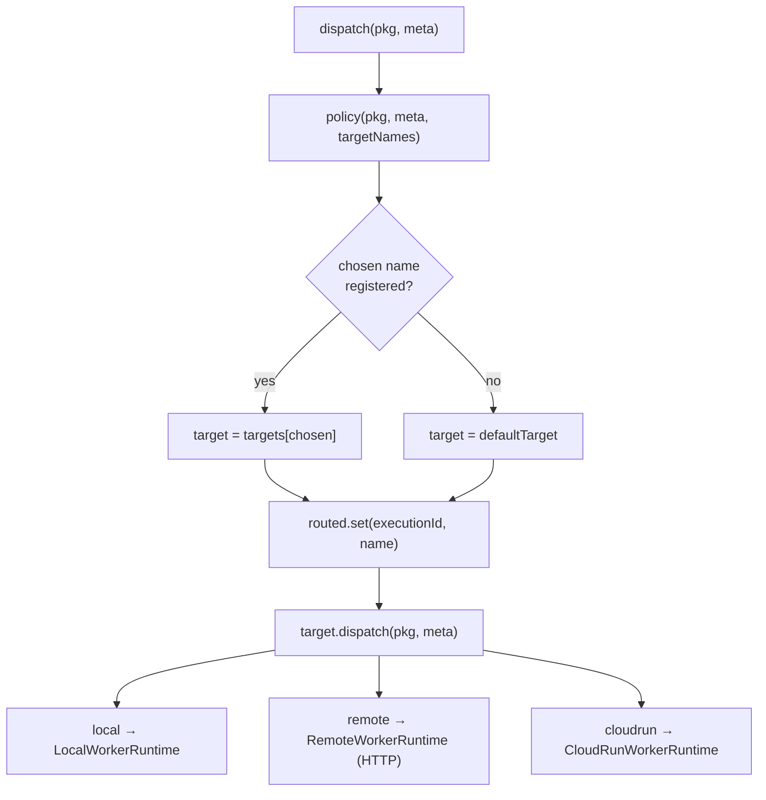
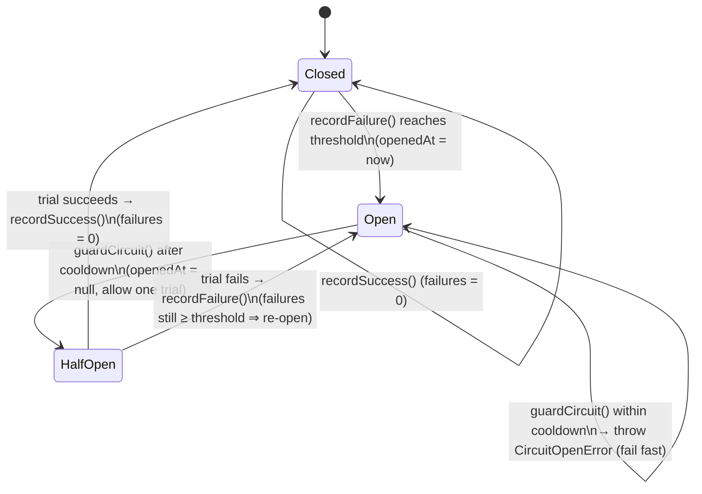
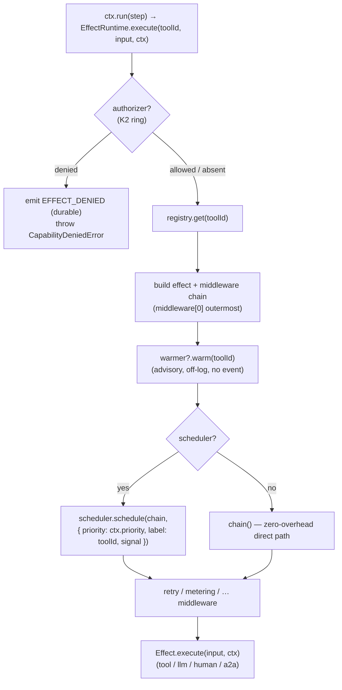
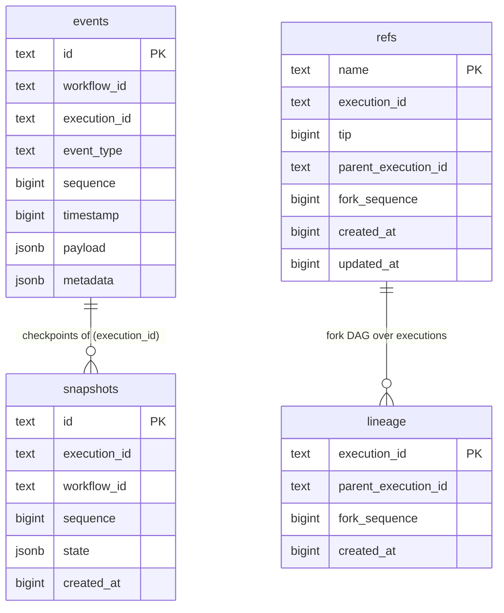
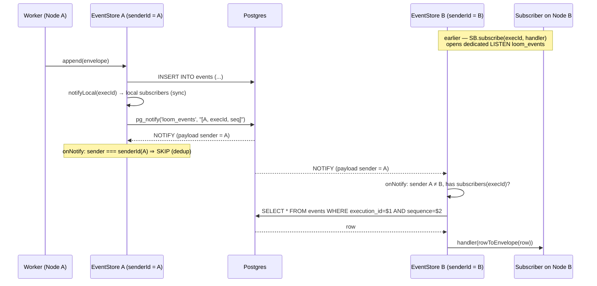

# Loom 2.0 — Compute, Scheduling & Storage

> **Where an execution runs, when it runs, how it survives a flaky worker, and how the durable log scales past one box — without the kernel ever learning about any of it.**
>
> This chapter covers four Loom 2.0 milestones that all sit *outside* the durable core and reach it only through interfaces:
> **M4** (compute placement), **M6** (the scheduler in the hot path), **K4** (fault supervision), and **M3.5** (Postgres scale-out storage).
> Every one of them is an application of principles **P8** (the core is isomorphic; the edges are pluggable) and **P10** (minimal kernel; intelligence lives in an advisory plane). The kernel never imports the dispatcher, the scheduler, or a specific database — it only knows `ExecutionDispatcher`, `Scheduler`, `EventStore`, `SnapshotStore`, and `BranchRegistry`.

See also: **[00-overview.md](00-overview.md)** for the milestone map and how these pieces relate to the durable core, and **[04-kernel-hardening.md](04-kernel-hardening.md)** for the K1–K3 protection rings (authority, budgets, isolation) that K4 completes.

---

## Table of contents

1. [The placement seam (M4)](#1-the-placement-seam-m4)
2. [Fault supervision (K4)](#2-fault-supervision-k4)
3. [The scheduler in the hot path (M6)](#3-the-scheduler-in-the-hot-path-m6)
4. [Scale-out storage (M3.5)](#4-scale-out-storage-m35)

---

## 1. The placement seam (M4)

The orchestrator decides *what* runs and produces an event log; it must not know *where* the work executes. M4 inserts a two-interface seam between the two — `ExecutionDispatcher` (the **WHERE** decision + worker lifecycle) and `WorkerRuntime` (the **HOW/where** of one execution) — so the same flow runs in-process in a test, over HTTP to a worker pool, or on Cloud Run, with no change to the public SDK ([ADR 0001–0004]; architecture §5.5, D8).

### 1.1 The two SPIs and the payload that crosses the boundary

The scheduler decides **WHAT** runs; the `ExecutionDispatcher` decides **WHERE**, owns worker allocation, result collection, retries and (from Step 4) timeout + failure redispatch — and it talks *only* to a `WorkerRuntime`, never to a specific cloud (`packages/dispatcher/src/types.ts:42-52`). The single thing that crosses the boundary is an **`ExecutionPackage`**: an immutable, JSON-serializable description of one execution carrying **identity + resume coordinates, never live code** (`packages/worker-runtime/src/types.ts:16-31`). The worker resolves the flow and its effects *by id* (`flowId`) from the code it was booted with, and rebuilds state from the shared event + snapshot stores — which is exactly why closures need never be serialized (P5, D8).

```mermaid
classDiagram
  class ExecutionDispatcher {
    <<interface>>
    +dispatch(pkg, meta?) Promise~ExecutionResult~
    +cancel(executionId) Promise~void~
    +health() Promise~DispatcherHealth~
  }
  class WorkerRuntime {
    <<interface>>
    +allocate(request) Promise~WorkerLease~
    +execute(lease, pkg) Promise~ExecutionResult~
    +release(lease) Promise~void~
  }
  class ExecutionPackage {
    +executionId : string
    +workflowId : string
    +flowId : string
    +input? : unknown
    +resumeEvent? : {eventType, payload}
    +snapshotId? : string
    +fromSequence? : number
    +metadata? : Record
  }
  class ExecutionResult {
    +executionId : string
    +status : "completed"|"suspended"|"failed"
    +state : ExecutionState
    +output? : unknown
    +error? : unknown
    +suspendedOn? : SuspendCondition
    +lastSequence : number
  }
  class DispatchMetadata {
    +lane? : string
    +priority? : number
    +estimatedCpu? : number
    +estimatedMemory? : number
    +estimatedDuration? : number
    +target? : string
  }

  ExecutionDispatcher ..> ExecutionPackage : dispatches
  ExecutionDispatcher ..> DispatchMetadata : advisory hints
  ExecutionDispatcher ..> ExecutionResult : returns
  ExecutionDispatcher ..> WorkerRuntime : drives
  WorkerRuntime ..> ExecutionPackage : runs
  WorkerRuntime ..> ExecutionResult : returns
```

An `ExecutionPackage` has two shapes: a **fresh start** (`input` set, `resumeEvent` absent) and a **resume** (`resumeEvent` set — e.g. an approval decision — from which the worker rebuilds from the latest snapshot + event tail and continues). The returned `ExecutionResult` reports one of three outcomes — `completed`, `suspended`, or `failed` — where **`suspended` is a normal, non-terminal outcome** (P3): the caller simply resumes with a fresh dispatch (`packages/worker-runtime/src/types.ts:33-55`). `DispatchMetadata` is purely advisory — "correctness never depends on it" (`packages/dispatcher/src/types.ts:3-21`), which is what keeps the placement plane off the durable path (P10).

### 1.2 LocalDispatcher — allocate → execute → release, with retry & timeout

`LocalDispatcher` is the default dispatcher: it wraps a *single* `WorkerRuntime` and exposes the placement seam without any cloud awareness. Its job is the lease lifecycle plus a retry loop with an optional per-attempt deadline (`packages/dispatcher/src/LocalDispatcher.ts:38-99`).

```mermaid
sequenceDiagram
  participant Caller as Orchestrator / scheduler
  participant D as LocalDispatcher
  participant W as WorkerRuntime
  participant RT as WorkflowRuntime (shared stores)

  Caller->>D: dispatch(pkg, meta)
  Note over D: inFlight++ ; clear cancelled flag
  loop attempt 1..maxAttempts
    D->>W: allocate({ executionId, metadata })
    W-->>D: lease
    Note over D: leases.set(executionId, lease)
    D->>W: execute(lease, pkg)
    W->>RT: start / resume (fold shared stores)
    alt returns within executeTimeoutMs
      RT-->>W: ExecutionResult (completed|suspended|failed)
      W-->>D: ExecutionResult
      D->>W: release(lease)  (finally)
      D-->>Caller: ExecutionResult ✅
    else throws or times out
      Note over D: lastErr = err ; release(lease) ; retry
    end
  end
  D-->>Caller: throw lastErr  (attempts exhausted)
```

Key distinctions:

- **An attempt fails only when the worker *throws*** — a transport/allocation error, a crashed instance, or exceeding `executeTimeoutMs` — **not** when the flow *returns* a `"failed"` result, which is a normal terminal outcome and is returned to the caller unretried (`packages/dispatcher/src/LocalDispatcher.ts:11-27`).
- **Redispatch is safe.** The worker is idempotent: on retry it inspects durable state and resumes a crashed execution from its latest snapshot rather than restarting, so completed steps never re-run (D2/P2).
- **`executeTimeoutMs`** turns a wedged/lost instance (e.g. a hung Cloud Run request) into a failed attempt via `withTimeout`, which races the run against a timer and rejects with a `DispatchTimeoutError` (`packages/dispatcher/src/LocalDispatcher.ts:101-118`).
- **`cancel`** in Step 1 is best-effort: it marks the id cancelled and releases any held lease (`packages/dispatcher/src/LocalDispatcher.ts:87-94`). True mid-flight interruption is Step 4.
- **`health`** reports liveness plus the live `inFlight` count.

### 1.3 PlacementDispatcher — routing to named targets by policy

`PlacementDispatcher` is a *composite* `ExecutionDispatcher` (Loom 2.0 M4): it routes each dispatch to one of several **named targets** according to a `PlacementPolicy` — the WHERE decision, driven by a flow's `ExecutionPolicy`. It owns *no* cloud knowledge; every target is itself just another `ExecutionDispatcher` (typically a `LocalDispatcher` wrapping a local / remote-HTTP / Cloud Run `WorkerRuntime`), so retry/timeout/lease handling is reused per target and all three worker kinds compose behind one seam. With a single target it behaves exactly like that target — existing single-placement dispatch is unchanged (`packages/dispatcher/src/PlacementDispatcher.ts:21-90`).



**Where the target comes from.** A flow's declared placement lives in an `ExecutionPolicy` — the out-of-core "PCB sidecar" carried *beside* an execution, never embedded in the fold (`packages/core/src/types/execution.ts:104-121`). `dispatchMetadataFromPolicy` maps that policy onto the advisory `DispatchMetadata` the compute layer already understands (`packages/dispatcher/src/placement.ts:8-16`). This is the seam by which a flow's declared placement/priority/resources drive WHERE it runs **without the kernel ever depending on the compute layer** (P10):

| `ExecutionPolicy` field | → | `DispatchMetadata` field | Consumed by |
|---|---|---|---|
| `computeTarget` | → | `target` | `PlacementPolicy` (picks the named target) |
| `priority` | → | `priority` | telemetry / lane hints |
| `affinity` | → | `lane` | Cloud Run sizing (`planning`/`heavy` → bigger instance) |
| `resources.cpu` | → | `estimatedCpu` | Cloud Run sizing |
| `resources.memoryMb` | → | `estimatedMemory` | Cloud Run sizing |

The **default policy** (`defaultPlacementPolicy`) is deterministic and dependency-free: honour an explicit `meta.target` when it names a registered target, otherwise fall through to the dispatcher's default (`packages/dispatcher/src/placement.ts:21-26`). A custom `PlacementPolicy` is a *pure, synchronous* `(pkg, meta, targets) => name` — placement stays deterministic and cheap; if it returns an unregistered name, the dispatcher falls back to its `default` (`packages/dispatcher/src/types.ts:23-33`, `PlacementDispatcher.ts:57-68`).

**Cancel routing.** `PlacementDispatcher` remembers where each execution was placed (`routed` map) so `cancel(executionId)` reaches the right target. If placement is unknown — never dispatched here, or the process restarted and lost the map — it asks *every* target to cancel (`packages/dispatcher/src/PlacementDispatcher.ts:70-78`).

**Health aggregation.** `health()` fans out to every target, is `healthy` only if all are, sums `inFlight`, and reports a per-target breakdown in `detail` (e.g. `local:2,cloudrun:0`) (`packages/dispatcher/src/PlacementDispatcher.ts:80-89`).

### 1.4 One seam, three workers

All three `WorkerRuntime` implementations satisfy the same `allocate → execute → release` contract, so nothing above them changes when you move execution off-box:

- **`LocalWorkerRuntime`** (in-process): the zero-cloud reference. It runs an `ExecutionPackage` directly on a local `WorkflowRuntime` — the worker's "code bundle" is simply this process. A lease is a trivial correlation token; capacity is unbounded here because the scheduler/dispatcher already owns concurrency limits (`packages/worker-runtime-local/src/LocalWorkerRuntime.ts:26-38`). `execute` races `waitForSuspend` against `waitForCompletion` so it returns on whichever the flow actually does (`:52-59`), and `resolveHandle` makes redispatch **idempotent**: explicit resume → resume; fresh id → start; a crashed still-`running` execution → resume from the latest snapshot (only the in-flight tail re-runs); an already terminal/suspended execution → `null`, signalling the caller to return the folded state untouched — a redispatched "lost response" must not re-run or restart (`:61-100`).
- **`RemoteWorkerRuntime`** (HTTP): posts the package to a stateless worker over `POST {baseUrl}/execute` and returns the worker's `ExecutionResult`. There is *no* client-side execution state — `allocate`/`release` are trivial because the worker rebuilds everything from the shared event + snapshot stores per request; the same package sent twice (start, then resume) works because the worker is stateless across dispatches (`packages/worker-runtime-remote/src/RemoteWorkerRuntime.ts:29-80`).
- **`CloudRunWorkerRuntime`** (Cloud Run): `RemoteWorkerRuntime` **plus placement**. On `allocate` it sizes the execution from the dispatch metadata (`defaultSizingPolicy` maps `estimatedCpu`/`estimatedMemory`/`lane` → a `CloudRunConfig`, e.g. `planning`/`heavy` → 4 vCPU / 8 GiB), asks the `CloudRunPlatform` SPI for an endpoint of that size, then `execute` runs the stateless worker there via an internal `RemoteWorkerRuntime` (`packages/platform-cloudrun/src/CloudRunWorkerRuntime.ts:47-101`, `sizing.ts`). All Cloud Run specifics — `resolveEndpoint`, secrets, identity, logs, metrics — hang off the `CloudRunPlatform` SPI, which **the core runtime never imports** (`packages/platform-cloudrun/src/types.ts:32-51`). Suspend/timeout reconciliation is clean: a worker runs to suspend-or-complete within one request; a `suspended` result is normal and the instance can scale to zero; resuming after an approval is a *fresh* dispatch → a fresh `allocate` → possibly a cold instance — safe because the worker is stateless and rebuilds from the shared stores.

---

## 2. Fault supervision (K4)

`LocalDispatcher`'s retry (§1.2) handles a *single* wedged attempt. K4 promotes the runtime's ad-hoc retry/redispatch into a **named supervision seam**: `SupervisingDispatcher` is a composite `ExecutionDispatcher` that wraps a child with an explicit **restart-with-backoff** policy and a **per-key circuit breaker**, so a flaky model/tool/worker is not hammered (`packages/dispatcher/src/SupervisingDispatcher.ts:45-67`). It composes over `LocalDispatcher` / `PlacementDispatcher` unchanged — supervision, placement, and lease handling are three independent layers you stack. This is the fourth protection ring, completing K1–K3 from [04-kernel-hardening.md](04-kernel-hardening.md) (authority, budgets, isolation) with *availability*.

### 2.1 The policy

```ts
interface SupervisionPolicy {
  maxRestarts?: number;    // restart a *throwing* dispatch up to N extra times (default 0)
  backoffMs?: number;      // base backoff between restarts (default 0)
  backoffFactor?: number;  // exponential growth factor (default 2)
  circuit?: CircuitPolicy; // optional per-key breaker
}
interface CircuitPolicy {
  threshold: number;                    // consecutive failures before the circuit opens
  cooldownMs: number;                   // how long it stays open before a half-open trial
  key?: (pkg: ExecutionPackage) => string; // circuit key; default pkg.flowId (per-flow breaker)
}
```

As with `LocalDispatcher`, **a returned `"failed"` result is a normal outcome, not a restartable error** — only a *throwing* dispatch counts as a failure for both restart and circuit accounting (`packages/dispatcher/src/SupervisingDispatcher.ts:13-23`). The clock and sleep are injectable (`now`, `sleep`) so supervision stays testable and library code avoids a bare `Date.now()` (`:39-67`).

### 2.2 The circuit breaker

The breaker is keyed (default: `pkg.flowId`, a per-flow breaker) and moves through the classic three states. Note Loom's variant is **two stored fields** — `failures` and `openedAt` — with no explicit "half-open" flag: half-open is the *transient* condition of `openedAt === null` after the cooldown has elapsed, admitting exactly one trial.



Step by step through the four methods:

1. **`dispatch(pkg, meta)`** — resolve the circuit `key`, then `guardCircuit(key)` *first* (throws `CircuitOpenError` if open within cooldown). If the guard passes, run the restart loop: `for attempt in 0..maxRestarts` call `child.dispatch`; on success `recordSuccess(key)` and return; on throw, remember the error and — if attempts remain — `sleep(base * factor ** attempt)` (exponential backoff) before retrying. When the loop is exhausted, `recordFailure(key)` then rethrow (`packages/dispatcher/src/SupervisingDispatcher.ts:69-90`).
2. **`guardCircuit(key)`** — no circuit or `openedAt === null` ⇒ return (closed/half-open, allow through). Otherwise, if `now() - openedAt < cooldownMs` ⇒ throw `CircuitOpenError`. If the cooldown elapsed ⇒ set `openedAt = null` (**half-open**: allow one trial) *keeping the failure count* so a fresh failure re-opens immediately while a success resets it (`:110-120`).
3. **`recordFailure(key)`** — no-op if no `circuit` policy. Otherwise increment `failures`; when it reaches `threshold`, stamp `openedAt = now()` — the circuit **opens** (`:130-139`). Because `dispatch` only calls this *after* exhausting all restarts, one open-worthy failure means "even the retries couldn't get through."
4. **`recordSuccess(key)`** — reset `failures = 0` and `openedAt = null`; the circuit **closes** (`:122-128`).

**Health** reflects the breakers: `health()` is `healthy` only if the child is healthy *and* no circuit is open, and it names any open circuits in `detail` (`circuits-open: <keys>`) (`packages/dispatcher/src/SupervisingDispatcher.ts:96-108`). `cancel` passes straight through to the child (`:92-94`).

---

## 3. The scheduler in the hot path (M6)

M6 lets a runtime bound concurrency and order effects by priority *without* touching durability. The scheduler is deliberately **ephemeral** (P10, advisory plane): it governs three things and *nothing else* — ordering (by `Priority`), how many tasks run at once, and cancellation via `AbortSignal`. It is not durable — event-sourcing + replay-vm already own durable pause/resume — so **scheduler state is never persisted** (`packages/scheduler/src/scheduler.ts:4-14`). See architecture §5.5.

### 3.1 Priority lanes, options, and the interface

```ts
enum Priority {          // lower numeric value == more urgent (dequeued first)
  Immediate = 0,         // interactive, must-run-now (user cancel/approval)
  UserBlocking = 1,      // foreground work a user is waiting on (a live agent turn)
  Normal = 2,            // default — ordinary flow/effect work
  Idle = 3,              // background/pre-fetch that yields to everything (planning)
}
interface ScheduleOptions { priority?: Priority; signal?: AbortSignal; label?: string; }
interface Scheduler {
  schedule<T>(task: (signal: AbortSignal) => Promise<T>, opts?: ScheduleOptions): Promise<T>;
  readonly inFlight: number;
  readonly pending: number;
}
```

Unlike React's scheduler, these lanes do **not** drive a frame-deadline time-slicer — yielding to a frame budget is meaningless while awaiting a socket. They only decide the order queued tasks acquire a slot when a finite concurrency cap is set (`packages/scheduler/src/priority.ts:1-17`).

### 3.2 Two paths: the zero-overhead default and the gated queue

`createScheduler({ concurrency })` returns one of two implementations. This is the M6/P10 promise made concrete — **you never pay for a runtime you did not opt into**:

- **Fast path (`concurrency: Infinity`, the default).** Gating is disabled entirely: `schedule` reduces to `await task(signal)` with *no queue node, no controller, and no bookkeeping* (only an early-abort check and optional telemetry). Overhead is paid only when a finite cap is explicitly set (`packages/scheduler/src/scheduler.ts:82-126`).
- **Gated path (finite `concurrency`).** A **priority-ordered queue in front of a counting semaphore** (`active` count vs `concurrency`). `insertSorted` does a **binary-search insert** keeping the queue ordered by `(priority asc, seq asc)` so the most urgent, oldest task sits at the front — N is small (in-flight fan-out), so this beats a heap in both speed and simplicity (`:63-76`). `pump()` drains the queue while `active < concurrency`. Cancellation that arrives **while a task is still queued** removes it from the queue and rejects immediately, so it never occupies a slot — keeping cancellation latency low under a cap; a task already running observes the `signal` itself (`:128-229`).

`parallelLimit` builds structured concurrency on the same ideas, with one guarantee that is **load-bearing for replay determinism**: it runs tasks with bounded concurrency **preserving input order in the result array** — `results[i]` always corresponds to `tasks[i]` regardless of completion order — so callers that fan out (agent tool calls, `ctx.parallel`) can reduce results deterministically even though execution interleaves (`packages/scheduler/src/structured.ts:18-105`). It degenerates to `Promise.all` semantics when `limit >= tasks.length`, and `failFast` (default `true`) aborts siblings on the first rejection via a task-scoped `AbortController` linked to the caller's signal. The `AbortSignal` helpers (`NEVER_SIGNAL`, `linkSignals`, `throwIfAborted`, `withTimeout`) are optional-signal-safe: passing `undefined` allocates nothing, so the non-cancellable fast path pays zero cost (`packages/scheduler/src/signals.ts`).

### 3.3 Wiring the scheduler (and the Warmer) into effects

`EffectRuntime` is where the advisory plane meets the durable one. Both the `scheduler` and the `warmer` are *optional* constructor options; omitting them yields the zero-overhead direct path with today's exact behaviour (`packages/effect-runtime/src/EffectRuntime.ts:22-27`). When a `scheduler` is present, effects are routed through `scheduler.schedule(...)` at **`ctx.priority`** (a `@loom/scheduler` `Priority`, defaulting to `Normal`), forwarding the effect's `label` (its `toolId`) and cancellation `signal` (`:74-82`). `EffectContext.priority` is the plumbing that carries a flow's declared priority down to the scheduler (`packages/effect-runtime/src/types.ts:38-44`).

The **`Warmer`** is advisory pre-warm (M6): `warm(toolId)` is called *off the durable path*, fire-and-forget, before an effect runs, so a backend can keep a model/connection/cache hot. It is **latency-only** — it MUST NOT emit events or influence outcomes; a failed or absent warm just means a cold call (`packages/effect-runtime/src/types.ts:46-54`, `EffectRuntime.ts:69-70`). This is the canonical shape of a P10 advisory module: it can affect *latency* but is never a hidden input to the fold.



Note the ordering: the **K2 authority check runs first** (an unauthorized effect never runs and its denial is a durable `EFFECT_DENIED` fact — P9), *before* registry lookup, so probing for unregistered effects is denied too (`packages/effect-runtime/src/EffectRuntime.ts:41-53`). Middleware (retry, K3 metering, …) runs *inside* the scheduled task, only when the effect actually executes — replayed/resumed runs short-circuit completed steps in `WorkflowContext.run` before `execute` is ever called, so middleware and the scheduler never re-fire for work already in the log (`packages/effect-runtime/src/types.ts:64-82`).

---

## 4. Scale-out storage (M3.5)

The in-memory and SQLite stores are single-box. M3.5 adds a **Postgres** backend behind the *same three interfaces* — `EventStore`, `SnapshotStore`, `BranchRegistry` — so many workers on many machines share one durable log without the runtime changing at all (P8). Nothing in the core knows it is talking to Postgres; it only sees the interfaces described in architecture §5.1.

### 4.1 The schema

One idempotent migration bootstraps all four tables (any of the three stores can run it, so they compose on one database). `JSONB` for `payload`/`metadata`/`state`; `BIGINT` for `sequence`/timestamps (`packages/store-postgres/src/schema.ts:8-51`).



`events` carries a **`UNIQUE (execution_id, sequence)`** constraint and an index on `(execution_id, sequence ASC)`; `snapshots` indexes `(execution_id, sequence DESC)` for cheap latest-lookup. `refs` are the movable git-style branch pointers and `lineage` the immutable fork DAG edges (§ architecture 4.5, D10) — both backing the `BranchRegistry` upserts/pointer moves (`packages/store-postgres/src/PostgresBranchRegistry.ts`).

### 4.2 Single-writer-per-execution (D3) is the lock-free shard model

The Postgres store preserves the D3 invariant that makes this scale cleanly: **sequences are still allocated by the in-process `ExecutionJournal`, not the database**. `append` never needs a read-then-write round-trip — the `EventStore` interface deliberately has *no* `nextSequence` (`packages/event-runtime/src/types.ts:9-14`) — so there is no allocation contention, and the `UNIQUE(execution_id, sequence)` constraint is a backstop that catches any accidental double-writer rather than a coordination mechanism (`packages/store-postgres/src/PostgresEventStore.ts:31-43`). Each execution is effectively its **own shard with one writer**; different executions never contend. This is precisely why a network store plugs in "cleanly" (architecture D3) — the design that made SQLite fast is the same design that makes Postgres horizontally scalable.

### 4.3 Encoding: BIGINT → Number, JSONB payloads

node-postgres returns `int8` (BIGINT) as a **string**, so every row mapper coerces `sequence`/`timestamp`/`created_at`/`tip`/`fork_sequence` back to JS `Number` (`rowToEnvelope` at `PostgresEventStore.ts:18-29`; `rowToSnapshot` at `PostgresSnapshotStore.ts:16-25`; `rowToRef`/`rowToLineage` at `PostgresBranchRegistry.ts:23-42`). `payload`/`metadata`/`state` are `JSONB`: written with an explicit `$n::jsonb` cast of a `JSON.stringify`'d value, and read back already parsed by the driver (no manual `JSON.parse`). Snapshots and refs/lineage upsert by primary key (`ON CONFLICT ... DO UPDATE`), so a re-saved checkpoint or a moved ref replaces the prior row.

### 4.4 `copyPrefix` runs entirely server-side

`fork()` copies a log prefix into a new execution id. On Postgres this is a single `INSERT ... SELECT` that copies the prefix **entirely inside the database** — the `payload` JSONB stays server-side (no JS round-trip), `id`/`execution_id` are re-stamped, and provenance `metadata` is merged with the JSONB concat operator `||` (right-hand wins, like SQLite's `json_patch`). It is `O(P)` rows with *zero* JS (de)serialization (`packages/store-postgres/src/PostgresEventStore.ts:108-126`). `copyPrefix` is an *optional* `EventStore` method — a store that omits it falls back to a per-event `append` loop, so this is purely a performance fast-path (`packages/event-runtime/src/types.ts:20-32`).

### 4.5 Cross-node live subscribe via LISTEN/NOTIFY

The in-memory and SQLite stores deliver `subscribe` synchronously in-process. Postgres must also deliver **across processes**, because two workers on two nodes may share one execution's log (e.g. a live projection on node B watching an execution driven on node A). It does this with Postgres `LISTEN`/`NOTIFY` on the `loom_events` channel (`packages/store-postgres/src/schema.ts:53-54`), plus a **`senderId` dedup** so a store never double-delivers events it published itself.

Each store instance has a process-unique `senderId` (pid + counter, avoiding `Math.random` to keep library code deterministic — `packages/store-postgres/src/pool.ts:14-20`). On `append` it (a) fires same-process subscribers synchronously via `notifyLocal`, then (b) `pg_notify`s a JSON tag `[senderId, executionId, sequence]`. Every store lazily opens a *dedicated* `LISTEN` connection (a pooled client can't hold `LISTEN`) and, on each notification, **skips its own** `senderId` (already delivered locally), ignores executions it has no subscribers for, then fetches the one row by `(execution_id, sequence)` and fans it out locally (`PostgresEventStore.ts:62-88`, `154-204`).



The dedup is what keeps delivery **exactly-once per subscriber**: the appending node delivers locally *and* broadcasts, but its own listener recognises its `senderId` and drops the echo, so only *other* nodes act on the NOTIFY. `close()` tears down both the `LISTEN` client and the owned pool (`PostgresEventStore.ts:146-152`). The three stores can share one `Pool` (pass a built `Pool` as config) so a single connection pool serves events, snapshots, and refs (`packages/store-postgres/src/pool.ts:5-11`).

---

### See also

- **[00-overview.md](00-overview.md)** — the Loom 2.0 milestone map and how the advisory plane relates to the durable core.
- **[04-kernel-hardening.md](04-kernel-hardening.md)** — K1 (isolation), K2 (authority/capability), K3 (budgets/metering); K4 here completes the four protection rings with availability.
- **[architecture.md](../architecture.md)** — §5.5 (compute & distribution), D3 (single sequencer/writer), D8 (placement seam), D9 (per-branch fan-out), D10 (git-style branching), P8/P10 (pluggable edges, advisory plane).
- **ADRs 0001–0005** — the placement seam, Platform SPI, Cloud Run adapter, and distributed graph fork/join.
</content>
</invoke>
