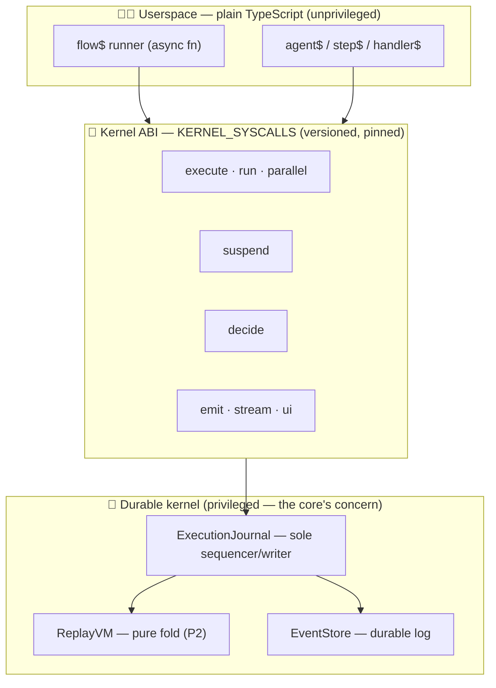
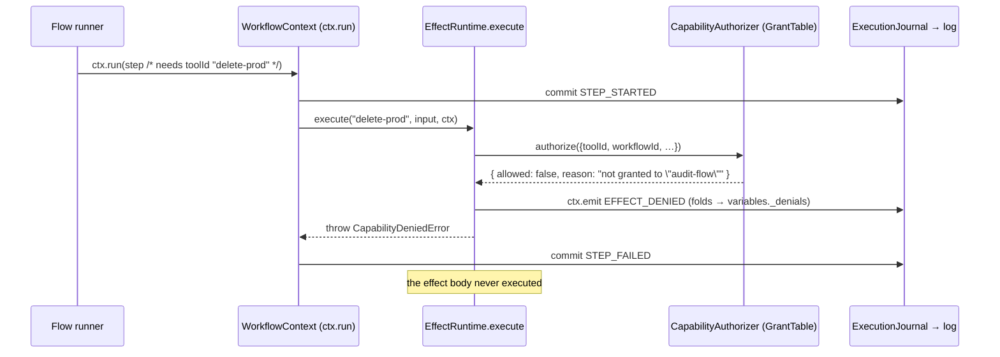
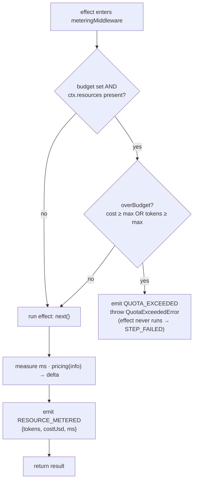
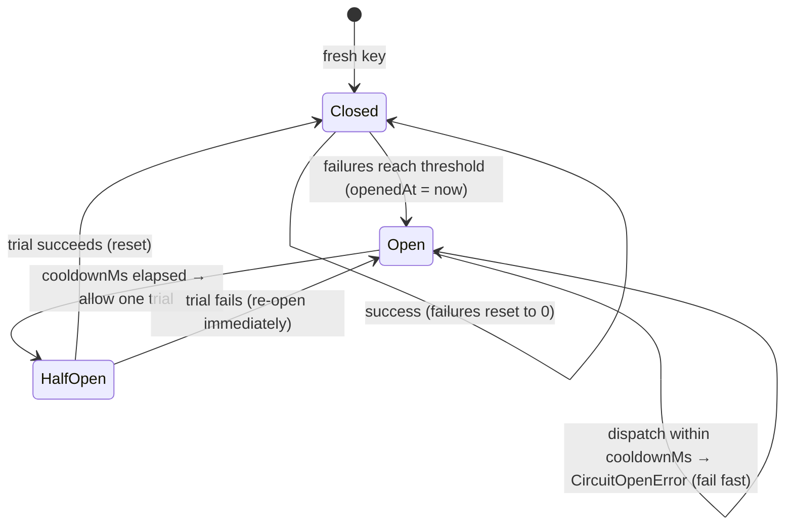
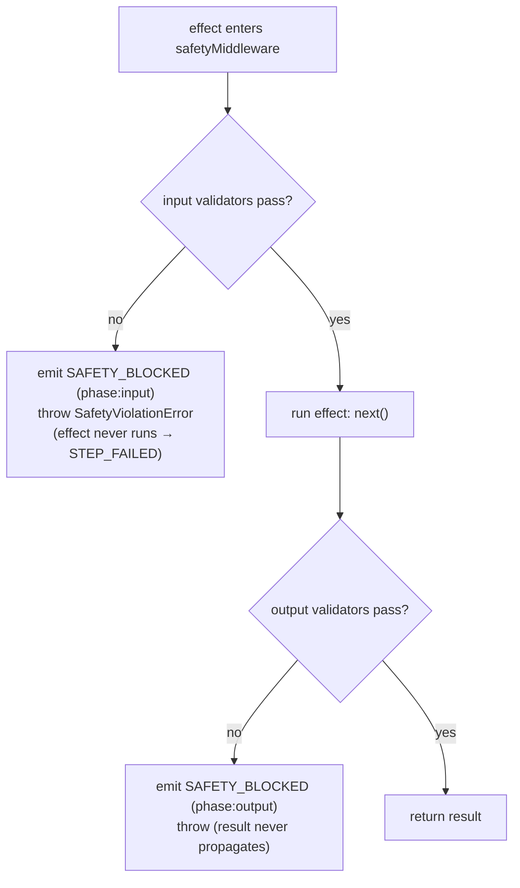

# Loom 2.0 — Kernel Hardening

> **Why "kernel" is not a metaphor**
>
> Loom 1.x was a *framework*: it gave you durability, replay, and suspension around plain TypeScript. Loom 2.0 goes further and earns the word **kernel** — the thing a platform is *built on*. A kernel is not defined by being "the core"; it is defined by the **enforcement rings** it provides: a stable syscall ABI, an authority boundary, resource accounting, fault supervision, and governed on-disk formats. This document walks the hardening seams (**K1–K6**) that make Loom an execution kernel rather than a library, reading the actual source for each. K1–K5 are the rings *ordinary* durable software needs; **K6** adds the one guarantee unique to running *autonomous intelligent* work — that a non-deterministic action or output is **safe**, not merely authorized (K2) and metered (K3).

---

## Table of contents

1. [Kernel-readiness — the framing](#1-kernel-readiness--the-framing)
2. [K1 — Kernel ABI (the syscall surface)](#k1--kernel-abi-the-syscall-surface)
3. [K2 — Capability protection ring](#k2--capability-protection-ring)
4. [K3 — Resource accounting & quotas](#k3--resource-accounting--quotas)
5. [K4 — Fault supervision](#k4--fault-supervision)
6. [K5 — Event-schema ABI governance](#k5--event-schema-abi-governance)
7. [K6 — Behavioral safety ring](#k6--behavioral-safety-ring)
8. [Tying it together](#8-tying-it-together)

---

## 1. Kernel-readiness — the framing

A real operating-system kernel is trusted to run untrusted, long-lived, resource-hungry work because it holds a small set of guarantees no application can bypass:

- a **stable ABI** — a narrow, versioned syscall surface userspace can depend on;
- an **authority boundary** — a ring where privileged operations are checked, not merely requested;
- **resource accounting** — the kernel meters the scarce resource and can refuse work that exceeds a quota;
- **fault supervision** — a supervisor that restarts, backs off, and isolates failing subsystems;
- **on-disk ABI governance** — durable formats that survive across versions, so old data still loads.

Loom 2.0 provides each of these for *intelligent, long-running software*. The mapping is deliberate — one seam per kernel responsibility. Each seam is **opt-in** and, when unwired, byte-identical to Loom 1.x behaviour: you never pay for a ring you did not turn on (this is [P10 — minimal kernel, advisory plane](../architecture.md#p10--minimal-kernel-intelligence-lives-in-an-advisory-plane-loom-20)).

### Kernel-readiness scorecard

| # | Kernel responsibility | Loom mechanism | Where it lives | Milestone |
|---|---|---|---|---|
| **K1** | Stable ABI / syscall surface | `KERNEL_ABI` + `KERNEL_SYSCALLS` table, semver'd, pinned by a conformance test | `@loom/workflow-runtime` — [`abi.ts`](../../packages/workflow-runtime/src/abi.ts) | ABI named & versioned |
| **K2** | Authority boundary (protection ring) | `CapabilityAuthorizer` enforced by `EffectRuntime` before every effect; denial is a durable fact | `@loom/effect-runtime` — [`authz.ts`](../../packages/effect-runtime/src/authz.ts), [`EffectRuntime.ts`](../../packages/effect-runtime/src/EffectRuntime.ts) | Least-privilege effects |
| **K3** | Resource accounting & quotas | `meteringMiddleware(pricing, budget?)` meters every effect (`RESOURCE_METERED`) and admission-controls over-budget work (`QUOTA_EXCEEDED`) | `@loom/middleware` — [`metering.ts`](../../packages/middleware/src/metering.ts) | Budgeted execution |
| **K4** | Fault supervision | `SupervisingDispatcher` — restart/backoff + per-key circuit breaker | `@loom/dispatcher` — [`SupervisingDispatcher.ts`](../../packages/dispatcher/src/SupervisingDispatcher.ts) | Named supervision seam |
| **K5** | On-disk ABI governance | `EVENT_SCHEMA_VERSION` + `knownEventTypes()`, pinned by a governance test; `@loom/deploy-sim` gates it at the flow level | `@loom/replay-vm` — [`eventHandlers.ts`](../../packages/replay-vm/src/eventHandlers.ts) | Governed event log |
| **K6** | Behavioral-safety ring | `safetyMiddleware(validators)` validates an effect's input/output; a block is a durable `SAFETY_BLOCKED` fact + `SafetyViolationError` (fails the step) | `@loom/middleware` — [`safety.ts`](../../packages/middleware/src/safety.ts) | Governed action/output safety |

Two properties of the durable core underwrite all five: **[P2 — deterministic, pure replay](../architecture.md#p2--replay-is-deterministic-and-pure)** (every ring's decision is reproducible because it is a function of logged facts) and **[P9 — non-determinism only when logged](../architecture.md#p9--non-determinism-is-allowed-but-only-when-logged-loom-20)** (a denial, a metered cost, or a quota trip is a durable event, so it replays exactly). The rings *enforce*; the log *remembers*.

---

## K1 — Kernel ABI (the syscall surface)

A framework becomes a kernel when userspace can depend on a **narrow, versioned boundary** that will not shift under it. In Loom the `ExecutionContext` (`ctx`) *is* that boundary: everything a flow, agent, or step can ask the durable core to do goes through it. K1 does one thing — it **names and versions** that surface so applications can build against it and CI can catch drift ([`abi.ts:1`](../../packages/workflow-runtime/src/abi.ts)).

### The syscall table

`KERNEL_ABI_VERSION` is a semver string (`"1.0.0"`), and `KERNEL_SYSCALLS` is the pinned table of calls the kernel exposes ([`abi.ts:14`](../../packages/workflow-runtime/src/abi.ts), [`abi.ts:29`](../../packages/workflow-runtime/src/abi.ts)):

| Syscall | Kind | Since | Summary |
|---|---|---|---|
| `execute` | call | 1.0.0 | run any task to durable completion (the generalized primitive) |
| `run` | call | 1.0.0 | run a step — the `"step"` task alias of `execute` |
| `decide` | call | 1.0.0 | record an advisory/optimizer choice durably; served on replay ([P9](../architecture.md#p9--non-determinism-is-allowed-but-only-when-logged-loom-20)) |
| `parallel` | call | 1.0.0 | run tasks concurrently, input-order-preserving |
| `suspend` | call | 1.0.0 | pause durably until an external signal, then resume from here |
| `emit` | call | 1.0.0 | append a durable domain event |
| `stream` | call | 1.0.0 | emit an incremental delta event |
| `ui` | accessor | 1.0.0 | drive durable, replayable UI surfaces (A2UI) |

Each entry records its `kind` (`"call"` for a method, `"accessor"` for a property object such as `ui`), the ABI version it was `since`, and a one-line `summary` ([`abi.ts:18`](../../packages/workflow-runtime/src/abi.ts)). `KERNEL_ABI` bundles the version and the table into one exported object ([`abi.ts:45`](../../packages/workflow-runtime/src/abi.ts)).

### The compatibility guarantee

The versioning rule is the same contract a syscall ABI makes ([`abi.ts:6`](../../packages/workflow-runtime/src/abi.ts)):

- **Adding a syscall → MINOR bump.** Existing userspace is untouched; new code opts into the new call.
- **Removing or renaming a syscall, or changing its meaning → MAJOR break.** This must be deliberate — it cannot happen by accident.

Everything *below* the syscall boundary (the event schema, the stores, the scheduler) is the kernel's own concern; everything *above* builds only against these eight calls.

### The conformance test that pins it

The guarantee is enforced by [`abi.test.ts`](../../packages/workflow-runtime/src/abi.test.ts), which does three things:

1. asserts `KERNEL_ABI_VERSION` is semver-shaped and that `KERNEL_ABI` re-exports the same table ([`abi.test.ts:58`](../../packages/workflow-runtime/src/abi.test.ts));
2. **starts a real flow, captures the live `ExecutionContext`, and checks every declared syscall is actually present with the right kind** — a `call` must be a function, an `accessor` must be defined ([`abi.test.ts:64`](../../packages/workflow-runtime/src/abi.test.ts)). The declared surface can never drift away from the real one;
3. pins the exact sorted syscall set, so removing or renaming one fails CI ([`abi.test.ts:76`](../../packages/workflow-runtime/src/abi.test.ts)).

### The userspace ↔ kernel boundary



Userspace never reaches past the ABI into the journal or the store; it makes syscalls. That single narrow surface is what lets a resume on a fresh machine, a remote worker, or a replay reconstruct identical behaviour — the boundary is fixed and inspectable.

---

## K2 — Capability protection ring

A hardware kernel enforces authority with an MMU: userspace *cannot* touch memory it was not granted. A library has no MMU — but Loom has one place through which **every side effect must pass**: `EffectRuntime.execute`. Because every tool call, LLM call, human wait, and agent-to-agent call is keyed by `toolId` and dispatched here, this is the one boundary a *library* can genuinely enforce ([`authz.ts:1`](../../packages/effect-runtime/src/authz.ts)). K2 turns that chokepoint into an **authority ring**.

### Data structures

The protection ring is deliberately small and **pure/synchronous**, so the check is deterministic and replay-safe — the same request always yields the same decision ([`authz.ts:23`](../../packages/effect-runtime/src/authz.ts)):

- **`CapabilityRequest`** — what is being attempted: `{ toolId, executionId, workflowId, stepId }` ([`authz.ts:11`](../../packages/effect-runtime/src/authz.ts)).
- **`CapabilityDecision`** — the verdict: `{ allowed: boolean, reason?: string }` ([`authz.ts:18`](../../packages/effect-runtime/src/authz.ts)).
- **`CapabilityAuthorizer`** — the ring interface: `authorize(req) => decision` ([`authz.ts:25`](../../packages/effect-runtime/src/authz.ts)). Pluggable — you can supply your own principal model, ACL, or policy engine.
- **`CapabilityDeniedError`** — thrown on denial, carrying the `toolId` and `reason` ([`authz.ts:29`](../../packages/effect-runtime/src/authz.ts)).
- **`GrantTable`** — the built-in **least-privilege** authorizer: a static `Record<principal, effectId[]>` where `"*"` grants all and anything not listed is denied ([`authz.ts:55`](../../packages/effect-runtime/src/authz.ts)). By default the *principal* is the `workflowId` — a flow is the unit of authority — but `GrantTableOptions.principal` lets you key on `executionId` or any field ([`authz.ts:40`](../../packages/effect-runtime/src/authz.ts), [`authz.ts:64`](../../packages/effect-runtime/src/authz.ts)).

The authorizer is passed to the runtime via `EffectRuntimeOptions.authorizer` ([`authz.ts:80`](../../packages/effect-runtime/src/authz.ts)).

Three kernel-grade properties fall out of this design:

- **Least-privilege by default.** `GrantTable` denies anything not explicitly granted — an unlisted principal has *no* authority ([`authz.ts:67`](../../packages/effect-runtime/src/authz.ts)).
- **Unforgeable grants.** An execution cannot grant itself a capability; grants live only in the authorizer, wired statically at boot ([P5](../architecture.md#p5--wiring-is-static-and-replay-safe)) and cannot be mutated at runtime ([`authz.ts:6`](../../packages/effect-runtime/src/authz.ts), [`authz.ts:49`](../../packages/effect-runtime/src/authz.ts)).
- **Pluggable principal.** The mapping from request to principal is a function you provide ([`authz.ts:46`](../../packages/effect-runtime/src/authz.ts)).

### The algorithm — authorize before run

`EffectRuntime.execute` runs the ring **first**, before it even looks up the effect in its registry, so that probing for an unregistered effect is denied too ([`EffectRuntime.ts:38`](../../packages/effect-runtime/src/EffectRuntime.ts)):

1. If an `authorizer` is configured, build a `CapabilityRequest` from the effect context and call `authorize` ([`EffectRuntime.ts:41`](../../packages/effect-runtime/src/EffectRuntime.ts)).
2. If **denied**: the effect **never runs**. The runtime emits an `EFFECT_DENIED` durable fact and throws `CapabilityDeniedError` ([`EffectRuntime.ts:48`](../../packages/effect-runtime/src/EffectRuntime.ts)). That thrown error propagates to the surrounding step, which fails via the normal `STEP_FAILED` path.
3. If **allowed**: the effect+middleware chain proceeds as usual ([`EffectRuntime.ts:55`](../../packages/effect-runtime/src/EffectRuntime.ts)).

The `EFFECT_DENIED` event folds into a reserved `variables._denials` audit list — a pure audit fact that does *not* itself change frame/execution status (the following `STEP_FAILED` owns that) ([`eventHandlers.ts:200`](../../packages/replay-vm/src/eventHandlers.ts)). So on replay, a denied run reconstructs its denial exactly: the ring's verdict is a logged fact, not a re-decision.



### Opt-in

Enforcement is deliberately **opt-in**. If no `authorizer` is wired, `execute` skips the ring entirely and behaves exactly as Loom 1.x did — the permissive default ([`EffectRuntime.ts:41`](../../packages/effect-runtime/src/EffectRuntime.ts), [`authz.ts:9`](../../packages/effect-runtime/src/authz.ts)). You turn the protection ring on only where you need least-privilege, and pay nothing where you do not.

---

## K3 — Resource accounting & quotas

A kernel meters the scarce resource and refuses work that would exceed a quota. For a general OS the scarce resource is CPU, memory, and file descriptors. For **intelligent software it is tokens, dollars, and latency** — not CPU cycles ([`metering.ts:3`](../../packages/middleware/src/metering.ts)). K3 provides both halves of a kernel's resource story: **accounting** (meter what every effect spends) and **admission control** (refuse the next effect once a budget is spent).

### Where the running total lives

Each effect's context carries a `resources` snapshot — the running totals for the owning execution *before* this effect ([`types.ts:36`](../../packages/effect-runtime/src/types.ts)):

```ts
interface ResourceSnapshot { tokens: number; costUsd: number; ms: number; count: number; exceeded?: boolean }
```

Critically, this snapshot is **not** ambient state — it is threaded in from `variables._resources`, which is itself the deterministic fold of `RESOURCE_METERED` events ([`types.ts:5`](../../packages/effect-runtime/src/types.ts)). The total an effect sees is therefore a pure function of the log. When accounting is not wired, `resources` is `undefined`, so effects that never meter pay nothing ([`types.ts:33`](../../packages/effect-runtime/src/types.ts)).

### `meteringMiddleware(pricing, budget?)`

The metering middleware is an ordinary effect middleware — the same `(ctx, input, next)` shape as retry — so it composes into the existing chain ([`metering.ts:70`](../../packages/middleware/src/metering.ts)). It does two jobs per effect:

**1. Admission control (before running).** If a `budget` is set and the pre-effect `ctx.resources` is already over it, the effect is *refused*: emit `QUOTA_EXCEEDED` and throw `QuotaExceededError` ([`metering.ts:74`](../../packages/middleware/src/metering.ts)). `overBudget` compares the running totals against `maxCostUsd`/`maxTokens` ([`metering.ts:52`](../../packages/middleware/src/metering.ts)).

**2. Metering (after running).** Otherwise it measures the effect's wall-time, computes a `ResourceDelta` from the `Pricing` function, and emits a `RESOURCE_METERED` fact with the tokens/cost/ms spent ([`metering.ts:82`](../../packages/middleware/src/metering.ts)).

The supporting types ([`metering.ts:13`](../../packages/middleware/src/metering.ts)):

- **`Pricing`** — `(info: MeterInfo) => ResourceDelta`: your cost model, e.g. `tokens × rate` for an LLM ([`metering.ts:28`](../../packages/middleware/src/metering.ts)).
- **`ResourceDelta`** — `{ tokens?, costUsd?, ms? }`: what one call spent ([`metering.ts:13`](../../packages/middleware/src/metering.ts)).
- **`Budget`** — `{ maxTokens?, maxCostUsd? }`: the per-execution quota ([`metering.ts:30`](../../packages/middleware/src/metering.ts)).
- **`QuotaExceededError`** — thrown on admission-control denial, carrying the `reason` ([`metering.ts:43`](../../packages/middleware/src/metering.ts)).
- **`llmUsageTokens(result)`** — a helper that reads `{ usage: { inputTokens, outputTokens } }` off an `LlmResponse`-shaped result, so a `Pricing` for LLM effects is a one-liner ([`metering.ts:63`](../../packages/middleware/src/metering.ts)).



### Replay-safety

Both accounting and enforcement are **replay-safe**, and this is the whole point of doing it on the log rather than in a counter:

- **Metered facts live in the log.** Every `RESOURCE_METERED` event folds the delta into the running `_resources` total (`tokens += …`, `costUsd += …`, `ms += …`, `count += 1`) ([`eventHandlers.ts:223`](../../packages/replay-vm/src/eventHandlers.ts)). The total is *derived*, never stored ambiently.
- **The total comes from a deterministic fold.** Because the pre-effect snapshot each middleware sees is `fold(events).variables._resources`, two replays of the same log meter and admission-control identically. Metering runs only when an effect *actually* executes — completed steps short-circuit before `EffectRuntime.execute`, so replayed runs never re-meter work already in the log ([`types.ts:64`](../../packages/effect-runtime/src/types.ts)).
- **Quota trips are logged too.** `QUOTA_EXCEEDED` folds `_resources.exceeded = true` — a pure audit fact; the following `STEP_FAILED` fails the step ([`eventHandlers.ts:247`](../../packages/replay-vm/src/eventHandlers.ts)).

The kernel does not "remember" your budget in memory; it *recomputes* it from the log every time, which is exactly why a resume on another machine enforces the same quota.

---

## K4 — Fault supervision

A kernel supervises its subsystems: it restarts a crashed driver, backs off, and isolates a component that keeps failing so it cannot take the system down. Loom's supervision seam is the **`SupervisingDispatcher`** in `@loom/dispatcher` ([`SupervisingDispatcher.ts:54`](../../packages/dispatcher/src/SupervisingDispatcher.ts)). It is a composite `ExecutionDispatcher` that wraps any child dispatcher (`LocalDispatcher`, `PlacementDispatcher`, the Cloud Run adapter) with two policies:

- **Restart / backoff** — a *throwing* dispatch is retried up to `maxRestarts` times with exponential backoff (`backoffMs × backoffFactor ** attempt`). A returned `"failed"` result is a normal outcome, not a restartable error ([`SupervisingDispatcher.ts:13`](../../packages/dispatcher/src/SupervisingDispatcher.ts), [`SupervisingDispatcher.ts:78`](../../packages/dispatcher/src/SupervisingDispatcher.ts)).
- **Per-key circuit breaker** — after `threshold` consecutive dispatch failures the circuit **opens** and further dispatches to that key fail fast with `CircuitOpenError` until a `cooldownMs` half-open trial, so a flaky model/tool/worker is not hammered ([`SupervisingDispatcher.ts:4`](../../packages/dispatcher/src/SupervisingDispatcher.ts), [`SupervisingDispatcher.ts:110`](../../packages/dispatcher/src/SupervisingDispatcher.ts)). The key defaults to `pkg.flowId` — a per-flow breaker.



This promotes the runtime's ad-hoc retry/redispatch into a *named* supervision seam, and it composes over the existing dispatchers unchanged. The circuit also surfaces through `health()`, which reports `circuits-open: <keys>` and marks the dispatcher unhealthy while any circuit is open ([`SupervisingDispatcher.ts:96`](../../packages/dispatcher/src/SupervisingDispatcher.ts)).

> **Full treatment:** supervision sits in the compute/scheduling layer alongside placement, workers, and the cooperative scheduler. See **[03 — Compute, Scheduling & Storage](03-compute-scheduling-storage.md)** for how `SupervisingDispatcher` fits the dispatcher SPI, how it interacts with `WorkerRuntime` redispatch, and the crash-recovery path. This section is the kernel-ring summary; the compute doc is the deep dive.

---

## K5 — Event-schema ABI governance

If K1 is the *in-memory* ABI (the syscall surface), **the event log is the kernel's *on-disk* ABI**. State is `fold(events)`, and stored logs must replay across deploys — a log written last month must fold correctly against this month's binary ([`eventHandlers.ts:303`](../../packages/replay-vm/src/eventHandlers.ts)). K5 names and versions **the set of event types the fold understands**, so that set cannot drift silently.

### `EVENT_SCHEMA_VERSION` and `knownEventTypes()`

`EVENT_SCHEMA_VERSION` is the semver of the on-disk schema (`"1.0.0"`), and `knownEventTypes()` returns the sorted list of every event type that has a fold handler ([`eventHandlers.ts:311`](../../packages/replay-vm/src/eventHandlers.ts)) — it is derived directly from the `handlers` map, so the *declared* schema can never diverge from what the fold *actually* handles.

The governance rule mirrors K1 ([`eventHandlers.ts:303`](../../packages/replay-vm/src/eventHandlers.ts)):

- **Adding an event type → additive (MINOR bump).** Old logs still fold; new logs use the new type.
- **Removing or repurposing one → MAJOR break.** It changes how *historical* logs fold, so it must be deliberate.

### The governance test pinning the ~19 event types

[`eventSchema.test.ts`](../../packages/replay-vm/src/eventSchema.test.ts) pins the exact set of 19 event types the fold understands and fails CI if `knownEventTypes()` differs ([`eventSchema.test.ts:33`](../../packages/replay-vm/src/eventSchema.test.ts)). The pinned set is the union of the durable core's events and the Loom 2.0/2.1 kernel-ring events:

| Category | Event types |
|---|---|
| Execution lifecycle | `EXECUTION_STARTED`, `EXECUTION_SUSPENDED`, `EXECUTION_RESUMED`, `EXECUTION_COMPLETED`, `EXECUTION_FAILED`, `EXECUTION_CANCELLED` |
| Step lifecycle | `STEP_STARTED`, `STEP_COMPLETED`, `STEP_FAILED`, `STEP_CANCELLED`, `STEP_RETRYING` |
| Parallelism | `PARALLEL_STARTED`, `PARALLEL_COMPLETED` |
| Advisory plane (P9) | `DECISION_RECORDED`, `OUTCOME_RECORDED` |
| **Kernel rings (K2/K3/K6)** | `EFFECT_DENIED` (K2), `RESOURCE_METERED` (K3), `QUOTA_EXCEEDED` (K3), `SAFETY_BLOCKED` (K6) |

The ring events — `EFFECT_DENIED`, `RESOURCE_METERED`, `QUOTA_EXCEEDED`, `SAFETY_BLOCKED` — are governed exactly like every other event: they have pinned fold handlers, so a stored log carrying a denial, a metered cost, or a safety block replays identically forever. That is what makes the enforcement in K2/K3/K6 durable rather than incidental. Each schema addition is additive (MINOR): `SAFETY_BLOCKED` shipped in 1.1.0, `OUTCOME_RECORDED` in 1.2.0.

### Two gates, two levels

- **Unit-level:** the governance test pins the *set* of types ([`eventSchema.test.ts`](../../packages/replay-vm/src/eventSchema.test.ts)).
- **Flow-level:** **`@loom/deploy-sim`** replays real historical logs against *new* flow definitions before promotion, catching a schema/flow change that would break stored executions in the field. It is the CI gate that proves the on-disk ABI still loads. See the [architecture overview](../architecture.md#d11--tooling-is-lenses-on-the-log-not-new-infrastructure).

> **Reference:** for the full event catalogue — every payload shape and its fold semantics — see **[10 — Event Schema Reference](10-event-schema-reference.md)**.

---

## K6 — Behavioral safety ring

K2 governs *who may act*; K3 governs *how much it costs*. Neither governs *whether the
action or its output is safe* — the guarantee an autonomous intelligent system most needs.
An OS kernel can trust userspace with the MMU because a fault is *contained*; a kernel that
runs LLM-driven work must likewise contain what that work *emits and does* — hallucinated
instructions, prompt-injection, PII, a schema-violating result, or simply behaviour that
must be halted now. K6 turns the same chokepoint K2/K3 use — the effect path — into a
**behavioral-safety ring**.

### `safetyMiddleware({ validators })`

The safety middleware is an ordinary effect middleware — the same `(ctx, input, next)` shape
as metering — so it composes into the existing chain ([`safety.ts`](../../packages/middleware/src/safety.ts)).
A `SafetyValidator` runs in one of two phases:

- **input** validators run *before* `next()` — an unsafe *action* is refused before it
  happens (admission control, exactly like K3);
- **output** validators run *after* `next()` against the `result` — an unsafe *result* is
  stopped from propagating.

On a failed verdict the middleware emits a durable **`SAFETY_BLOCKED`** fact and throws
`SafetyViolationError`, which fails the step via the normal `STEP_FAILED` path — identical to
a K3 quota trip. Built-in validators cover the common hazards: `schemaValidator(schema)`
(runtime-enforce an output schema that was declared-but-unchecked), `denyPatterns(regexes)`
(jailbreak/policy), `piiValidator()`, and `killSwitch(isTripped)` — a real emergency stop,
distinct from K4's *fault* breaker.



### Replay-safety & opt-in

`SAFETY_BLOCKED` is governed under K5: a pinned fold handler appends it to a reserved
`variables._safety` audit list (mirroring `EFFECT_DENIED`'s `_denials`) — a pure audit fact
that does not itself change status. So a blocked run reconstructs its safety verdict exactly
on replay; the validator is served from the log, never re-invoked (P9). And like every ring
it is **opt-in** — no `safetyMiddleware` ⇒ effects run byte-identically to before (P10). The
kernel provides the ring; the *policies* (which patterns, which schemas, when to trip the
kill-switch) live in the platform layer above it. See [ADR 0017](../adr/0017-k6-behavioral-safety-ring.md).

> **Scope:** K6 is the *behavioral/output* half of safety. Data-plane isolation — sandboxing
> untrusted tool code (WASM/process) and egress control — deepens K2 and is tracked separately.

---

## 8. Tying it together

Loom 2.0 earns the word *kernel* because it provides the enforcement rings a real kernel has, each mapped to the scarce realities of intelligent software rather than to CPU and memory:

- **K1** gives userspace a stable, versioned **syscall ABI** to build against.
- **K2** turns the one chokepoint every effect passes through into an **authority ring** with least-privilege, unforgeable grants.
- **K3** meters the actual scarce resource — **tokens, dollars, latency** — and admission-controls work that exceeds its budget.
- **K4** supervises faults with **restart/backoff and circuit breaking**, isolating flaky subsystems.
- **K5** governs the **on-disk ABI** so durable logs replay across deploys.
- **K6** validates the **safety of an action or output** — refusing an unsafe input before it runs and an unsafe result before it propagates, with a real kill-switch — the guarantee unique to running autonomous intelligent work.

None of these would be trustworthy without the durable core beneath them. **[P2 — deterministic, pure replay](../architecture.md#p2--replay-is-deterministic-and-pure)** is what makes each ring's verdict *reproducible*: a denial, a metered cost, a quota trip, and a safety block are all pure functions of logged facts, so a resume on a fresh machine reaches the identical decision. **[P9](../architecture.md#p9--non-determinism-is-allowed-but-only-when-logged-loom-20)** is what lets those verdicts be *durable*: they are events, folded like any other.

And every ring honours **[P10 — minimal kernel, advisory plane](../architecture.md#p10--minimal-kernel-intelligence-lives-in-an-advisory-plane-loom-20)**: each is opt-in, and each is byte-identical to Loom 1.x when unwired. No authorizer ⇒ permissive; no metering middleware ⇒ no accounting; no supervising dispatcher ⇒ plain dispatch; no safety middleware ⇒ no validation. You turn on exactly the rings your platform needs and pay for nothing else. That combination — a small, deterministic, boring core plus opt-in enforcement rings and an advisory plane for intelligence — is what makes Loom an **execution kernel a platform can be built on**, not merely a framework you call.

> **Start here:** for the Loom 2.0 story end-to-end, see the **[00 — Overview](00-overview.md)**. For the durable spine these rings sit on, see the **[Architecture reference](../architecture.md)**.

---

## 9. What's next — K7–K12, T1–T2 (proposed)

K1–K6 are implemented. The next hardening series is recorded as a requirements proposal —
**[Kernel-Hardening Requirements K7–K12, T1–T2](../requirements/2026-07-10-kernel-hardening-k7-k12-t1-t2.md)** —
critically evaluated against the codebase and the four non-negotiables (kernel genericity,
DX-first, performance ROI, real security) in the
**[evaluation & amendments](../requirements/2026-07-10-kernel-hardening-evaluation.md)**
(verdict: all eight **accepted with amendments**), with one proposal ADR per item carrying
its amendments:

| Item | Closes | ADR | Priority |
|---|---|---|---|
| **K7** | Data-plane isolation & egress control (the gap ADR 0017 deferred) | [0019](../adr/0019-k7-data-plane-isolation-and-egress-control.md) | P1 |
| **K8** | Cancellation, deadlines & bounded effects (a kill path for in-flight work) | [0020](../adr/0020-k8-cancellation-deadlines-bounded-effects.md) | P0 |
| **K9** | Effect delivery contract: idempotency keys, in-doubt parking, fencing tokens | [0021](../adr/0021-k9-effect-delivery-contract-idempotency-fencing.md) | P0 — **implemented** |
| **K10** | Log lifecycle: retention, crypto-shredding, redaction, compaction | [0022](../adr/0022-k10-log-lifecycle-retention-redaction-encryption.md) | P2 |
| **K11** | Flow-code versioning for in-flight executions (pin / migrate, never silent) | [0023](../adr/0023-k11-flow-code-versioning-in-flight-executions.md) | P1 |
| **K12** | Identity, tenancy & delegated authority | [0024](../adr/0024-k12-identity-tenancy-delegated-authority.md) | P2 |
| **T1** | Durable timers & scheduled executions (kernel service) | [0025](../adr/0025-t1-durable-timers-and-scheduled-executions.md) | P1 |
| **T2** | Wire-level kernel ABI (language neutrality) | [0026](../adr/0026-t2-wire-level-kernel-abi.md) | P3 |

Every item inherits **G1** (preserve P2/P9) and **G2** (additive, opt-in per P10 — unwired
means byte-identical), and its definition of done includes pinned conformance tests,
zero-overhead benchmarks when unwired, and fold-reference updates for each new durable fact:
`EGRESS_DENIED` (K7), `EFFECT_INDOUBT` (K9), `PAYLOAD_SHREDDED` (K10), `EXECUTION_MIGRATED`
(K11), `APPROVAL_GRANTED` (K12), `TIMER_FIRED` (T1). (This list is the
[corrected one](../requirements/2026-07-10-kernel-hardening-evaluation.md#corrected-new-facts-list-replaces-the-requirements-dod-list):
`EXECUTION_CANCELLED` is *not* new — it is already pinned in schema 1.2.0; K8 adds
producers, not the type.)
