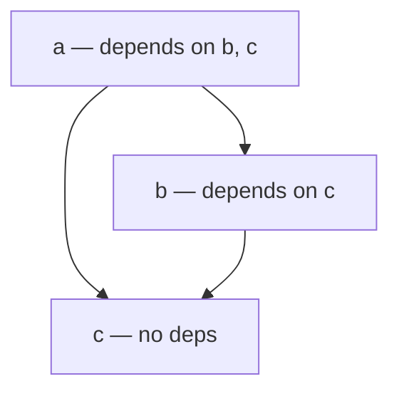
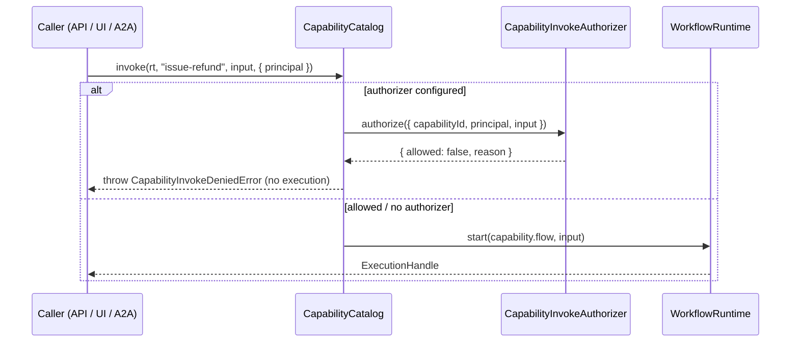
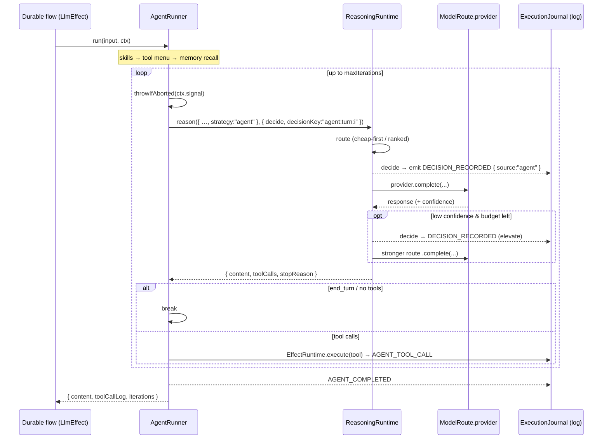
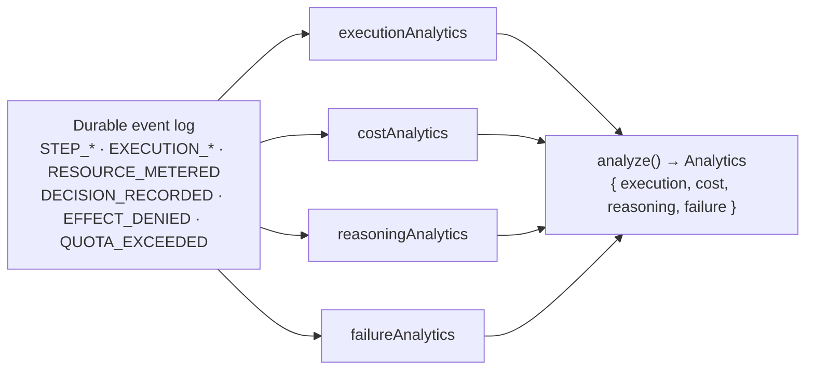
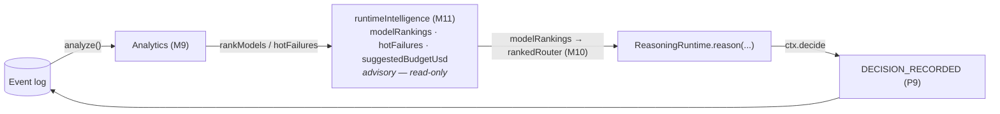
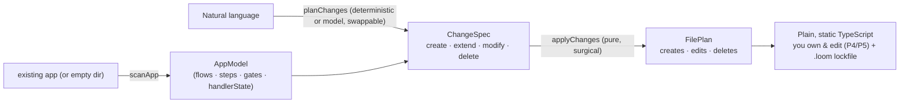

# Loom 2.0 — Capabilities, Agents, Intelligence & AI-native DX

> **Where this fits**
>
> The [durable core](../architecture.md) gives you an event log, deterministic replay, and an effect isolation boundary. This document covers the *intelligence plane* built on top of it: how a flow becomes an intent-addressable **capability** (M7), how an **agent** re-bases its model calls onto the reasoning runtime (M8), how the log is mined for **event intelligence, self-optimization, and runtime intelligence** (M9–M11), and how natural language is compiled into plain, static, owned TypeScript (**AI-native DX**, P11).
>
> Every module here obeys the same discipline: the kernel stays small and boring; everything "smart" is optional, composable, and may affect *outcomes* only through **logged decisions** (`DECISION_RECORDED`, P9) — never as a hidden input to the fold (P10).

**Related reading**

- [00 — Overview](00-overview.md) — the Loom 2.0 milestone map (M1–M11 + P-series).
- [01 — Execution & decision seams](01-execution-and-decision-seams.md) — `ctx.decide`, `DECISION_RECORDED`, the effect authority ring (K2), and metering (K3).
- [02 — Reasoning & memory](02-reasoning-and-memory.md) — `ReasoningRuntime`, the elevation ladder, confidence signals, and agent memory.
- [Architecture](../architecture.md) — the durable spine and the core principles (P1–P11) referenced throughout.

---

## Table of contents

1. [Capability deepening (M7, P5)](#1-capability-deepening-m7-p5)
2. [Agent runtime re-based (M8, P8)](#2-agent-runtime-re-based-m8-p8)
3. [Event intelligence, self-optimization, runtime intelligence (M9–M11)](#3-event-intelligence-self-optimization-runtime-intelligence-m9m11)
4. [AI-native DX — NL → codegen (P11)](#4-ai-native-dx--nl--codegen-p11)

---

## 1. Capability deepening (M7, P5)

A **capability** is Loom's unit of application composition: a runnable flow wrapped with intent-facing metadata so the *same* flow can be exposed uniformly as an API, a UI action, an A2A endpoint, or a workflow node — `"investigate-incident"`, `"scale-cluster"`, `"issue-refund"`. M7 deepens capabilities with two additive, replay-safe features: **versioned dependencies** (resolved topologically) and **invoke authorization** (who may *call* a capability).

### 1.1 `CapabilityDefinition` + version + dependencies

The definition ([`packages/capability/src/types.ts`](../../packages/capability/src/types.ts)) is a plain object — no base class (P6):

```ts
export interface CapabilityDefinition<TIn = unknown, TOut = unknown> {
  readonly _tag: "CapabilityDefinition";
  id: string;
  name: string;
  intent: string;                    // NL goal — matched by @loom/intent & @loom/planner
  tags: string[];
  inputSchema: ZodSchema<TIn>;
  flow: RegisteredFlow<TIn, TOut>;
  version?: string;                  // (M7) semver — advisory metadata for discovery/compat
  dependencies?: string[];           // (M7) capability ids this one needs; resolved by the catalog
}
```

You build one with `capability$(config)` ([`packages/capability/src/capability$.ts:19`](../../packages/capability/src/capability$.ts)), which wraps a `RegisteredFlow`. `CapabilityConfig` ([`capability$.ts:5`](../../packages/capability/src/capability$.ts)) mirrors the definition but makes `name`/`tags` optional and carries the new `version` and `dependencies` fields. Both fields are *additive*: a capability with neither behaves exactly as it did before M7 (P5 — wiring stays static; these are declarations, not runtime discovery).

- `version` is **advisory** — it names the semver of the capability for discovery and compatibility checks; it does not gate anything at runtime.
- `dependencies` names the ids of other capabilities this one relies on. It is the input to the catalog's resolver (§1.2).

### 1.2 `CapabilityCatalog.resolve(id)` — transitive topological resolution

The `CapabilityCatalog` ([`packages/capability/src/CapabilityCatalog.ts`](../../packages/capability/src/CapabilityCatalog.ts)) is the registry: capabilities can be listed, keyword-searched (a deterministic offline fallback for intent routing when no LLM is supplied — see `find` at [`CapabilityCatalog.ts`](../../packages/capability/src/CapabilityCatalog.ts)), registered into a `WorkflowRuntime`, and invoked by id.

`resolve(id)` ([`CapabilityCatalog.ts`](../../packages/capability/src/CapabilityCatalog.ts)) returns a capability's **transitive dependencies in dependency-first (topological) order**, with the capability itself last — the exact order you would deploy or warm them in. It is a depth-first post-order traversal with two safety nets:

- **Missing-dependency detection.** If a referenced id is not registered, it throws `Missing capability dependency: "<id>" (needed by "<parent>")` — the error names the parent so you can find the dangling edge.
- **Cycle detection.** A `stack` set tracks the *current* recursion path; re-entering an id already on the stack throws `Capability dependency cycle: a -> b -> a`. A separate `done` set memoizes fully-resolved nodes so a diamond (a shared dependency reached by two paths) is visited once, not treated as a cycle.

**The algorithm** (paraphrasing [`CapabilityCatalog.ts`](../../packages/capability/src/CapabilityCatalog.ts)):

```text
resolve(id):
  order = []            # result, dependency-first
  done  = {}            # fully-resolved ids (memo — collapses diamonds)
  stack = {}            # ids on the current DFS path (cycle guard)

  visit(cid, path):
    if cid in done:  return                       # already emitted
    if cid in stack: throw "cycle: path -> cid"    # back-edge
    cap = capabilities[cid]  or  throw "missing: cid (needed by path.last)"
    stack.add(cid)
    for dep in cap.dependencies: visit(dep, path + [cid])   # children first
    stack.remove(cid)
    done.add(cid)
    order.push(cap)        # post-order → dependencies precede dependents

  visit(id, [])
  return order
```

Because children are pushed *before* the current node (post-order), the returned array is already in dependency-first order — no separate topological sort pass is needed.

**Worked example** — `a` depends on `[b, c]`, and `b` depends on `[c]`:



`resolve("a")` visits `a → b → c` (emit `c`), unwinds to emit `b`, then revisits `c` from `a` (short-circuited by `done`), and finally emits `a`:

```text
resolve("a") ⇒ [ c, b, a ]
```

`c` (the shared leaf) appears exactly once and first; `a` (the requested root) is last. Deploy/initialize in that order and every dependency is ready before its dependent.

### 1.3 Invoke authorization — `CapabilityInvokeAuthorizer`

M7 adds a second, **distinct** protection ring. It is important not to conflate it with the K2 *effect* authority ring:

| Ring | Governs | Boundary | Fact on denial |
|---|---|---|---|
| **K2 effect authorizer** (`@loom/effect-runtime`) | which *effects* (tools/LLM/human/A2A) a running flow may invoke | inside the `EffectRuntime`, per `toolId` | `EFFECT_DENIED` (logged, P9) → `CapabilityDeniedError` |
| **M7 invoke authorizer** (`@loom/capability`) | who may **invoke a capability** (start an intent-addressable flow at all) | at the catalog's `invoke` entry point | throws `CapabilityInvokeDeniedError` (no execution started) |

The K2 ring decides *what a flow that is already running is allowed to do*. The M7 ring decides *whether that flow is allowed to start in the first place* — front-door admission versus in-house permissions.

The types ([`packages/capability/src/types.ts`](../../packages/capability/src/types.ts)):

```ts
export interface CapabilityInvokeRequest  { capabilityId: string; principal?: string; input?: unknown; }
export interface CapabilityInvokeDecision { allowed: boolean; reason?: string; }
export interface CapabilityInvokeAuthorizer { authorize(req: CapabilityInvokeRequest): CapabilityInvokeDecision; }

export class CapabilityInvokeDeniedError extends Error { /* carries capabilityId + reason */ }
```

Wire it through `CapabilityCatalogOptions.authorizer` ([`CapabilityCatalog.ts`](../../packages/capability/src/CapabilityCatalog.ts)). `invoke(runtime, id, input, { principal })` ([`CapabilityCatalog.ts`](../../packages/capability/src/CapabilityCatalog.ts)) consults the authorizer *before* starting the flow: a denied decision throws `CapabilityInvokeDeniedError(id, reason)` and **no execution is created** (nothing is appended to the log — there is nothing to run yet). Like K2, the ring is **opt-in**: omit the authorizer and every invoke is allowed (unchanged permissive default, P5-compatible).



---

## 2. Agent runtime re-based (M8, P8)

`@loom/agent` is a ReAct-style, tool-using loop that runs *inside* a durable flow. M8's headline change: the agent's model call is **re-based onto the `ReasoningRuntime`** so routing and elevation are decided (and logged) by the reasoning plane, while the agent stays thin. The bare-provider path is preserved byte-for-byte.

> **Since ADR 0087 there are two ways to run the loop, and this chapter describes the first.**
> `agentStep$` wraps the whole loop in ONE `LlmEffect`, so replay serves the whole thing from a
> single frame — cheap, and everything below applies to it. `agentLoop$` instead runs from a
> **runner body**, one durable frame per turn: a crash costs one turn rather than all of them, the
> model call resolves through the `EffectRuntime` (so K2, metering and K9 in-doubt apply to it), and
> the loop can `suspend` mid-flight for human approval. See
> [ADR 0087](../adr/0087-durable-agent-loop.md) and the
> [user guide](../user-guide.md#running-the-loop-agentstep-or-agentloop) for the trade-off.

### 2.1 `AgentConfig`

From [`packages/agent/src/AgentRunner.ts`](../../packages/agent/src/AgentRunner.ts):

```ts
export interface AgentConfig {
  definition: AgentDefinition;
  provider?: LlmProvider;        // ── supply a bare provider ──
  reasoning?: ReasoningRuntime;  // ── OR (preferred) a reasoning runtime (M8) ──
  effectRuntime: EffectRuntime;
  maxIterations?: number;        // default 10
  systemPrompt?: string;
  memory?: MemoryRuntime;        // Agent Runtime memory, scoped by input.memoryScope
  parallelTools?: boolean | number;  // opt-in parallel tool exec within one turn
  skills?: SkillRegistry;        // lazy-loaded, per-turn skill selection
  skillSelector?: SkillSelector;
}
```

The constructor ([`AgentRunner.ts`](../../packages/agent/src/AgentRunner.ts)) enforces that **exactly one model access is supplied** — `provider` *or* `reasoning` — throwing `AgentRunner requires a "provider" or a "reasoning" runtime` if neither is given.

### 2.2 The ReAct loop

A `run(input, ctx)` turn ([`AgentRunner.ts`](../../packages/agent/src/AgentRunner.ts)) proceeds in these stages:

1. **Skill selection.** If a `SkillRegistry` is supplied, a `SkillSelector` (deterministic by default → replay-safe) picks the relevant skills, the choice is recorded via `ctx.emit("SKILLS_SELECTED", …)` ([`AgentRunner.ts`](../../packages/agent/src/AgentRunner.ts)), and **only** the selected skills' instruction bodies are lazy-loaded and their tools pulled in.
2. **Tool menu.** The model's tool menu = the agent's own tools plus any tools the selected skills bring, de-duplicated by id with the agent's own tools winning ([`AgentRunner.ts`](../../packages/agent/src/AgentRunner.ts)).
3. **Memory recall.** If the agent's `definition.memoryId` is set and a `MemoryRuntime` is provided, prior turns for `memoryScope` (default: `ctx.executionId`) are read back into the message list ([`AgentRunner.ts`](../../packages/agent/src/AgentRunner.ts)).
4. **LLM loop.** Up to `maxIterations`, with an abort checkpoint (`throwIfAborted(ctx.signal)`) before each expensive round-trip ([`AgentRunner.ts`](../../packages/agent/src/AgentRunner.ts)). Each iteration calls `complete(...)` (§2.3). If the model returns `end_turn` or no tool calls, the loop breaks.
5. **Tool execution.** Requested tool calls run through the `EffectRuntime` (so they are logged & isolated). Sequential by default; `parallelTools` opts into concurrent execution capped by `parallelLimit`, which **preserves the model's tool-call order** in results — so event emission and replay stay deterministic regardless of completion order ([`AgentRunner.ts`](../../packages/agent/src/AgentRunner.ts)). Each result is recorded, emitted as `AGENT_TOOL_CALL`, and fed back into the message list *in tool-call order* ([`AgentRunner.ts`](../../packages/agent/src/AgentRunner.ts)).
6. **Memory append.** After the loop, this turn's prompt and answer are appended to memory ([`AgentRunner.ts`](../../packages/agent/src/AgentRunner.ts)), and `AGENT_COMPLETED` is emitted.

### 2.3 Re-basing the model call — the `complete()` helper

The whole M8 change is isolated in one private helper, `complete()` ([`AgentRunner.ts`](../../packages/agent/src/AgentRunner.ts)):

- **With `reasoning` (preferred).** It builds a `decide(id, decider)` closure that runs the decider and emits `ctx.emit("DECISION_RECORDED", { decisionId: id, choice, source: "agent" })` ([`AgentRunner.ts`](../../packages/agent/src/AgentRunner.ts)), then calls `reasoning.reason({ ...request, strategy: "agent" }, { decide, decisionKey: \`agent:turn:${iteration}\` })`. The reasoning runtime therefore does the routing/elevation heavy-lifting; each route/elevation becomes a durable `DECISION_RECORDED` fact **tagged `source:"agent"`** (distinguishing agent-driven routes from flow-level ones in analytics — see §3). The `decisionKey` namespaces decisions per turn so multiple iterations don't collide.
- **With only a `provider`.** It calls `provider.complete(request)` directly ([`AgentRunner.ts`](../../packages/agent/src/AgentRunner.ts)) — the original path, unchanged.

No short-circuit is needed inside `complete()`: on replay the *entire* agent step (an `LlmEffect`) is served from the log, so the recorded decisions and the final content come back verbatim (P9 keeps replay a pure fold — P2 is untouched). This is the P8 "isomorphic core, pluggable edges" story applied to model access: the agent depends only on an interface-shaped seam, and you plug in either a bare provider or a full reasoning runtime.



---

## 3. Event intelligence, self-optimization, runtime intelligence (M9–M11)

M1–M8 *enriched the log*: metering wrote `RESOURCE_METERED` (tokens/cost/ms), the decision seam wrote `DECISION_RECORDED` (routes/elevations), and the authority/quota rings wrote `EFFECT_DENIED` / `QUOTA_EXCEEDED`. M9–M11 are the payoff — pure, read-only *lenses on the log* ([D11 in the architecture](../architecture.md#d11--tooling-is-lenses-on-the-log-not-new-infrastructure)) that turn that enriched history into analytics, optimizers, and a single advisory report. **None of them writes; none affects the fold.**

### 3.1 M9 — `@loom/analytics`: read-only analyzers

Four pure functions each fold an `EventEnvelope[]` into a typed summary; `analyze` runs all four ([`packages/analytics/src/analyze.ts`](../../packages/analytics/src/analyze.ts)):

```ts
export interface ExecutionAnalytics {           // mines STEP_* / EXECUTION_* events
  steps; completed; failed; cancelledSteps;
  suspended: boolean; resumes: number;
  status?: "completed" | "failed" | "cancelled";
}
export interface CostAnalytics {                // mines RESOURCE_METERED + QUOTA_EXCEEDED
  tokens; costUsd; ms; meteredCalls; quotaExceeded: boolean;
}
export interface ReasoningAnalytics {           // mines DECISION_RECORDED
  decisions;
  routes: Record<string, number>;   // modelId (choice) → times chosen
  elevations;                       // decisions whose id includes "elevate"
  bySource: Record<string, number>; // "reasoning" | "agent" → count
}
export interface FailureAnalytics {             // mines STEP_FAILED / EFFECT_DENIED / QUOTA_EXCEEDED
  failures; denials; quotaExceeded;
  failedSteps: string[]; deniedTools: string[];
}
export interface Analytics {
  execution: ExecutionAnalytics; cost: CostAnalytics;
  reasoning: ReasoningAnalytics; failure: FailureAnalytics;
}
```

What each mines:

- **`executionAnalytics`** ([`analyze.ts`](../../packages/analytics/src/analyze.ts)) — counts `STEP_STARTED/COMPLETED/FAILED/CANCELLED`, notes suspension and resumes, records terminal status.
- **`costAnalytics`** ([`analyze.ts`](../../packages/analytics/src/analyze.ts)) — sums `tokens`/`costUsd`/`ms` from each `RESOURCE_METERED` fact (the K3 metering middleware) and flips `quotaExceeded` on `QUOTA_EXCEEDED`.
- **`reasoningAnalytics`** ([`analyze.ts`](../../packages/analytics/src/analyze.ts)) — over `DECISION_RECORDED`: tallies each string `choice` into `routes`, counts decisions whose `decisionId` contains `"elevate"`, and buckets by `source` (so agent-driven vs flow-driven routes are separable — see §2.3).
- **`failureAnalytics`** ([`analyze.ts`](../../packages/analytics/src/analyze.ts)) — collects `failedSteps` (from `STEP_FAILED`), `deniedTools` (from `EFFECT_DENIED`), and a `quotaExceeded` count.

Everything the public API exposes is re-exported from [`packages/analytics/src/index.ts`](../../packages/analytics/src/index.ts).



### 3.2 M10 — self-optimization: `rankModels`, `hotFailures`, `rankedRouter`

M10 turns the M9 lenses into *optimizers* ([`packages/analytics/src/intelligence.ts`](../../packages/analytics/src/intelligence.ts)):

- **`rankModels(events)`** ([`intelligence.ts`](../../packages/analytics/src/intelligence.ts)) — returns `reasoningAnalytics(events).routes`, i.e. each model id → how often it was the chosen route. This is a proxy for "which models actually got used and (implicitly) trusted."
- **`hotFailures(events, limit = 5)`** ([`intelligence.ts`](../../packages/analytics/src/intelligence.ts)) — the "what's flaky" lens: most-failing step ids, most-frequent first.

The learned router lives in `@loom/reasoning`. **`rankedRouter(rankings)`** ([`packages/reasoning/src/router.ts`](../../packages/reasoning/src/router.ts)) is a `Router` that, given a ranking (typically from `rankModels`), **prefers the highest-ranked route that exists**, falling back to cheap-first `tagRouter` for unranked requests:

```ts
export function rankedRouter(rankings: Record<string, number>): Router {
  return {
    select(req, routes) {
      const ranked = routes
        .filter((r) => rankings[r.id] !== undefined)
        .sort((a, b) => (rankings[b.id] ?? 0) - (rankings[a.id] ?? 0));
      return ranked[0] ?? tagRouter.select(req, routes);
    },
  };
}
```

Crucially, `rankedRouter` is used *inside* `ReasoningRuntime` where its `select(...)` is wrapped by `ctx.decide` (the route is emitted as `DECISION_RECORDED`, [`ReasoningRuntime.ts`](../../packages/reasoning/src/ReasoningRuntime.ts)). So the "learned" preference is **auditable and override-able, never silently autonomous** (P10): you can see exactly which model it picked and why, replay serves the same choice, and a human or a `fixedRouter` can override it. Optimization changes *future outcomes*; it never rewrites the past.

#### The learning seam — closing the loop (M12)

`rankModels` ranks by *how often* a model was chosen — a proxy for trust, but blind to whether choosing it actually *worked*. The **learning seam** ([ADR 0018](../adr/0018-learning-seam-outcome-recorded.md)) adds the missing half. `recordOutcome(sink, { key, success?, score? })` ([`packages/analytics/src/outcomes.ts`](../../packages/analytics/src/outcomes.ts)) emits a durable **`OUTCOME_RECORDED`** fact — the symmetric counterpart to `DECISION_RECORDED` ("what was chosen" ↔ "how it turned out"). **`rankFromOutcomes(events)`** then mines per-key mean success/score into a ranking you feed straight into the same `rankedRouter`:

```ts
const router = rankedRouter(rankFromOutcomes(log)); // route toward what actually worked
```

This closes the P9 loop operationally: outcomes feed back into routing, so the system improves run-to-run — yet every future route is still a logged `DECISION_RECORDED`, so replay stays deterministic and the improvement is auditable. It composes with the existing router (no new dependency), and `outcomeRankings` is surfaced alongside `modelRankings` in `runtimeIntelligence`. The `{ key, success?, score? }` shape generalizes past model routing to capability, tool, and planner-step selection.

### 3.3 M11 — `runtimeIntelligence`: one advisory report

`runtimeIntelligence(events, options?)` ([`intelligence.ts`](../../packages/analytics/src/intelligence.ts)) composes M9 analytics + M10 optimizers into a single **advisory** `RuntimeIntelligenceReport`:

```ts
export interface RuntimeRecommendations {
  modelRankings: Record<string, number>;    // = analytics.reasoning.routes (frequency chosen)
  outcomeRankings: Record<string, number>;  // = rankFromOutcomes(events) (how well it worked)
  hotFailures: string[];
  suggestedBudgetUsd?: number;               // round(observed cost × headroom), only if metered
}
export interface RuntimeIntelligenceReport {
  analytics: Analytics;
  recommendations: RuntimeRecommendations;
}
```

`options.budgetHeadroom` (default `1.5`) sets the margin over observed spend; `options.failureLimit` (default `5`) caps `hotFailures`. `suggestedBudgetUsd` is only present when something was actually metered ([`intelligence.ts`](../../packages/analytics/src/intelligence.ts)).

The emphasis, restated because it is the whole point: this report is **read-only and never mutates the fold** — it is the advisory plane (P10). To *act* on it, you feed `recommendations.modelRankings` into `rankedRouter` and pass `ctx.decide`; only then does anything change, and that change is a logged decision (P9). The loop is a full circle over the same log:



Analyze → rank → apply (via `rankedRouter` + `ctx.decide`) → log → analyze again. Outcomes improve run-to-run; replay stays a pure fold; nothing is ever a hidden input.

---

## 4. AI-native DX — NL → codegen (P11)

`@loom/appgen` is Loom's answer to "AI-native developer experience" — and it is deliberately *not* a runtime that interprets natural language. It is **brownfield-aware**: it scans the app that already exists and applies a *delta*. Four stages, with NL understanding isolated to exactly one and everything else deterministic and offline (see [ADR 0042](../adr/0042-ai-native-brownfield-appgen.md)):

**scan → plan → apply → validate.** The output is ordinary Loom code, statically wired (P4/P5), with `TODO` handlers to fill in — *code you own*, not a black box you call.

### 4.1 `scanApp(dir) → AppModel` (deterministic)

`scanApp` walks the folder convention and parses each `app/flows/<id>/flow.ts` with the TypeScript AST into a compact summary — flow ids, step ids, approval/UI gates, and each step's `handlerState` (`stub | edited | external`). It never carries raw file contents; a net-new directory yields an empty model. This is where brownfield "intelligence" comes from — cheap, deterministic analysis, not a model reading the repo.

### 4.2 `planChanges(intent, appModel) → ChangeSpec` (the one NL stage)

The plan stage is the *only* component that sees raw NL, and it emits a structured `ChangeSpec` — an `AppSpec` extended with an operation per capability and step (`create | extend | modify | delete`), plus `addApproval`/`addUi`/`wireGrants`. `planChangesDeterministic` wraps the directive grammar parser and diffs the result against the `AppModel`; a model-backed planner ([`@loom/appgen-model`](../../tools/appgen-model), §4.5) emits the *same* `ChangeSpec`. Codegen never sees raw NL either way.

The base `AppSpec`/`ChangeSpec` types ([`tools/appgen/src/types.ts`](../../tools/appgen/src/types.ts), [`changeSpec.ts`](../../tools/appgen/src/changeSpec.ts)):

```ts
export interface CapabilitySpec {
  id: string; name: string; intent: string;
  steps: string[];                      // step ids in order (defaults to a single "run")
  reasoning?: { baseModel?: string; elevateTo?: string[] };
  approval?: boolean;                   // pause for a human — a durable suspend gate
  ui?: boolean;                         // emit a UI surface update
}
// ChangeSpec: the same, but a DELTA against an existing app —
export type Op = "create" | "extend" | "modify" | "delete";
export interface CapabilityChange extends /* id,name,intent */ {
  op: Op; steps: { id: string; op: Op }[];
  addApproval?: boolean; addUi?: boolean; wireGrants?: string[];
}
```

The deterministic parser ([`parseIntent.ts`](../../tools/appgen/src/parseIntent.ts) + [`changeSpec.ts`](../../tools/appgen/src/changeSpec.ts)) is a small, documented, case-insensitive **directive grammar** — a pure function of its input, no model/clock/randomness (the P2 discipline the core lives by):

| Sentence | Effect |
|---|---|
| `create a <name>` | a capability (existing flow → `extend`, else `create`) |
| `(add) step <name>` | a step (existing → `modify`, else `create`) |
| `delete <name>` / `delete step <s> from <flow>` | a `delete` op |
| `grant <tool>[, <tool>] to <cap>` | `wireGrants` → a `GrantTable` authorizer |
| `use <model> first` / `elevate to <model>` | reasoning ladder |
| `pause for approval` / `generate ui` | durable suspend gate / UI surface |
| `deploy on <target>` | app-level `compute.target` |

Natural, compound phrasing ("add a summarize step to the planner and pause for approval") is the *model* planner's job, not the directive grammar's.

### 4.3 `applyChanges(changeSpec, appModel) → FilePlan` (deterministic)

Creates come from the same folder-convention templates as `create-loom-app` / `loom new` (reusing `@loom/scaffold`): `app/flows/<id>/flow.ts` (a `RegisteredFlow` with `step$`/`handler$`/`flow$` and `TODO` handlers), and a regenerated `app/loom.gen.ts`. Edits to existing flows are **surgical, formatting-preserving splices** via a self-contained `FlowEditor` (a TS-AST reader + an offset splice buffer): insert a `step$` const, register it in `steps: [...]`, wire a `ctx.run(...)` call into the runner, add an approval/UI gate, or wire grants into `app/config.ts`. Deletes remove generated flow files/steps.

The **safety gate**: a handler body is overwritten only if it still hashes to the generated `TODO` stub. Anything a human has touched is insert-only, and a `delete` refuses to remove a flow/step carrying hand-written code. Untouched formatting and comments are preserved byte-for-byte, which keeps the `--dry-run` diff honest.

### 4.4 `validate` + the plan → diff → confirm loop

`--dry-run` renders the `FilePlan` as a real unified diff and writes nothing; on a TTY, `appgen` shows the plan and asks before applying (`--yes` skips). `--check` typechecks the result in-process (`tsc`, not `loom check`, which needs a post-build manifest fresh source lacks). Every apply records the accepted `ChangeSpec` to `.loom/appgen/<timestamp>.spec.json`; `--from-spec` replays it byte-for-byte with **no model** — the appgen equivalent of a golden log.



### 4.5 Optional local model (`@loom/appgen-model`)

The plan stage can be driven by a small **on-device Gemma model** (`loom appgen --model <gguf>`): output is constrained to the `ChangeSpec` JSON schema (grammar-constrained decoding), planning runs through [`@loom/reasoning`](../../packages/reasoning)'s cheap-first elevation ladder with a *validator* confidence signal (logging elevations, P9), and a **self-repair loop** re-prompts the model with the exact semantic issues when a plan references a flow/step that doesn't exist. It is entirely optional and offline — if the model is missing, too weak, or produces an invalid plan, `appgen` falls back to the deterministic parser. You always get a valid `ChangeSpec`; that is the AI-native DX thesis — NL gets you a *starting point of real, inspectable code you own*, never a runtime that re-interprets English.

---

### See also

- [00 — Overview](00-overview.md) · [01 — Execution & decision seams](01-execution-and-decision-seams.md) · [02 — Reasoning & memory](02-reasoning-and-memory.md)
- [Architecture](../architecture.md) — P1–P11, the durable spine, and the effect authority ring (K2).
- [ADR 0016 — Loom 2.0 execution runtime & decision seam](../adr/0016-loom-2.0-execution-runtime-and-decision-seam.md) — P9/P10 in full.
