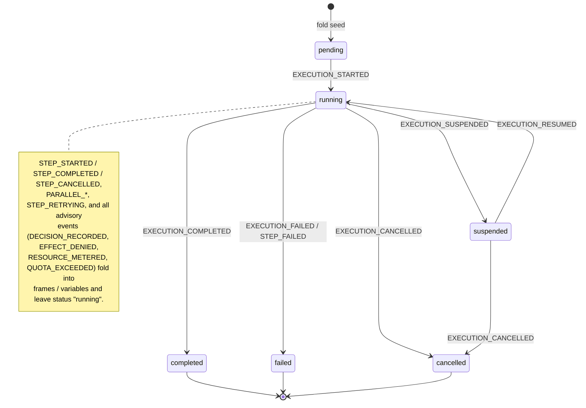

# Loom 2.0 — Event-Schema ABI Reference (K5)

> See **[docs/loom-2.0/00-overview.md](00-overview.md)** for the milestone map, and
> **[01-execution-and-decision-seams.md](01-execution-and-decision-seams.md)** for the
> Execution seam, Decision seam, and the kernel ABI (K1) that write these events.

> **What this document is**
>
> The event log is the kernel's **on-disk ABI**. State is `fold(events)` — nothing else defines
> it — and stored logs must replay across deploys. This is the complete reference for every event
> type the fold understands: its payload shape (exactly as the handler casts it), the state fields
> it folds into, and the milestone that introduced it. The single source of truth is the handler
> table in `packages/replay-vm/src/eventHandlers.ts`; each event below cites its handler line.

---

## Table of contents

1. [The fold contract](#1-the-fold-contract)
2. [Event catalogue](#2-event-catalogue)
   - [Execution-lifecycle events](#21-execution-lifecycle-events)
   - [Task (step) lifecycle events](#22-task-step-lifecycle-events)
   - [Parallel events](#23-parallel-events)
   - [Suspend / resume events](#24-suspend--resume-events)
   - [Loom 2.0 advisory events](#25-loom-20-advisory-events)
3. [Execution status transitions](#3-execution-status-transitions)
4. [An example event-log timeline](#4-an-example-event-log-timeline)
5. [Schema version & governance (K5)](#5-schema-version--governance-k5)

---

## 1. The fold contract

`foldEvents(events, initial?)` is a pure left-fold (`packages/replay-vm/src/foldEvents.ts`). It
seeds a default state and applies each event's handler in `sequence` order:

```ts
// packages/replay-vm/src/foldEvents.ts
for (const event of events) {
  const handler = getHandler(event.eventType);
  if (handler) state = handler(state, event);
  state.sequence = event.sequence;
}
```

Two properties fall out of this loop and govern everything below:

- **Unknown event types are inert.** If `getHandler(eventType)` returns `undefined`, the event is
  skipped — but `state.sequence` is *still* advanced to `event.sequence`. So an unrecognized
  event never breaks the fold; it just doesn't fold into state. (This is what makes forward
  compatibility possible.)
- **Every handler is `(state, event) => state`** and never mutates in place — it returns a new
  state via copy-on-write (untouched frames are shared by reference; see `withFrame` at
  `packages/replay-vm/src/eventHandlers.ts:10`). Every handler also sets `updatedAt = event.timestamp`.

The default seed (`packages/replay-vm/src/foldEvents.ts:4`):

```ts
{ status: "pending", frames: {}, variables: {}, sequence: -1, startedAt: 0, updatedAt: 0 }
```

Loom 2.0's advisory events fold into **reserved `variables` keys** rather than into `frames` or
`status`:

| Reserved key | Written by | Shape |
|---|---|---|
| `variables._input` | `EXECUTION_STARTED` | the flow input |
| `variables._output` | `EXECUTION_COMPLETED` | the flow output |
| `variables._error` | `EXECUTION_FAILED` | error string |
| `variables._cancelReason` | `EXECUTION_CANCELLED` | cancel reason |
| `variables._resumePayload` | `EXECUTION_RESUMED` | resume payload (consumed by `ctx.suspend` passthrough) |
| `variables._decisions` | `DECISION_RECORDED` | `Record<decisionId, { choice, rationale?, source? }>` |
| `variables._denials` | `EFFECT_DENIED` | `Array<{ toolId, stepId?, reason? }>` |
| `variables._resources` | `RESOURCE_METERED` / `QUOTA_EXCEEDED` | `{ tokens, costUsd, ms, count, exceeded? }` |
| `variables._safety` | `SAFETY_BLOCKED` | `Array<{ validatorId, stepId?, phase?, reason?, category? }>` |
| `variables._outcomes` | `OUTCOME_RECORDED` | `Array<{ key, success?, score?, decisionId? }>` |
| `variables._indoubt` | `EFFECT_INDOUBT` | `Array<{ stepId, toolId?, attempts?, idempotencyKey? }>` |
| `variables._flowHash` | `EXECUTION_STARTED` / `EXECUTION_MIGRATED` | the flow-code content hash this execution currently resolves against (K11.1/.3) |
| `variables._migratedTo` | `EXECUTION_MIGRATED` | the flow id this execution now resolves to after a migration (K11.3) |
| `variables._migrations` | `EXECUTION_MIGRATED` | `Array<{ toFlowId, toHash?, fromHash?, strategy? }>` — migration audit trail |
| `variables._timers` | `TIMER_FIRED` | `Array<{ firedAt, wakeAt?, scheduleId?, occurrence? }>` — durable-timer wakes (T1) |
| `variables._egress` | `EGRESS_DENIED` | `Array<{ toolId?, stepId?, target?, reason? }>` — kernel-side egress denials (K7) |
| `variables._shredded` | `PAYLOAD_SHREDDED` | `{ subjectId?, reason?, at }` — crypto-shred tombstone (K10) |
| `variables._approvals` | `APPROVAL_GRANTED` | `Array<{ actor?, verifiedBy?, on?, at }>` — verified approvals (K12) |

---

## 2. Event catalogue

Every event handled by the fold, grouped by concern. **"Introduced"** notes the milestone: 1.x
= pre-existing core; the Loom 2.0 advisory events are tagged with their kernel work-item (K2 =
capability/authority, K3 = resource metering, P9 = the Decision seam).

### 2.1 Execution-lifecycle events

#### `EXECUTION_STARTED`
- **Introduced:** 1.x core; `flowHash` payload field added in 1.4.0 (K11.1, additive — folds
  treat absence as legacy, per the K5 payload-extension rule).
- **Emitted by:** `WorkflowRuntime.start()` as the sequence-0 bootstrap event (`WorkflowRuntime.ts:148`).
- **Payload:** `{ input?: unknown; flowHash?: string }`
- **Folds into:** `status → "running"`; `startedAt = event.timestamp`; if `input` is present,
  `variables._input = input`; if `flowHash` is present, `variables._flowHash = flowHash` —
  the content hash of the flow code this execution started under (`flowContentHash`,
  @loom/core). Resume/recovery compares it against the registered flow and refuses a
  mismatch (`FlowCodeMismatchError`) instead of silently folding the log with changed code;
  logs without a recorded hash resume unchecked (G2).
- Handler: `eventHandlers.ts:19`.

#### `EXECUTION_COMPLETED`
- **Introduced:** 1.x core.
- **Emitted by:** `WorkflowRuntime.execute()` after the runner returns (`WorkflowRuntime.ts:475`).
- **Payload:** `{ output?: unknown }`
- **Folds into:** `status → "completed"`; if `output` is present, `variables._output = output`.
- Handler: `eventHandlers.ts:262`.

#### `EXECUTION_FAILED`
- **Introduced:** 1.x core.
- **Emitted by:** `WorkflowRuntime.execute()` when the runner throws a non-suspend, non-cancel,
  non-storage error (`WorkflowRuntime.ts:518`).
- **Payload:** `{ error?: unknown }` (a `String(err)` in practice)
- **Folds into:** `status → "failed"`; if `error` is present, `variables._error = error`.
- Handler: `eventHandlers.ts:274`.

#### `EXECUTION_CANCELLED`
- **Introduced:** 1.x core.
- **Emitted by:** the `cancel()` closure on the execution handle (`WorkflowRuntime.ts:465`). Owns
  the execution-level status (a preceding `STEP_CANCELLED` only marks the in-flight frame).
- **Payload:** `{ reason?: unknown }` (a `String(reason)` in practice)
- **Folds into:** `status → "cancelled"`; if `reason` is present, `variables._cancelReason = reason`.
- Handler: `eventHandlers.ts:286`.

### 2.2 Task (step) lifecycle events

These are the wire events emitted by `ctx.execute` / `ctx.run` for **every task kind** — they
stay `STEP_*` regardless of `TaskKind`, which is what keeps logs additive across the 1.x → 2.0
generalization.

#### `STEP_STARTED`
- **Introduced:** 1.x core.
- **Emitted by:** `ctx.execute` before running the effect (`WorkflowContext.ts:57`).
- **Payload:** `{ stepId: string; input?: unknown }`
- **Folds into:** `frames[stepId]` = a fresh frame `{ stepId, status: "running", attempts:
  (existing.attempts ?? 0) + 1, startedAt: event.timestamp, firstStartedAt, input? }`. The
  `attempts` increment is what makes a retry observable. `firstStartedAt` (K8.3, additive)
  preserves the FIRST attempt's logged start across re-runs — step deadlines (`timeoutMs`)
  anchor to it, so crash recovery never resets a step's clock.
- Handler: `eventHandlers.ts:32`.

#### `STEP_COMPLETED`
- **Introduced:** 1.x core.
- **Emitted by:** `ctx.execute` on effect success (`WorkflowContext.ts:93`).
- **Payload:** `{ stepId: string; output?: unknown }`
- **Folds into:** `frames[stepId].status → "completed"`; `completedAt = event.timestamp`;
  preserves the prior frame's `attempts`, `startedAt`, `input`; sets `output` when present. This
  frame is what `vm.hasCompleted(id)` / `vm.getOutput(id)` read for the **replay short-circuit**
  (exactly-once effects).
- Handler: `eventHandlers.ts:49`.

#### `STEP_FAILED`
- **Introduced:** 1.x core.
- **Emitted by:** `ctx.execute` when the effect throws (non-suspend, non-cancel)
  (`WorkflowContext.ts:89`).
- **Payload:** `{ stepId: string; error?: unknown }`
- **Folds into:** `status → "failed"` (execution-level) **and** `frames[stepId].status →
  "failed"` (preserving `attempts`, `startedAt`, `input`, setting `error`). This is the only
  `STEP_*` event that also moves the *execution* status.
- Handler: `eventHandlers.ts:68`.

#### `STEP_CANCELLED`
- **Introduced:** 1.x core.
- **Emitted by:** `ctx.execute` when the effect rejects and `signal.aborted` is true
  (`WorkflowContext.ts:86`).
- **Payload:** `{ stepId: string }`
- **Folds into:** `frames[stepId].status → "cancelled"` **only** — deliberately does **not**
  touch execution `status` (the surrounding `EXECUTION_CANCELLED` owns that; this must not
  overwrite it). Preserves `attempts`, `startedAt`, `input`.
- Handler: `eventHandlers.ts:87`.

#### `STEP_RETRYING`
- **Introduced:** 1.x core (emitted by retry middleware).
- **Payload:** `{ stepId: string; attempt: number }`
- **Folds into:** `frames[stepId]` = `{ stepId, status: "pending", attempts: payload.attempt,
  input? }` — resets the frame to `pending` and stamps the upcoming attempt number ahead of the
  next `STEP_STARTED`.
- Handler: `eventHandlers.ts:107`.

### 2.3 Parallel events

#### `PARALLEL_STARTED`
- **Introduced:** 1.x core (emitted around `ctx.parallel`).
- **Payload:** `{ stepIds: string[] }`
- **Folds into:** for each `stepId`, a `pending` frame `{ stepId, status: "pending", attempts: 0,
  startedAt: event.timestamp }`. (The handler builds one fresh `frames` container and writes each
  new frame into it directly.)
- Handler: `eventHandlers.ts:123`.

#### `PARALLEL_COMPLETED`
- **Introduced:** 1.x core.
- **Payload:** `{}` (no fields read).
- **Folds into:** nothing but `updatedAt` — a pure marker event; the individual `STEP_COMPLETED`
  events carry the real per-branch state.
- Handler: `eventHandlers.ts:139`.

### 2.4 Suspend / resume events

#### `EXECUTION_SUSPENDED`
- **Introduced:** 1.x core (P3 — suspension is a first-class outcome).
- **Emitted by:** `WorkflowRuntime.execute()` when the runner throws `SuspendError`
  (`WorkflowRuntime.ts:480`).
- **Payload:** `{ condition: { on: string; timeout?: number; correlationKey?: string } }`
- **Folds into:** `status → "suspended"`; `suspendedOn = payload.condition`.
- Handler: `eventHandlers.ts:143`.

#### `EXECUTION_RESUMED`
- **Introduced:** 1.x core.
- **Emitted by:** `WorkflowRuntime.resume()` as a bootstrap event after the caller's resume event
  (`WorkflowRuntime.ts:193`).
- **Payload:** the resume payload (any shape).
- **Folds into:** `status → "running"`; **removes** `suspendedOn`; if the payload is present,
  `variables._resumePayload = payload`. That reserved key is consumed by `ctx.suspend`'s
  replay-passthrough so execution continues *past* the original suspend point
  (`WorkflowContext.ts:150`).
- Handler: `eventHandlers.ts:155`.

### 2.5 Loom 2.0 advisory events

These are the genuinely new event types. All are **purely additive** and fold into reserved
`variables` keys; none changes how a pre-existing event folds, and none changes frame or
execution `status` (except via the ordinary `STEP_FAILED` that a denial / quota / safety breach
triggers downstream).

#### `DECISION_RECORDED`
- **Introduced:** Loom 2.0 — P9, the Decision seam.
- **Emitted by:** `ctx.decide` on first run (`WorkflowContext.ts:116`).
- **Payload:** `{ decisionId: string; choice: unknown; rationale?: unknown; source?: string }`
- **Folds into:** `variables._decisions[decisionId] = { choice, rationale?, source? }` (merged
  onto any existing `_decisions` map). On replay, `vm.hasDecision(id)` / `vm.getDecision(id)`
  serve `.choice` so the decider is never re-consulted — this is what keeps replay a pure fold
  while outcomes improve run-to-run.
- Handler: `eventHandlers.ts:171`.

#### `EFFECT_DENIED`
- **Introduced:** Loom 2.0 — K2, the authority boundary. The `EffectRuntime` refused an ungranted
  effect (a `CapabilityAuthorizer` / `GrantTable` denied it); the effect never ran.
- **Payload:** `{ toolId: string; stepId?: string; reason?: string }`
- **Folds into:** appends `{ toolId, stepId?, reason? }` to `variables._denials`. **Pure audit** —
  it does not change frame/execution status; the step still fails via the `STEP_FAILED` that
  follows (from the `CapabilityDeniedError`).
- Handler: `eventHandlers.ts:200`.

#### `RESOURCE_METERED`
- **Introduced:** Loom 2.0 — K3, resource metering (the scarce resource for intelligent software
  is tokens/$/latency). Emitted by accounting/metering middleware when an effect actually runs.
- **Payload:** `{ tokens?: number; costUsd?: number; ms?: number }`
- **Folds into:** accumulates a running total in `variables._resources`:
  `{ tokens += tokens?, costUsd += costUsd?, ms += ms?, count += 1, exceeded? (sticky) }`. Because
  the total is a deterministic fold of logged facts, quota admission control replays identically.
  `ctx.execute` reads this total into `effectCtx.resources` so middleware can enforce budgets
  (`WorkflowContext.ts:68`).
- Handler: `eventHandlers.ts:223`.

#### `QUOTA_EXCEEDED`
- **Introduced:** Loom 2.0 — K3, budget admission control. The execution exceeded its budget, so
  the next effect was refused.
- **Payload:** `{ reason?: string }`
- **Folds into:** marks `variables._resources.exceeded = true` (and records `reason?`), preserving
  the running totals. **Pure audit** — the step fails via the `STEP_FAILED` that follows.
- Handler: `eventHandlers.ts:247`.

#### `SAFETY_BLOCKED`
- **Introduced:** Loom 2.1 — K6, the behavioral-safety ring ([ADR 0017](../adr/0017-k6-behavioral-safety-ring.md)).
  A `safetyMiddleware` validator refused an effect's input (before it ran) or its output (before
  it propagated).
- **Payload:** `{ validatorId: string; stepId?: string; phase?: "input" | "output"; reason?: string; category?: string }`
- **Folds into:** appends the block to `variables._safety`. **Pure audit** — it does not change
  frame/execution status; the step fails via the `STEP_FAILED` that follows (from the thrown
  `SafetyViolationError`). Served from the log on replay, so a blocked run reconstructs identically.

#### `OUTCOME_RECORDED`
- **Introduced:** Loom 2.1 — the learning seam ([ADR 0018](../adr/0018-learning-seam-outcome-recorded.md)).
  Records *how a prior choice turned out* — the symmetric counterpart to `DECISION_RECORDED`.
  Emitted via `recordOutcome(sink, …)` (`@loom/analytics`).
- **Payload:** `{ key: string; success?: boolean; score?: number; decisionId?: string }`
- **Folds into:** appends the outcome to `variables._outcomes`. **Pure audit.** Mined by
  `rankFromOutcomes(events)` into a ranking fed to `rankedRouter` (@loom/reasoning), closing the
  loop while every future route stays a logged `DECISION_RECORDED`.

#### `EXECUTION_MIGRATED`
- **Introduced:** Loom 2.1 — K11.3, flow-code versioning ([ADR 0023](../adr/0023-k11-flow-code-versioning-in-flight-executions.md)).
  A durable migration verdict: the execution was explicitly resumed on DIFFERENT flow code
  via `resumeAs(executionId, flowId, event, { strategy })` — `"replay-check"` (proven
  fold-compatible first: every recorded step still exists in the target flow, deploy-sim's
  step-orphan rule) or `"operator-ack"`.
- **Payload:** `{ toFlowId: string; toHash?: string; fromHash?: string; strategy?: string }`
- **Folds into:** re-points `variables._flowHash = toHash` and
  `variables._migratedTo = toFlowId` (subsequent resumes resolve and check against the NEW
  code), and appends the verdict to `variables._migrations`. Status untouched — the
  accompanying resume events own the lifecycle. Replay re-applies the same verdict at the
  same sequence (G1).

#### `APPROVAL_GRANTED`
- **Introduced:** Loom 2.1 — K12, identity & delegated authority ([ADR 0024](../adr/0024-k12-identity-tenancy-delegated-authority.md)).
  A `ResumeAuthenticator` *verified* the identity behind an authority-gating resume (an
  approval), so "who approved" is durable evidence, not an unverified `approvedBy` string. A
  rejected approval never reaches the log — the resume is refused (`ApprovalRejectedError`)
  before any event commits.
- **Payload:** `{ actor?: string; verifiedBy?: string; on?: string }` (all optional; `on` = the approval event type)
- **Folds into:** appends to `variables._approvals`. **Pure audit** — the accompanying
  `EXECUTION_RESUMED` owns the lifecycle.

#### `PAYLOAD_SHREDDED`
- **Introduced:** Loom 2.1 — K10, crypto-shredding ([ADR 0022](../adr/0022-k10-log-lifecycle-retention-redaction-encryption.md)).
  A subject's encryption key was destroyed (`shredSubject`, `@loom/store-crypto`), so this
  execution's sensitive payload fields are permanently unrecoverable. Written AT SHRED TIME
  by the lifecycle service (A3) — never at replay — so replay stays a pure read and
  deterministically encounters the erasure.
- **Payload:** `{ subjectId?: string; reason?: string }`
- **Folds into:** `variables._shredded = { subjectId?, reason?, at }`. **Pure audit.** The
  loud failure is enforced by the encrypting store: a decrypting read of a shredded subject
  throws `PayloadShreddedError` rather than folding ciphertext or a default (never a silent
  third behavior).

#### `EGRESS_DENIED`
- **Introduced:** Loom 2.1 — K7, data-plane isolation ([ADR 0019](../adr/0019-k7-data-plane-isolation-and-egress-control.md)).
  The kernel-side egress broker refused an isolated tool's network target: not in the tool's
  static allowlist (`tool$({ egress })` / `IsolatedToolSpec.egress`), denied BEFORE any
  connection was opened. Allowed requests dispatch resolve-and-pin (DNS-rebind safe).
- **Payload:** `{ toolId?: string; stepId?: string; target?: string; reason?: string }`
- **Folds into:** appends to `variables._egress` (mirroring `EFFECT_DENIED`'s `_denials`).
  **Pure audit** — the step fails via the tool's ordinary error path when it doesn't catch
  the denial.

#### `TIMER_FIRED`
- **Introduced:** Loom 2.1 — T1, durable timers ([ADR 0025](../adr/0025-t1-durable-timers-and-scheduled-executions.md)).
  The wake that ends a `ctx.sleep`/`ctx.sleepUntil` (or a timer-service-backed
  `suspend({ timeout })`), fired by the `TimerService` as the resume event.
- **Payload:** `{ wakeAt?: number; scheduleId?: string; occurrence?: number }`
- **Folds into:** appends `{ firedAt: event.timestamp, wakeAt?, … }` to `variables._timers`.
  **Pure audit** — the accompanying `EXECUTION_RESUMED` owns the status change. `wakeAt` is
  the *scheduled* time (recorded once in the suspend condition — the only place wall clock
  enters the log, P9); `firedAt` records actual delivery, so drift is observable but never
  enters control flow. Replay of a timer-bearing execution is bit-identical regardless of
  when it replays.

#### `EFFECT_INDOUBT`
- **Introduced:** Loom 2.1 — K9, the effect delivery contract ([ADR 0021](../adr/0021-k9-effect-delivery-contract-idempotency-fencing.md)).
  Recovery found a tool declared `idempotent: false` whose prior attempt is in an **unknown
  state** (a `STEP_STARTED` with no terminal step event — the process died between the effect
  and its completion append) and refused to silently re-run it; the execution parks for an
  operator verdict.
- **Emitted by:** `ctx.execute`'s in-doubt guard on recovery (`WorkflowContext.ts`); the
  `EXECUTION_SUSPENDED { condition: { on: "EffectInDoubtResolved", correlationKey: stepId } }`
  that follows owns the status change. Resolution is a standard
  `resume(executionId, { eventType: "EffectInDoubtResolved", payload })` with an
  `EffectInDoubtResolution` payload (`completed-with-result` / `retry-fresh` / `fail`).
- **Payload:** `{ stepId: string; toolId?: string; attempts?: number; idempotencyKey?: string }`
- **Folds into:** appends to `variables._indoubt`. **Pure audit** — the per-step entry count is
  also the durable **key epoch**: after a `retry-fresh` verdict the re-run carries a fresh
  idempotency key (`executionId:stepId:rN`), so the provider sees a deliberate new logical
  attempt, never an accidental replay.

---

## 3. Execution status transitions

`ExecutionStatus` = `"pending" | "running" | "suspended" | "completed" | "failed" | "cancelled"`.
The fold seed is `"pending"`; the terminal states are `completed`, `failed`, `cancelled`.
(`suspended` is durable and may outlive the process, resuming to `running`.)



Only these events move the execution `status`: `EXECUTION_STARTED` (→ running),
`EXECUTION_SUSPENDED` (→ suspended), `EXECUTION_RESUMED` (→ running), `EXECUTION_COMPLETED`
(→ completed), `EXECUTION_FAILED` and `STEP_FAILED` (→ failed), `EXECUTION_CANCELLED`
(→ cancelled). Everything else folds only into `frames` / `variables`.

---

## 4. An example event-log timeline

A realistic execution that routes with a logged decision, runs two metered LLM tasks, and
completes. Each node is `#sequence EVENT_TYPE` with the reserved state it folds into.

```mermaid
flowchart LR
  S0["#0 EXECUTION_STARTED<br/>status→running<br/>_input"]
  S1["#1 DECISION_RECORDED<br/>_decisions['route']={choice:'strong'}"]
  S2["#2 STEP_STARTED<br/>frame draft:running"]
  S3["#3 RESOURCE_METERED<br/>_resources +{tokens:1200,costUsd:0.02}"]
  S4["#4 STEP_COMPLETED<br/>frame draft:completed"]
  S5["#5 STEP_STARTED<br/>frame refine:running"]
  S6["#6 RESOURCE_METERED<br/>_resources +{tokens:800,costUsd:0.01}"]
  S7["#7 STEP_COMPLETED<br/>frame refine:completed"]
  S8["#8 EXECUTION_COMPLETED<br/>status→completed · _output"]
  S0 --> S1 --> S2 --> S3 --> S4 --> S5 --> S6 --> S7 --> S8
```



Folding this log yields (abridged):

```jsonc
{
  "status": "completed",
  "sequence": 8,
  "frames": {
    "draft":  { "stepId": "draft",  "status": "completed", "attempts": 1, "output": "…" },
    "refine": { "stepId": "refine", "status": "completed", "attempts": 1, "output": "…" }
  },
  "variables": {
    "_input": { /* … */ },
    "_output": { /* … */ },
    "_decisions": { "route": { "choice": "strong" } },
    "_resources": { "tokens": 2000, "costUsd": 0.03, "ms": 4210, "count": 2 }
  }
}
```

On any later replay (resume, fork, eval, time-travel debug), `#1 DECISION_RECORDED` is served
from `_decisions` — the router is **never re-consulted** — and the `_resources` totals recompute
to the same numbers, because both are pure folds of logged facts (P2 / P9).

---

## 5. Schema version & governance (K5)

The set of event types the fold understands **is** the kernel's on-disk ABI: stored logs must
replay across deploys (`@loom/deploy-sim` guards this at the flow level). K5 names and versions
that set (`packages/replay-vm/src/eventHandlers.ts:311`).

```ts
export const EVENT_SCHEMA_VERSION = "1.9.0"; // …1.6.0 TIMER_FIRED (T1); 1.7.0 EGRESS_DENIED (K7); 1.8.0 PAYLOAD_SHREDDED (K10); 1.9.0 APPROVAL_GRANTED (K12)

export function knownEventTypes(): string[] {
  return Object.keys(handlers).sort();
}
```

**Governance rule — additive-only:**

- **Adding an event type is additive** → bump the **MINOR** version and update the pinned list. A
  deploy that doesn't yet understand a new type simply skips it (unknown types are inert, §1), so
  new events never break old readers.
- **Removing or repurposing an event type changes how historical logs fold** → a **MAJOR** break
  that must be deliberate. A conformance test pins `knownEventTypes()` so the set cannot drift
  silently.

The complete pinned set (the 25 handlers in `eventHandlers.ts`, sorted as `knownEventTypes()`
returns them):

`APPROVAL_GRANTED`, `DECISION_RECORDED`, `EFFECT_DENIED`, `EFFECT_INDOUBT`, `EGRESS_DENIED`,
`EXECUTION_CANCELLED`, `EXECUTION_COMPLETED`, `EXECUTION_FAILED`, `EXECUTION_MIGRATED`,
`EXECUTION_RESUMED`, `EXECUTION_STARTED`, `EXECUTION_SUSPENDED`, `OUTCOME_RECORDED`,
`PARALLEL_COMPLETED`, `PARALLEL_STARTED`, `PAYLOAD_SHREDDED`, `QUOTA_EXCEEDED`,
`RESOURCE_METERED`, `SAFETY_BLOCKED`, `STEP_CANCELLED`, `STEP_COMPLETED`, `STEP_FAILED`,
`STEP_RETRYING`, `STEP_STARTED`, `TIMER_FIRED`.

This mirrors the kernel-ABI guarantee (K1): just as `KERNEL_SYSCALLS` pins the syscall surface,
`knownEventTypes()` pins the on-disk event surface — same additive-MINOR / breaking-MAJOR
discipline, one for what userspace calls, one for what the kernel persists.

---

### See also

- **[00-overview.md](00-overview.md)** — the Loom 2.0 milestone map.
- **[01-execution-and-decision-seams.md](01-execution-and-decision-seams.md)** — `ctx.execute`,
  `ctx.decide`, and the kernel ABI (K1) that emit these events.
- **[../architecture.md](../architecture.md)** — the durable core, the fold (P1/P2), the
  `ExecutionJournal`, and the subsystems.
- **[11-encryption-at-rest.md](11-encryption-at-rest.md)** — K10.5: encrypting the store
  files at rest (SQLite / Postgres) and how it layers with the app-level crypto (K10.2/K10.3).
