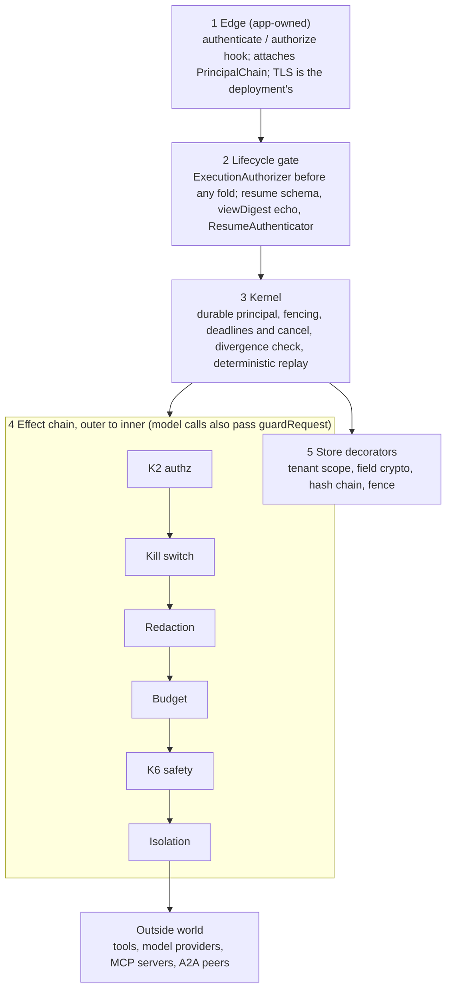

# Loom security guardrails overview (for security review)

*As of 2026-10-24, `main` at `64bc28b2`.*

## 1. Scope and how to read this document

Loom is a durable execution kernel for long-running and agentic workloads: every step, decision and approval is an append-only event, and state is rebuilt by folding the log. Its security model rests on three ideas. The log is the evidence. Every guardrail verdict (deny, block, approve) is itself a durable fact. Enforcement sits at named seams, not in conventions.

This document lists the guardrails loom ships, what each one guarantees, and where it stops. It is written for a security reviewer. Every claim names the ADR (`docs/adr/NNNN-*.md`), the package, and where possible the test that pins it, so you can check the claim against code.

**Version reviewed:** `loom` `main` at commit `64bc28b2` (2026-10-24), 75 packages under `packages/`, `plugins/` and `tools/`.

**Read this first: almost every guardrail is opt-in.** Loom's design rule G2 says an unwired guardrail leaves behaviour byte-identical to before. This keeps the kernel generic, but it means a deployment is only as safe as what it wires. Section 9 lists what an integrator must configure. A review of loom is a review of the *mechanisms*; a review of a product built on loom must also check that those mechanisms are switched on.

**Conventions used below**

- *Kernel*: `@loom/workflow-runtime`, `@loom/event-runtime`, `@loom/effect-runtime` and the event-store SPI. Code that every execution passes through.
- *1P plugin*: a first-party package in this repo (`plugins/*`, `@loom/plugin-*`) that an app opts into.
- *Durable fact*: an event appended to the execution's log, replayed identically and visible to audit.
- *Residual*: a known gap, stated in the ADR, that is accepted rather than fixed.

## 2. Architecture, trust boundaries and threat model

Every side effect in loom crosses the same five boundaries in a fixed order, and each boundary records its refusals in the log. A tool call, model call or child start is an *effect*; flow code cannot reach the outside world except through one.

1. **Edge** (app-owned). HTTP worker, A2A server, SSE conversation transport, MCP App server. Loom ships an `authorize(req)` hook on each server (ADR 0045 D1), not a fixed scheme. The edge authenticates the caller and attaches a `PrincipalChain` (`tenant`, `actor`, `onBehalfOf`, optional delegation token).
2. **Lifecycle gate** (`@loom/workflow-runtime`). `ExecutionAuthorizer` rules on `start`, `resume`, `cancel`, `loadState`, `send`, `fork` and related ops (ADR 0039). Resume payloads are schema-checked before append (ADR 0077), bound to what the approver saw, and checked by a `ResumeAuthenticator` (ADR 0117).
3. **Kernel**. The deterministic fold and replay, the durable principal (ADR 0111), deadlines and cancellation (ADR 0020, 0112), fencing (ADR 0021), and the replay-divergence detector (ADR 0113).
4. **Effect chain** (`@loom/effect-runtime`). The K2 capability authorizer runs first, then middleware outermost-first: kill switch, secret redaction, rate limit, budget, then app middleware such as the K6 safety validators (`packages/app/src/defineConfig.ts`). Model calls also pass `guardRequest` between prompt assembly and the provider (ADR 0085). The innermost link can be an isolated executor: a child process (ADR 0019) or the sandbox worker pool (ADR 0064, 0089).
5. **Store**. Composable `EventStore` decorators: tenant scoping, field encryption, hash-chain audit, fencing, over SQLite or Postgres (ADR 0022, 0024, 0037, 0074).

The capability authorizer runs before any middleware, and isolation is innermost, so authorization, metering and validation stay on the trusted side of the boundary. The kernel appends every verdict through the store decorators.

### Trust assumptions

| Actor or input | Trusted? | What loom does about it |
| --- | --- | --- |
| Host process, Node runtime, loom packages | Trusted | Out of scope. A malicious host is an explicit non-goal (ADR 0019). |
| App code: flows, registered tools, middleware, policies | Trusted by default | A tool bound to the isolated executor is *not* trusted: no store access, scrubbed env, egress allowlist (ADR 0019). |
| Callers at the edge | Untrusted once `authorize` and an `ExecutionAuthorizer` are wired | Unwired, any caller of the runtime may start, resume or cancel. `security.strict` refuses to boot without them. |
| Approvers | Authenticated only with a `ResumeAuthenticator` | HMAC proof bound to one park of one execution, with expiry (ADR 0117). |
| Model output (text, tool calls, reasoning) | Untrusted | Tool names checked against the menu, inputs schema-checked, approval gates, budgets (ADR 0121). |
| Third-party content: MCP results, A2A peers, fetched documents, remote tool descriptions | Untrusted | Tainted at ingress, refused in any instruction position (ADR 0085, 0125 D14). |
| LLM-authored code | Untrusted | Run only in `@loom/plugin-sandbox`: QuickJS compiled to WASM with no I/O, plus an optional worker-thread pool with a hard kill (ADR 0064, 0089). |
| Other tenants | Untrusted | Key-prefixed stores, owner-checked lifecycle ops, per-tenant budgets and fair scheduling (ADR 0024, 0038, 0039). |
| Store operator, database at rest | Partly trusted | Field-level AES-256-GCM and crypto-shred for confidentiality; hash chain with Ed25519 signatures for tamper evidence (ADR 0022, 0037). |
| Network path between nodes | Not addressed by loom | TLS and mTLS are the deployment's job; the `authorize` hook sees `req.socket` for mTLS. |

### Design rules that shape every guardrail

- **G1: no silent third behaviour.** A replay reconstructs the same state or fails loudly with a named fact (`PAYLOAD_SHREDDED`, `EFFECT_INDOUBT`). It never quietly diverges.
- **G2: opt-in, byte-identical when unwired.** See section 1. `security.strict` (section 4) is the switch that flips the baseline to fail-closed.
- **P9: every verdict is a fact.** `EFFECT_DENIED`, `EXECUTION_DENIED`, `SAFETY_BLOCKED`, `EGRESS_DENIED`, `QUOTA_EXCEEDED`, `APPROVAL_GRANTED` are durable events. On replay the verdict is read back from the log, not recomputed.
- **P10: minimal kernel.** The kernel carries identity opaquely and never interprets it. Policies, authorizers and schemes are plugged in at the seams.

## 3. Integrity of the durable log

The log is append-only, single-writer and replay-deterministic, and with `@loom/plugin-audit-chain` wired it is cryptographically tamper-evident. Current contract versions: `EVENT_SCHEMA` 1.25.0, `KERNEL_ABI` 1.3.0, `EVENT_STORE_SPI` 2.6.0.

### Single writer and fencing (ADR 0021, 0118, 0129)

- Each `(execution_id, sequence)` pair is unique; Postgres enforces it with a `UNIQUE` constraint as the backstop.
- Worker leases carry a monotonic **fencing token**. The store rejects an append bearing a stale token, so a partitioned "zombie" worker cannot write after re-dispatch. Enforced in the in-memory and Postgres stores; single-node SQLite is exempt by design.
- Conditional writes (`appendIfUnchanged`, `acquireIfParked`) compare the observed tip, fence and a store-assigned **incarnation** anchor. The anchor closes an ABA where a deleted and re-created execution id could accept a stale write (ADR 0129, SPI 2.3.0).
- The Postgres incarnation trigger function is `SECURITY DEFINER` with `search_path = pg_catalog, pg_temp`, `EXECUTE` revoked from `PUBLIC`, and a schema-qualified sequence.

### Effect delivery: at-least-once, with an in-doubt park (ADR 0021)

Effects are at-least-once; steps are exactly-once with respect to the log. The kernel gives every effect a deterministic idempotency key, `executionId:stepId`, for provider-side dedup. A tool declared `idempotent: false` is never silently re-run after a crash. Recovery parks the execution with a durable `EFFECT_INDOUBT` fact for an operator to resolve (`completed-with-result`, `retry-fresh` or `fail`). For those tools the kernel waits for `STEP_STARTED` to be durable before dispatch (2026-10-15 amendment). Tools with no declaration keep automatic re-run (G2); `loom deploy check` lists them.

### Tamper evidence (ADR 0037)

`@loom/plugin-audit-chain` wraps any `EventStore`. Each event's metadata carries `prevHash`, `hash = SHA-256(prevHash ‖ canonical(event))` and an optional signature. `verifyChain` recomputes the chain and reports the first break and its reason.

- **Canonicalisation** sorts keys recursively and drops `undefined`, so key reordering cannot preserve a hash.
- **Two signature modes, mutually exclusive.** HMAC-SHA256 gives tamper *evidence* against third parties, but the verifier can also forge. Ed25519 (`ed25519Signer` / `ed25519Verifier`) gives third-party *verifiability*: an auditor holding only the public key can check authorship. `keyId` supports rotation without invalidating history.
- `signaturesChecked: false` is reported when no key was supplied, so a hash-only pass is never mistaken for an authorship check.
- The chain lives in metadata, which the fold ignores, so replay is identical with or without it.
- **Limitation:** verification assumes an untruncated log. Compaction and retention break the chain at the new head; verify and archive before truncating.

### Determinism and replay safety

- **Schema governance (K5).** Every event type is registered and pinned (`knownEventTypes()`); adding one is a versioned MINOR bump guarded by `eventSchema.test.ts`.
- **Replay-divergence detector (ADR 0113).** The flow fingerprint is SHA-256 (previously 32-bit FNV). If edited flow code no longer requests a step the log records as completed, the run is refused before any append. Default `warn`; `fail` under `security.strict`.
- **Compaction integrity (ADR 0106, 0022).** `fold(snapshot, suffix) === fold(events)` is conformance-tested. Checkpoints carry their execution identity, and a checkpoint loaded under the wrong identity throws `SnapshotIdentityMismatchError`.
- **Sealed payloads (ADR 0130).** A node that cannot decrypt an inbox payload never hands the ciphertext to a flow or journals it. It parks and leaves the message for a capable node. The check runs in kernel code, so it protects nodes that do not load the crypto plugin.
- **Recovery never answers a gate (ADR 0104).** Re-driving an abandoned execution never records an answer to a parked gate, so a crash cannot turn into an approval.
- **Deterministic simulation testing (ADR 0036, `tools/dst`).** Seeded crash schedules run against a fault-injecting store, and `verifyChain` must hold across the whole crash space.

## 4. Identity, authorization and multi-tenancy

Authority is checked twice: once on the execution lifecycle (who may start, resume, query) and once on every effect (may this principal call this tool). The owner of an execution is recorded in its log and survives crashes, recovery and remote workers.

### The fail-closed profile: `security.strict`

Loom's defaults are permissive. `defineConfig({ security: { strict: true } })` flips the baseline (`packages/app/src/strict.ts`). It **refuses to boot** without:

- a capability authorizer (`security.authorizer`, e.g. a `GrantTable`);
- an `executionAuthorizer` (e.g. `executionAccessPolicy()`);
- a `resumeAuthenticator` (e.g. `signedResumeAuthenticator()`), unless the app declares it has no approval gates;
- pre-flight verification switched on;
- at least one spend bound.

It also turns on defaults that do not depend on the workload: principal required on every lifecycle call, a 24-hour execution deadline, a spawn depth of 5 and fan-out of 32, a 1,000,000-token per-execution budget, replay divergence set to `fail`, and no plaintext identity in the log. A non-strict app gets one boot notice listing every gap it leaves open.

### Lifecycle authorization (ADR 0039, 0111)

`ExecutionAuthorizer` rules on `start`, `resume`, `cancel`, `query`, `send`, `annotate`, `discard`, `quarantine`, `release` and `actAsOwner`. The first-party `executionAccessPolicy()` (`packages/workflow-runtime/src/executionAccessPolicy.ts`) defaults to: start by any identified actor; resume, cancel, query and send within the owner's tenant; annotate by the owner only; discard, quarantine, release and act-as-owner denied.

- **The verdict comes before the fold.** It is reached from sequence 0 alone, before any checkpoint load, fold or caller-supplied transform. A refused caller cannot use error types (shredded, sealed, bad checkpoint) to learn whether an execution exists or what state it is in.
- **Storage faults are not denials.** A fault yields a retryable `ExecutionStoreUnavailableError`, identical for owner and stranger; it never admits anyone.
- **Erasure is a brand, not a name.** Only an error carrying the realm-safe `Symbol.for("loom.payloadShredded")` brand is treated as proof of erasure. A third-party store cannot forge an "unknown owner" by naming an error `PayloadShreddedError`.
- A denied `resume` or `cancel` writes a best-effort `EXECUTION_DENIED` fact without taking the fence, so a denial can never disrupt a running execution.
- Kernel-internal callers (timers, recovery, supervisor) present a system grant instead of a principal. It is an identity-compared object, so it cannot be forged by copying or serialising it. It bypasses lifecycle authorization only, never effect authorization. Any in-process code holding the runtime can obtain it via \`runtime.systemOptions()\`, so the runtime object itself must not be reachable from untrusted callers.

### Durable principal (ADR 0111)

`EXECUTION_STARTED` records a `PrincipalRecord`: bounded identity strings, or an opaque `ref` when a `principalCodec` is wired. A delegation token is never written; only its digest and expiry are. Every effect of the execution then runs as the recorded owner on every entry path, not as whoever resumed it.

- The record is read from the log, never from caller-supplied state, so `restoreFromState` cannot forge or strip an owner.
- A delegated child whose token cannot be restored is denied in the kernel before any authorizer runs. This closed a privilege escalation where recovery dropped the token and the child fell back to broader base grants.
- A **fork runs as the forker**. Running as the original owner is a separate op, `actAsOwner`, denied by default.
- A crypto-shredded principal denies every effect; it never falls back to the caller.
- Under strict or compliance, identity is never written in plaintext: crypto or a codec is required, or composition fails.

### Effect authorization: the K2 ring (ADR 0016, 0048, 0084)

- `CapabilityAuthorizer` runs before any middleware; a denial is a durable `EFFECT_DENIED`. Per-resource grants (R12) let an effect expose `resourceOf(input)`; a resolver that throws matches only effect-wide grants.
- `policy$` rules (allow/deny globs over effect, tenant and step; deny wins) compose *under* the base authorizer. Policy can tighten a grant, never widen it.
- **Effect classes** (ADR 0084) are a static ceiling checked at composition: a flow declared `read-only` that can reach an `external-write` tool fails `@loom/verify`, even though K2 would allow the call.
- **Effect mode** (ADR 0073): an `ambient` tool cannot enter a durable execution, and a `journaled` one cannot run through `invokeTransient`. The seam is passed by the entry point, never inferred from spoofable context fields.

### Delegation (ADR 0024 K12.4, 0045 D2)

`signDelegation` and `verifyDelegation` use HMAC-SHA256. A token is bound to its holder (`issuedTo` must match the caller's actor) and may carry a signed expiry. `DelegationAuthorizer` grants only the intersection of the verified token and the callee's own grants, and `base` is **required**: the symmetric key means a callee could mint itself a wildcard token, so the intersection is what bounds it. Cross-organisation delegation (asymmetric keys) and revocation (`jti`) are out of scope today.

### Tenancy and resource isolation

- `TenantScopedEventStore` and `TenantScopedSnapshotStore` prefix every key, so a tenant store can only address its own executions; fork stays in-tenant (ADR 0024 K12.5).
- `nestedBudgetMiddleware`: tenant, workflow and execution budgets, most restrictive wins, each `QUOTA_EXCEEDED` attributed to its level. A streaming model call that crosses its budget is cut mid-stream (ADR 0020 K8.4).
- `@loom/fair-scheduler`: weighted round-robin per tenant so no tenant monopolises concurrency (ADR 0038).
- Kill switch, deadlines, cancellation and structured-concurrency cancel cascades (ADR 0020, 0112); `rateLimitMiddleware` for per-effect rate limits.
- `@loom/compliance` partitions its subject index by tenant, so two tenants' `"alice"` never merge in an access or erasure request.

## 5. Untrusted content and LLM guardrails

Loom treats model output and third-party content as untrusted data. Third-party bytes can never sit in an instruction position of a prompt, and every model-proposed action passes the same menu, schema, approval, authority and budget checks as any other effect.

### The integrity axis: taint at the prompt boundary (ADR 0085)

- **Taint is a value, not a field.** `tainted(value, origin)` wraps content where it is acquired. It survives JSON, so the log holds the taint and a replay hands back a still-tainted value. `unwrapTainted()` is the one greppable call that drops provenance.
- **`guardRequest` runs unconditionally** inside every `createLlmEffect`, between prompt assembly and the provider call. Tainted content may appear only in a `user` message, fenced. It is refused with `UntrustedContentError` in `request.system`, a `system`-role message, an `assistant`-role message, or a tool name or description.
- **The fence cannot be escaped from inside.** Forged opening and closing fence tags are escaped, and `<>"` are stripped from the origin attribute.
- **Producers.** MCP results (`registerMcpInvoke(..., { taintResults: true })`, whole result), A2A peer `content`, tool error text from remote tools (ADR 0121 D1), recalled memory written by a run that saw tainted output, and prompts with a declared `promptOrigin`.
- **Stated honestly in the ADR:** the refusal is a structural guarantee; the fence is only a label a model can still be talked across. Taint does not follow string concatenation, so an app that unwraps and interpolates loses it.

### Third-party tool descriptions (ADR 0125 D7, D14)

A tool from an MCP server or A2A peer is presented to the model as `"Third-party tool; description withheld"` unless the operator vouches for it (`trustDescriptions` / `trustJsonSchemaText`). A tainted description is withheld even when vouched. Tool-search results that name a third-party tool are returned tainted. Search queries are cut to 512 characters before any regex runs, and searches are capped per run.

### The canonical agent loop: `agentLoop$` (ADR 0087, 0121)

| Check on a model-proposed tool call | Behaviour |
| --- | --- |
| Tool name not on this loop's menu | Refused as a `tool_not_on_menu` result; never dispatched (`packages/agent/src/toolSchema.ts`) |
| Input fails the tool's schema | Refused as `invalid_tool_input`; never dispatched |
| `needsApproval(call)` returns anything but `false` | Execution parks on a durable gate before the tool runs (fails closed) |
| K2 authorizer denies | Terminal: `EFFECT_DENIED`, the run fails; never fed back to the model to retry |
| Kill switch, quota, rate limit, egress denial, stale fence | Terminal; not fed back. `toolFailure.test.ts` forces every exported error class to be classified terminal or feedback |
| Ordinary tool error | Fed back to the model as an `isError` result, tainted when the text came from a remote tool |
| Turn and tool timeouts, `maxIterations` (default 10) | Timeouts are kernel frame deadlines; the iteration cap is enforced by the loop |

Each model response and each tool outcome is a recorded decision, so a resume replays what the model saw and never re-asks or re-runs a completed step. On the routed \`reasoning\` path a recorded response is capped at 256 K characters; oversized tool calls fail the run rather than being truncated. The response cache is partitioned by principal, and the loop refuses to start without a `cacheScope` when a cache is configured, so one tenant's prompt cannot hit another's entry.

### Human approval (ADR 0077, 0117)

- **Bound to what the approver saw.** A gate records `viewDigest(proposal)` (SHA-256 over canonical JSON). The resume must echo it or is refused `view-digest-mismatch` before append. This closes the time-of-check/time-of-use gap where a re-plan swaps the proposal under a pending approval.
- **Authenticated.** `signedResumeAuthenticator` verifies an HMAC over the event, the echoed digest, the actor and a required expiry, bound to *one park of one execution* (`parkedAtSequence`). The proof is refused on a fork, a later park of the same gate, or another execution. Secrets under 16 bytes are refused. The verdict is recorded as `APPROVAL_GRANTED { actor, verifiedBy }`.
- **No auto-approve.** The in-process A2A bus leaves gates parked unless the app answers them; the demo-only `unsafeAutoApprove` logs a warning.
- **Timer wakes cannot approve.** A caller-supplied `TIMER_FIRED` is refused under strict; on every runtime its payload is normalised to `{ wakeAt }`.
- Resume payloads are parsed against a per-gate schema before they are appended (ADR 0077).

### Output and behaviour safety: the K6 ring (ADR 0017)

`safetyMiddleware({ validators })` checks an effect's input before it runs and its result before it propagates. Built-ins: `schemaValidator`, `denyPatterns`, `piiValidator`, `killSwitch`. A block is a durable `SAFETY_BLOCKED` fact. Streaming responses pass per-delta guards, and streaming is refused when a middleware must inspect the whole output. These validators are app-wired and pattern-based; they are a containment ring, not a prompt-injection classifier.

### Reasoning and memory

- Model reasoning is captured in a sidecar store, never in the log, and read back *tainted* by auditors (ADR 0133).
- Memory write-back stores answers from tainted runs as tainted; a recalled tainted entry goes into a fenced `user` message. Write-back inside the effect ring gets K2, tenant checks and the kill switch; outside the ring it must be explicitly allowed (`allowDirect: true`).

## 6. Isolation and code execution

Loom has two isolation boundaries: a child process for untrusted tool code (`@loom/isolate`) and a capability-empty WASM VM for model-written code (`@loom/plugin-sandbox`). Both sit innermost in the effect chain, so authorization, metering and validation stay on the trusted side.

### Isolated tool executor (ADR 0019, K7)

- The tool runs in a pooled child process **at the effect position**. It cannot reach the event store or snapshot store.
- **Credentials:** the child gets a scrubbed, per-tool environment. An execution cannot name, list or copy credentials; it can only cause a granted tool to run.
- **Egress:** network access only through a marshalled `ctx.fetch` brokered on the parent side. The static per-tool allowlist (`tool$({ egress: ["host:port"] })`) is checked *before* connecting. The hostname is resolved once and the socket is pinned to that address (defeats DNS rebinding); TLS still validates against the hostname. A violation is a durable `EGRESS_DENIED`. A module deny-list on ambient network modules is defence in depth.
- **Kill path:** abort or timeout sends `SIGKILL`, the kernel's only non-cooperative kill. A cold-start bound (`coldStartMs`, default 10 s) covers the tool's untrusted top-level code; each brokered fetch has its own deadline, and concurrent fetches are capped.
- **IPC is untrusted:** a disconnect is treated as death; live children are killed when the parent exits.
- **Acceptance test:** a malicious tool that reads `/etc/passwd`, dials an unlisted host and appends to the event log fails all three, each as a durable fact.
- **Stated limits:** this is hardening, not OS confinement. A hostile tool can override its runner's handlers, and hostile-code-grade confinement needs netns, seccomp or container egress rules. The allowlist is not re-checked against private IP ranges after resolution (ADR 0045 S7, deferred), so an allowlisted name that resolves to a metadata address is reachable.

### Sandbox for model-authored code (ADR 0064, 0089)

- **Engine:** QuickJS compiled to WebAssembly. A fresh runtime holds nothing but what is injected: no filesystem, network, process or timers. "No I/O" is a property of construction, not a scrub list.
- **Limits:** memory limit, interrupt-based CPU budget and a wall clock, each a typed `limitExceeded { kind }` outcome. The optional worker-thread pool (`SandboxSpec.workers`) adds a hard kill at `wallClockMs + hardKillGraceMs`. It is needed because a script that never loops never yields to the interrupt handler (measured: 790 ms against a 50 ms wall clock in-process).
- **Provenance:** scripts are content-addressed; a blueprint pins a script by hash, and a rewrite is a new version, never a mutation. Output shape is checked against a pinned hash (`shapeMismatch`).
- **Error text is data:** script exception text is bounded (2,048 characters, no stack) and is never used as a prompt instruction.
- One guard implementation (`evalCore.ts`) serves both engines, and the same security test list runs against both.

### Developer tooling: file writes and codegen

The CLI, `appgen` and scaffolders write into a project directory, so a cloned repository is treated as hostile input.

- **No writes through symlinks** below the project root, whether they point outside or back inside; the root itself may not be a symlink (`tools/appgen/src/safeWrite.ts`). Containment is decided by filesystem identity (device and inode), not by comparing path strings.
- `--from-spec` lockfiles re-check every id against `^[a-z0-9]+(-[a-z0-9]+)*$`, so a shared spec cannot traverse the output directory or inject code (ADR 0045 D3).
- Interpolated names in generated code are escaped; destructive CLI operations need consent (`--yes` when not on a TTY); `loom retention run` is a dry run unless `--apply` is passed.

## 7. Data protection: classification, encryption, erasure, retention

Sensitive data is classified once at the schema, and the runtime derives redaction, encryption and masking from that classification. Secrets never enter the log; sensitive fields are encrypted per subject and erased by destroying the key; erased data fails loudly instead of replaying silently.

### Classification marks (`@loom/classify`)

| Mark | What happens | Mechanism |
| --- | --- | --- |
| `secret()` | Never persisted. The log records a deterministic reference; the effect receives the real value. | `secretRef` + `SecretResolver` + `redactionMiddleware`, outermost in the chain (ADR 0022 K10.3) |
| `sensitive()` | Persisted encrypted, shreddable per subject | `@loom/plugin-crypto` `EncryptingEventStore` / `EncryptingSnapshotStore` (K10.2) |
| `internal()` | Persisted; masked on egress | Telemetry adapters, agent surfaces and CLI output are masked to `[redacted]` (K10-R6) |
| `externalized()` | Bytes leave the log for a content store; the log holds an address | Claim-check (ADR 0046, 0054) |

A verifier (`classification-reachability`) fails the build when a mark sits inside a `z.record`, union, tuple or intersection, where the path walkers cannot reach it. MCP per-call tokens are classified `secret()` so they never reach the log (ADR 0063 D3).

### Encryption at rest

- **Field level:** AES-256-GCM, a fresh random 96-bit IV per value, keys per subject (default: per execution; a subject can span executions and forks). A custom IV source is refused outside a test run.
- **Snapshots:** whole-state sealing bound by AAD to `(executionId, sequence)`, so a sealed snapshot moved to another slot fails to open. `legacyPlaintext: "refuse"` blocks a downgrade by swapping in a plaintext row.
- **Identity:** when crypto is composed, the principal's `tenant`, `actor` and `onBehalfOf` are registered as sensitive automatically (ADR 0111).
- **Storage layer:** SQLite and Postgres at-rest encryption are documented as a third layer (`docs/loom-2.0/11-encryption-at-rest.md`).
- **Key management is the integrator's.** The `KeyStore` SPI is the erasure primitive. Loom ships only `InMemoryKeyStore` (tests, ephemeral apps) and a scaffold template; production must back it with a KMS or HSM. A store declares `durable`, and `loom doctor` flags one that does not.
- **Residual:** field-level event envelopes are sealed without AAD, so they are not bound to their event or path. A party with write access to the store could move one ciphertext to another field of the same subject undetected by GCM; `@loom/plugin-audit-chain` detects such an edit.

### Erasure: crypto-shredding and subject rights (ADR 0022, `@loom/compliance`)

- `shredSubject` destroys the key and appends a `PAYLOAD_SHREDDED` tombstone at shred time. Replay of a shredded field throws `PayloadShreddedError`; it never succeeds silently. A tolerant read mode exists for off-log consumers only.
- Shredding covers snapshots and compaction checkpoints. `compact` refuses (`UnsafeCompactionError`) and retention returns `unsafe-archive` when the destination does not share the source's keys, so archiving cannot turn shreddable ciphertext into plaintext (2026-09-27 amendment).
- A destroyed key is never re-minted. `wasDestroyed` gives the key store's own proof of destruction; the log alone only proves intent.
- `app.eraseSubject` is liveness-gated: it never shreds a running fold. It parks a durable `ERASURE_PENDING` request and completes when the subject's executions end, or cancels parked owners with `parked: "shred"`.
- `exportSubject` builds an access and portability package from a subject index that is partitioned by tenant.
- **Gap stated in the docs:** content-store blobs (claim-checked and externalized bytes) are deduplicated plaintext keyed by hash with no subject mapping, and erasure does not reach them. Derived read models need an explicit row purge (ADR 0093).

### Retention, compaction and content GC (ADR 0022, 0055, 0106)

- Retention is operator-driven and dry-run first (`loom retention run`, `--apply` to reclaim); no timer prunes the log. It archives before deleting, journals `EXECUTION_ARCHIVED` / `EXECUTION_DELETED` facts, and refuses to delete a run a live fork still depends on.
- Pinned event kinds and pinned content survive compaction and sweeps; the content sweep makes each erase conditional on the blob's touch time, so a blob re-cited mid-sweep is kept.

### Model reasoning and media (ADR 0133, 0120)

- **Reasoning** text is stored in a separate, content-addressed sidecar, classified at least as high as its request. The log holds only digests and references (`LLM_REASONING_CAPTURED`), and readers get the text back tainted. It is served at a transport edge only to the turn's asker and the conversation's owner. A forged reference from another execution is dropped.
- **Media** is claim-checked by address; the log never holds the bytes. Because the content store is content-addressed with no tenancy, every read goes through an app-supplied `ContentResolver(ref, context)` that must authorize the asking tenant, where the owner is a *set* of tenants. A tool argument that names another tenant's content reference is refused. Providers receive only the modalities their model family is allowlisted for.

## 8. Network surfaces and input bounds

Every server loom ships binds `127.0.0.1` by default. The A2A and conversation servers refuse to start unauthenticated without an explicit, logged `insecure` opt-out, which strict refuses. The HTTP worker server is the exception: it accepts unauthenticated requests on loopback unless the worker runs with the kernel's system identity. Authentication schemes stay the integrator's: loom provides the hooks and refuses to run without them in the risky configurations.

| Surface | Package | Authentication | Notable hardening |
| --- | --- | --- | --- |
| A2A server (`/tasks/*`) | `@loom/plugin-a2a` | `authenticate(req)` returns a principal (non-empty `actor`), or a boolean `authorize(req)` | Refuses creation with neither unless `insecure: true`, which is refused under strict. Principal is derived from connection facts, never the task body. Task ownership keyed by actor. Non-string `task.id` rejected. 10 MiB body cap |
| HTTP worker (`/execute`, `/cancel`) | `@loom/plugin-worker-server` | `authorize(req)` | Throws at creation if the worker runs as the kernel system identity and no `authorize` is set. A dispatcher's claimed principal is honoured only behind `authorize`. 10 MiB body cap |
| Conversation SSE gateway | `@loom/plugin-conversation-sse` | `authenticate(req)` required (or `insecure`, refused under strict) | See below |
| MCP App surface | `@loom/plugin-mcp-app` | Served through the host's MCP server | Declares no CSP domains by default, so the host applies its restrictive iframe policy; inbound `ui/update-model-context` is tainted (ADR 0072, 0085) |
| Remote and Cloud Run workers | `@loom/plugin-worker-remote`, `@loom/plugin-cloudrun` | Deployment-supplied | Fencing tokens stop a zombie worker writing after re-dispatch (section 3) |

### Conversation gateway (ADR 0122 D6, D10)

- **Fail closed and hide existence.** A conversation the caller may not touch and one that does not exist both return `404 {"error":"not found"}` on every route, and authorization runs before any 429 limit.
- **Owner-only by default.** Shared mode is explicit: a participant list kept on a side stream, a host-supplied service principal for the coordinator, and each turn run *as its asker* with the asker's grants, quota and memory scope. Envelopes are HMAC-signed; tampered, impersonated, replayed or stale envelopes are refused. Turn execution ids include an HMAC, so they are not guessable.
- **Browser safety:** exact-match `Origin` allowlist (403 otherwise), `Host` never treated as proof of same origin, loopback-only `Host` for an unauthenticated server (DNS rebinding), JSON-only POSTs (415), `nosniff`, user text escaped into single SSE `data:` lines.
- **Limits:** 256 concurrent streams (8 per principal), 64 KiB bodies, 15-minute stream lifetime, 1 MiB pending bytes per connection, 120 POSTs per principal per minute, server request and header timeouts.
- **Revocation:** open streams re-authenticate and re-authorize every 30 s.
- 500 responses carry a fixed body and an `errorId`; details go to `onError`.

### Bounded inputs (denial-of-service)

Three internal audit passes (2026-08-09, 2026-09-07, 2026-09-10) targeted unbounded work on attacker-reachable input. Bounds now in place include:

- canonical JSON refuses nesting past 1,024 levels; walks over untrusted payloads are iterative with node budgets (100,000 for the sealed-payload walk);
- memory search queries are de-duplicated and capped before reaching SQLite or Postgres (`queryTerms`, MemoryStore SPI 2.1.0), after a single repeated word took 32.7 s on SQLite and overflowed the Postgres stack;
- tool-search queries cut to 512 characters before any regex; tool descriptions capped at 1,000 characters;
- recorded model responses and decision payloads have size caps; conversation turns default to 32,000 characters;
- per-execution and per-tenant maps are bounded with eviction (for example the back-off map at 1,024 entries);
- prototype-pollution guards (`__proto__`, `constructor`, `prototype`) on surface patches and other key-by-input maps (`packages/agent-surface/src/applyPatch.ts`).

## 9. Assurance, residual risks and what the integrator must configure

Loom's guardrails are pinned by tests that include the negative case (the attack succeeds when the guard is removed), but they have not yet had an independent external review. This section lists the evidence, the known residuals, and the configuration a deployment needs before the mechanisms above are actually in force.

### Evidence

- **Test suite:** 652 test files, run as build, test, typecheck (including tests) and lint on every ready pull request. Tests import sibling packages' built `dist`, so they check what ships.
- **Negative controls.** Security tests assert the guard fires *and* that the attack works with the guard off, for example `plugins/mcp/src/taintedIngress.test.ts` shows an injection reaching the system prompt when `taintResults` is off.
- **Fitness functions** (`packages/spec/src`): event-kind writers, layering, seal-guard coverage, decorator conformance (every store decorator forwards every optional SPI method), test servers bound to `127.0.0.1`, and an error-classification sweep that forces every exported error class to be labelled terminal or feedback.
- **Conformance kits** (`@loom/conformance` and SPI kits) for event stores, snapshot stores, resume authenticators and execution authorizers, run against in-memory, SQLite and Postgres.
- **Deterministic simulation testing** (`tools/dst`): seeded crash schedules over a fault-injecting store; the audit chain must verify across the whole schedule space.
- **Internal audits:** security and denial-of-service sweeps on 2026-08-09, 2026-09-07 and 2026-09-10, an agentic-readiness audit on 2026-10-05, and multi-round reviews on each kernel or security ADR. Findings and fixes are recorded in the ADR amendments cited above.
- **Pre-flight tooling:** `@loom/verify` checks at composition (effect classes, classification reachability, capability compatibility), and `loom doctor` flags non-durable key stores and mismatched encryption.

### Known residual risks

| Area | Residual | Source |
| --- | --- | --- |
| Defaults | Every guardrail is opt-in. A non-strict app with nothing wired lets any runtime caller start, resume, approve and cancel any execution, and every effect is allowed. | G2; section 4 |
| Tool isolation | Child-process hardening, not OS confinement. No private-IP recheck after DNS resolution, so an allowlisted name resolving to a metadata address is reachable. | ADR 0019, 0045 S7 |
| Prompt injection | The fence is a label a model can be talked across; taint is lost through string concatenation; data ingested before taint was enabled is untainted. K6 validators are pattern-based. | ADR 0085, 0017 |
| Symmetric keys | Delegation tokens and approval proofs are HMAC; the verifier can mint. No delegation revocation (`jti`). An approval proof is a bearer artefact until answered or expired. | ADR 0024, 0045, 0117 |
| Field encryption | Event-field envelopes carry no AAD, so a store writer could swap ciphertexts between fields of one subject; detectable only with the audit chain. Snapshots are AAD-bound. | `plugins/crypto/src` |
| Key management | Only `InMemoryKeyStore` ships. Production key storage, rotation and true deletion are the integrator's. | `keystore.ts` |
| Erasure scope | Content-store blobs and derived read models are not reached by subject erasure. | `docs/data-protection-patterns.md`, ADR 0093 |
| Audit chain | Compaction and retention truncate the chain; verify and archive first. HMAC mode is tamper-evident but not third-party verifiable (use Ed25519). | ADR 0037 |
| Existence oracles | Narrow: during a key-service outage a stranger can tell an existing encrypted id from a missing one; denial reason strings differ for unknown-owner versus other-tenant executions; a caller with a principal can tell "not found" from "denied". | ADR 0039 amendments |
| Identity at rest | Outside strict and compliance, tenant and actor ids are written to the log in plaintext. | ADR 0111 D1 |
| Single node | SQLite has no fencing; it is for single-writer deployments. | ADR 0021 A4 |
| Deadlines | The strict default deadline is not durable across a resume; declare `flow$({ deadlineMs })`. | `packages/app/src/strict.ts` |
| Worker server | Unauthenticated on loopback unless `authorize` is set or the worker runs as system. | `createWorkerServer.ts` |

### Integrator checklist

1. Set `security.strict: true`, and fix every problem it reports.
2. Supply `security.authorizer` (a `GrantTable` with least-privilege grants per flow), `security.executionAuthorizer` (`executionAccessPolicy()`), and `security.resumeAuthenticator` (`signedResumeAuthenticator()` with secrets of at least 16 bytes from a secret store).
3. Put `authenticate` / `authorize` on every server you expose; terminate TLS or mTLS in front of it; set `allowedOrigins` and `allowedHosts` for browser-facing endpoints.
4. Classify schemas with `secret()`, `sensitive()` and `externalized()`; wire `security.secrets.resolver` to a vault; compose `@loom/plugin-crypto` with a KMS-backed `KeyStore` declared `durable`.
5. Wrap stores per tenant (`TenantScopedEventStore`) and add `@loom/plugin-audit-chain` with an Ed25519 signer; verify chains before archiving.
6. Enable `taintResults` on MCP and A2A producers; paste `UNTRUSTED_CONTENT_SYSTEM_NOTE` into system prompts; set `needsApproval` for destructive tools and declare `idempotent: false` on non-idempotent ones.
7. Run untrusted tool code under `@loom/isolate` with an egress allowlist inside an OS sandbox or container with egress rules; run model-written code only in `@loom/plugin-sandbox` with `workers` set.
8. Configure budgets, rate limits, spawn limits and a kill switch; declare per-flow deadlines.
9. Run `loom doctor` and `@loom/verify` in CI, and treat their warnings as findings.

### Out of scope for loom

A malicious host process or Node runtime; OS, container and network confinement; TLS; identity-provider integration; key custody; the content of policies; the security of application flows, tools and prompts written on top of loom; and the sibling `loom-ui`, `loom-examples` and `loom-plugins` repositories.

## Appendix: where to look

ADRs live in `docs/adr/`; each one's amendments record review findings and fixes, so read them to the end.

| ADR | Guardrail | Main code |
| --- | --- | --- |
| 0017 | K6 behavioural-safety ring, `SAFETY_BLOCKED` | `@loom/middleware` |
| 0019 | K7 isolated tool executor, egress allowlist | `@loom/isolate` |
| 0020, 0112 | Cancellation, deadlines, structured concurrency | `@loom/workflow-runtime` |
| 0021, 0118, 0129 | Idempotency, fencing, `EFFECT_INDOUBT`, incarnation anchor | `@loom/event-runtime`, store plugins |
| 0022, 0055, 0106 | Retention, crypto-shredding, redaction, compaction integrity | `@loom/plugin-crypto`, `LogLifecycle` |
| 0024, 0111 | Principal chain, delegation, tenant-scoped stores, durable principal | `@loom/effect-runtime`, `@loom/event-runtime` |
| 0037 | Hash-chained, signed audit log | `@loom/plugin-audit-chain` |
| 0038 | Per-tenant fair scheduling | `@loom/fair-scheduler` |
| 0039 | Execution-lifecycle authorization, authorize-before-fold | `executionAccessPolicy.ts` |
| 0045 | HTTP authorize seam, delegation expiry, lockfile id checks | `@loom/plugin-a2a`, `@loom/plugin-worker-server`, `tools/appgen` |
| 0046, 0054, 0120 | Thin log, claim-check, media `ContentResolver` | `@loom/plugin-content`, `@loom/llm` |
| 0048, 0084, 0073 | `policy$`, effect classes, effect mode | `@loom/app`, `@loom/verify`, `@loom/effect-runtime` |
| 0063 | MCP dispatch, principals kept out of the log | `@loom/plugin-mcp` |
| 0064, 0089 | WASM sandbox, worker pool hard kill | `@loom/plugin-sandbox` |
| 0077, 0117 | Typed resume payloads, bound and signed approvals | `@loom/workflow-runtime` |
| 0085, 0125 | Taint and the prompt boundary, withheld third-party descriptions | `@loom/classify`, `@loom/llm`, `@loom/agent` |
| 0104 | Recovery never answers a gate | `@loom/workflow-runtime` |
| 0113 | SHA-256 flow fingerprint, replay-divergence detection | `@loom/core`, `@loom/workflow-runtime` |
| 0121 | Canonical agent loop: menu, schema, approval, terminal errors | `packages/agent/src/agentLoop$.ts` |
| 0122 | Conversation layer, SSE gateway, shared mode | `@loom/conversation`, `@loom/plugin-conversation-sse` |
| 0130 | Sealed-payload delivery guard | `@loom/workflow-runtime` |
| 0133 | Model reasoning sidecar | `@loom/llm`, `@loom/conversation` |

**Docs:** `docs/data-classification.md`, `docs/data-protection-patterns.md`, `docs/compliance.md`, `docs/loom-2.0/11-encryption-at-rest.md`, `docs/spec/loom-kernel-specification.md`.

**Tests worth reading first:** `packages/llm/src/untrusted.test.ts`, `plugins/mcp/src/taintedIngress.test.ts`, `packages/workflow-runtime/src/authzBeforeFold.test.ts`, `packages/workflow-runtime/src/shreddedBrand.test.ts`, `packages/workflow-runtime/src/c1-lifecycle-authz.test.ts`, `packages/agent/src/toolFailure.test.ts`, `packages/workflow-runtime/src/log-lifecycle.test.ts`, `packages/isolate/src/isolate.test.ts`, `packages/app/src/strict.test.ts`, `packages/spec/src/sealGuardFitness.test.ts`.
