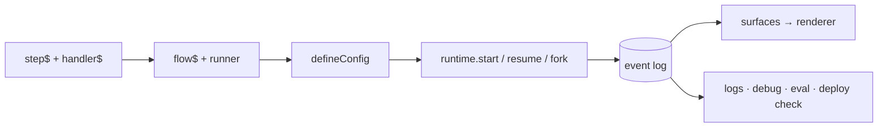

# Loom — Usage Guide

A hands-on, **build-it-in-order** tutorial. By the end you'll have assembled a realistic incident-remediation app that plans work, calls an agent, streams progress to a UI, pauses for human approval, resumes, can be forked to explore alternatives, and is hardened with capability grants, quotas, safety and isolation — using the same primitives the apps in the sibling [`loom-examples`](examples.md) repo use.

If you just want the 5-minute version, read **[Getting Started](getting-started.md)** first. For a topic-by-topic reference, see the **[User Guide](user-guide.md)**.

**Contents**

1. [Model your work as steps](#step-1--model-your-work-as-steps)
2. [Compose steps into a flow](#step-2--compose-steps-into-a-flow)
3. [Wire the app with `defineConfig`](#step-3--wire-the-app-with-defineconfig)
4. [Run, suspend, resume](#step-4--run-suspend-resume)
5. [Drive a live UI with surfaces](#step-5--drive-a-live-ui-with-surfaces)
6. [Add effects & middleware](#step-6--add-effects--middleware)
7. [Add intelligence: LLM, agents, A2A](#step-7--add-intelligence-llm-agents-a2a)
8. [Route & plan with intent + planner](#step-8--route--plan-with-intent--planner)
9. [Human-in-the-loop approval gates](#step-9--human-in-the-loop-approval-gates)
10. [Branch: fork / simulate / promote](#step-10--branch-fork--simulate--promote)
11. [Harden it: grants, quotas, safety, secrets & isolation](#step-11--harden-it-grants-quotas-safety-secrets--isolation)
12. [Test it](#step-12--test-it)
13. [Inspect, eval, and ship](#step-13--inspect-eval-and-ship)

---

## Step 1 — Model your work as steps

A **step** (`step$`) is a schema-checked unit of work. The actual logic lives in a co-located **handler** (`handler$`). Schemas are Zod; they validate inputs/outputs and document the contract.

```ts
import { z } from "zod";
import { step$, handler$ } from "@loom/core";

export const investigateStep = step$({
  id: "investigate",
  name: "Investigate",
  inputSchema: z.object({ target: z.string() }),
  outputSchema: z.object({ summary: z.string(), cpuPct: z.number() }),
  handler: handler$(async (input, ctx) => {
    // `ctx` here is the step handler context: executionId, stepId, attempt, emit()
    return { summary: `High CPU on ${input.target} → pool starvation.`, cpuPct: 87 };
  }),
  retry: { maxAttempts: 3 }, // optional per-step retry policy
});
```

A handler is just an `async` function. Everything you know about error handling, `await`, and typing applies. The `handler$` marker lets the optional compiler extract handlers for resumability, but the runtime works without it.

> **Steps vs. tools.** A `step$` is invoked positionally inside a flow. A `tool$` describes a capability an *agent* may choose to call. You'll meet `tool$` in Step 7.

---

## Step 2 — Compose steps into a flow

A **flow** has a declarative `flow$` definition (id, version, schemas, the list of steps) and a **runner** — an ordinary async function that orchestrates. The runner is where control flow lives.

```ts
import { flow$ } from "@loom/core";
import type { FlowRunner, RegisteredFlow } from "@loom/workflow-runtime";

interface In { target: string }
interface Out { summary: string }

const runner: FlowRunner<In, Out> = async (ctx, input) => {
  ctx.ui.set("phase", "investigating");
  const found = await ctx.run(investigateStep, { target: input.target });
  ctx.ui.append("timeline", found.summary);
  ctx.ui.set("phase", "done");
  return { summary: found.summary };
};

export const investigateFlow: RegisteredFlow<In, Out> = {
  definition: flow$({
    id: "investigate-incident",
    name: "Investigate Incident",
    version: "1.0.0",
    inputSchema: z.object({ target: z.string() }),
    outputSchema: z.object({ summary: z.string() }),
    steps: [investigateStep],
  }),
  runner,
};
```

Inside a runner you have the full `ExecutionContext` (`WorkflowContext` is an alias). Every call states its **durability** — whether it puts a fact in the log that replay must serve — because that is the cost you cannot undo later:

| Call | Purpose |
|---|---|
| `ctx.execute(task, input)` | Run any task kind to durable completion — **recorded** as `STEP_STARTED`/`STEP_COMPLETED` and served from the log on replay, never re-executed. The generalized primitive |
| `ctx.run(step, input)` | The step-shaped alias for `execute` — **recorded**, replay-safe, exactly-once |
| `ctx.parallel(pairs, { limit })` | Run steps concurrently; each is **recorded** on its own, and results return in *input* order regardless of completion order (load-bearing for replay) |
| `ctx.decide(id, decider, opts?)` | **Recorded** advisory choice (`DECISION_RECORDED`) — on replay the recorded choice is returned and `decider` is never called, so routing can change run-to-run while any single run stays pure (P9) |
| `ctx.negotiateBudget(dim, request, opts?)` | **Recorded** budget grant through the decision seam — advisory and replay-safe; enforcement stays with metering middleware (`QUOTA_EXCEEDED`) |
| `ctx.suspend({ on, correlationKey, timeout })` | **Durable** pause for a human/signal. `resume()` routes by **executionId**; `correlationKey` is metadata for an external dispatcher that knows a business key instead |
| `ctx.sleep(ms)` / `ctx.sleepUntil(wakeAt)` | **Durable** timer suspension — the absolute wake time is in the log, so restarts survive it and wall-clock drift never enters the fold |
| `ctx.emit(type, payload)` | Append a domain event — **durable**, appended **once per execution**: a resume or recovery re-runs the flow from the top, and each emit the log already holds is served from it rather than appended again (ADR 0102). Load-bearing forever |
| `ctx.stream(type, delta, done?)` | Stream incremental output (e.g. LLM output). **Each call appends a durable event**, once per execution like `ctx.emit` — chunk at a semantic granularity (sentence / tool call), not per token; for per-token feedback use `@loom/live-query` `subscribe` or `progressHub` instead |
| `ctx.ui.set/merge/append(path, …)` | Push updates to a UI surface (agent-surface) — **durable per patch**, appended once per execution (so `append`/`increment` before a gate do not repeat on resume), and the same granularity rule as `ctx.stream` applies |

`ctx.executionId` and `ctx.workflowId` are plain identity fields — nothing is written, so durability does not apply.

**Emits are served only when the log proves them.** On a re-run, a flow-level `emit`/`stream`/`ui` call is served from the log (appends nothing) only when (1) the log holds an unmatched stamped emit of the same `(type, payload)` in the same gate segment (the stretch between two resumes), and (2) every step and decision so far in that segment was itself served from the log. Otherwise it is appended. An emit is stamped (so a later re-run can match it) only when nothing earlier in the run ended unsettled (an untyped failure, a timeout, a cancellation, an in-doubt park, a throwing decider) and no step or decider of the run was still executing. Timing can cost a duplicate, never an emit: a different interleaving of concurrent branches can turn a served emit into an appended one, never into a lost one. A long-lived session (ADR 0081) that catches an untyped failure early re-appends every later emit on every resume — declare the failure channel (ADR 0060) so the failure is served and the emits after it converge. You may see duplicates, in these cases: emits after a step that fails untyped (it re-executes on every re-run; declare its failure channel, ADR 0060, and they converge), an emit made while one of the run's own steps is still un-awaited (one extra copy), a payload with no JSON form (every re-run), a deploy that edits an emit (the new content is appended and the old stays), and an execution written before 1.19.0 (its prefix once). An emit is served in place of a new one only if a deploy moves identical content within a segment whose steps are all served, if flow code breaks the determinism rules (ADR 0061), or on a 64-bit hash collision ([ADR 0102](adr/0102-flow-emits-append-once.md) D2).

---

## Step 3 — Wire the app with `defineConfig`

`defineConfig` is the composition root. It assembles the `WorkflowRuntime`, stores, effect middleware, projection runtime, and A2A bus from a static config and returns a `LoomApp` — you still have direct access to every primitive.

```ts
import { defineConfig } from "@loom/app";

const app = defineConfig({
  storage: sqliteStorage({ dir: ".loom", branching: true }), // or { kind: "memory" }
  surfaces: ["mission", "telemetry"],
  flows: [investigateFlow],
  checks: { validate: "warn" }, // static flow-graph checks at boot (missing effects, etc.)
});

// app.runtime, app.effectRuntime, app.projectionRuntime, app.bus, app.stores, app.close()
// app.memory (MemoryRuntime) · app.knowledge(scope) (a document corpus over the same store)
// app.skills, app.tools, app.schedules, app.lifecycle, app.verify()
```

`LoomConfig` fields you'll use most:

| Field | What it does |
|---|---|
| `storage` | `{ kind: "memory" }` or `{ kind: "custom", eventStore, snapshotStore, branchRegistry? }`. Concrete backends are **presets** returning a `custom` descriptor: `sqliteStorage({ dir, branching })` from `@loom/plugin-sqlite`, `postgresStorage({ url, branching })` from `@loom/plugin-postgres`, or your own (ADR 0043) |
| `surfaces` | agent surface ids to project — a bare id, or `{ id, redact: [...] }` to mask surface paths from egress (K10-R6) |
| `flows` / `flowModules` | flows to register (explicit, or via `loom gen`'s `flowModules`) |
| `agentModules` / `toolModules` / `skillModules` | `agent$` / `tool$` / `skill$` definitions discovered by `loom gen` (value-shape); agents fold into `agents` (auto-wired behind `a2a`/`agentSurface`), tools are exposed on `app.tools`, skills register into `app.skills` |
| `scheduleModules` / `memoryModules` | `schedule$` / `memory$` definitions discovered by `loom gen`; schedules merge into `app.schedules` + fire via the `TimerService` (needs `timers.store`), memories register into `app.memory` |
| `skills` / `memories` | `skill$` / `memory$` definitions registered directly (in addition to the `*Modules`) |
| `memoryStore` | backing `MemoryStore` for `app.memory` **and every corpus `app.knowledge(scope)` opens**. Defaults to in-memory — **agent memory is lost on restart** unless you pass a durable one: `new SqliteMemoryStore(".loom/events.db")` (`@loom/plugin-sqlite`) or `new PostgresMemoryStore(url)` (`@loom/plugin-postgres`). Memory is stored separately from the durable log. Both durable backends implement the optional `search` (FTS5 / `tsvector`), which `TieredMemory.recallRelevant` needs, and `remove` ([ADR 0091](adr/0091-corpus-lifecycle-and-the-knowledge-package.md), `MEMORY_STORE_SPI_VERSION` 2.1.0 — the query is bounded: terms come from `queryTerms`, deduplicated and capped) |
| `projections` / `projectionModules` | `projection$` definitions (explicit, or discovered by `loom gen`) folded into surfaces |
| `catalog` | the widget catalogue a model-composed blueprint is validated against (`validateBlueprint`, [ADR 0088](adr/0088-blueprint-conformance.md)) |
| `timers` | durable timers + `schedule$` cron occurrences (T1; see Step 11) |
| `agents` / `capabilityAgents` | A2A agent cards (or `agent$` definitions — see `a2a`/`agentSurface`) + capability→agent routing |
| `a2a` | opt-in: auto-derive + register an `AgentCard` for each `agent$` definition in `agents` (no hand-built cards). Off ⇒ wire cards manually as before |
| `agentSurface` | opt-in: auto-register an agent surface per agent (`surfaceId = agent.id`). Off ⇒ register `surfaces` manually |

**Cross-cutting concerns are grouped**, so the list above stays about *what is in your app* rather
than every knob it has. The flat spellings were removed rather than deprecated — `defineConfig`
throws and names the replacement, so a stale config fails at boot instead of silently losing an
option:

| Group | Options |
|---|---|
| `execution` | `dispatcher` (where executions run — in-process / remote / Cloud Run), `effectMiddleware` (retries, metering, safety, redaction… — see Step 11), `registerEffects`, `validateInput`, `now` |
| `security` | `authorizer` (capability protection ring — deny ungranted effects, K2), `policies` (app-global `policy$` via a `PolicyAuthorizer`), `secrets` (`{ resolver }` — resolve `secretRef` input + redact `secret()` output, K10-R2; see [data classification](data-classification.md)), `compliance` (`{ subjectOf, tenantOf?, erase?: { shred } }` — subject index + `app.exportSubject`/`app.eraseSubject`, T3; see [compliance](compliance.md)), `executionAuthorizer`, `resumeAuthenticator`, `onExecutionDenied` |
| `observability` | `onEvent` (tap every committed event), `telemetry`, `onWarn`, `onStorageError` |
| `durability` | `retention` (`{ archive? }` — expose `app.lifecycle` for `loom retention run`, K10.1), `snapshotEvery` |
| `checks` | `validate` (`false \| "warn" \| "error"` — boot-time flow-graph validation), `verify`, `manifest` |

> Prefer manual wiring? You can construct `new WorkflowRuntime({ eventStore, snapshotStore, effectRuntime, onEvent })` directly — `defineConfig` is sugar over exactly that (P6: nothing is hidden).

---

## Step 4 — Run, suspend, resume

```ts
const handle = await app.runtime.start(investigateFlow, { target: "prod-postgres" });
const state = await handle.waitForCompletion();
console.log(state.variables._output); // { summary: "…" }
```

An `ExecutionHandle` gives you `executionId`, `waitForCompletion()`, `waitForSuspend()`, `getState()`, and `cancel(reason?)`. To resume a suspended execution (from Step 9's gate, or after a restart):

```ts
const resumed = await app.runtime.resume(executionId, {
  eventType: "ApprovalGranted",
  payload: { approved: true, approvedBy: "operator" },
});
await resumed.waitForCompletion();
```

Because state is `fold(events)`, you can also inspect without running: `await app.runtime.loadState(executionId)` returns the folded `ExecutionState` (or `null`).

---

## Step 5 — Drive a live UI with surfaces

Flows push UI updates through `ctx.ui` (the **agent-surface** patch protocol). These fold into named **surfaces** in the `ProjectionRuntime`, completely decoupled from durability.

```ts
const runner: FlowRunner<In, Out> = async (ctx, input) => {
  ctx.ui.set("phase", "investigating");            // overwrite a value
  ctx.ui.merge("metrics", { cpu: 87, memMb: 14000 }); // shallow-merge an object
  ctx.ui.append("timeline", "collected metrics");   // push to an array
  // …
};
```

Read a surface anywhere (server or test):

```ts
const view = app.projectionRuntime.getState<{ phase: string; timeline: string[] }>(
  "mission",
  handle.executionId
);
```

Render it with any renderer — `@loom/plugin-renderer-react`, `@loom/plugin-renderer-terminal`, or your own (**bring-your-own-renderer**). The same backend drives React, Web Components, and Angular in the examples without changing a line of flow code.

For long-running work you can stream **numeric progress** and **log lines** out-of-band via a small pub/sub hub (see `schema-migration-planner`'s `progressHub`): handlers call `report(ctx.executionId, line)` / `reportProgress(ctx.executionId, pct)`, and an orchestrator subscribes.

---

## Step 6 — Add effects & middleware

Any side effect — a tool call, an LLM call, an external API — is an **Effect** registered in the `EffectRuntime` by `toolId`. A step with a `toolId` (and no inline `handler`) resolves to a registered effect. This isolation is what makes replay exactly-once.

```ts
import { EffectRuntime, ToolEffect } from "@loom/effect-runtime";

app.effectRuntime.register(
  "lookup-metrics",
  new ToolEffect(async (input: { target: string }, ctx) => {
    return await fetchMetrics(input.target); // your real API call
  })
);
```

**Middleware** wraps every effect with cross-cutting concerns as a composable chain. The reference `retryMiddleware` adds exponential backoff with deterministic jitter and never retries a suspension:

```ts
import { retryMiddleware } from "@loom/middleware";

const app = defineConfig({
  storage: { kind: "memory" },
  flows: [investigateFlow],
  execution: {
    effectMiddleware: [
      retryMiddleware({ maxRetries: 3, baseDelayMs: 200, factor: 2, jitter: true }),
    ],
  },
});
```

Middleware is `(ctx, input, next) => Promise` — the same mental model as HTTP middleware, applied to effects. Write your own for logging, idempotency, or tracing. The kernel-hardening middleware — `meteringMiddleware` (quotas), `safetyMiddleware` (validation), `redactionMiddleware` (secrets) — compose in this same ordered array; **Step 11** wires them.

---

## Step 7 — Add intelligence: LLM, agents, A2A

Everything intelligent runs *inside* durable flows, so it inherits replay and resume.

**LLM (provider-agnostic).** Wrap a provider in an `LlmEffect` and call it from a step. In tests, swap the real provider for the VCR provider (Step 12) so runs are deterministic and offline. Because every LLM call is a metered effect, `meteringMiddleware` can enforce token/cost budgets on it (`QUOTA_EXCEEDED`) — see Step 11.

```ts
import { LlmEffect } from "@loom/effect-runtime";
app.effectRuntime.register("triage-llm", new LlmEffect(async (input, ctx) => {
  ctx.emit("llm_call", { model: "claude-…" });
  return await llm.complete(input); // @loom/llm LlmProvider
}));
```

**Agents (ReAct).** `agent$` declares a tool-using agent; `@loom/agent` runs the reason→act loop — as `agentStep$` (one opaque frame, cheapest) or `agentLoop$` (**one durable frame per turn**, so a crash costs one turn, the model call runs inside the K2/metering ring, and the loop can suspend mid-flight for human approval). See the [user guide](user-guide.md#running-the-loop-agentstep-or-agentloop) for the trade-off and [ADR 0087](adr/0087-durable-agent-loop.md); `@loom/plugin-mcp` discovers external tools via the Model Context Protocol — and, with `createMcpServer`, exposes your own flows to any MCP host in the other direction. `@loom/plugin-mcp-app` adds the MCP Apps (`ui://`) UI layer on top of that server.

Per-turn durability journals each turn's whole message array as its `STEP_STARTED` input, so the log grows O(n²) in turn count unless bounded. `agentLoop$`'s `compaction` folds older turns into one summary — through `ctx.execute`, so replay serves the same fold rather than re-summarizing — once **either** threshold is crossed: `afterMessages` (turn count) or `afterBytes` (a running UTF-8 byte count, cheaper to check than count when one tool result is enormous and the rest are small). At least one of the two is required. The byte trigger keeps the longest run of the newest messages whose bytes total at most `afterBytes / 2` (floored at 1, capped at `keepRecent`), and skips compacting a turn where even the newest message alone is over budget, rather than paying a summary call that folds nothing:

```ts
compaction: { toolId: "summarize", afterMessages: 20, afterBytes: 64_000, keepRecent: 4 }
```

**The claim-check contract toward the model is a documented shape, not a resolve hook.** `claimCheckMiddleware` ([ADR 0054](adr/0054-claim-check-middleware.md)) offloads a tool's RESULT bytes, not the transcript an agent re-sends every turn — it does not shrink what `compaction` above bounds. A claim-checked tool's result reaches the model exactly as recorded: the envelope (`{ __loomClaimCheck: true, ref, digest }`), never resolved back to its bytes — resolving it would put those bytes into the NEXT turn's journaled input, undoing the offload. Declare a `digests[toolId]` projection for every tool a claim-checking agent calls, so the model sees the digest instead of a bare hash. For a lossless answer to the O(n²) growth itself (not just oversized results), externalize `STEP_STARTED` `input.messages` by reference with `ContentResolvingEventStore` ([ADR 0046](adr/0046-content-store-seam-thin-authoritative-log.md)) — safe under the content sweep only once the sweep respects still-referenced externalized input.

**A2A (agent-to-agent).** Expose a flow as an A2A task with `LoomAgentExecutor`, and call *external* agents (Google ADK, LangGraph, CrewAI) as steps. Locally, an `InProcessA2ABus` dispatches capabilities to the owning agent with streaming callbacks:

```ts
const result = await app.bus.dispatch(capabilityId, input, prompt, {
  executionId: taskId,
  onProgress: (line) => report(taskId, line),
  onStatus: (status) => setStatus(taskId, status),
  onApproval: mutating ? () => gate(taskId) : undefined,
});
```

---

## Step 8 — Route & plan with intent + planner

For "type a goal, do the right thing" UX, compose two stateless services:

```ts
import { IntentRuntime } from "@loom/intent";
import { PlannerRuntime } from "@loom/planner";

const intent = new IntentRuntime({ catalog, provider });   // provider optional — omit for offline keyword routing
const planner = new PlannerRuntime({ catalog, provider });

// Route a natural-language goal to the primary capability (null if nothing matches).
const route = await intent.route(goal);

// Compose an ordered, multi-step capability plan from the goal.
const plan = await planner.plan(goal);
for (const stepPlan of plan.steps) {
  const agentId = CAPABILITY_AGENT[stepPlan.capabilityId];
  await app.bus.dispatch(stepPlan.capabilityId, /* … */);
}
```

This is the backbone of the `db-command-center` example: **intent → planner → A2A dispatch → approval gate**, all surfaced live.

---

## Step 9 — Human-in-the-loop approval gates

The signature Loom move: pause at a durable checkpoint, wait for a human, resume.

```ts
const ApprovalDecision = z.object({ approved: z.boolean(), approvedBy: z.string() });
type ApprovalDecision = z.infer<typeof ApprovalDecision>;

const runner: FlowRunner<{ target: string }, { applied: boolean }> = async (ctx, input) => {
  ctx.ui.set("phase", "awaiting-approval");

  const decision = await ctx.suspend<ApprovalDecision>({
    on: "ApprovalGranted",
    correlationKey: input.target,     // business key for an external dispatcher
    timeout: 24 * 60 * 60 * 1000,     // 24h
  });

  if (!decision.approved) return { applied: false };
  return ctx.run(applyStep, { target: input.target });
};
```

The type argument is **erased at runtime** — it types the call site and nothing more. Declare the
same schema on the flow so the runtime actually parses the payload *before* appending it:

```ts
flow$({ /* … */ resumeSchemas: { ApprovalGranted: ApprovalDecision } });
```

A wrongly-shaped resume is then refused with `ResumePayloadValidationError` and nothing is
written, leaving the execution suspended and resumable ([ADR 0077](adr/0077-typed-resume-payloads.md)).

For **policy-driven** gates (auto-approve low risk, escalate the rest), use the composable `decideApproval` primitive:

```ts
import { decideApproval } from "@loom/orchestrator";

await decideApproval(
  { goal, riskLevel: "medium" },
  {
    onAutoApprove: () => log("low risk — auto-applying"),
    onManualRequired: () => surfacePendingApproval(),
    waitForManual: () => new Promise((resolve) => { approvalResolver = resolve; }),
  }
);
```

---

## Step 10 — Branch: fork / simulate / promote

Explore alternative decisions from a suspension gate, compare projected outcomes, and promote a winner — git-style, no merge. Requires `storage: { branching: true }` (or a `BranchRegistry`).

```ts
import { parallelLimit } from "@loom/scheduler";

// 1) Run to the gate; record the fork point.
const handle = await runtime.start(RemediateFlow, { target }, { executionId: parentId });
const forkPoint = (await handle.waitForSuspend()).sequence;

// 2) Fork per strategy and simulate concurrently (order-preserving).
const outcomes = await parallelLimit(
  STRATEGIES.map((s) => async () => {
    const fork = await runtime.fork(parentId, forkPoint, { branchName: `spec/${s.id}` });
    const resumed = await runtime.resume(fork.executionId, {
      eventType: "RemediationDecision",
      payload: { approved: true, strategy: s.id, simulate: true },
    });
    return (await resumed.waitForCompletion()).variables._output;
  }),
  { limit: STRATEGIES.length }
);

// 3) Promote the winner: fresh fork resumed with simulate:false, then move the ref.
const commit = await runtime.fork(parentId, forkPoint, { branchName: "commit" });
await runtime.resume(commit.executionId, {
  eventType: "RemediationDecision",
  payload: { approved: true, strategy: winner, simulate: false },
});
await branchRegistry.promote("commit", "main");
```

The parent and losing branches remain immutable — a full audit trail of what was tried and why. See `incident-war-room` and `schema-migration-planner` in the sibling [`loom-examples`](examples.md) repo.

> **If a branch can suspend, do not await completion in the fan-out.** The shape above works
> only while every branch runs straight through. A branch that parks — on a human, a timer, an
> approval — never resolves `waitForCompletion()`, so one such branch stalls the whole cohort
> forever. Await `waitForSuspend()` instead, record the cohort, and let each branch's resume
> arrive on its own schedule. `incident-war-room` is the worked example: a review gate inside
> every branch, an approval that carries the branch id (a sibling's approval parses identically
> at the same gate), and a `promote` that cancels the branches still parked so a late answer
> cannot resume a loser.

---

## Step 11 — Harden it: grants, quotas, safety, secrets & isolation

Everything so far is the happy path. The **kernel-hardening rings (K1–K12, T1–T2)** add the guardrails that make a flow safe to run against real systems and real tenants. Every ring is **opt-in and byte-identical to the un-hardened path when unwired** — you add exactly the ones you need, and each verdict lands on the log as a durable, replayable fact (audit for free). Full API in the [reference](api-reference.org#kernel-hardening); the reasoning is in [Kernel Hardening](loom-2.0/04-kernel-hardening.md).

**Capability grants (K2)** — least-privilege authority. A `GrantTable` maps a principal to the effect ids it may invoke; an ungranted effect never runs — it records `EFFECT_DENIED` and fails the step.

```ts
import { GrantTable } from "@loom/effect-runtime";

const app = defineConfig({
  storage: sqliteStorage({ dir: ".loom" }),
  flows: [investigateFlow],
  security: { authorizer: new GrantTable({ "*": ["lookup-metrics", "triage-llm"] }) }, // "*" principal
});
```

**Declarative policies (`policy$`)** — a higher-level companion to the grant table ([ADR 0048](adr/0048-declarative-policy-enforcement.md)). Attach a `policy$` to a flow (or declare it app-global via `defineConfig({ security: { policies } })`, or on an agent via `agent$({ policies })`) and it is enforced through the *same* K2 ring by a `PolicyAuthorizer`. Rules are **deny-wins** and combine simple allow/deny effect lists with richer `match` rules (glob on effect id / `principal.tenant` / step id). A policy composes **under** any `authorizer` — both must allow — so it can *tighten* a grant but never widen it; a flow with no policy is unaffected. Policy is a **capability gate** (may this effect run?), not a data-predicate engine — value rules like "cpu > 90%" belong in flow logic / a `projection$` alert, not here (see ADR 0048).

```ts
import { policy$ } from "@loom/core";

const flow = flow$({
  id: "billing",
  // …
  policies: [
    policy$({
      id: "no-external",
      name: "No external calls for acme",
      rules: {
        allow: ["metrics", "logs-*"],                       // allow-list restricts to these
        deny: ["external-http"],                            // deny wins
        match: [{ effect: "external-*", tenant: "acme", deny: true }], // richer matcher
      },
    }),
  ],
});
// Enforcement is automatic: defineConfig reads each flow's `policies` and builds the PolicyAuthorizer.
```

**Quotas & budgets (K3)** — meter every effect onto the log and stop over-budget runs (`RESOURCE_METERED`, then `QUOTA_EXCEEDED`). Compose it in `effectMiddleware`:

```ts
import { meteringMiddleware, llmUsageTokens } from "@loom/middleware";

meteringMiddleware({
  pricing: ({ result }) => ({ tokens: llmUsageTokens(result) }),
  budget: { maxTokens: 100_000 }, // over-budget ⇒ QUOTA_EXCEEDED + QuotaExceededError
});
```

**Behavioral safety (K6)** — validate effect input/output; a violation blocks the effect and records `SAFETY_BLOCKED`.

```ts
import { safetyMiddleware, piiValidator, denyPatterns, killSwitch } from "@loom/middleware";

safetyMiddleware({ validators: [piiValidator(), denyPatterns([/DROP TABLE/i]), killSwitch(() => paused)] });
```

**Secrets & redaction (K10)** — pass secrets as `secretRef("db-password")` placeholders; `redactionMiddleware` resolves them just-in-time so plaintext never enters the log. Pair with **encryption-at-rest**: wrap the store in `EncryptingEventStore` (marked fields encrypted under a per-subject key), and erase a subject with `shredSubject(...)` — crypto-shredding appends `PAYLOAD_SHREDDED` and makes later reads fail *loudly*.

```ts
import { EncryptingEventStore } from "@loom/plugin-crypto";

const events = new EncryptingEventStore(inner, keys, {
  sensitive: { STEP_COMPLETED: ["output.ssn", "output.email"] },
});
// later, on erasure request: await shredSubject(keys, inner, executionId);
```

`keys` must be a `KeyStore` that **survives a restart** — the key is the erasure boundary, so
losing one is indistinguishable from shredding the subject, and nothing fails at the moment it
happens. `InMemoryKeyStore` declares `durable: false` and `loom doctor` refuses it; back it
with a KMS (`loom-plugin-kms`) or your own store.

**Data-plane isolation & egress (K7)** — run an untrusted tool in a scrubbed child process whose network is restricted to a static allowlist (a target off the list is denied kernel-side with `EGRESS_DENIED`, before any connection):

```ts
import { IsolatedToolEffect } from "@loom/isolate";

app.effectRuntime.register("enrich", new IsolatedToolEffect({
  id: "enrich",
  modulePath: "/abs/path/to/enrich.js",   // the child loads this module — never a parent closure
  egress: ["api.internal:443"],           // only these host:port pairs; omit = no network at all
  env: { API_TOKEN: process.env.ENRICH_TOKEN! }, // only THIS tool's credentials
  timeoutMs: 5_000,                        // exceed ⇒ SIGKILL
}));
```

**Cancellation & deadlines (K8)** — bound a single effect with a step's `timeoutMs`, or a whole run with a flow's `deadlineMs` (anchored to `EXECUTION_STARTED`, never reset by recovery). Breach — or `handle.cancel()` — aborts in-flight effects via `ctx.signal` and records `EXECUTION_CANCELLED`.

**Tenancy (K12)** — scope a shared store per tenant so cross-tenant reads are impossible *by construction*, and honor signed, attenuated delegations across an A2A boundary:

```ts
import { TenantScopedEventStore } from "@loom/event-runtime";
import { DelegationAuthorizer, signDelegation } from "@loom/effect-runtime";

const tenantEvents = new TenantScopedEventStore(sharedEvents, "acme"); // only ever addresses tenant "acme"
const token = signDelegation(secret, "worker-agent", ["lookup-metrics"]); // narrowable, never broadenable
```

**Durable timers & schedules (T1)** — `await ctx.sleep(60_000)` (or `ctx.sleepUntil(ts)`) suspends durably and wakes via a logged `TIMER_FIRED`; declare cron starts with `schedule$` and wire the `timers` slot in `defineConfig`:

```ts
import { schedule$ } from "@loom/core";

defineConfig({
  storage: sqliteStorage({ dir: ".loom" }),
  flows: [reconcileFlow],
  timers: { store: timerStore, schedules: [schedule$({ id: "nightly", cron: "0 3 * * *", flowId: "reconcile" })] },
});
```

Each ring emits its own durable fact (`EFFECT_DENIED`, `QUOTA_EXCEEDED`, `SAFETY_BLOCKED`, `EGRESS_DENIED`, `PAYLOAD_SHREDDED`, `EXECUTION_CANCELLED`, `EXECUTION_MIGRATED`, …) so the log *is* the audit trail — inspectable with the same `loom logs` tooling from Step 13.

---

## Step 12 — Test it

`@loom/testing` removes the boilerplate: an in-memory app, phase-waiters, golden capture, and a VCR LLM provider.

```ts
import { createTestApp, waitForPhase, captureGolden } from "@loom/testing";

const app = createTestApp({ surfaces: ["mission"], flows: [investigateFlow] });

const handle = await app.runtime.start(investigateFlow, { target: "prod-postgres" });
await handle.waitForCompletion();
await waitForPhase(app.projectionRuntime, "mission", handle.executionId, "done");

// Capture the event log as a golden fixture for eval/replay.
const golden = await captureGolden(app.stores.eventStore, handle.executionId);
await app.close();
```

For deterministic LLMs, wrap your provider with `recordingProvider(real, cassette)` once, then `replayingProvider(cassette)` in CI — no live calls, no flakiness.

---

## Step 13 — Inspect, eval, and ship

With SQLite storage, the `loom` CLI turns the log into tooling (each command is a lens on the same log):

```bash
loom logs   --db .loom/events.db <id>          # tail the timeline
loom debug  --db .loom/events.db <id> --at 5   # state at sequence 5 (time-travel)
loom inspect --db .loom/events.db <id>         # web timeline + slider
loom eval   --dir evals/                       # replay golden logs vs expectations (CI gate)
loom deploy check --logs logs/ --config dist/app.js  # simulate a deploy vs new flow defs
loom check  --manifest loom-manifest.json      # static flow-graph checks
loom gen                                        # regenerate loom.gen.ts from app/flows
```

For the full command reference — every flag, exit code, and output shape — see the **[CLI Usage Guide](usage-cli.md)**.

**Deploy safety.** `loom deploy check` replays historical logs against your *new* flow definitions and fails on breaking changes (a removed step, a missing flow) before you promote — catching resume-incompatibility that types can't.

**Where it runs.** By default executions run in-process. Point `dispatcher` at a remote worker (`@loom/plugin-worker-remote` → `@loom/plugin-worker-server`) or Cloud Run (`@loom/plugin-cloudrun`) and the *same flows* run there — the public API is unchanged. See [`plugins/cloudrun/deploy.md`](../plugins/cloudrun/deploy.md).

---

## Recap — the shape of a Loom app



Continue to the **[User Guide](user-guide.md)** for deep dives on each feature, or the **[Architecture](architecture.md)** for the reasoning behind the design.
