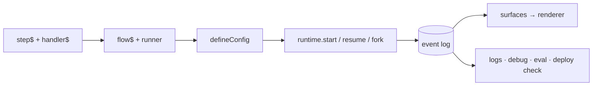

# Loom — Usage Guide

A hands-on, **build-it-in-order** tutorial. By the end you'll have assembled a realistic incident-remediation app that plans work, calls an agent, streams progress to a UI, pauses for human approval, resumes, can be forked to explore alternatives, and is hardened with capability grants, quotas, safety and isolation — using the same primitives the apps in the sibling [`loom-examples`](examples.md) repo use.

If you just want the 5-minute version, read **[Getting Started](getting-started.md)** first. For a topic-by-topic reference, see the **[User Guide](user-guide.md)**.

**Contents**

1. [Model your work as steps](#step-1--model-your-work-as-steps)
2. [Compose steps into a flow](#step-2--compose-steps-into-a-flow)
3. [Wire the app with `defineConfig`](#step-3--wire-the-app-with-defineconfig)
4. [Run, suspend, resume](#step-4--run-suspend-resume)
5. [Drive a live UI with surfaces](#step-5--drive-a-live-ui-with-surfaces)
6. [Add effects & middleware](#step-6--add-effects--middleware)
7. [Add intelligence: LLM, agents, A2A](#step-7--add-intelligence-llm-agents-a2a)
8. [Route & plan with intent + planner](#step-8--route--plan-with-intent--planner)
9. [Human-in-the-loop approval gates](#step-9--human-in-the-loop-approval-gates)
10. [Branch: fork / simulate / promote](#step-10--branch-fork--simulate--promote)
11. [Harden it: grants, quotas, safety, secrets & isolation](#step-11--harden-it-grants-quotas-safety-secrets--isolation)
12. [Test it](#step-12--test-it)
13. [Inspect, eval, and ship](#step-13--inspect-eval-and-ship)

---

## Step 1 — Model your work as steps

A **step** (`step$`) is a schema-checked unit of work. The actual logic lives in a co-located **handler** (`handler$`). Schemas are Zod; they validate inputs/outputs and document the contract.

```ts
import { z } from "zod";
import { step$, handler$ } from "@loom/core";

export const investigateStep = step$({
  id: "investigate",
  name: "Investigate",
  inputSchema: z.object({ target: z.string() }),
  outputSchema: z.object({ summary: z.string(), cpuPct: z.number() }),
  handler: handler$(async (input, ctx) => {
    // `ctx` here is the step handler context: executionId, stepId, attempt, emit()
    return { summary: `High CPU on ${input.target} → pool starvation.`, cpuPct: 87 };
  }),
  retry: { maxAttempts: 3 }, // optional per-step retry policy
});
```

A handler is just an `async` function. Everything you know about error handling, `await`, and typing applies. The `handler$` marker lets the optional compiler extract handlers for resumability, but the runtime works without it.

> **Steps vs. tools.** A `step$` is invoked positionally inside a flow. A `tool$` describes a capability an *agent* may choose to call. You'll meet `tool$` in Step 7.

---

## Step 2 — Compose steps into a flow

A **flow** has a declarative `flow$` definition (id, version, schemas, the list of steps) and a **runner** — an ordinary async function that orchestrates. The runner is where control flow lives.

```ts
import { flow$ } from "@loom/core";
import type { FlowRunner, RegisteredFlow } from "@loom/workflow-runtime";

interface In { target: string }
interface Out { summary: string }

const runner: FlowRunner<In, Out> = async (ctx, input) => {
  surface(ctx).set("phase", "investigating");
  const found = await ctx.run(investigateStep, { target: input.target });
  surface(ctx).append("timeline", found.summary);
  surface(ctx).set("phase", "done");
  return { summary: found.summary };
};

export const investigateFlow: RegisteredFlow<In, Out> = {
  definition: flow$({
    id: "investigate-incident",
    name: "Investigate Incident",
    version: "1.0.0",
    inputSchema: z.object({ target: z.string() }),
    outputSchema: z.object({ summary: z.string() }),
    steps: [investigateStep],
  }),
  runner,
};
```

Inside a runner you have the full `ExecutionContext` (`WorkflowContext` is an alias). Every call states its **durability** — whether it puts a fact in the log that replay must serve — because that is the cost you cannot undo later:

| Call | Purpose |
|---|---|
| `ctx.execute(task, input)` | Run any task kind to durable completion — **recorded** as `STEP_STARTED`/`STEP_COMPLETED` and served from the log on replay, never re-executed. The generalized primitive |
| `ctx.run(step, input)` | The step-shaped alias for `execute` — **recorded**, replay-safe, exactly-once |
| `ctx.parallel(branches, { limit, failFast, onPark })` | Run branches (`[step, input]` pairs or `(b) => Promise` functions) concurrently as one **cancellation scope**; each step is **recorded** on its own, and results return in *input* order regardless of completion order (load-bearing for replay). With `kernel.features.scopes` on, the first real failure aborts the siblings (`STEP_CANCELLED`, outcome journaled as `PARALLEL_COMPLETED`, served on re-run, the SAME error value thrown both times: a `TypedFailure` stays typed, a class in `execution.errorClasses` or the built-in `Error` family is rebuilt, anything else is a `ParallelScopeFailedError`; inside a branch, code that catches a step's error sees the effect's error on the first run but `ScopeServedError` on a replay, so rethrow it or use typed failures); a park drains in-flight siblings before `EXECUTION_SUSPENDED` and nothing follows it (ADR 0112) |
| `ctx.decide(id, decider, opts?)` | **Recorded** advisory choice (`DECISION_RECORDED`) — on replay the recorded choice is returned and `decider` is never called, so routing can change run-to-run while any single run stays pure (P9) |
| `ctx.negotiateBudget(dim, request, opts?)` | **Recorded** budget grant through the decision seam — advisory and replay-safe; enforcement stays with metering middleware (`QUOTA_EXCEEDED`) |
| `ctx.suspend({ on, correlationKey, timeout })` | **Durable** pause for a human/signal. `resume()` routes by **executionId**; `correlationKey` is metadata for an external dispatcher that knows a business key instead |
| `ctx.receive(topic)` | **Durable** wait for the next message on this execution's inbox (`runtime.send`, ADR 0110). Registers a wait and parks when the flow is quiescent; consumption is a recorded `MESSAGE_CONSUMED`, so replay returns the recorded message and never reads the inbox. FIFO per topic, exactly once within the dedupe window. The payload arrives **tainted** (`inbox:<topic>`). Needs `kernel.features.inbox` |
| `ctx.select([{ gate }, { inbox }, { timer }])` | **Durable** race of several waits; the first answered arm settles it and a later answer to a sibling is refused. Resolves `{ arm, kind, value }`; a timer arm's wake is **recorded** once at first registration. Arms are numbered `<scopePath>#<ordinal>`, so a body edit that shifts an ordinal raises `FlowDivergenceError`. Needs `kernel.features.inbox` |
| `ctx.continueAsNew(carry)` | **Durable** end of this execution and start of its **successor** (id `<chainId>~<n>`) with `carry` as its input; never returns. The successor is started FIRST (idempotent), then a kernel-stamped `EXECUTION_CONTINUED` is **recorded** on the predecessor, which folds to the new terminal status `continued`. History stays bounded: the successor inherits the principal, the running resource totals, the inbox cursors and dedupe window and the chain's absolute deadline, and none of the fold. Refused (log untouched) inside a `ctx.parallel` scope, with a `receive` / `select` wait outstanding (a step still in flight is awaited, never refused: the call waits as `await p` would); a carry over `kernel.continuation.maxCarryBytes` (1 MiB) is refused. Needs `kernel.features.continueAsNew` (ADR 0109) |
| `ctx.sleep(ms)` / `ctx.sleepUntil(wakeAt)` | **Durable** timer suspension — the absolute wake time is in the log, so restarts survive it and wall-clock drift never enters the fold |
| `ctx.emit(type, payload)` | Append a domain event — **durable**, appended **once per execution**: a resume or recovery re-runs the flow from the top, and each emit the log already holds is served from it rather than appended again (ADR 0102). Load-bearing forever |
| `ctx.stream(type, delta, done?)` | Stream incremental output (e.g. LLM output). **Each call appends a durable event**, once per execution like `ctx.emit` — chunk at a semantic granularity (sentence / tool call), not per token; for per-token feedback use `@loom/live-query` `subscribe` or `progressHub` instead |
| `surface(ctx).set/merge/append(path, …)` (sugar over `ctx.emit`) | Push updates to a UI surface (agent-surface; `import { surface } from "@loom/agent-surface"`, the old `ctx.ui` accessor is deprecated and injected, ADR 0114) — **durable per patch**, appended once per execution (so `append`/`increment` before a gate do not repeat on resume), and the same granularity rule as `ctx.stream` applies |

**Streaming from a decider ([ADR 0119](adr/0119-decide-scope-streaming-deltas.md)).** `scope.invokeTransient(toolId, input, { onDelta })` hands a streaming effect (`createLlmEffect({ stream: true })`, `createAgentModelEffect`) a per-call sink. It receives `EffectDelta` chunks: text (`delta` is a **tainted** string, `unwrapTainted(chunk.delta)` to display it — `guardRequest` refuses it if you feed it into a prompt), a `{ reset: true, attempt }` chunk before a retried attempt (clear your view and re-render), and a final `{ done: true, usage }` sent only after the call **succeeded** — the promise's settlement is authoritative. The call is governed exactly like one without a sink (authz, middleware, kill switch, taint, budget admission, cancellation). Deltas are live-only (never journaled, silent on replay; the decision records only your return value); a throwing sink is swallowed and warned; the sink goes silent once the call settles or aborts. **Safety:** `safetyMiddleware` validators with a delta form (`piiValidator()`, `denyPatterns()` by default) check the running text and sever the stream before the offending delta is delivered. If an output validator has NO delta form (e.g. `schemaValidator`), streaming is disabled (warned): the per-call sink AND any sink configured on the effect (`createLlmEffect({ onDelta })`, `AgentRunner` `onDelta`) receive nothing and the call completes non-streamed. The configured sink is guarded the same way on durable `ctx.run` calls too, and `createLlmEffect({ onReset })` is its reset hook. A middleware that rejects or rewrites output after `next()` MUST set `inspectsOutput` (or provide a `deltaGuard`); `redactionMiddleware` does so when `redactOutput` is set. A UI that displays deltas depends on `@loom/classify` to `unwrapTainted` them. Delta checks scan the last `deltaWindow` characters (default 4096): text before a match completes is delivered, and a pattern wider than the window can evade the delta form.

`ctx.executionId` and `ctx.workflowId` are plain identity fields — nothing is written, so durability does not apply.

**Emits are served only when the log proves them.** On a re-run, a flow-level `emit`/`stream`/`ui` call is served from the log (appends nothing) only when (1) the log holds an unmatched stamped emit of the same `(type, payload)` in the same gate segment (the stretch between two resumes), and (2) every step and decision so far in that segment was itself served from the log. Otherwise it is appended. An emit is stamped (so a later re-run can match it) only when nothing earlier in the run ended unsettled (an untyped failure, a timeout, a cancellation, an in-doubt park, a throwing decider) and no step or decider of the run was still executing. Timing can cost a duplicate, never an emit: a different interleaving of concurrent branches can turn a served emit into an appended one, never into a lost one. A long-lived session (ADR 0081) that catches an untyped failure early re-appends every later emit on every resume — declare the failure channel (ADR 0060) so the failure is served and the emits after it converge. You may see duplicates, in these cases: emits after a step that fails untyped (it re-executes on every re-run; declare its failure channel, ADR 0060, and they converge), an emit made while one of the run's own steps is still un-awaited (one extra copy), a payload with no JSON form (every re-run), a deploy that edits an emit (the new content is appended and the old stays), and an execution written before 1.19.0 (its prefix once). An emit is served in place of a new one only if a deploy moves identical content within a segment whose steps are all served, if flow code breaks the determinism rules (ADR 0061), or on a 64-bit hash collision ([ADR 0102](adr/0102-flow-emits-append-once.md) D2).

---

## Step 3 — Wire the app with `defineConfig`

`defineConfig` is the composition root. It assembles the `WorkflowRuntime`, stores, effect middleware, projection runtime, and A2A bus from a static config and returns a `LoomApp` — you still have direct access to every primitive.

```ts
import { defineConfig } from "@loom/app";

const app = defineConfig({
  storage: sqliteStorage({ dir: ".loom", branching: true }), // or { kind: "memory" }
  surfaces: ["mission", "telemetry"],
  flows: [investigateFlow],
  checks: { validate: "warn" }, // static flow-graph checks at boot (missing effects, etc.)
});

// app.runtime, app.effectRuntime, app.projectionRuntime, app.bus, app.stores, app.close()
// app.memory (MemoryRuntime) · app.knowledge(scope) (a document corpus over the same store)
// app.skills, app.tools, app.schedules, app.lifecycle, app.verify()
```

`LoomConfig` fields you'll use most:

| Field | What it does |
|---|---|
| `storage` | `{ kind: "memory" }` or `{ kind: "custom", eventStore, snapshotStore, branchRegistry? }`. Concrete backends are **presets** returning a `custom` descriptor: `sqliteStorage({ dir, branching })` from `@loom/plugin-sqlite`, `postgresStorage({ url, branching })` from `@loom/plugin-postgres`, or your own (ADR 0043) |
| `surfaces` | agent surface ids to project — a bare id, or `{ id, redact: [...] }` to mask surface paths from egress (K10-R6) |
| `flows` / `flowModules` | flows to register (explicit, or via `loom gen`'s `flowModules`) |
| `agentModules` / `toolModules` / `skillModules` | `agent$` / `tool$` / `skill$` definitions discovered by `loom gen` (value-shape); agents fold into `agents` (auto-wired behind `a2a`/`agentSurface`), tools are exposed on `app.tools`, skills register into `app.skills` |
| `scheduleModules` / `memoryModules` | `schedule$` / `memory$` definitions discovered by `loom gen`; schedules merge into `app.schedules` + fire via the `TimerService` (needs `timers.store`), memories register into `app.memory` |
| `skills` / `memories` | `skill$` / `memory$` definitions registered directly (in addition to the `*Modules`) |
| `memoryStore` | backing `MemoryStore` for `app.memory` **and every corpus `app.knowledge(scope)` opens**. Defaults to in-memory — **agent memory is lost on restart** unless you pass a durable one: `new SqliteMemoryStore(".loom/events.db")` (`@loom/plugin-sqlite`) or `new PostgresMemoryStore(url)` (`@loom/plugin-postgres`). Memory is stored separately from the durable log. Both durable backends implement the optional `search` (FTS5 / `tsvector`), which `TieredMemory.recallRelevant` needs, and `remove` ([ADR 0091](adr/0091-corpus-lifecycle-and-the-knowledge-package.md), `MEMORY_STORE_SPI_VERSION` 2.1.0 — the query is bounded: terms come from `queryTerms`, deduplicated and capped) |
| `projections` / `projectionModules` | `projection$` definitions (explicit, or discovered by `loom gen`) folded into surfaces |
| `catalog` | the widget catalogue a model-composed blueprint is validated against (`validateBlueprint`, [ADR 0088](adr/0088-blueprint-conformance.md)) |
| `timers` | durable timers + `schedule$` cron occurrences (T1; see Step 11) |
| `kernel.features` | rolling-upgrade flags for writers an older node cannot read (default off): `redrive` (ADR 0118) turns a contended supervisor resume into a backed-off `TimerStore` row fired by the app's `TimerService`, so it completes without `recover()`; needs `timers`, hands out `app.redrive` for `superviseChildren({ redrive: app.redrive })`; `scopes` (ADR 0112) turns `ctx.parallel` into a cancellation scope (fail-fast abort, `STEP_CANCELLED`, a journaled `PARALLEL_COMPLETED` that a replay serves) — off, `parallel` is the pre-R6 bounded `Promise.all`; `inbox` (ADR 0110) turns on `ctx.receive` / `ctx.select` and `runtime.send` (a durable inbox, multi-wait parks, wait-addressed resumes) — off, they throw; `continueAsNew` (ADR 0109) turns on `ctx.continueAsNew` (bounded history: a chain of executions linked by `EXECUTION_CONTINUED`) — off, it throws; bounds in `kernel.continuation` (`maxCarryBytes` [1 MiB], `maxChainHops` [8, the head walk from a stale id]); needs `timers` for the cross-process wake and `scopes` for a wait inside `ctx.parallel`; bounds in `kernel.inbox` (`maxBacklog`, `maxRetained` [default 4 x `maxBacklog`: the stream refuses `send` once it retains that many entries above its oldest unconsumed message, with an `onWarn` at half], `maxPayloadBytes`; the dedupe window is the fold's fixed 1 024, keyed by sender + `messageId`) |
| `agents` / `capabilityAgents` | A2A agent cards (or `agent$` definitions — see `a2a`/`agentSurface`) + capability→agent routing |
| `a2a` | opt-in: auto-derive + register an `AgentCard` for each `agent$` definition in `agents` (no hand-built cards). Off ⇒ wire cards manually as before |
| `agentSurface` | opt-in: auto-register an agent surface per agent (`surfaceId = agent.id`). Off ⇒ register `surfaces` manually |

**Cross-cutting concerns are grouped**, so the list above stays about *what is in your app* rather
than every knob it has. The flat spellings were removed rather than deprecated — `defineConfig`
throws and names the replacement, so a stale config fails at boot instead of silently losing an
option:

| Group | Options |
|---|---|
| `execution` | `dispatcher` (where executions run — in-process / remote / Cloud Run), `effectMiddleware` (retries, metering, safety, redaction… — see Step 11), `registerEffects`, `validateInput`, `now`, `envelope` (the autonomy envelope — spawn caps, spend budget, rate limit; see Step 11 "Strict mode") |
| `security` | `authorizer` (capability protection ring — deny ungranted effects, K2), `policies` (app-global `policy$` via a `PolicyAuthorizer`), `secrets` (`{ resolver }` — resolve `secretRef` input + redact `secret()` output, K10-R2; see [data classification](data-classification.md)), `compliance` (`{ subjectOf, tenantOf?, erase?: { shred } }` — subject index + `app.exportSubject`/`app.eraseSubject`, T3; see [compliance](compliance.md)), `executionAuthorizer`, `resumeAuthenticator`, `onExecutionDenied`, `strict` (the strict profile — see Step 11), `killSwitch` (stop effects system-wide / per tenant / per flow) |
| `observability` | `onEvent` (tap every committed event), `telemetry`, `onWarn`, `onStorageError` |
| `durability` | `retention` (`{ archive? }` — expose `app.lifecycle` for `loom retention run`, K10.1), `snapshotEvery` |
| `checks` | `validate` (`false \| "warn" \| "error"` — boot-time flow-graph validation), `verify`, `manifest` |

> Prefer manual wiring? You can construct `new WorkflowRuntime({ eventStore, snapshotStore, effectRuntime, onEvent })` directly — `defineConfig` is sugar over exactly that (P6: nothing is hidden).

---

## Step 4 — Run, suspend, resume

```ts
const handle = await app.runtime.start(investigateFlow, { target: "prod-postgres" });
const state = await handle.waitForCompletion();
console.log(state.variables._output); // { summary: "…" }
```

To make a start idempotent, derive the id from whatever triggered it and pass it as `executionId`. A second `start()` with an id that already exists rejects with `ExecutionAlreadyExistsError` **before the flow body runs** — no effect is invoked and `onEvent` sees nothing — so a redelivered message or a schedule occurrence fired by two nodes pays for its effects once ([ADR 0103](adr/0103-durable-bootstrap-for-caller-chosen-ids.md)):

```ts
import { ExecutionAlreadyExistsError } from "@loom/workflow-runtime";

try {
  await app.runtime.start(investigateFlow, { target }, { executionId: `investigate:${msg.id}` });
} catch (err) {
  if (!(err instanceof ExecutionAlreadyExistsError)) throw err; // already started — nothing ran
}
```

Choosing the id costs one awaited write before the body starts; without an `executionId` the runtime mints a ULID, which cannot collide, and skips it.

An `ExecutionHandle` gives you `executionId`, `waitForCompletion()`, `waitForSuspend()`, `getState()`, and `cancel(reason?)`. To resume a suspended execution (from Step 9's gate, or after a restart):

```ts
const resumed = await app.runtime.resume(executionId, {
  eventType: "ApprovalGranted",
  payload: { approved: true, approvedBy: "operator" },
});
await resumed.waitForCompletion();
```

Because state is `fold(events)`, you can also inspect without running: `await app.runtime.loadState(executionId)` returns the folded `ExecutionState` (or `null`).

---

## Step 5 — Drive a live UI with surfaces

Flows push UI updates through `surface(ctx)` from `@loom/agent-surface` (the **agent-surface** patch protocol). `ctx.ui` is the deprecated spelling: the kernel no longer imports agent-surface ([ADR 0114](adr/0114-ctx-ui-leaves-the-kernel.md)), so `ctx.ui` exists only on a runtime built with the `surface` dep (`defineConfig` supplies it) and a bare `new WorkflowRuntime(...)` throws on it. These fold into named **surfaces** in the `ProjectionRuntime`, completely decoupled from durability.

```ts
const runner: FlowRunner<In, Out> = async (ctx, input) => {
  surface(ctx).set("phase", "investigating");            // overwrite a value
  surface(ctx).merge("metrics", { cpu: 87, memMb: 14000 }); // shallow-merge an object
  surface(ctx).append("timeline", "collected metrics");   // push to an array
  // …
};
```

Read a surface anywhere (server or test):

```ts
const view = app.projectionRuntime.getState<{ phase: string; timeline: string[] }>(
  "mission",
  handle.executionId
);
```

Render it with any renderer — `@loom/plugin-renderer-react`, `@loom/plugin-renderer-terminal`, or your own (**bring-your-own-renderer**). The same backend drives React, Web Components, and Angular in the examples without changing a line of flow code.

For long-running work you can stream **numeric progress** and **log lines** out-of-band via a small pub/sub hub (see `schema-migration-planner`'s `progressHub`): handlers call `report(ctx.executionId, line)` / `reportProgress(ctx.executionId, pct)`, and an orchestrator subscribes.

---

## Step 6 — Add effects & middleware

Any side effect — a tool call, an LLM call, an external API — is an **Effect** registered in the `EffectRuntime` by `toolId`. A step with a `toolId` (and no inline `handler`) resolves to a registered effect. This isolation is what makes replay exactly-once.

```ts
import { EffectRuntime, ToolEffect } from "@loom/effect-runtime";

app.effectRuntime.register(
  "lookup-metrics",
  new ToolEffect(async (input: { target: string }, ctx) => {
    return await fetchMetrics(input.target); // your real API call
  })
);
```

**Middleware** wraps every effect with cross-cutting concerns as a composable chain. The reference `retryMiddleware` adds exponential backoff with deterministic jitter and never retries a suspension:

```ts
import { retryMiddleware } from "@loom/middleware";

const app = defineConfig({
  storage: { kind: "memory" },
  flows: [investigateFlow],
  execution: {
    effectMiddleware: [
      retryMiddleware({ maxRetries: 3, baseDelayMs: 200, factor: 2, jitter: true }),
    ],
  },
});
```

Middleware is `(ctx, input, next) => Promise` — the same mental model as HTTP middleware, applied to effects. Write your own for logging, idempotency, or tracing. The kernel-hardening middleware — `meteringMiddleware` (quotas), `safetyMiddleware` (validation), `redactionMiddleware` (secrets) — compose in this same ordered array; **Step 11** wires them.

---

## Step 7 — Add intelligence: LLM, agents, A2A

Everything intelligent runs *inside* durable flows, so it inherits replay and resume.

**LLM (provider-agnostic).** Wrap a provider in an `LlmEffect` and call it from a step. In tests, swap the real provider for the VCR provider (Step 12) so runs are deterministic and offline. Because every LLM call is a metered effect, `meteringMiddleware` can enforce token/cost budgets on it (`QUOTA_EXCEEDED`) — see Step 11.

```ts
import { LlmEffect } from "@loom/effect-runtime";
app.effectRuntime.register("triage-llm", new LlmEffect(async (input, ctx) => {
  ctx.emit("llm_call", { model: "claude-…" });
  return await llm.complete(input); // @loom/llm LlmProvider
}));
```

**Agents (ReAct).** `agent$` declares a tool-using agent; `@loom/agent` runs the reason→act loop — as `agentStep$` (one opaque frame, cheapest) or `agentLoop$` (**one durable frame per turn**, so a crash costs one turn, the model call runs inside the K2/metering ring, and the loop can suspend mid-flight for human approval). See the [user guide](user-guide.md#running-the-loop-agentstep-or-agentloop) for the trade-off and [ADR 0087](adr/0087-durable-agent-loop.md); `@loom/plugin-mcp` discovers external tools via the Model Context Protocol — and, with `createMcpServer`, exposes your own flows to any MCP host in the other direction. `@loom/plugin-mcp-app` adds the MCP Apps (`ui://`) UI layer on top of that server.

Per-turn durability journals each turn's whole message array as its `STEP_STARTED` input, so the log grows O(n²) in turn count unless bounded. `agentLoop$`'s `compaction` folds older turns into one summary — through `ctx.execute`, so replay serves the same fold rather than re-summarizing — once **either** threshold is crossed: `afterMessages` (turn count) or `afterBytes` (a running UTF-8 byte count, cheaper to check than count when one tool result is enormous and the rest are small). At least one of the two is required. The byte trigger keeps the longest run of the newest messages whose bytes total at most `afterBytes / 2` (floored at 1, capped at `keepRecent`), and skips compacting a turn where even the newest message alone is over budget, rather than paying a summary call that folds nothing:

```ts
compaction: { toolId: "summarize", afterMessages: 20, afterBytes: 64_000, keepRecent: 4 }
```

**The claim-check contract toward the model is a documented shape, not a resolve hook.** `claimCheckMiddleware` ([ADR 0054](adr/0054-claim-check-middleware.md)) offloads a tool's RESULT bytes, not the transcript an agent re-sends every turn — it does not shrink what `compaction` above bounds. A claim-checked tool's result reaches the model exactly as recorded: the envelope (`{ __loomClaimCheck: true, ref, digest }`), never resolved back to its bytes — resolving it would put those bytes into the NEXT turn's journaled input, undoing the offload. Declare a `digests[toolId]` projection for every tool a claim-checking agent calls, so the model sees the digest instead of a bare hash. For a lossless answer to the O(n²) growth itself (not just oversized results), externalize `STEP_STARTED` `input.messages` by reference with `ContentResolvingEventStore` ([ADR 0046](adr/0046-content-store-seam-thin-authoritative-log.md)) — safe under the content sweep only once the sweep respects still-referenced externalized input.

**A2A (agent-to-agent).** Expose a flow as an A2A task with `LoomAgentExecutor`, and call *external* agents (Google ADK, LangGraph, CrewAI) as steps. Locally, an `InProcessA2ABus` dispatches capabilities to the owning agent with streaming callbacks:

```ts
const result = await app.bus.dispatch(capabilityId, input, prompt, {
  executionId: taskId,
  onProgress: (line) => report(taskId, line),
  onStatus: (status) => setStatus(taskId, status),
  onApproval: mutating ? () => gate(taskId) : undefined,
});
```

---

## Step 8 — Route & plan with intent + planner

For "type a goal, do the right thing" UX, compose two stateless services:

```ts
import { IntentRuntime } from "@loom/intent";
import { PlannerRuntime } from "@loom/planner";

const intent = new IntentRuntime({ catalog, provider });   // provider optional — omit for offline keyword routing
const planner = new PlannerRuntime({ catalog, provider });

// Route a natural-language goal to the primary capability (null if nothing matches).
const route = await intent.route(goal);

// Compose an ordered, multi-step capability plan from the goal.
const plan = await planner.plan(goal);
for (const stepPlan of plan.steps) {
  const agentId = CAPABILITY_AGENT[stepPlan.capabilityId];
  await app.bus.dispatch(stepPlan.capabilityId, /* … */);
}
```

This is the backbone of the `db-command-center` example: **intent → planner → A2A dispatch → approval gate**, all surfaced live.

---

## Step 9 — Human-in-the-loop approval gates

The signature Loom move: pause at a durable checkpoint, wait for a human, resume.

```ts
const ApprovalDecision = z.object({ approved: z.boolean(), approvedBy: z.string() });
type ApprovalDecision = z.infer<typeof ApprovalDecision>;

const runner: FlowRunner<{ target: string }, { applied: boolean }> = async (ctx, input) => {
  surface(ctx).set("phase", "awaiting-approval");

  const decision = await ctx.suspend<ApprovalDecision>({
    on: "ApprovalGranted",
    correlationKey: input.target,     // business key for an external dispatcher
    timeout: 24 * 60 * 60 * 1000,     // 24h
  });

  if (!decision.approved) return { applied: false };
  return ctx.run(applyStep, { target: input.target });
};
```

The type argument is **erased at runtime** — it types the call site and nothing more. Declare the
same schema on the flow so the runtime actually parses the payload *before* appending it:

```ts
flow$({ /* … */ resumeSchemas: { ApprovalGranted: ApprovalDecision } });
```

A wrongly-shaped resume is then refused with `ResumePayloadValidationError` and nothing is
written, leaving the execution suspended and resumable ([ADR 0077](adr/0077-typed-resume-payloads.md)).

For **policy-driven** gates (auto-approve low risk, escalate the rest), use the composable `decideApproval` primitive:

```ts
import { decideApproval } from "@loom/orchestrator";

await decideApproval(
  { goal, riskLevel: "medium" },
  {
    onAutoApprove: () => log("low risk — auto-applying"),
    onManualRequired: () => surfacePendingApproval(),
    waitForManual: () => new Promise((resolve) => { approvalResolver = resolve; }),
  }
);
```

### Bind the approval to what the approver saw

An approval must mean *this* proposal, not whatever is parked when it arrives. Have the gate
declare a digest of the proposal, and make the approver echo it ([ADR 0117](adr/0117-approvals-bound-to-what-the-approver-saw.md)):

```ts
import { answerApproval, signResume, signedResumeAuthenticator, viewDigest } from "@loom/workflow-runtime";

// in the flow
await ctx.suspend({ on: "ApprovalGranted", viewDigest: viewDigest({ target: input.target }) });

// at the edge: show the approver `state`, keep it, and answer FROM it
const state = await runtime.loadState(executionId);
await runtime.resume(executionId, answerApproval(state!, { approved: true }));
```

A resume whose digest is missing or stale is refused with `ResumeRefusedError`
(`view-digest-mismatch`) before anything is appended. `agentLoop$({ requireApproval })` does this
for you (tool + input + position); `bindApproval: false` opts out.

To record *who* approved, wire the first-party authenticator (`security.strict` requires one) and
have approvers sign:

```ts
defineConfig({
  security: {
    resumeAuthenticator: signedResumeAuthenticator({
      gates: ["ApprovalGranted"],
      keys: (actor) => secrets.approverKey(actor),   // your key store
      authorize: (actor) => approvers.has(actor),    // optional role check
    }),
  },
});

await runtime.resume(
  id,
  signResume(answerApproval(state, { approved: true }), {
    actor: "alice",
    secret,                                   // 16+ bytes
    exp: Date.now() + 60_000,                 // required
    executionId: id,                          // the signature is for THIS execution…
    parkedAtSequence: (await runtime.parkedAtSequence(id))!, // …and THIS park
  }),
  { principal: { actor: "alice" } }           // must match the signing actor
);
```

A signature is single-use: it is refused at another execution (a fork included) and at a later
park of the same gate. An unsigned, actor-less, forged, expired or replayed approval is refused
(`ApprovalRejectedError`); a verified one records `APPROVAL_GRANTED { actor, verifiedBy }`. Show the
approver the tool call from the log and recompute `approvalViewDigest(correlationKey, tool, input)`
from what you render. Through the bus, sign `approvalPayload(request, decision)` and return
`{ ...decision, proof }` from `onApproval`. `InProcessA2ABus` no longer
approves for you: without `onApproval` the gate stays parked (`resolveApproval` answers it);
`onApproval: unsafeAutoApprove` is the demo-only opt-in.

---

### Address a running agent: the durable inbox (ADR 0110)

`ctx.suspend` waits for ONE answer to ONE gate. An agent that must be addressable while it works, or wait
on a message, an approval and a deadline at once, uses the inbox (`defineConfig({ kernel: { features: { inbox: true } } })`,
plus `timers` for the cross-process wake):

```ts
// inside a runner body
const turn = await ctx.select([
  { gate: "Approval", viewDigest },        // answered by runtime.resume(id, { eventType: "Approval", waitId?, payload })
  { inbox: "user-message" },               // answered by runtime.send(id, { topic: "user-message", payload })
  { timer: { afterMs: 3_600_000 } },       // the wake time is recorded once, at first registration
]);
if (turn.kind === "inbox") handle(unwrapTainted(turn.value)); // delivered TAINTED (ADR 0085)
```

`ctx.receive(topic)` is `select([{ inbox: topic }])` returning the payload. Both register a wait and the
runtime parks when the flow is quiescent. `runtime.send(executionId, { topic, payload, messageId? }, { principal })`
is the only writer of the inbox: it is authorized as op `send` against the execution's OWNER, appends to a
separate stream (never to the owner's log), and wakes a parked owner. Delivery is FIFO per topic and
exactly-once within the dedupe window (`messageId` is the idempotency key: at-least-once send). A message to
a finished execution is refused (`InboxClosedError`); past `maxBacklog` unconsumed messages the sender gets
`InboxFullError`. A park lists every wait in `state.suspendedOn.waits`; answer one gate wait by passing its
`waitId` to `resume`. Waits inside `ctx.parallel` need `kernel.features.scopes`.

### Keep a long conversation bounded: `ctx.continueAsNew` (ADR 0109)

A flow that loops on a message (`while (true) { msg = await ctx.receive(...); ... }`) re-runs its body from the
top on every wake, so the cost of turn *n* is O(n) and its folded state and every snapshot grow without bound.
Compaction truncates the LOG, not the fold (the re-run needs every recorded step to short-circuit), so the
bound has to be a point where the flow CHOOSES what it carries and starts over:

```ts
import { continueEvery } from "@loom/agent";

const runner: FlowRunner<{ summary?: string }, never> = async (ctx, input) => {
  const turns = continueEvery(500);                       // a flow counts its OWN turns
  let summary = input.summary ?? "";
  for (;;) {
    const msg = unwrapTainted(await ctx.receive<string>("user"));
    summary = await ctx.run(answer, { summary, msg });
    if (turns.turn()) return ctx.continueAsNew({ summary }); // never returns; the carry is the successor's input
  }
};
```

`defineConfig({ kernel: { features: { continueAsNew: true } } })` (default off; turn it on once every node folds
`EXECUTION_CONTINUED`). The successor `<chainId>~<n>` is a fresh execution on the code registered NOW (a rotation
is the clean re-versioning point: no deploy needs `resumeAs`); it inherits the principal, the running resource
totals (a rotation cannot reset a quota), the inbox cursors and dedupe window, and the chain's absolute
deadline. Address the chain by any id you hold: `runtime.send` / `resume` / `cancel` resolve forward through
`_continuedTo` (at most `kernel.continuation.maxChainHops`, default 8, then `ChainHopLimitError` names the head;
use the `executionId` a `send` returns). `runtime.followToHead(id)` returns the head and its state.

The call is refused, with the log untouched and a typed error the flow may catch, inside a `ctx.parallel`
scope, with a `receive` / `select` wait outstanding, or with a
carry over `kernel.continuation.maxCarryBytes` (1 MiB): carry a summary or a reference, not the history. A step
still in flight is awaited (without a timeout: a timing-dependent refusal would make a replay diverge), as
`await p` would. Do not
rotate unconditionally (a flow that consumes nothing between calls is a runaway chain). A tainted value in the
carry stays tainted. Children of the predecessor that are not `detached` are cancelled when the rotation
commits (`@loom/orchestration`); a supervised child may itself rotate, and the parent resumes with the head's
output. `@loom/analytics`'s `chainLineage(events, id)` lists a chain's generations and head;
`runtime.recordOutcome` on a rotated generation attaches the reward to the generation that made the decision.

## Step 10 — Branch: fork / simulate / promote

Explore alternative decisions from a suspension gate, compare projected outcomes, and promote a winner — git-style, no merge. Requires `storage: { branching: true }` (or a `BranchRegistry`).

```ts
import { parallelLimit } from "@loom/scheduler";

// 1) Run to the gate; record the fork point.
const handle = await runtime.start(RemediateFlow, { target }, { executionId: parentId });
const forkPoint = (await handle.waitForSuspend()).sequence;

// 2) Fork per strategy and simulate concurrently (order-preserving).
const outcomes = await parallelLimit(
  STRATEGIES.map((s) => async () => {
    const fork = await runtime.fork(parentId, forkPoint, { branchName: `spec/${s.id}` });
    const resumed = await runtime.resume(fork.executionId, {
      eventType: "RemediationDecision",
      payload: { approved: true, strategy: s.id, simulate: true },
    });
    return (await resumed.waitForCompletion()).variables._output;
  }),
  { limit: STRATEGIES.length }
);

// 3) Promote the winner: fresh fork resumed with simulate:false, then move the ref.
const commit = await runtime.fork(parentId, forkPoint, { branchName: "commit" });
await runtime.resume(commit.executionId, {
  eventType: "RemediationDecision",
  payload: { approved: true, strategy: winner, simulate: false },
});
await branchRegistry.promote("commit", "main");
```

The parent and losing branches remain immutable — a full audit trail of what was tried and why. See `incident-war-room` and `schema-migration-planner` in the sibling [`loom-examples`](examples.md) repo.

> **If a branch can suspend, do not await completion in the fan-out.** The shape above works
> only while every branch runs straight through. A branch that parks — on a human, a timer, an
> approval — never resolves `waitForCompletion()`, so one such branch stalls the whole cohort
> forever. Await `waitForSuspend()` instead, record the cohort, and let each branch's resume
> arrive on its own schedule. `incident-war-room` is the worked example: a review gate inside
> every branch, an approval that carries the branch id (a sibling's approval parses identically
> at the same gate), and a `promote` that cancels the branches still parked so a late answer
> cannot resume a loser.

---

## Step 11 — Harden it: grants, quotas, safety, secrets & isolation

Everything so far is the happy path. The **kernel-hardening rings (K1–K12, T1–T2)** add the guardrails that make a flow safe to run against real systems and real tenants. Every ring is **opt-in and byte-identical to the un-hardened path when unwired** — you add exactly the ones you need, and each verdict lands on the log as a durable, replayable fact (audit for free). Full API in the [reference](api-reference.org#kernel-hardening); the reasoning is in [Kernel Hardening](loom-2.0/04-kernel-hardening.md).

**Strict mode (R9)** — every default above is permissive: no authorizer means every effect is allowed, no deadline means an execution may run forever, a child may spawn children without bound, and nothing meters spend. `security.strict` flips the baseline for an app whose agents act on their own:

```ts
const app = defineConfig({
  storage: sqliteStorage({ dir: ".loom" }),
  flows: [investigateFlow],
  security: {
    strict: true,                                   // or { defaultDeadlineMs: 3_600_000 }
    authorizer: new GrantTable({ investigate: ["lookup-metrics", "triage-llm"] }),
    executionAuthorizer,                            // who may start / resume / cancel
  },
  // execution: { envelope: { spawn: { maxDepth: 3 }, rateLimit: { capacity: 50, refillPerSecond: 20 } } },
});
```

Under `strict`, `defineConfig` **throws** (listing every problem at once) unless you supply the two authorizers — only you can write them, so loom refuses their absence rather than guessing — and unless pre-flight verification stays on (`checks.verify` defaults to `"error"`; `"off"` is refused). It then applies, each overridable or `false` to disable:

| Bound | Strict default | Why this value |
|---|---|---|
| default execution deadline (flows that declare none) | 24 h | The deadline counts *suspended* time, so a human-approval flow parked for a day must not be cancelled by a default meant to catch a stuck run. It is the "runs forever" backstop, not a latency target; tighten per flow with `flow$({ deadlineMs })`. A flow's own deadline and an explicit `start({ deadlineMs })` always win. It applies to executions *started* under strict and is applied at `start` only: it is **not durable per execution** — the kernel re-arms a resumed execution from the flow's own `deadlineMs`, so a strict-started flow with no `deadlineMs` of its own is unbounded again after its first resume (an explicit `start({ deadlineMs })` likewise does not survive a resume). Declare `flow$({ deadlineMs })` for a deadline that does; a durable per-execution deadline is a kernel change. It does not change the flow fingerprint, and a resume under strict never cancels an execution started before strict was on. |
| child spawn depth (`envelope.spawn.maxDepth`) | 5 | Root = 0. Deeper than five levels is a recursion, not a plan. |
| child fan-out (`envelope.spawn.maxFanOut`) | 32 | Children one `awaitChildren`/`awaitAll` group may start. |
| per-execution token budget (`envelope.budget.perExecution`) | 1,000,000 tokens | Admission control before each effect, recorded as `RESOURCE_METERED`. Needs a provider that reports `usage`; set `envelope.budget.pricing` for another unit. |
| kill switch (`app.killSwitch`) | in-memory | `stopAll()` / `stopTenant(id)` / `stopWorkflow(id)`; supply your own `KillSwitchRegistry` over a shared store to stop across processes. |

Deliberately **not** defaulted: a rate limit (`envelope.rateLimit`, a token bucket per execution / tenant / flow / process) and the per-agent / per-tenant lifetime budgets — their safe value depends on the workload, and a wrong default throttles legitimate work, which is how a safety feature gets switched off. A refusal is a typed, non-retryable error — `QuotaExceededError`, `RateLimitExceededError`, `KillSwitchEngagedError`, `SpawnLimitExceededError` — and `retryMiddleware` does not retry the new ones.

Two things the app still has to do, because it owns the objects: pass `app.envelope.spawn` to `superviseChildren({ runtime, flows, limits })` (the supervisor refuses a spawn over the cap — the child is never started and the parent resumes with a failed child instead of hanging), and give agents the effect ring: `agentLoop$` with `reasoning` calls its routes' providers directly unless you set `reasoningToolId` (see `registerReasoningRoutes`), and `llmSkillSelector(provider)` likewise — `requireEffectRing: true` makes `agentLoop$` refuse both.

**Not strict** (the default) behaves exactly as before and logs **one** advisory through `observability.onWarn` naming what is left permissive. `strict: false` is the explicit opt-out: same behaviour, no advisory. `create-loom-app` scaffolds `strict: true` with a `GrantTable` + an `executionAccessPolicy` (owner-only, same tenant) in `app/security.ts`; its `main.ts` and test attach a principal to `start`.

> **The principal is durable (R3k, [ADR 0111](adr/0111-durable-principal.md)).** The kernel records the principal that started an execution on `EXECUTION_STARTED` (`{ v: 1, identity: { tenant, actor, onBehalfOf } }`, never the delegation token) and every `start`, `resume`, `resumeAs`, `restoreFromState`, timer wake, `recoverAbandoned`, remote-worker re-drive and supervisor child start runs the flow's **effects as that owner**. `options.principal` on a call is only the *lifecycle caller* — who may perform the op (`executionAuthorizer`, `resumeAuthenticator`). So after an approval the effects run as the owner (the approver is recorded in `APPROVAL_GRANTED`), tenant `policy$` DENY rules fire after a timer or recovery, and a delegation-attenuated child keeps its token across a crash (`superviseChildren({ delegation })` composes the codec that restores it). Executions started **before 1.23.0** recorded no principal and keep the old behaviour. Only `{ tenant, actor, onBehalfOf }` is recorded and rebuilt: extra claims on a `PrincipalChain` do not survive, so carry them with a `principalCodec` / `principalResolver`. A `start` carrying a delegation that nothing can restore is refused (`PrincipalUnrestorableError`). A fork acts as the **forker**; `fork(…, { actAs: "owner" })` is a separate op, `"actAsOwner"`, denied by default. A supervised child's lifecycle (query/cancel/**resume**, never `actAsOwner`) is also authorized to its **parent's owner**, read from the child's recorded `parent` (written only by the supervisor, via `runtime.lineageOptions()`; at most 8 hops; unknown beyond, so denied by default) — for a principal-less child (effects stay anonymous) and for a delegated child (effects stay under its attenuated delegation). **Consequence:** resume is included, so under the default `"tenant"` rule scope a same-tenant principal can approve a gate inside a supervised child; set `rules.resume: "owner"` to narrow it. A non-supervisor caller passing `parentExecutionId` gets no parent recorded. **Threat model:** write access to the event store is *inside* the principal trust boundary — whoever can append can already forge any event, a principal record included — so protect the store with its own access control and compose the audit chain / crypto where you need tamper evidence; the orchestration ref is MACed as defence in depth only.
>
> **Identity in the log.** Outside strict/compliance the identity subset is written verbatim (zero config; it cannot be redacted later, a stated non-goal). Under `security.strict` or a composed `compliance` it is never written verbatim: pass `security.crypto: { events, snapshots }` (your `EncryptingEventStore` / `EncryptingSnapshotStore`) and `principal.identity.*` is encrypted at rest and shredded with the subject, or pass `security.principalCodec` and the log carries only an opaque `ref` — otherwise `defineConfig` refuses to compose (`PrincipalRecordingRefusedError`). A shredded or unrestorable record denies every effect; it never runs as the resumer.

**Fail-closed execution authorization (R3).** Without strict, `executionAuthorizer` is consulted only for a call that carries a `principal`, so a call with none bypassed it. Under strict a principal-less `start`/`resume`/`resumeAs`/`cancel`/`loadState` reaches the authorizer with `principal: undefined` and the policy decides (`strict: { requirePrincipal: false }` restores the bypass explicitly). Attach an authenticated principal at your edge: `runtime.start(flow, input, { principal })`. `executionAccessPolicy` from `@loom/workflow-runtime` is the reference policy: per-op scopes (`owner` / `tenant` / `any` / `deny`), a workflow allow-list, `requireTenant`, and `allowAnonymous` (default `false`). The kernel's own machinery (timer wakes and schedule starts, `recoverAbandoned`, `retireAbandonedBranches`, the child supervisor) presents `runtime.systemOptions()`, an unforgeable per-runtime grant that bypasses only the execution authorizer; pass `runtime.systemStateReader()` to `orphanCensus` / `reconcileTimers` / `liveQuery` and `...runtime.systemOptions()` from your own internal jobs, never from request-derived code. Until R3's kernel half the principal is not durable: the policy remembers who started an execution in memory (lost on restart; supply `resolveOwner` from your own record), and the internal paths act as the system, not as the principal that started the execution.

Ownership is the principal recorded on `EXECUTION_STARTED` (a fork's owner is the forker). An execution with no recorded owner — a legacy log, an anonymous start, a supervisor child started with no principal, a schedule occurrence, a shredded record — has an unknown owner, and owner/tenant-scoped ops on it are refused unless `resolveOwner` answers (consulted for legacy logs only). `unknownOwner: "allow"` is unsafe without `resolveOwner`. `fork(…, { actAs: "owner" })` is the separate op `"actAsOwner"`, denied by default. `ExecutionAuthorizer.committed` stays on the SPI but the reference policy no longer needs it.

**Late rewards (R11, [ADR 0116](adr/0116-late-outcome-attach.md)).** `runtime.recordOutcome(executionId, { decisionId, key, success?, score? }, { principal })` attaches a reward to a decision of a **finished** execution (`completed` / `failed` / `cancelled`; a running, parked or continued one throws `ExecutionNotTerminalError`, a live run uses `ctx.emit`). It is authorized as op `"annotate"` (default `"owner"`; `rules: { annotate: "tenant" }` for a tenant-wide reward pipeline) against the recorded owner, appends through the store's atomic `appendIfUnchanged` (EventStore SPI 2.2.0; a store without it is refused, never bypassed): it can neither orphan a log a retention sweep deleted nor displace a fence holder, a concurrent writer is retried (a lost race that exhausts the retries is the retryable `OutcomeContendedError`; a fence acquired after the end does not block it, and a reopen of the execution retries over it), is idempotent per `(decisionId, key)` (`{ appended: false }`; a different score is `OutcomeRefusedError`) and refuses an unknown `decisionId`. The kernel stamps `recordedBy` and `late: true`; a flow cannot forge them. `@loom/learning` `trajectories` reads it as a direct reward with no join (for an execution that may have been compacted, build the evidence from the fold: `trajectories(evidenceEvents(await runtime.loadState(id), await store.read(id)))`); `attachOutcomes` in `@loom/analytics` is the batch/retry loop. Scores must be finite with `|score| <= 1e9`; one execution takes at most 1024 late outcomes; give a reward pipeline its own `key` namespace, since an in-run outcome under the same `(decisionId, key)` makes a late one a duplicate or a conflict. Like `send`/`resume`, an authorized caller can learn that an execution exists and is terminal.

**The dispatch seam is an edge.** `LocalWorkerRuntime` holds NO system grant by default. A dispatcher-routed caller acts as the `principal` on its `ExecutionPackage` (`dispatch({ ..., principal })`; `InProcessA2ABus` takes `options.principal` or `dispatch(..., { principal })`; `executeGraph` takes `options.principal`); a package with none is anonymous and a strict runtime refuses it. Only a worker that serves the kernel's own re-drives (the target of a `TimerDispatcher` / `recoverAbandoned`, not reachable by user dispatch) should be built as `new LocalWorkerRuntime(runtime, { system: runtime.systemOptions().system })`; it then runs principal-less packages as the system. `createWorkerServer` refuses to be built around such a worker without `authorize`, and honours a package's `principal` only when `authorize` is set. Cancel through the SPI carries no principal, so a worker without the grant cannot cancel on a strict runtime (it answers `false`; the caller's own store-side cancel is the durable one). The wire carrier takes `resolvePrincipal` for every `execution.*` method and `createA2AServer` takes `resolvePrincipal(req)`; without one the caller is anonymous and refused. R12: `createA2AServer` and `createMcpServer` are authenticated by default — they throw at creation without `authenticate`/`authorize` (or an explicit `insecure: true`), bind `127.0.0.1` unless `host` widens it, and refuse `insecure` under `strict: app.strict`; the A2A server scopes every task id to its caller, so one caller cannot read or resume another's task (the principal must carry a non-empty `actor`, else 401). `createWorkerServer` also binds `127.0.0.1` unless `host` widens it (the container entrypoint `startWorkerServer` binds all interfaces — `host` / `$HOST`, default `0.0.0.0` — so set `authorize` on anything reachable); `createMcpServer` without `runtime` (or an explicit `strict`) logs a one-time warning that strictness is advisory; a bare-id allow pattern (`mcp.invoke`, `mcp.*`, `mcp.invoke*`) allows EVERY resource of the effect — scope with `mcp.invoke:<server>/<tool>`, where `<server>` is the client's `serverHost` (hostname, plus `_<port>` for a non-default port); `createA2AServer` takes `publicUrl` for the agent card behind a proxy; `strict` defaults from the runtime (`requiresPrincipal`).

Every public `WorkflowRuntime` method that reads or changes an execution, and its op class:

| Method | Op | Notes |
| --- | --- | --- |
| `start` | `start` | owner recorded on commit |
| `resume`, `resumeAs` | `resume` | `resumeAuthenticator` runs |
| `restoreFromState` | `resume` | `resumeAuthenticator` runs; a denial is reported, not written to the log (the state is caller-supplied) |
| `cancel` | `cancel` | |
| `loadState` | `query` | |
| `fork` | `query` (parent) + `start` (child) | the child is owned by the forker |
| `acquireFence` | `cancel` (execution exists) / `start` (new id) | supersedes the current holder. A dispatcher fencing to RESUME passes `gateAs: "resume"` (`LocalWorkerRuntime.allocate` does), so a `cancel: "deny"` policy does not refuse a dispatched resume; a caller allowed `resume` can therefore fence. A fence on a FRESH id is gated as `start` but records no owner, so an identified principal can pre-fence an id it could start anyway |
| `systemOptions`, `systemStateReader` | grant | in-process capability: never hand to request-derived code |
| `events` | none | raw `EventStore`; in-process only, whoever holds the runtime holds the log |
| `invokeTransient` | none | no execution identity; governed by the effect ring (K2), not this authorizer |
| `register`, `registerFlow`, `getFlow`, `getFlowIds`, `hasEffect`, `effectModeOf`, `warmFlow`, `hasResumeAuthenticator`, `hasTimerStore`, `clock` | none | no execution |
| `ExecutionHandle` methods | none | a handle is a capability returned to an authorized caller |

Residuals of the op table: an identified caller can still tell "not found" from "denied" (only an ANONYMOUS caller is denied before existence is revealed, because `loadState(id, { principal })` returning `null` is how an edge asks whether an id is free). `RunOptions.parentExecutionId` seeds owner inheritance only on a system-granted start (the supervisor) or a fork; a caller-supplied value is ignored. A `committed` hook that throws is reported through `onWarn` and the start stands, leaving the execution with no recorded owner (owner-scoped ops on it are refused, fail-closed). `createWorkerServer`'s `authorize` is a boolean gate: an admitted dispatcher can name any actor in `package.principal`, so the principal is trusted only as far as that gate, and a worker-remote forwarding a client's principal must authenticate the client at its own edge.

**Limits of strict and the envelope** (what they do not do, so you do not read them as coverage):

- Strict also refuses a config with no effective spend bound (e.g. `budget: false` with `rateLimit: false`, or `perExecution: false` with no `perAgent`/`perTenant`).
- A refusal (kill switch, rate limit, budget, spawn cap) is an ordinary untyped `STEP_FAILED`. A flow that catches it and continues will re-run that step live on replay (at-least-once for untyped failures), so do not catch-and-continue past one.
- A rate-limit trip is terminal: `retryable: false`, `retryAfterMs` is informational. The middleware order is kill switch, redaction, rate limit, budget, then yours, so a `retryMiddleware` of yours sits inside the limiter and does not retry a trip.
- `stopTenant` and `perTenant` read `ctx.principal.tenant`, which is not carried across timers, recovery, dispatchers or child spawn until R3. Until then only `stopAll` / `stopWorkflow` are reliable across those paths.
- Spawn caps read depth from the child-id string and count fan-out per `awaitChildren`/`awaitAll` group. A `runtime.start` made from inside an effect, an A2A or remote dispatcher hop, or a freshly minted id is not counted.
- Budget does not see spend made inside `ctx.decide` / `invokeTransient` (their emit is a no-op).
- Strict cannot set `requireEffectRing` (it does not construct agents): pass it at each `agentLoop$`; without it `agentLoop$` warns once per process (`LOOM_AGENT_RING`) when `reasoning` runs without `reasoningToolId`. Skill selection through `llmSkillSelector({ toolId })` is journaled as a decision, so replay serves the selected ids.
- Remote and Cloud Run workers: strict and the envelope apply only to the EffectRuntime of the process that configured them.

What the kill switch cannot do: it refuses the *next* effect. It does not interrupt an effect already running or cancel a running execution's children (the kernel's cancel cascade is a separate, later change).

**Capability grants (K2)** — least-privilege authority. A `GrantTable` maps a principal to the effect ids it may invoke; an ungranted effect never runs — it records `EFFECT_DENIED` and fails the step.

```ts
import { GrantTable } from "@loom/effect-runtime";

const app = defineConfig({
  storage: sqliteStorage({ dir: ".loom" }),
  flows: [investigateFlow],
  security: { authorizer: new GrantTable({ "*": ["lookup-metrics", "triage-llm"] }) }, // "*" principal
});
```

**Declarative policies (`policy$`)** — a higher-level companion to the grant table ([ADR 0048](adr/0048-declarative-policy-enforcement.md)). Attach a `policy$` to a flow (or declare it app-global via `defineConfig({ security: { policies } })`, or on an agent via `agent$({ policies })`) and it is enforced through the *same* K2 ring by a `PolicyAuthorizer`. Rules are **deny-wins** and combine simple allow/deny effect lists with richer `match` rules (glob on effect id / `principal.tenant` / step id). A policy composes **under** any `authorizer` — both must allow — so it can *tighten* a grant but never widen it; a flow with no policy is unaffected. Policy is a **capability gate** (may this effect run?), not a data-predicate engine — value rules like "cpu > 90%" belong in flow logic / a `projection$` alert, not here (see ADR 0048).

```ts
import { policy$ } from "@loom/core";

const flow = flow$({
  id: "billing",
  // …
  policies: [
    policy$({
      id: "no-external",
      name: "No external calls for acme",
      rules: {
        allow: ["metrics", "logs-*"],                       // allow-list restricts to these
        deny: ["external-http"],                            // deny wins
        match: [{ effect: "external-*", tenant: "acme", deny: true }], // richer matcher
      },
    }),
  ],
});
// Enforcement is automatic: defineConfig reads each flow's `policies` and builds the PolicyAuthorizer.
```

**Quotas & budgets (K3)** — meter every effect onto the log and stop over-budget runs (`RESOURCE_METERED`, then `QUOTA_EXCEEDED`). Compose it in `effectMiddleware`:

```ts
import { meteringMiddleware, llmUsageTokens } from "@loom/middleware";

meteringMiddleware({
  pricing: ({ result }) => ({ tokens: llmUsageTokens(result) }),
  budget: { maxTokens: 100_000 }, // over-budget ⇒ QUOTA_EXCEEDED + QuotaExceededError
});
```

**Behavioral safety (K6)** — validate effect input/output; a violation blocks the effect and records `SAFETY_BLOCKED`.

```ts
import { safetyMiddleware, piiValidator, denyPatterns, killSwitch } from "@loom/middleware";

safetyMiddleware({ validators: [piiValidator(), denyPatterns([/DROP TABLE/i]), killSwitch(() => paused)] });
```

**Secrets & redaction (K10)** — pass secrets as `secretRef("db-password")` placeholders; `redactionMiddleware` resolves them just-in-time so plaintext never enters the log. Pair with **encryption-at-rest**: wrap the store in `EncryptingEventStore` (marked fields encrypted under a per-subject key), and erase a subject with `shredSubject(...)` — crypto-shredding appends `PAYLOAD_SHREDDED` and makes later reads fail *loudly*.

```ts
import { EncryptingEventStore } from "@loom/plugin-crypto";

const events = new EncryptingEventStore(inner, keys, {
  sensitive: { STEP_COMPLETED: ["output.ssn", "output.email"] },
});
// later, on erasure request (innerSnaps: the RAW snapshot store — the tombstone follows the
// folded tip, ADR 0106): await shredSubject(keys, inner, executionId, { snapshotStore: innerSnaps });
```

`keys` must be a `KeyStore` that **survives a restart** — the key is the erasure boundary, so
losing one is indistinguishable from shredding the subject, and nothing fails at the moment it
happens. `InMemoryKeyStore` declares `durable: false` and `loom doctor` refuses it; back it
with a KMS (`loom-plugin-kms`) or your own store.

**Data-plane isolation & egress (K7)** — run an untrusted tool in a scrubbed child process whose network is restricted to a static allowlist (a target off the list is denied kernel-side with `EGRESS_DENIED`, before any connection):

```ts
import { IsolatedToolEffect } from "@loom/isolate";

app.effectRuntime.register("enrich", new IsolatedToolEffect({
  id: "enrich",
  modulePath: "/abs/path/to/enrich.js",   // the child loads this module — never a parent closure
  egress: ["api.internal:443"],           // only these host:port pairs; omit = no network at all
  env: { API_TOKEN: process.env.ENRICH_TOKEN! }, // only THIS tool's credentials
  timeoutMs: 5_000,                        // exceed ⇒ SIGKILL
}));
```

**Cancellation & deadlines (K8)** — bound a single effect with a step's `timeoutMs`, or a whole run with a flow's `deadlineMs` (anchored to `EXECUTION_STARTED`, never reset by recovery). Breach — or `handle.cancel()` — aborts in-flight effects via `ctx.signal` and records `EXECUTION_CANCELLED`.

**Tenancy (K12)** — scope a shared store per tenant so cross-tenant reads are impossible *by construction*, and honor signed, attenuated delegations across an A2A boundary:

```ts
import { TenantScopedEventStore } from "@loom/event-runtime";
import { DelegationAuthorizer, signDelegation } from "@loom/effect-runtime";

const tenantEvents = new TenantScopedEventStore(sharedEvents, "acme"); // only ever addresses tenant "acme"
const token = signDelegation(secret, "worker-agent", ["lookup-metrics"]); // narrowable, never broadenable
```

**Durable timers & schedules (T1)** — `await ctx.sleep(60_000)` (or `ctx.sleepUntil(ts)`) suspends durably and wakes via a logged `TIMER_FIRED`; declare cron starts with `schedule$` and wire the `timers` slot in `defineConfig`:

```ts
import { schedule$ } from "@loom/core";

defineConfig({
  storage: sqliteStorage({ dir: ".loom" }),
  flows: [reconcileFlow],
  timers: { store: timerStore, schedules: [schedule$({ id: "nightly", cron: "0 3 * * *", flowId: "reconcile" })] },
});
```

Each ring emits its own durable fact (`EFFECT_DENIED`, `QUOTA_EXCEEDED`, `SAFETY_BLOCKED`, `EGRESS_DENIED`, `PAYLOAD_SHREDDED`, `EXECUTION_CANCELLED`, `EXECUTION_MIGRATED`, …) so the log *is* the audit trail — inspectable with the same `loom logs` tooling from Step 13.

---

## Step 12 — Test it

`@loom/testing` removes the boilerplate: an in-memory app, phase-waiters, golden capture, and a VCR LLM provider.

```ts
import { createTestApp, waitForPhase, captureGolden } from "@loom/testing";

const app = createTestApp({ surfaces: ["mission"], flows: [investigateFlow] });

const handle = await app.runtime.start(investigateFlow, { target: "prod-postgres" });
await handle.waitForCompletion();
await waitForPhase(app.projectionRuntime, "mission", handle.executionId, "done");

// Capture the event log as a golden fixture for eval/replay.
const golden = await captureGolden(app.stores.eventStore, handle.executionId);
await app.close();
```

For deterministic LLMs, wrap your provider with `recordingProvider(real, cassette)` once, then `replayingProvider(cassette)` in CI — no live calls, no flakiness.

---

## Step 13 — Inspect, eval, and ship

With SQLite storage, the `loom` CLI turns the log into tooling (each command is a lens on the same log):

```bash
loom logs   --db .loom/events.db <id>          # tail the timeline
loom debug  --db .loom/events.db <id> --at 5   # state at sequence 5 (time-travel)
loom inspect --db .loom/events.db <id>         # web timeline + slider
loom eval   --dir evals/                       # replay golden logs vs expectations (CI gate)
loom deploy check --logs logs/ --config dist/app.js  # simulate a deploy vs new flow defs
loom check  --manifest loom-manifest.json      # static flow-graph checks
loom gen                                        # regenerate loom.gen.ts from app/flows
```

For the full command reference — every flag, exit code, and output shape — see the **[CLI Usage Guide](usage-cli.md)**.

**Deploy safety.** `loom deploy check` replays historical logs against your *new* flow definitions and fails on breaking changes (a removed step, a missing flow) before you promote — catching resume-incompatibility that types can't.

**Where it runs.** By default executions run in-process. Point `dispatcher` at a remote worker (`@loom/plugin-worker-remote` → `@loom/plugin-worker-server`) or Cloud Run (`@loom/plugin-cloudrun`) and the *same flows* run there — the public API is unchanged. See [`plugins/cloudrun/deploy.md`](../plugins/cloudrun/deploy.md).

---

## Recap — the shape of a Loom app



Continue to the **[User Guide](user-guide.md)** for deep dives on each feature, or the **[Architecture](architecture.md)** for the reasoning behind the design.
