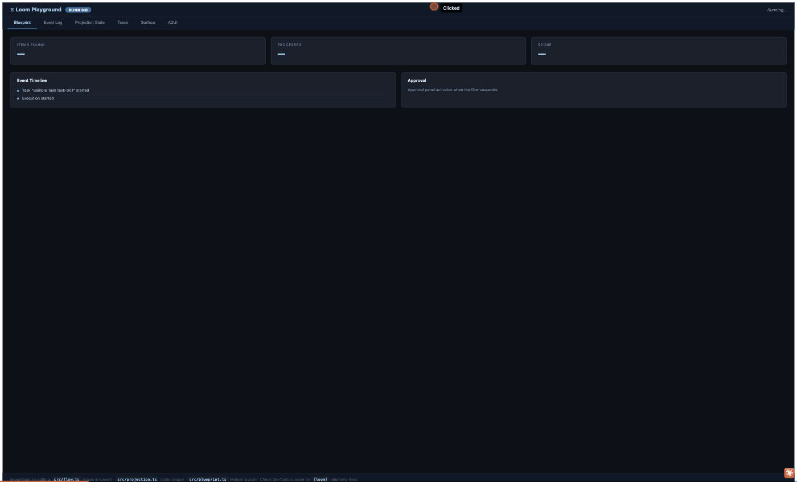
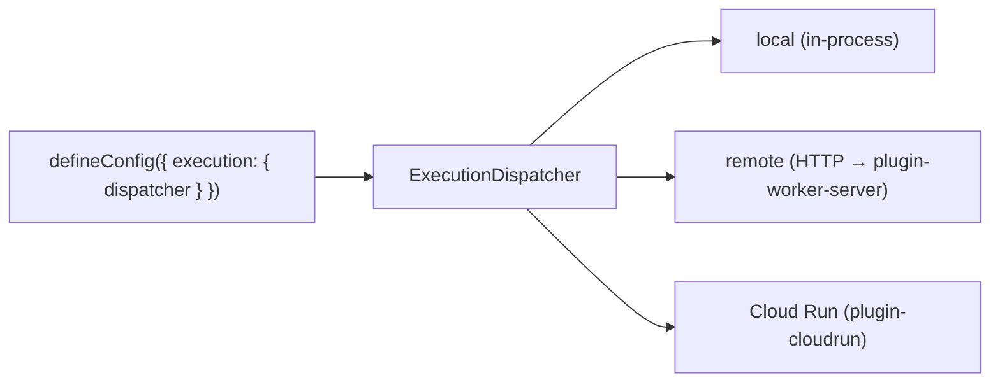

# Loom — User Guide

A **topic-by-topic reference** with runnable examples. Unlike the sequential [Usage](usage.md) tutorial, jump to any section. For the *why* behind these designs, see [Architecture](architecture.md).

> **Loom 2.0.** Sections 1–14 are the durable core (unchanged and always valid). Sections **15–20**
> cover the execution-kernel evolution — the Reasoning Runtime, tiered memory, the kernel-hardening
> rings (grants / quotas / supervision), event intelligence, AI-native codegen, and capability
> governance. Everything in 2.0 is **additive and opt-in**. Full data-structure/algorithm/diagram
> detail lives in [`loom-2.0/`](loom-2.0/00-overview.md).

## Contents

- [1. Flows, steps & handlers](#1-flows-steps--handlers)
- [2. The ExecutionContext (`ctx.execute` / `ctx.decide`)](#2-the-executioncontext)
- [3. Effects & middleware](#3-effects--middleware)
- [4. Suspend & resume](#4-suspend--resume)
- [5. Branching: fork / simulate / promote](#5-branching-fork--simulate--promote)
- [6. Projections & agent surfaces](#6-projections--agent-surfaces)
- [7. Agents, tools & A2A](#7-agents-tools--a2a)
- [8. Intent, planner & memory](#8-intent-planner--memory)
- [9. Configuration reference](#9-configuration-reference)
- [10. Testing](#10-testing)
- [11. The `loom` CLI](#11-the-loom-cli)
- [12. Evals & deploy simulation](#12-evals--deploy-simulation)
- [13. Where executions run (compute)](#13-where-executions-run-compute)
- [14. Determinism rules & pitfalls](#14-determinism-rules--pitfalls)
- **Loom 2.0:**
- [15. Reasoning Runtime — routing & elevation](#15-reasoning-runtime--routing--elevation)
- [16. Tiered memory](#16-tiered-memory)
- [17. Kernel: grants, quotas & supervision](#17-kernel-grants-quotas--supervision)
- [18. Event intelligence & self-optimization](#18-event-intelligence--self-optimization)
- [19. AI-native codegen (`appgen`)](#19-ai-native-codegen-appgen)
- [20. Capabilities: versioning, dependencies & authorization](#20-capabilities-versioning-dependencies--authorization)

---

## 1. Flows, steps & handlers

### `step$` — a unit of work

```ts
import { step$, handler$ } from "@loom/core";
import { z } from "zod";

const step = step$({
  id: "restart-pool",              // unique within the flow
  name: "Restart connection pool",
  inputSchema: z.object({ target: z.string() }),
  outputSchema: z.object({ ok: z.boolean() }),
  handler: handler$(async (input, ctx) => ({ ok: true })), // co-located logic
  toolId: "restart-pool",          // OR resolve to a registered Effect by id
  retry: { maxAttempts: 3 },       // optional
  timeoutMs: 30_000,               // optional
});
```

A step either carries an inline `handler` **or** names a `toolId` that resolves to an Effect registered in the `EffectRuntime` (§3). Use inline handlers for logic that lives with the flow; use `toolId` for shared or externally-provided effects.

### `flow$` + runner — a `RegisteredFlow`

The `flow$` **definition** is declarative metadata (schemas, version, the step list). The **runner** is the imperative orchestration function. A `RegisteredFlow` bundles them:

```ts
import { flow$ } from "@loom/core";
import type { FlowRunner, RegisteredFlow } from "@loom/workflow-runtime";

const runner: FlowRunner<In, Out> = async (ctx, input) => {
  const a = await ctx.run(stepA, { target: input.target });
  const b = await ctx.run(stepB, { from: a });
  return { result: b };
};

export const myFlow: RegisteredFlow<In, Out> = {
  definition: flow$({ id: "my-flow", name: "My Flow", version: "1.0.0", inputSchema, outputSchema, steps: [stepA, stepB] }),
  runner,
};
```

Register and run:

```ts
runtime.registerFlow(myFlow.definition, myFlow.runner);
const handle = await runtime.start(myFlow, input, { executionId: "opt-custom-id" });
```

> **Versioning.** `version` is part of the flow identity and is recorded. Deploy-sim (§12) uses the log to check whether new definitions can still resume old executions.

---

<a id="2-the-executioncontext"></a>
## 2. The ExecutionContext

The `ctx` passed to a runner is the only durability touch-point. Everything else is plain code. In Loom 2.0 the interface is named `ExecutionContext` (`WorkflowContext` remains an alias) and its methods are the **kernel's versioned syscall surface** (K1).

```ts
interface ExecutionContext {
  readonly executionId: string;
  readonly workflowId: string;

  // Loom 2.0: the generalized durable primitive. A step is one task kind; `run` is a thin alias.
  execute<TIn, TOut>(task: ExecutableTask<TIn, TOut>, input: TIn): Promise<TOut>;
  run<TIn, TOut>(step: StepDefinition<TIn, TOut>, input: TIn): Promise<TOut>;

  // Loom 2.0 (P9): record an advisory/optimizer choice durably; served on replay.
  decide<T>(id: string, decider: (scope: DecideScope) => T | Promise<T>, opts?: { rationale?: unknown; source?: string }): Promise<T>;

  parallel<const B extends readonly ParallelBranch[]>(
    branches: B & { readonly [K in keyof B]: CheckedBranch<B[K]> },
    options?: { limit?: number }
  ): Promise<ParallelResults<B>>;
  suspend<T = never>(config: { on: string; timeout?: number; correlationKey?: string }): Promise<T>;
  emit(eventType: string, payload: unknown): void;
  stream(eventType: string, delta: string, done?: boolean): void;
  readonly ui: SurfaceEmitter; // .set / .merge / .append
}
```

**`ctx.execute` — the generalized primitive.** A `StepDefinition` is a valid task (the `'step'` kind), so `ctx.run(step, input)` *is* `ctx.execute(step, input)`. Other task kinds (`llm` / `agent` / `tool` / `ui` / `memory` / `human` / `plan`) route through the same effect resolution and record the same `STEP_*` events, so existing logs replay byte-identically.

**`ctx.decide` — log an optimizer's choice (P9).** Wrap any non-deterministic decision (a model route, a memory recall, a learned ranking). On the first run the `decider` is consulted and its choice recorded as `DECISION_RECORDED`; on replay/resume the recorded choice is returned and the decider is **never called** — the twin of how a completed step is served from the log.

```ts
const model = await ctx.decide("route:triage", () =>
  reasoning.route(task, { budget }), { source: "triage-flow" });
// replay serves "model" from the log — no re-routing, deterministic run
```

**Parallel steps**, order-preserving and concurrency-bounded:

```ts
const [metrics, logs] = await ctx.parallel(
  [ [fetchMetrics, { target }], [fetchLogs, { target }] ],
  { limit: 2 }
);
// a step with a typed input is accepted as-is, `metrics`/`logs` carry each step's output type,
// and a wrong `{ target }` for a step is a compile error
```

**Emit domain events** into the log for projections/telemetry:

```ts
ctx.emit("assessment_complete", { riskLevel: "high" });
```

**Stream** incremental output (e.g. LLM output). Each call appends a **durable event** — that is what makes a stream replay-deterministic, and it means the delta count is a permanent cost of the log. So choose a semantic granularity (a sentence, a tool call, a section), not one call per model token:

```ts
for await (const chunk of provider.stream(request)) {
  sentence += chunk.delta;
  if (endsSentence(sentence)) {
    ctx.stream("triage_output", sentence);   // one durable event per sentence
    sentence = "";
  }
}
ctx.stream("triage_output", "", true);       // done
```

For genuinely per-token UI feedback, don't put it in the log: tail the execution with `liveQuery(deps).subscribe(executionId, cb)` (`@loom/live-query`), or narrate with `progressHub.report(ctx.executionId, line)` (`@loom/app`). Both are transient, so nothing becomes load-bearing for replay.

---

## 3. Effects & middleware

### Effects isolate side effects

All I/O flows through the `EffectRuntime`, keyed by `toolId`. During replay, a completed effect is served from the log — **never re-executed** — which is what makes resumes and forks exactly-once.

```ts
import { EffectRuntime, ToolEffect, LlmEffect } from "@loom/effect-runtime";

runtime.register("fetch-metrics", new ToolEffect(async (input: { target: string }, ctx) => {
  return await api.metrics(input.target);
}));

runtime.register("triage-llm", new LlmEffect(async (input, ctx) => {
  ctx.emit("llm_call", { model });
  return await provider.complete(input);
}));
```

Effect kinds: `"tool" | "llm" | "human" | "a2a"`. The `EffectContext` gives handlers `executionId`, `stepId`, `attempt`, `emit()`, and an optional `signal` (AbortSignal) for cancellation.

### Middleware wraps effects

Middleware is a composable chain `(ctx, input, next) => Promise`, applied outermost-first — identical in spirit to HTTP middleware.

```ts
import { retryMiddleware } from "@loom/middleware";
import type { EffectMiddleware } from "@loom/effect-runtime";

const logging: EffectMiddleware = async (ctx, input, next) => {
  const t = performance.now();
  try { return await next(); }
  finally { console.log(`${ctx.stepId} took ${(performance.now() - t).toFixed(1)}ms`); }
};

const app = defineConfig({
  storage: { kind: "memory" },
  flows: [myFlow],
  execution: {
    effectMiddleware: [
      logging,
      retryMiddleware({ maxRetries: 3, baseDelayMs: 200, factor: 2, jitter: true }),
    ],
  },
});
```

For effects whose results are large and individually low-value (telemetry reads, bulk
exports), `claimCheckMiddleware` ([ADR 0054](adr/0054-claim-check-middleware.md)) keeps the
log lean: results over an inline cap are stored content-addressed and the log records
`{ ref, size, digest }` **as the step output** — replay never resolves the ref, and the
per-tool `digest` (a declared pure projection) is the only part orchestration may branch on
(`loom lint claim-check` flags reach-through). Pair it with the K10.6 pinned sweep
(`sweepUnpinnedContent`) so refs cited by your domain events outlive raw-data TTLs:

```ts
import { claimCheckMiddleware } from "@loom/middleware";

claimCheckMiddleware({
  store: contentStore,                       // the ADR 0046 ContentStore
  inlineCapBytes: 16 * 1024,
  digests: { "pg.stat.read": (r) => summarize(r) }, // pure — the replayable projection
});
```

For results too large to hold in memory at all (a table dump, shadow-execution output), the
tool returns `streamResult(stream, { digest })` (ADR 0059): the middleware pipes the stream
into the content store *inside the effect* — the worker heap never holds the payload — and the
recorded value is still the small envelope (with a `codec`; read those back with
`resolveClaimCheckBytes`, outside the determinism boundary as ever). The digest must come from
the tool itself, computed while producing (the bytes are consumed by the upload).

`retryMiddleware` options: `maxRetries`, `baseDelayMs`, `factor`, `maxDelayMs`, `jitter` (deterministic FNV-1a jitter — no `Math.random`), `isRetryable`, `onRetry`, and an injectable `sleep`. It **never** retries a `SuspendError`, an aborted signal, or (by default) a `TypedFailure` — a declared domain outcome is not transient.

### Typed failure channels (ADR 0060)

An effect that can fail in an *expected* way — schema drift, not-found, quota — declares those
channels on its contract and completes on them with `fail(channel, payload)`:

```ts
import { fail, step$, TypedFailure } from "@loom/core";
import { z } from "zod";

const hydrate = step$({
  id: "hydrate#0",
  toolId: "mcp.invoke",
  inputSchema: z.unknown(),
  outputSchema: z.unknown(),
  errors: { schemaDrift: z.object({ toolName: z.string(), observedHash: z.string() }) },
});

// in the flow runner:
try {
  await ctx.run(hydrate, input);
} catch (err) {
  if (err instanceof TypedFailure && err.channel === "schemaDrift") {
    // err.payload is the validated, RECORDED payload — branch deterministically
    // (suspend into repair, re-plan, …). On replay this branch re-runs from the
    // log without re-invoking the effect.
  }
}
```

A declared-channel failure is logged as `STEP_FAILED { channel, payload }` (payload
Zod-validated, capped at 16 KiB) and **substituted on replay** exactly like a completed
result — the failure twin of the memoized success. Undeclared channels, invalid payloads,
and over-cap payloads degrade loudly to the legacy untyped failure (at-least-once
re-execution). Re-invoking the *same step id* after a typed failure is served the recorded
outcome; a deliberate retry mints a new id (`` `${id}#retry:1` `` — see §14's identity rule).
Declare channels on `tool$`/`ToolEffect` (`errors:` option) to cover every step that
dispatches through the effect.

---

### Journaled vs ambient effects (ADR 0073)

Some calls belong in the log and some must never enter it. A resumption — an approval, a submit —
is a durable fact. An **enrichment read** — a UI paginating a table, drilling into a row,
refetching a surface — is driven by a human clicking, so its count and order are a function of
user behaviour; journaling it makes replay a function of that behaviour too.

`invokeTransient` has always been the ambient path (zero durable footprint *by construction* —
the `EffectRuntime` holds no event store, journal, or fence). What was missing was the
**declaration**: which side a tool belongs on was decided by the caller's entry point, so every
new invocation surface had to hand-wire the routing.

```ts
const page = tool$({ id: "page", name: "page", description: "paginate", mode: "ambient", … });
effects.register("page", new ToolEffect(fn, { mode: "ambient" }));   // the enforced copy

await ctx.execute(page, { page: 2 });          // ✗ EffectModeViolationError
await effects.invokeTransient("page", { page: 2 });   // ✓
```

`execute` refuses an `ambient` effect; `invokeTransient` refuses a `journaled` one. Undeclared
tools are unaffected on both seams, so this is opt-in.

It is a **boundary check, not a journaling mode**. An `ambient` tool is not "an effect that skips
its journal" — that would be a second replay model inside one execution (the rejected DE-2
durability class). It is one that may not enter an execution at all. The seam comes from the
entry point, never from the context's contents, so a hand-built transient-*looking* context
cannot spoof it.

The payoff is that a surface can route from the declaration instead of an allowlist — which is
exactly what `@loom/plugin-mcp`'s `servedEffect` does.

**When to declare — and when not to.** Declare a mode when the effect's *own contract* depends on
the seam, i.e. when being on the wrong side would corrupt recovery, replay, or durability.
`a2ui.callFunction` is `journaled` because a crashed call parks at EFFECT_INDOUBT and there is no
journal to park in transiently; durable-state's `save`/`clear` are `journaled` because a transient
write moves the store while the log learns nothing.

Leave it **undeclared** when both seams are legitimate — that is a real answer, not an omission:

- `mcp.invoke` and `sandbox.eval` are dual-seam by design. The transient-interpreter pattern
  hydrates a read path with `invokeTransient`, then starts a *durable repair run* that calls the
  same effects through `ctx.run`. Pinning either would break one path.
- durable-state's `load` — journaled in a flow, a fine ambient read for an operator dashboard.
- Anything wrapping someone else's system (a discovered MCP tool, an A2A peer): you cannot know
  whether a remote tool is a read or a mutation, and a guessed seam has teeth.

## 4. Suspend & resume

`ctx.suspend()` writes a durable checkpoint and returns control to the caller. The execution now lives entirely in storage — the process can restart, and another machine can resume it.

```ts
const ApprovalDecision = z.object({ approved: z.boolean(), approvedBy: z.string() });
type ApprovalDecision = z.infer<typeof ApprovalDecision>;

const decision = await ctx.suspend<ApprovalDecision>({
  on: "ApprovalGranted",           // logical event you'll resume with
  correlationKey: input.target,     // metadata for an external dispatcher; resume() routes by executionId
  timeout: 24 * 60 * 60 * 1000,     // optional; drives a timeout condition
});
```

The type parameter names what the gate delivers; it defaults to `never`, so omitting it is exactly the old behaviour. But it is a **claim, not a check** — erased at runtime. Declare the same schema in `resumeSchemas` (below) and the two share one source: the runtime enforces it, and the runner is typed by it.

Resume from anywhere:

```ts
await runtime.resume(executionId, {
  eventType: "ApprovalGranted",
  payload: { approved: true, approvedBy: "operator" },
});
```

**Enforcing the gate (ADR 0077).** The type argument above buys static safety and nothing else — nothing verifies the payload a caller actually sends, and once it is appended it is a permanent fold input that cannot be rejected retroactively. Declare the contract on the flow and `resume()` parses it **before** anything is written:

```ts
flow$({
  id: "remediate-lag",
  // …
  resumeSchemas: {
    ApprovalGranted: ApprovalDecision,          // the same schema the runner is typed by
    RemediationDecision: RemediationDecision,
  },
})
```

A payload that does not satisfy its gate's schema is refused with `ResumePayloadValidationError`,
naming the offending field; **nothing is appended** and the execution stays suspended, so a
corrected payload still lands. The *parsed* value (Zod defaults and transforms applied) is what gets
recorded — the same principle `validateInput` applies at `start()`. Declared per flow rather than at
the `ctx.suspend` call site so the schema resolves without running the flow body, which is what
makes refuse-before-append possible.

Opt-in by presence: no map, or no entry for that event type, is exactly today's behaviour. `resumeAs` validates against the **target** flow's map, since that is the code being resumed onto.

> **Careful: a strict schema changes what gets persisted.** "The parsed value is what gets recorded" cuts both ways — `z.object` **strips** keys it does not name, so a field absent from your schema is dropped from the durable log *permanently*, with no warning. Declaring a gate contract is a decision about what is stored, not only about what is accepted.
>
> ```ts
> // Caller sends: { approvedBy: "ops", a2ui: { surfaceId, action, context } }
>
> z.object({ approvedBy: z.string() })                  // log keeps { approvedBy } — a2ui GONE
> z.object({ approvedBy: z.string() }).passthrough()    // log keeps both
> z.object({ approvedBy: z.string(), a2ui: A2uiAction })// log keeps both, and checks a2ui
> ```
>
> Prefer modelling the extra fields — you get validation as well as retention. Reach for `.passthrough()` when the payload legitimately carries an open envelope you do not own (an A2UI `functionResponse`, a webhook body) and cannot enumerate. Because the stripped write is durable, this is not something you can fix after the fact: the events are already folded.
>
> **And model what callers actually send, not what the gate name suggests.** Grep your
> `runtime.resume` call sites first. In the examples repo, a gate named `ApprovalGranted` turned out
> to receive `{ approvedBy, approvedAt }` with no `approved` field at all, and another received a
> bare `{ approved }` from one caller and `{ approved, approvedBy }` from a second — the "obvious"
> schema would have refused every real resume those apps send. A cast hid that for as long as it
> existed; a schema is where it surfaces.

**Mechanics.** On resume the runner re-runs from the top. Every step that already completed is replayed from its logged `STEP_COMPLETED` (the effect does not run again); when execution reaches the original `suspend()`, that call *returns the resume payload* and the flow proceeds. This is deterministic replay (see [Architecture §4.3](architecture.md#43-suspend--resume)).

**Recovery.** A crash mid-flight is just a resume: on redispatch the runtime folds durable state and, if still `running`, resumes; if already terminal, returns as-is. No step re-runs. `loadState(id)` folds state without running.

**Bounding replay.** For long executions, set `snapshotEvery` so a resume folds only the tail after the latest snapshot. It is a `defineConfig` key, so it does not cost you the composition root — and it is storage-agnostic, applying to whatever `EventStore`/`SnapshotStore` pair you wired (`kind: "memory"`, `sqliteStorage()`, `postgresStorage()`, or your own preset):

```ts
defineConfig({
  storage: { kind: "custom", eventStore, snapshotStore }, // …or any preset
  durability: { snapshotEvery: 100 },
  // Snapshot saves are fire-and-forget — a lost checkpoint costs replay time, not
  // correctness, so nothing rejects and no event records it. Wire this or a failing
  // snapshot store is indistinguishable from one taking no snapshots at all.
  observability: { onStorageError: (executionId, err) => logger.warn({ executionId, err }) },
});

// Hand-wiring takes the same two options:
new WorkflowRuntime({ eventStore, snapshotStore, effectRuntime, snapshotEvery: 100 });
```

Worth setting once executions get long: measured at a 102-event log it is 4.76 ms → 1.22 ms p50; at 4 events it is nothing (0.72 → 0.71 ms), so short flows should not bother. Larger *N* means fewer snapshot writes and a longer worst-case replay. See [scaling §3.2](scaling.md) for the measurements.

### Child workflows (`@loom/orchestration`)

Spawn another flow as a **separate child execution** — its own durable log, its own replay, its own
failure — and durably await its result from the parent. Built entirely from `ctx.decide` +
`ctx.suspend` + `runtime.resume` (one suspend/resume cycle per await):
**no new syscall, no new event type**. A `superviseChildren` supervisor, wired into the runtime's
`onEvent`, turns each spawn into a running child and each child's completion back into a parent
resume.

```ts
import {
  awaitChild, awaitChildren, awaitAll,
  superviseChildren, type ChildResult,
} from "@loom/orchestration";

// Wire the supervisor once (it sees every execution's events):
const holder: { supervisor?: ReturnType<typeof superviseChildren> } = {};
const runtime = new WorkflowRuntime({
  eventStore, snapshotStore, effectRuntime,
  observability: { onEvent: (e) => holder.supervisor?.onEvent(e) },
});
holder.supervisor = superviseChildren({ runtime, flows: { build: buildFlow, smoke: smokeFlow } });
```

Three ways to await, inside a parent runner:

```ts
// One child — returns its output, or THROWS a typed `childFailed` if it fails/cancels.
const artifact = await awaitChild<Built>(ctx, { key: "build", flowId: "build", input });

// N children CONCURRENTLY, wait-all SETTLED — a partial failure is data, not an exception.
const results: ChildResult<Built>[] = await awaitChildren<Built>(ctx, {
  key: "build",
  children: services.map((s) => ({ flowId: "build", input: s })),
});
results.forEach((r, i) => {                    // positionally aligned with the input, in order
  if (r.status === "completed") ship(r.output);
  else if (r.status === "failed") report(services[i], r.error);
  else report(services[i], r.reason);          // "cancelled"
});

// N children, ALL-OR-NOTHING — unwrapped outputs, or THROWS `childFailed` on the first failure.
const built = await awaitAll<Built>(ctx, { key: "build", children: [...] });
```

**Replay-safe by construction.** Each spawn is fixed by one `ctx.decide`, and child ids are deterministic — `<parentId>::<key>` for `awaitChild`, `<parentId>::<key>#<i>` for the `awaitChildren`/`awaitAll` fan-out — so a recovery re-run never starts a second child, and the id scheme composes for nested children. `maxDepth` bounds recursive re-entry.

**Failure propagation composes up the tree.** An uncaught `childFailed` (from
`awaitChild`/`awaitAll`) fails the parent; if that parent is itself a child, the failure climbs one
level up through the same mechanism. `childFailed` is a typed failure (channel `CHILD_FAILED`)
carrying `{ childId, status, error?/reason? }` — catch it to settle with a fallback, or let it
propagate. Use `awaitChildren` when partial failure is acceptable (the parent weighs the settled
results); use `awaitAll` when the set must all succeed.

Composed from existing primitives, so it stays outside the kernel (P10). See the runnable **`child-orchestration`** example in the sibling [`loom-examples`](examples.md) repo (a release pipeline: `awaitChildren` builds → `awaitAll` smoke gate → `awaitChild` publish).

---

## 5. Branching: fork / simulate / promote

Branching is nearly free because state is `fold(events)` — a fork copies the event prefix into a new execution and resumes it differently. Enable it with `storage: { branching: true }` (or pass a `BranchRegistry`).

```ts
// Fork the prefix [0..sequence] into a new branch.
const fork = await runtime.fork(parentId, atSequence, { branchName: "spec/scale" });
// fork.executionId is a new, independent execution seeded at the fork point.

// Resume the branch differently (e.g. a "simulate" flag your flow reads).
const resumed = await runtime.resume(fork.executionId, {
  eventType: "RemediationDecision",
  payload: { approved: true, strategy: "scale", simulate: true },
});
const outcome = (await resumed.waitForCompletion()).variables._output;
```

**Forking a timed gate.** If the fork point is a suspension carrying a deadline
(`suspend({ timeout })` or `ctx.sleep`), the branch gets its own timer row so its deadline fires
independently of the parent's — a timer is keyed by execution, so without this a branch would carry
a deadline nothing could fire. The branch **inherits the recorded wake time**; it cannot re-base it,
because a timer fires only when it matches the `wakeAt` in the log and the copied prefix is
byte-identical by design. A branch that needs its own deadline resumes the gate and suspends again
with a fresh `timeout`.

**Forking a compacted parent.** Compaction removes the events below its checkpoint, so not every
sequence of a compacted execution can be forked any more. `fork` serves a fork point exactly or
refuses it ([ADR 0107](adr/0107-compacted-fork-points-and-the-blank-stream.md)). It is exact when
every event between the nearest snapshot and the fork point survived, or when a snapshot sits
exactly at it. A log compacted through its tip (`[0]`) can therefore be forked at its checkpoint:
the range is the folded tip, not the last event. Anything else throws `CompactedForkPointError` with
nothing written. Its `forkableFrom..forkableThrough` names the span you can fork instead, and
sequence 0 always works. A fork at a checkpoint whose own event was compacted away is also refused
when pinned events survive below it (`reason: "checkpoint-above-prefix"`), because that child's log
would read as never compacted.

**Branches and retention.** A losing branch stays durable and independently resumable — that is the
audit trail. It also *blocks its parent*: retention never reclaims an execution while a live
descendant branch still has events, and a branch nobody answered is suspended forever, so the parent
is never reclaimed either. Retiring an abandoned branch is what unblocks the chain —
`retireAbandonedBranches(runtime, registry, parentId, { isAbandoned })` cancels the ones your
predicate claims (a durable `EXECUTION_CANCELLED`, not a deletion), after which ordinary retention
collects the branch on its TTL and the parent behind it. `isAbandoned` is required: a branch parked
on a human gate is someone's open question, and only you know whether that person is still coming.

After retention has collected a branch, two registry rows outlive it: `LogLifecycle` forgets the
fork edge as it deletes the execution (optional `removeLineage`), and
`pruneBranchRefs(eventStore, registry)` sweeps refs that point at nothing — a dangling ref is not
merely untidy, because promoting one leaves `main` naming an execution nobody can read. That sweep
needs no predicate: "the execution is gone" is a fact rather than a judgement. It protects `main` by
default and reports it instead.

**Promoting from more than one place.** `promote(from, to)` is last-write-wins: two nodes promoting
different winners onto `main` both succeed, and the loser silently becomes what `main` names. Pass
`{ expect }` to make it a compare-and-set — the executionId `to` must name right now, or `null` for
"must not exist yet". A mismatch throws `BranchPromotionConflictError` and nothing moves, so you
re-read and decide rather than retrying blind. `listRefs({ limit, after })` pages the ref table by
name, which matters because forking is cheap and refs are never collected.

The `BranchRegistry` provides git-style refs — `putRef`, `moveTip`, `promote(from, to)`, `children`, `getLineage`:

```ts
await branchRegistry.putRef({ name: "main", executionId: parentId, tip: forkPoint });
await branchRegistry.promote("commit", "main"); // pointer move, no merge
```

**Pattern (fork → simulate → compare → promote).** Fork per strategy, run concurrently with
`parallelLimit`, compare the projected outcomes, then commit the winner via a fresh fork resumed
with `simulate:false`. Losing branches stay immutable — a full audit trail. Full worked example:
`incident-war-room` (in the [examples catalogue](examples.md)) and the
[Usage tutorial §10](usage.md#step-10--branch-fork--simulate--promote).

---

## 6. Projections & agent surfaces

A **projection** is a read model folded from events, independent of durability. Flows emit UI patches via `surface(ctx)` (`import { surface } from "@loom/agent-surface"`; the old `ctx.ui` accessor is deprecated and only exists where the `surface` dep is injected, ADR 0114); they fold into named **surfaces**.

```ts
surface(ctx).set("phase", "investigating");                 // overwrite path
surface(ctx).merge("metrics", { cpu: 87, memMb: 14000 });   // shallow-merge object
surface(ctx).append("timeline", "collected metrics");        // push to array (amortized O(1) in a batch)
```

Read a surface (server, client, or test):

```ts
const view = app.projectionRuntime.getState<MyView>("mission", executionId);
```

Register surfaces via `defineConfig({ surfaces: ["mission", "telemetry"] })`, or a custom projection with `projection$({ id, name, initialState, handlers })` for domain-specific read models. Render with any renderer — `@loom/plugin-renderer-react`, `@loom/plugin-renderer-terminal`, or your own. **The durable log never depends on the renderer.**

> **Naming note.** `@loom/agent-surface` is Loom's *native* surface-patch protocol — it is **not** the external Google [A2UI](https://a2ui.org) wire protocol, despite the historical name. To interoperate with A2UI-compliant clients, use the `@loom/plugin-a2ui` adapter below.

### Exposing a surface over A2UI (external clients)

`@loom/plugin-a2ui` projects an agent surface onto the real
**A2UI (Agent-to-UI) wire protocol v1.0**, so any A2UI-compliant client (web/mobile/desktop) can
render a Loom-driven UI without executing code. A 1P plugin, kernel untouched
([ADR 0069](adr/0069-a2ui-egress-adapter.md),
[ADR 0070](adr/0070-a2ui-callfunction-bidirectional-rpc.md)): it folds `SURFACE_PATCH` events and
emits A2UI `createSurface` / `updateDataModel` / `deleteSurface` messages (translating Loom's
*delta* patches into A2UI's *absolute* value-replacement), ingests the client's inbound `action`,
and supports the **`callFunction` bidirectional RPC** (see below). Only continuous two-way *binding
sync* is out of scope.

```ts
import { A2UISurfaceBridge, column, text, badge, bind } from "@loom/plugin-a2ui";

// The A2UI "view" — components bound by JSON Pointer into the surface data model.
const view = [column("root", ["status", "score"]), badge("status", bind("/status")), text("score", bind("/stats/score"))];
const bridge = new A2UISurfaceBridge({ executionId, components: view });

send(bridge.snapshot());                                   // createSurface (view + current data)
eventStore.subscribe(executionId, (e) => {
  for (const msg of bridge.handleEvent(e)) send(msg);       // updateDataModel per patch
});

// Inbound: a client Button action → resume the flow.
onClientMessage((m) => {
  const action = bridge.ingestAction(m);
  if (action?.action === "approve") {
    app.runtime.resume(executionId, { eventType: "TaskApproved", payload: { a2ui: action } });
  }
});
```

It ships a default component catalog (`Text`/`Column`/`Row`/`List`/`Badge`/`Button`) plus `defineCatalog` for your own.

**`callFunction` (bidirectional RPC).** The agent can also ask the client to run a named catalog
function and answer with a `functionResponse` — reconciled with Loom's replay grain by the client's
*result* re-entering as a recorded fact (no client-side effect runtime needed), keyed by a
deterministic `callId`. Two grains ([ADR 0070](adr/0070-a2ui-callfunction-bidirectional-rpc.md);
runnable as `a2ui-callfunction` in the sibling [`loom-examples`](examples.md) repo):

- **Grain A** — a read, via a `ctx.suspend` gate: `bridge.callFunction(name, args, { callId })` → client answers → `bridge.ingestFunctionResponse(msg)` → `runtime.resume`. The `callId` must be deterministic **and** call-site-unique (e.g. `` `${executionId}:getLocale#1` ``).
- **Grain B** — a side effect, via a delegated effect:
  `registerA2UICallFunction(app.effectRuntime, transport)`, then
  `await ctx.execute({ toolId: A2UI_CALL_FUNCTION_TOOL_ID, … }, input)`. Declared
  `idempotent: false`, so a crash mid-call parks at `EFFECT_INDOUBT` for an operator verdict. The
  `callId` is `ctx.idempotencyKey` (unique per step); a side-effecting client function must dedup on
  it (effects are at-least-once).

See `apps/playground` (the **A2UI** tab) for a live end-to-end wiring, and the [API reference](api-reference.org) for the full surface.

The playground's **A2UI** tab shows the emitted wire messages (`createSurface` → `updateDataModel` → `deleteSurface`), and the **Approve** button round-trips an inbound `action` back through `ingestAction`:



For streamed progress independent of surfaces, use a pub/sub hub (`progressHub`) — handlers call `report(id, line)` / `reportProgress(id, pct)` and orchestrators subscribe (`onReport` / `onProgress`). See `schema-migration-planner` (in the [examples catalogue](examples.md)).

---

## 7. Agents, tools & A2A

### Tools & agents

```ts
import { tool$, agent$ } from "@loom/core";

const queryTool = tool$({
  id: "query-db", name: "Query DB", description: "Run a read-only query",
  inputSchema: z.object({ sql: z.string() }), outputSchema: z.object({ rows: z.array(z.unknown()) }),
});

const dbaAgent = agent$({
  id: "dba", name: "DBA Agent", description: "Owns database operations",
  tools: [queryTool],
});
```

`@loom/agent` runs a ReAct-style reason→act loop over an agent's tools; `@loom/plugin-mcp` discovers external tools via the Model Context Protocol.

### Running the loop: `agentLoop$`

`agentLoop$` is the canonical loop (R10, [ADR 0121](adr/0121-one-canonical-agent-loop.md)). `AgentRunner` and `agentStep$` are deprecated: they still work, unchanged, and the migration is in the ADR. What each costs, so the choice is informed:

> **`idempotent: false` tools.** `AgentRunner` / `agentStep$` / `asEffect()` run nested tool calls
> inside one outer frame, so the K9.3 in-doubt protection
> ([ADR 0021](adr/0021-k9-effect-delivery-contract-idempotency-fencing.md)) does not reach them and
> they REFUSE such a tool (`IdempotentToolRefusedError`, before it runs) unless you pass
> `acceptAtLeastOnce: true` (a crash then re-runs it). The check covers the WHOLE batch of a turn
> before any call of it is dispatched, so an ordinary sibling never runs ahead of a refused one. A
> runner's nested tool calls each get a per-call idempotency key,
> `<outer>:t<turn>:c<position>:<hash of tool name + canonical input>` (the same call at the same
> position re-runs with the same key; a different call, even at the same position, gets a different
> one). Use `agentLoop$` for these tools. See the ADR 0121 amendment of 2026-10-15.

**`agentStep$` (deprecated) — one opaque frame.** The whole loop is a single `step$`, so the execution log gets one `STEP_STARTED`/`STEP_COMPLETED` pair no matter how many turns it took. Cheap, and the right choice when a turn is not worth recovering individually. The costs are structural, because a step *handler* receives `StepHandlerContext` — `emit`, and nothing else:

- a crash at turn 39 re-runs all 39, since the frame is the unit of recovery;
- the agent cannot pause for approval, so a human gate has to sit outside the agent entirely;
- routing choices can be emitted as facts but not *recorded as decisions*, so a replay re-decides.

```ts
import { agentStep$ } from "@loom/agent";

const ask = agentStep$({ id: "ask-dba", agent: dbaAgent, provider, effectRuntime });
```

**`agentLoop$` — one durable frame per turn.** An ordinary function over `ExecutionContext`, called from a runner body. Each turn is its own task, so a crash costs one turn; the model call resolves through the `EffectRuntime`, so K2 authorization, metering, retry, `idempotencyKey` and K9 in-doubt all apply to it; and the loop can `suspend` mid-flight for approval.

```ts
import { agentLoop$, createAgentModelEffect } from "@loom/agent";

// The model is an effect, which is what puts it inside the protection ring.
effects.register("model", createAgentModelEffect(provider));

runtime.registerFlow(askFlow, async (ctx, input) =>
  agentLoop$(ctx, { definition: dbaAgent, modelToolId: "model" }, { prompt: input.question })
);
```

In a `defineConfig` app there is no `effects` variable to call `register` on: the model and every tool effect are registered through `execution.registerEffects`, which runs once at boot with the constructed `EffectRuntime` (section 9):

```ts
const app = defineConfig({
  flows, // …
  execution: {
    registerEffects: (effects) => {
      effects.register("model", createAgentModelEffect(provider)); // the id you pass as `modelToolId`
      // …and each tool's runnable effect, under the id the agent's tool definition names
    },
  },
});
```

An `agentLoop$` whose `modelToolId` (or a tool id) was never registered fails at its first call, so moving off `AgentRunner` (which took the provider directly) means adding this registration. Discovery (`toolModules`) supplies tool metadata only.

**What it costs:** per-turn durability journals each turn's message array, so the log grows with conversation length. Two mitigations, both already in the box — claim-check middleware bounds the *bytes* per turn, and `compaction` bounds the *turns* (below). An adopter who wants neither can still use the deprecated `agentStep$`.

See [ADR 0087](adr/0087-durable-agent-loop.md).

### Tool failures, parallel tools, stopping, memory

A failing tool does not fail the run: the failure goes back to the model as an `isError` `tool_result` (`{ error }`) so it can retry or explain. Authority denials, safety and quota stops, cancellation and a park are never fed back. `toolErrors: "fail"` restores fail-the-run.

```ts
agentLoop$(ctx, {
  definition: dbaAgent,
  modelToolId: "model",
  parallelTools: 4,              // one turn's calls overlap through ctx.parallel; true = unbounded
  signal: turn.signal,           // stop THIS run (barge-in): no further model or tool call, AGENT_INTERRUPTED
  turnTimeoutMs: 60_000,         // the model frame's kernel deadline
  toolTimeoutMs: 15_000,         // a tool that exceeds it is an isError result
  memory, writeBack: { toolId: "memwrite" },  // persist prompt + answer; or { unless } / { allowDirect: true }
}, input);
```

Step ids do not change with `parallelTools` (`<loop>#turn:<i>:tool:<j>`), results reach the model in
its order, and approvals are collected, in order, before any call of the turn starts. An untyped
tool failure is re-run on replay (the kernel's rule for a failed step); a tool that must fail
exactly once throws a `TypedFailure` on a declared channel. A `reasoning` model response is
journaled as a decision, so a resumed run makes no model call for a completed turn.

### Pausing for a human

`needsApproval` parks the execution on a gate **before** the tool runs — the point of asking. A refusal comes back to the model as a tool result rather than an exception, because a human declining is information the agent can settle on, not an error:

```ts
agentLoop$(ctx, {
  definition: dbaAgent,
  modelToolId: "model",
  needsApproval: (call) => call.name === "drop-table",    // true ⇒ ask first
  approvalGate: "AgentToolApproval",                       // resume with { approved: boolean }
}, input);
```

`needsApproval` returns `true` to park and `false` to run. It replaces `requireApproval`, which read
backwards (an auto-approve policy: `true` proceeds, `false` parks) and is now a deprecated alias
with its old polarity: `requireApproval: (c) => c.name !== "x"` is
`needsApproval: (c) => c.name === "x"`. The recorded log is identical, so old logs replay unchanged;
using the alias emits one `LOOM_AGENT_REQUIRE_APPROVAL_DEPRECATED` warning, and supplying both
throws `AgentLoopConfigError`. A `kind: "human"` tool parks by itself for its answer; the approval
policy is independent of that.

Pair the gate with `flow$({ resumeSchemas })` so the resume payload is parsed before it lands — see [§4 Suspend & resume](#4-suspend--resume) and [ADR 0077](adr/0077-typed-resume-payloads.md).

### Recorded choices: skills, memory, routing

Three things an agent decides change what the model is asked, and none is derivable from the log. Each goes through `ctx.decide`, so a replay reconstructs the prompt that **actually ran** rather than re-deciding:

```ts
agentLoop$(ctx, {
  definition: dbaAgent,
  modelToolId: "model",
  skills, skillSelector,          // which skills are relevant
  memory, recallLimit: 20,        // what conversation history to recall — BOUND it
  // or: reasoning,               // which model tier answers, plus each elevation
}, input);
```

`recallLimit` matters more than it looks: without it, every remembered entry reaches the prompt and conversation length becomes a hard wall rather than a cost curve.

Use `reasoning` **or** `modelToolId`, not both. The Reasoning Runtime routes and elevates across
model tiers and records every choice, and the response is journaled (R10), so a resume does not
re-ask — but without `reasoningToolId` it makes the model call through its own routes, so the
request is still guarded at the prompt boundary while K2, metering and K9 in-doubt do not apply to
it. `modelToolId` (or `reasoning` + `reasoningToolId`) gets the full ring.

### Large tool menus: `toolSearch` ([ADR 0125](adr/0125-tool-search.md))

With a few hundred tools (an MCP server catalogue) a full menu costs tokens every turn and degrades
tool choice. `toolSearch` offers the model a `search_tools` meta-tool instead: it searches the
host-offered `catalog` (the agent's own `definition.tools` and the selected skills' tools stay on
the menu from turn 0) and adds the best matches to its menu for the following turns.
**It is not worth enabling below about 30 tools** (the menu is cheaper than the extra round trip),
and it is off by default.

```ts
import { agentLoop$ } from "@loom/agent";
import { tool$ } from "@loom/core";

const chargeInvoice = tool$({
  id: "charge_invoice", name: "charge_invoice", description: "Create a payment request",
  inputSchema, outputSchema,
  tags: ["billing"], aliases: ["bill the customer", "collect payment"], // trusted author vocabulary
});

agentLoop$(ctx, {
  definition: agent$({ id: "ops", name: "Ops", tools: [lookupCustomer] }), // always on the menu
  skills, // a selected skill's tools are auto-loaded too
  modelToolId: "model",
  toolSearch: {
    catalog: [chargeInvoice, /* ...200 more... */], // the searchable set
    alwaysLoaded: ["charge_invoice"],           // a catalog entry on the menu from turn 0
    namespaces: ["mcp:ops:", "billing_"],       // optional host allowlist of searchable id prefixes
    annotations: { "mcp:ops:run_sql": { aliases: ["query the database"] } }, // host vocabulary for MCP tools
    maxPerSearch: 5, maxLoaded: 20,
  },
}, { prompt: "bill the customer for the March invoice" });
```

What you get and what you do not:

- **Authority is unchanged.** Only `toolSearch.catalog` can ever be found or loaded by a search (the agent's own tools and the selected skills' tools are already on the menu); a loaded tool still passes the menu gate, input validation, `requireApproval` and the effect ring. A tool outside that set is never returned or callable.
- **Replay-safe.** Each search is one recorded decision (`<loop>#turn:<i>:tool:<j>:search`), so a resume ranks nothing and reproduces the same menu. The menu is append-only (`search_tools`, then `definition.tools`, the selected skills' tools and `alwaysLoaded`, then searched tools in search order), which keeps the prompt prefix cacheable.
- **Bounded.** Query 512 characters / 16 distinct terms; `maxPerSearch`, `maxLoaded`, `maxSearches`, optional `maxMenuChars`. `fitToWindow` does not count tools: reserve for `alwaysLoaded` plus `maxLoaded` specs.
- **Close the vocabulary gap with aliases, not a bigger description.** Ranking is lexical BM25F
  (name > aliases = tags > description). Users say "bill the customer"; the tool is
  `charge_invoice`: give it `aliases`. For an MCP/A2A tool use `toolSearch.annotations`
  (host-written, trusted); a remote server's own tags and aliases are never trusted vocabulary, its
  description is not ranked on unless you set `trustJsonSchemaText`, and a result that names a
  third-party tool is tainted. "Third party" means a tool a plugin marked `origin: "remote"` (the
  MCP and A2A plugins do), or one with a `jsonInputSchema`, or `kind: "a2a"`; a tool whose
  description is itself tainted is listed but never loaded. The same rule applies to the tool spec
  the model is shown ([D14](adr/0125-tool-search.md)): an un-vouched remote tool, A2A included,
  appears with the fixed description `Third-party tool; description withheld` unless you set
  `trustJsonSchemaText`. This is the recommended fix before semantic ranking.
- **Give your ranker the vocabulary, and the stoplist ([D15](adr/0125-tool-search.md)).**
  `toolSearch.ranker` (and `skillActivation.skillRanker`) can be a factory, `(docs) => ToolRanker`,
  called once on the first search with the sanitized docs `{ id, description?, tags, aliases }` of
  the tools (or skills) this run can search: your annotations, first-party tags/aliases, vouched
  descriptions, and never an un-vouched remote tool's text, so you do not re-implement the trust
  policy. For a ranker you build once and share across runs, build it from
  `toolSearchDocs(catalog, { annotations })`. A factory that throws is `search_unavailable` and is
  retried on the next search; replay never calls it. The built-in ranker ignores common English
  words in the QUERY ("bill the customer" no longer matches an alias just because it contains
  "the"); tune it with `toolSearch.stopwords` (`[]` turns it off, at most 256 entries). The default
  list drops "can", "or" and "it" from mixed queries; the index is unchanged, so an all-stopword
  query keeps its terms. Set `stopwords: []` or your own list if those words carry intent in your
  domain (a multi-word entry splits into separate words). A factory must be synchronous and return a
  ranker with a string `kind`: an `async` factory or a class passed as `ranker` is refused or
  reported (`LOOM_AGENT_RANKER_FACTORY`), not silently unavailable. That changes live result order;
  recorded searches replay as before.
- **Plug in your own ranker** (`toolSearch.ranker`, a `ToolRanker`), e.g. an embedding model: its
  answer is recorded, so it replays identically. A ranker (and `skillActivation.skillRanker`) is
  read for at most the `limit` hits it was asked for; anything past that is ignored, so a sloppy
  ranker cannot make a search expensive. `Bm25ToolRanker` is exported for other consumers (the
  loom-ui planner can rank capabilities with it: `description: intent`).

### Activating skills mid-loop: `skillActivation` ([ADR 0125](adr/0125-tool-search.md) D11)

`skills` + `skillSelector` pick skills ONCE, before the first model call; an unselected skill can never show up later. `skillActivation` adds progressive discovery: the model sees a cheap index (`id: description [tags]`) of the skills that were not selected and calls `activate_skill({ name })` when it needs one. It is off by default.

```ts
agentLoop$(ctx, {
  definition, modelToolId: "model", skills: registry,
  skillActivation: { maxActive: 3 },   // catalog defaults to the `skills` registry; or pass SkillDefinition[]
});
```

- **The instructions come back as the tool result**, not as a system message: the turn-0 prompt (and its prompt cache) never changes. The skill's tools join the menu from the next step (deduped, append-only), so they are callable without a search; `toolSearch` will not offer them again.
- **Bounded and deterministic.** The index lists the first `maxIndex` (50) skills by id, within `maxIndexBytes` (8 KiB; the rest are summarised as `+N more` and cannot be activated; an id over 64 characters or with control characters is not offered); only listed skills can be activated; `maxActive` (5) per run; `maxInstructionBytes` (32 KiB) per skill.
- **Selection is relevance, not authorization.** The default `catalog` (the `skills` registry) makes EVERY registry skill reachable by the model; its tools still pass the menu gate, approval hook and effect ring when called, but restrict what can be reached with an explicit `catalog: [...]`.
- **Recorded.** Each activation is a decision `<loop>#turn:<i>:tool:<j>:skill`
  (`source: "agent-skill-activation"`), so a resume re-applies it without re-deciding. An unknown or
  over-cap call is an error result (`unknown_skill`, `skill_limit_reached`) that records nothing; an
  oversized or tainted-instruction call is an error result (`instructions_too_large`,
  `instructions_refused`) whose verdict is recorded, so a resume reproduces it even if the registry
  changed; an activation whose text became undeliverable since it was recorded stands (tools join)
  and returns `instructions_unavailable`. The record also carries a sha256 `digest` of the
  instructions delivered ([D14](adr/0125-tool-search.md)): if the registry text differs on a resume,
  or when you re-activate an already-active skill, nothing new is delivered; the result is the typed
  error `instructions_changed` (the skill's tools stay on the menu, nothing is recorded) and a
  `LOOM_AGENT_SKILL_CHANGED` process warning is emitted. Records written before the digest existed
  behave as before.
- **Large registries: `discovery` ([D12](adr/0125-tool-search.md)).** The index is capped, so with
  hundreds of skills the tail cannot be activated. Set `skillActivation: { discovery: "search" }`
  (needs `toolSearch`) and the prompt carries one fixed line instead of the index; the model finds
  skills with `search_tools`, which returns them under `skills`
  (`{ kind: "skill", id, description }`, beside the unchanged `tools`) and then calls
  `activate_skill({ name })`. Search is a convenience, not an authorization step: `activate_skill`
  accepts any catalog skill (minus upfront-selected ones) by id, found or not. `"both"` with a tiny
  `maxIndexBytes` is allowed (search covers everything) and `"search"` ignores `maxIndexBytes`. A
  search never loads a skill or its tools. `"both"` keeps the index and adds search; the default
  `"index"` is today's behaviour. Skill hits share the `maxPerSearch` page, already-active and
  upfront-selected skills are not hits. A custom `toolSearch.ranker` works with it
  ([D13](adr/0125-tool-search.md)): it ranks TOOLS only and never sees a skill; skills are ranked
  separately by the built-in BM25F over skill docs, or by your own
  `skillActivation: { discovery: "search", skillRanker }` (same `ToolRanker` interface, returns raw
  skill ids). The page interleaves the two lists by rank position, tool first (t1, s1, t2, s2, ...)
  up to `maxPerSearch`, a kind that runs out giving its share to the other; scores are never mixed.
  A ranker that throws is `search_unavailable` (nothing recorded), and replay calls neither ranker.
- **Skills are host author text.** Register them yourself; never build the catalog from a remote declaration. Compaction may fold an activation result into its summary; the skill's tools stay on the menu, and calling `activate_skill` for an already-active skill re-delivers its instructions (nothing recorded, no tools, not counted against `maxActive`).

- **Which skills ran: `selectedSkillsOf`.** The selection is not an event; it is recorded as
  decisions whose ids are internal. Read it with the supported helper, a pure function over events
  (works on a live log, a replay or an audit export):
  `selectedSkillsOf(await store.read(executionId))` returns `{ upfront, activated, byLoop }`,
  `upfront` being the skill ids the selector NAMED before turn 0 (an id the registry did not have is
  listed too, though the loop skipped it, so it is not strictly "which skills ran") and `activated`
  those the model loaded with `activate_skill` (a refused activation is not listed). Pass
  `{ loopId }` to read one loop. `byLoop` is an ordinary object. A decision with no `source` whose
  id ends in `#skills` is read as `agentLoop$`'s; one your app records itself with another `source`
  is not.

### Bounding what the log carries

`compaction` folds older turns into a summary once the transcript passes a threshold. It runs through `ctx.execute` against an effect you register, deliberately: a summary is lossy and nondeterministic, so it has to be a *recorded fact* or a replay would rebuild a different transcript than the one that ran.

```ts
effects.register("summarize", new ToolEffect(async ({ messages }) => ({ summary: await fold(messages) })));

agentLoop$(ctx, {
  definition: dbaAgent,
  modelToolId: "model",
  compaction: { toolId: "summarize", afterMessages: 40, keepRecent: 8 },
}, input);
```

### Streaming, interruption and budgets

The model effect can consume the provider's stream instead of waiting for the whole completion. The outcome is identical either way — conformance pins that a streamed result equals what `complete` returns — so what streaming buys is live output and a partial to keep when a generation is interrupted:

```ts
import { chunkDeltas } from "@loom/agent";
import { streamTokenBudget } from "@loom/middleware";

const sink = chunkDeltas((text) => progressHub.report(ctx.executionId, text), { minChars: 40 });

effects.register("model", createAgentModelEffect(provider, {
  stream: true,
  onDelta: sink.push,
}));
```

Three things worth knowing:

- **The delta sink is transient.** Route it to `@loom/live-query` or `progressHub` and per-token is free. Route it to `ctx.stream` and every delta becomes a **durable event** — use `chunkDeltas` to emit at sentence granularity instead of per token.
- **An interrupted turn keeps its work.** A stop mid-generation fails on the `agentInterrupted` channel carrying `{ content, iterations, toolCallLog }` — the partial text *and* the tool calls already paid for, rather than discarding both.
- **A runaway generation can be severed while it generates** (K8.4). Pass
  `guard: streamTokenBudget({ maxTokens })` to `createLlmEffect` and a breach emits `QUOTA_EXCEEDED`
  and aborts the call mid-stream, instead of letting it finish and denying the next one. The token
  count is an *estimate* from the text so far — severing at roughly the right point beats exact
  accounting that arrives after the money is spent.


### Conversations: chat, barge-in and streaming (`@loom/conversation`, [ADR 0122](adr/0122-conversation-layer-streaming-transport-and-token-budgeting.md))

A chat is one long-lived execution. `conversation$` is its flow: it parks on the inbox for each user turn, answers it with `agentLoop$`, records the exchange, and rotates (`continueAsNew`) every `rotateEveryTurns` so no generation's log grows without bound. Needs `kernel.features.inbox` and `kernel.features.continueAsNew`.

```ts
import { agent$ } from "@loom/core";
import { createAgentModelEffect } from "@loom/agent";
import { ConversationHub, conversation$, createConversations, inboxBargeIn } from "@loom/conversation";

const hub = new ConversationHub();
effects.register("model", createAgentModelEffect(hub.wrapProvider(provider), { stream: true, onDelta: hub.deltaSink() }));

const chat = conversation$({
  key: process.env.CONVERSATION_KEY!,                       // signs every inbox envelope; the body acts only on the host's
  agent: { definition: agent$({ id: "assistant", name: "Assistant", tools }), modelToolId: "model" },
  budget: { contextWindow: 200_000, summarizerToolId: "summarize" },
  bargeIn: inboxBargeIn(eventStore),
  hub,
});
runtime.registerFlow(chat.definition, chat.runner);

const conversations = createConversations({ runtime, eventStore, flow: chat, policy });   // policy: the owner-scoped executionAccessPolicy
const { conversationId } = await conversations.start({ principal });
await conversations.sendTurn(conversationId, "Plan a trip", { principal, messageId });   // retry-safe
const latest = await conversations.history(conversationId, { principal, direction: "backward", limit: 20 });
```

- **Barge-in.** Sending a message while a turn runs interrupts that turn; the execution is never
  cancelled, the partial reply is kept as an `interrupted` message and is part of the next turn's
  context. The signal is a store subscription *outside* the flow (a registered `ctx.receive` is not
  woken mid-step), read by the loop only through its recorded checkpoints, so a restart replays it.
  A client's retry of the same `messageId` is not a barge-in. Without `bargeIn` the conversation
  queues instead.
- **History** is the log: every message is a decision, `history` reads them with bounded range reads across all generations (`maxScan` caps the work of one call; `nextCursor` continues). Cursors are `<generation>.<sequence>`.
- **Budgeting.** The prompt is fitted to `contextWindow` (minus `reserveOutputTokens`) by dropping
  the oldest *whole turns*; `counter` is pluggable (the default heuristic over-counts non-ASCII on
  purpose). The verdict is recorded, so replay never re-decides it. With `summarizerToolId`, dropped
  turns fold into a rolling summary (the same effect contract as `agentLoop$` `compaction.toolId`;
  both inputs may carry `tainted()` wrappers, so read each message with `summarizerText` from
  `@loom/conversation`), delivered fenced in a user message, never the system prompt. In-run growth
  is still `agent.compaction`'s job.
- **Trust.** The turn runs as the conversation's owner, and **only the owner may talk to it**: the
  identity that started it (tenant, actor and `onBehalfOf` all equal; a delegate is a different
  identity) may send, close, read and stream; anyone else, a same-tenant colleague included, gets
  the same not-found as for a conversation that does not exist. User text is untrusted data (tainted
  `conversation:user`); render it as text. A failed turn records only a fixed reason and an
  `errorId`; pass `onError` to get the real error.

**Sharing a conversation (shared mode).** To let several people use one chat, say who: participants, not tenants. Each turn runs as the person who asked (their grants, their quotas), the answer is classified by the tools it used, and a viewer not cleared for that class sees a bare placeholder instead of the answer, in history, on the stream and in the model's context.

```ts
import { conversation$, createConversations, logParticipants } from "@loom/conversation";

const chat = conversation$({
  key: process.env.CONVERSATION_KEY!,                         // signs EVERY inbox envelope (both modes): the body acts only on the host's
  agent: { definition, modelToolId: "model" },
  shared: {
    servicePrincipal: { actor: "conversation-service", tenant: "platform" },   // owns the coordinating execution; nobody is this
    memoryScope: (asker) => `chat:${asker.tenant}:${asker.actor}`,             // required if the agent has a memory
    directory: logParticipants(eventStore),                  // the participant set, an append-only log
    classOf: (tool) => TOOL_CLASSES[tool],                   // undefined = "unclassified" (a label of its own)
    cleared: (viewer, classes) => classes.every((c) => policy.mayRead(viewer, c)),   // fail closed: false for anything unknown
    manageParticipants: (who) => responderLeads.has(who.actor),   // beside the owner; must not throw (see below)
  },
});
const conversations = createConversations({
  runtime, eventStore, flow: chat, effects,                  // registers the turn effect
  policy,                                                    // the executionAccessPolicy(...) the runtime was built with: it must be OWNER-scoped
});                                                          // for query / send / cancel / resume, or construction refuses
await conversations.addParticipant(id, { actor: "bob", tenant: "acme" }, { principal: owner });
```

The service principal only coordinates (grant it the `conversation.turn` effect and the summarizer);
each turn execution starts as the asker. Build the runtime with `executionAccessPolicy({ rules: {
query: "owner", send: "owner", cancel: "owner", resume: "owner" } })`: the coordinator's log holds
the unfiltered transcript, so a policy that lets a tenant peer read it defeats the filtering
(construction refuses it). A sender who presents a delegation is refused unless you supply
`principalFor`. Rotate the envelope key with `key: next, previousKeys: [old]`, then drop
`previousKeys` after `maxEnvelopeAgeMs` (do it while conversations are quiet: an in-flight turn is
restarted under its new id). Turns queue first-come; a participant's follow-up interrupts only their
own turn. Removing a participant is effective on their next request and ends their open streams at
the next re-authorization. `requireApproval` stays unsupported (the future rule is in ADR 0122
D10.8).

`history` reads `direction: "forward"` (oldest first) unless you pass `"backward"`; the SSE `/history` route takes the same `?direction=forward|backward` and defaults to forward, so a chat UI that wants the latest messages first must ask for `backward` and order the page to match (see the plugin README).

For a browser, put `@loom/plugin-conversation-sse` in front: authenticated JSON routes plus an SSE stream whose event ids are the history cursors, so `EventSource`'s automatic `Last-Event-ID` reconnect resumes from the log. Live tokens (`delta`, `partial`) are transient and per process; only the durable `message` events are resumable.

`manageParticipants` is judged inside a recorded decision in the conversation body: if it throws or rejects, the decision throws and the whole shared conversation fails (the same as `directory.list`). It should not throw; return `false` on a transient error.

Tests and trusted bridges that write to the inbox directly build a valid envelope with
`signInboxEnvelope(key, body)` (same signer as `sendTurn`). It needs the conversation's `key`, which
is the authority of a trusted bridge: a key holder can speak as ANY participant in shared mode, edit
that asker's turns, bypass the client-only checks (`maxQueuedPerAsker`, the delegated-sender rule),
write to every conversation the runtime `send` policy admits, and push the staleness floor forward
with an `iat` up to 60 s ahead. It cannot sign for another conversation, replay an id, use a stale
`iat`, speak as another owner in owner mode, name a non-participant in shared mode, close a shared
conversation unless the closer is the owner, the service principal or a `manageParticipants`
manager, send a turn over `maxTurnChars` (the body rejects it), or send a malformed body
(`InvalidEnvelopeError`, thrown by the signer). Keep the key server-side.

### Dynamic MCP dispatch & sandboxed reshaping (ADR 0063/0064)

For blueprint/interpreter-style flows whose tool calls are **data** (a saved manifest names
the tool, not the code), `mcpInvoke$` dispatches through ONE registered `mcp.invoke` effect
with the tool name, args, and a pinned schema hash in the run-time input — verified per call,
failing on the typed `schemaDrift` channel so the flow repairs in-band. `sandboxEval$`
(`@loom/sdk/sandbox`) executes content-addressed, LLM-authored reshaping scripts in a
capability-empty QuickJS VM with in-engine resource limits and shape-hash validation:

```ts
import { registerMcpInvoke, mcpInvoke$ } from "@loom/plugin-mcp";
import { registerSandboxEval, sandboxEval$ } from "@loom/plugin-sandbox";

const app = defineConfig({
  // …
  execution: {
    registerEffects: (effects) => {
      registerMcpInvoke(mcpClient, effects, { server: "metrics" });
      registerSandboxEval(effects, contentStore);
    },
  },
});

// in an interpreter runner — ids minted per the ADR 0061 identity rule:
const raw = await ctx.run(mcpInvoke$(`hydrate#${i}`), {
  toolName: node.toolName, args: node.args, expectedSchemaHash: node.pin,
});
const shaped = await ctx.run(sandboxEval$(`reshape#${i}`), {
  scriptRef: node.scriptRef, input: raw, expectedOutputShapeHash: node.shapePin,
});
```

Per-recipient credentials ride the opaque `ctx.principal` (mapped to transport headers inside
the effect) or a `secretRef` in the input resolved by `redactionMiddleware` — never the log
(string tokens are rejected unless `acceptResolvedTokens: true` asserts the middleware is
wired). Dispatches emit `MCP_DISPATCHED`, indexed by the shipped `mcpDispatchIndex`
projection for the "which executions called tool X at schema H" repair query.

**Per-tool authorization (R12).** `mcp.invoke` is ONE registered effect, but the authorizer is
also shown the tool: the request carries `resource: "<server>/<tool>"`
(`McpInvokeOptions.server`, default `"server"`), so a grant can name a single tool.

```ts
import { mcpToolCapability } from "@loom/plugin-mcp";
new GrantTable({ triage: [mcpToolCapability("docs", "read_doc")] });   // "mcp.invoke:docs/read_doc"
```

A grant on the bare `mcp.invoke` still means every tool on every server (the old, coarse
behaviour); qualified grants work in `GrantTable`, `PolicyAuthorizer` allow/deny lists and
delegations. A denied tool never reaches the server (`EFFECT_DENIED`).

### Serving Loom over MCP, and MCP Apps UI (ADR 0072)

Loom speaks MCP as a **server** too, so any MCP host (Claude, ChatGPT, an IDE) can consume Loom
tools — the `createA2AServer` story for a much larger ecosystem. On top of that,
`@loom/plugin-mcp-app` projects an agent surface onto the **MCP Apps** extension
(`io.modelcontextprotocol/ui`), so a host renders a Loom-driven UI.

MCP Apps ships HTML. Loom never generates it per flow: **one static, content-pinned template**
renders a declarative payload — the same A2UI catalog component tree from §6 — delivered as
`structuredContent`. The rendered UI is therefore a pure function of (pinned template hash,
logged `structuredContent`), both of which are in the log.

```ts
import { createMcpServer } from "@loom/plugin-mcp";
import { surfaceCursorTool, surfaceHostResource, isStale } from "@loom/plugin-mcp-app";

const server = createMcpServer({
  authenticate: (req) => verifyBearer(req.headers.authorization),   // principal, or undefined => 401
  resources: [surfaceHostResource({ pin: PINNED_TEMPLATE_HASH })],   // verified before serving
  tools: [
    surfaceCursorTool({ store: eventStore, components: view, redact: ["customer.email"] }),
    { name: "approve", inputSchema: {…}, mode: "journaled",
      ui: { resourceUri: SURFACE_HOST_URI, visibility: ["model", "app"] },
      handler: async (args) => runtime.resume(id, { eventType: "TaskApproved", payload: args }) },
  ],
  audienceOf: (req) => (isAppChannel(req) ? "app" : "model"),
  authorizeAppJournaledCall: (tool, req) => verifyUserGrant(req, tool.name),
});
```

Five things to get right:

- **The server is authenticated by default (R12).** `createMcpServer` (and `createA2AServer`)
  throw at creation unless you pass `authenticate` (returns the caller's principal) or
  `authorize` (a boolean gate), or opt out explicitly with `insecure: true` (loud warning; demos
  and tests). Both bind `127.0.0.1`; widen with `host`. Pass `strict: app.strict` and `insecure`
  becomes a config error. Use `authorizeTool(tool, { principal, request })` to decide which tools
  a caller can see and call (an unauthorized tool is reported as unknown); without it every
  authenticated caller may use every served tool.
- **Redaction is required.** `redact` has no default — the payload crosses into a rendered
  iframe, and a list that silently defaults to empty makes "we forgot" look like "nothing to
  mask". Pass `[]` to assert the latter explicitly.
- **Audience is deployment-supplied.** The extension puts visibility enforcement on the *host*,
  so a server cannot tell a model call from a View call. `audienceOf` defaults to `"model"`:
  absent an explicit boundary (a distinct path, port, or credential), app-only tools stay
  unreachable rather than silently open.
- **App→journaled calls are denied by default.** A View can call any tool the host proxies for
  it. Enrichment is harmless, but a call that appends to the log is a state transition requested
  by the *user's UI*, so it needs its own authority rather than the flow's.
- **There is no server push.** The View polls the `ambient`, app-only `loom.surface.since`
  cursor. It is worse than SSE — the extension's limitation, contained behind one tool.

**Staleness across a long suspension.** `resume()` already refuses stale flow *code* (K11),
stale *input* (K11.5), forged *approvals* (K12.2) and post-cancel resume (K8.2). What it cannot
know is which version of the data a human saw: the execution knows when *it* suspended, not what
was on screen. So the View echoes `seenSequence` and you decide:

The verdict belongs at the **trust boundary**, not in the flow: `seenSequence` is a claim by an
untrusted client, and the head sequence it must be judged against is a property of the log — which
the tool handler owns and `ctx` does not expose.

```ts
// In the approve tool's handler — evidence:
const events = await eventStore.read(executionId);      // BEFORE resuming; a resume moves the head
const headSequence = events.at(-1)?.sequence ?? 0;
await runtime.resume(executionId, {
  eventType: "TaskApproved",
  payload: { ...action, stale: isStale(action, headSequence), headSequence },
});

// In the flow, at the gate — policy:
const signal = await ctx.suspend<{ stale: boolean }>({ on: "TaskApproved" });
if (signal.stale) surface(ctx).set("status", "re-review");   // this gate refuses; another could accept
```

Declare a `staleDecision` channel on the step (ADR 0060) when you want the refusal recorded and
branchable rather than handled inline.

That is **evidence, not policy** — whether a lag invalidates a decision is domain-specific, so
Loom supplies the number and stops. An action with *no* `seenSequence` counts as stale: unknown
provenance is indistinguishable from arbitrarily old data.

Loom is deliberately **not** an MCP Apps host. Iframe sandboxing, CSP synthesis, permissions
policy and the sandbox-proxy architecture are browser-application concerns where a mistake is an
XSS or exfiltration hole. On ingress, `@loom/plugin-mcp` *carries* a UI-bearing tool result (the
`ui://` URI plus a content hash) so an application can render it — carry, never render.

**Connecting a hosted client to it.** Being spec-correct and being *reachable* are different
properties, and two of them are settled before a hosted client will exchange a single tool call.
Both are handled by the transport — there is nothing to configure — but they explain failures
that otherwise look like the server serving nothing:

- **OAuth discovery.** A remote host probes `/.well-known/oauth-protected-resource` (RFC 9728)
  and friends to learn whether it must authenticate. A server without OAuth must answer **404**
  — and answer it *above* the `authorize` gate, since a 401 there says "authenticate, somehow"
  with no way to learn how. Only a 404 lets the client conclude there is no OAuth here and
  connect unauthenticated. (`GET` on the MCP endpoint itself still returns 405: correct for a
  server that offers no SSE stream.)
- **Version negotiation.** `initialize` echoes back the dated revision the client asked for
  rather than asserting the configured one; a client told a different version than it requested
  is entitled to hang up. `protocolVersion` is the fallback only when the request names nothing
  usable.

The same "correct on the wire, invisible in practice" trap applies to the UI declaration itself:
the reference SDK emits **both** the spec's nested `_meta.ui.resourceUri` and the deprecated flat
`_meta["ui/resourceUri"]`, so a host that never migrated renders plain text for a server sending
only the nested form. Loom writes both and reads either (nested wins on conflict, and the flat
key is held to the same `ui://` scheme rule).

### A2A — agent-to-agent

Expose a Loom flow as an A2A task, and call *external* agents (Google ADK, LangGraph, CrewAI) as steps. Locally, the `InProcessA2ABus` dispatches a capability to its owning agent with streaming callbacks:

```ts
const result = await app.bus.dispatch(capabilityId, input, prompt, {
  executionId: taskId,
  onProgress: (line) => report(taskId, line),
  onStatus: (status) => setStatus(taskId, status),
  onApproval: mutating ? () => gate(taskId) : undefined, // human gate for mutating steps
});
```

Register the mapping in config: `defineConfig({ agents: [card…], capabilityAgents: { "assess-cpu": "sre", … } })`. The `LoomAgentExecutor` adapts any registered flow into a stateless A2A task (folds state from stores per request) — see [ADR 0007](adr/0007-manifest-and-a2a-adapter.md).

**Skip the boilerplate (opt-in).** Instead of hand-building `AgentCard`s, pass your `agent$`
definitions to `agents` and flip a flag: `defineConfig({ agents: [triageAgent], a2a: true })`
auto-derives + registers each agent's card (`toAgentCard`), and `agentSurface: true` auto-registers an
agent surface per agent (`surfaceId = agent.id`) so it can drive its own UI. Both are **off by
default** — with the flags unset, nothing changes and you wire cards/surfaces manually exactly
as above.

You don't even list the definitions by hand: `loom gen` discovers every construct under its
convention folder — `app/agents/*.ts`, `app/tools/*.ts`, `app/skills/*.ts`, `app/schedules/*.ts`,
`app/memories/*.ts` — and emits `agentModules` / `toolModules` / `skillModules` / `scheduleModules` /
`memoryModules`. Pass them straight through — `defineConfig({ agentModules, toolModules, skillModules,
scheduleModules, memoryModules, a2a: true })` — and each is wired to the runtime that consumes it:
agents fold into `agents` (auto-wired behind the same flags), tools land on `app.tools`, skills
register into `app.skills` (`app.skills.find(query)`), schedules merge into `app.schedules` and fire via
the `TimerService` (when `timers` is configured), and memories register into `app.memory` (agents
resolve their `memoryId` against it). Discovery is by value shape, not by parsing, so it's robust to how
you declare or re-export each construct. A tool's runnable **effect** is still registered explicitly
(`effectRuntime.register(id, new ToolEffect(fn))`) — `tool$` is metadata-only by design; a skill's
`instructions$` body stays lazy (only the selection metadata is held) until the skill is chosen.

> `projection$` is discovered too (`app/projections/*.ts` → `projectionModules`), and it folds its
> events **on demand**: the compiler extracts each projection's `handlers` map into its own `import()`
> chunk, so the fold code loads only when one of its handled events first fires — a projection whose
> events never fire never loads its code (the same lazy-chunk trick as `handler$`).
>
> `policy$` is the one builder **not** `loom gen`-discovered: it **is** enforced (a `PolicyAuthorizer`
> reads each flow's `policies` + `defineConfig({ security: { policies } })` — see below), but it's carried *inline on
> the flow definition* rather than in an `app/policies/*` folder, so there's nothing to generate.

---

## 8. Intent, planner & memory

Compose "type a goal, do the right thing":

```ts
const route = await intent.route(goal);   // @loom/intent → primary capability + rationale
const plan  = await planner.plan(goal);   // @loom/planner → ordered capability steps

for (const s of plan.steps) {
  await app.bus.dispatch(s.capabilityId, inputFor(s), prompt);
}
```

### Plans with arguments, dependencies, replanning and goals (R16)

**Non-English prompts and queries (R19).** The keyword scorers behind `CapabilityCatalog.find` and
`SkillRegistry.find` tokenize Unicode (NFKC, then letters and numbers in any script), so "Rechnung
prüfen" and "請求書" match. Scripts written without spaces (Han, Hiragana, Katakana, Thai, Lao,
Khmer, Myanmar) are split into overlapping character bigrams; there is no dictionary segmenter.
ASCII queries tokenize exactly as before. The fixed English prompt text is overridable, and the
English text stays the default: `new PlannerRuntime({ prompts: { system, user } })`,
`new IntentRuntime({ prompts: { system, user } })`, and `planGoal(ctx, { prompts })` /
`makeReviser({ prompts })` (`PlannerPrompts`: `system`, `maxSteps`, `capabilities`, `goal`,
`rejected`). A replacement `system` must still ask for the reply shape the parser reads (JSON plan,
or a bare capability id), and the untrusted-content note is always appended to the plan-graph system
prompt because it is a security boundary.

`planner.plan(goal)` returns a flat, un-journaled list and, with a model configured, silently falls back to a keyword heuristic when the model's answer is unusable (`new PlannerRuntime({ strict: true })` turns that into a `PlanFailedError`). For anything that must survive a restart, use the plan graph ([ADR 0123](adr/0123-planning-depth-plan-graphs-replanning-and-goals.md)):

```ts
import { planGoal, executePlan, makeReviser, effectPlanModel } from "@loom/planner";

effects.register("plan-model", createAgentModelEffect(provider));      // the model call goes through the effect ring
const model = effectPlanModel("plan-model");

const runner: FlowRunner = async (ctx) => {
  // One recorded decision. A replay serves the plan and makes zero model calls. Unparseable or invalid
  // output is fed back (3 attempts) and then throws PlanFailedError - there is no silent fallback.
  const plan = await planGoal(ctx, { goal: "triage the incident", catalog, model });

  // Steps are { id, capabilityId, args, dependsOn, preconditions }; an argument may bind an upstream output
  // with { "$from": "metrics.p99" } - resolved at execution, never typed by the model.
  const run = await executePlan(ctx, plan, {
    catalog,
    limit: 4,                                    // independent steps run together (ctx.parallel waves)
    onFailure: "continue-independent",
    replan: { max: 2, revise: makeReviser({ model }) },   // keeps completed steps; never re-runs them
  });
  return run;                                    // { status, outputs, failures, skipped, replans }
};
```

Arguments are checked against each capability's input schema before anything runs; arguments that contain `$from` are checked once they resolve, and a step whose arguments or preconditions fail is a typed failure that does not run the capability. A step's failure is recorded, so a resume does not re-run it. Failure text and step outputs reach the reviser only as fenced, untrusted `user` content.

Long-horizon goals live in a store, not in an execution:
`registerGoalEffects(effects, new DurableGoalStore(durableStateStore))`, then in a flow `const goals
= goalsClient(ctx); await goals.create({ id: "g1", title }); await runGoal(ctx, goals, "g1", {
catalog, plan: { model } })`. Goals belong to the execution's authenticated principal (ADR 0111);
another principal cannot read, change or detect them. `ctx.continueAsNew` carries the goal id, the
store holds the goal. Planning-depth migration notes: `plan()` and `dispatchPlan` keep working
unchanged; moving a flow to `planGoal` is a body change (ADR 0113).

`@loom/memory` gives agents scoped, TTL/size-bounded stores via `memory$({ id, name, ttlMs, maxEntries })`. The default backing store is in-memory, so an agent that restarts remembers nothing — pass `memoryStore: new SqliteMemoryStore(".loom/events.db")` (or `new PostgresMemoryStore(url)`) to point memory at the same database as the event log, so one backup captures both.

Recall comes in two shapes, and the difference matters more than the API surface suggests:

```ts
await mem.recall("episodic", conversationId, { limit: 20, decide: ctx.decide });        // the tail
await mem.recallRelevant("semantic", userId, question, { decide: ctx.decide, limit: 5 }); // the answer
```

`recall` returns the newest N — right for a conversation, meaningless for a `semantic` or
`procedural` tier, which never evict. `recallRelevant` ranks the tier against a question and
requires `decide`: what a relevance query returns changes as the corpus grows, so recording it
is what keeps the replayed prompt the one that actually ran. It needs a store implementing
`search` (both durable backends do, as does the in-memory default) and fails loudly on one that
does not — a silent fall back to the tail would look like retrieval and quietly answer worse.

### Knowledge: a corpus of documents

A knowledge base is a `semantic` tier plus one thing memory alone cannot express: the mapping from
a DOCUMENT — the unit people edit — to the PASSAGES it is searched in. `@loom/knowledge` owns that
mapping and nothing else (storage stays the `MemoryStore`'s, ranking stays the backend's):

```ts
// Startup / ops: the corpus over the app's memoryStore (tier defaults to "semantic").
const kb = app.knowledge("runbooks");
await kb.sync(await loadRunbooksFromWiki());   // write what changed, remove what the source dropped

// The flow: `kb` is a closure argument, like any other dependency.
const answerRunner = (kb: KnowledgeBase): FlowRunner<In, Out> => async (ctx, input) => {
  const passages = await kb.retrieve(input.question, { decide: ctx.decide, limit: 3 });
  const answer = await ctx.execute(AnswerTask, { question: input.question, passages });
  return { answer, cited: assertGrounded(citedIds(answer), passages) };
};

// The prompt boundary — inside the LLM effect's buildRequest, where guardRequest runs.
createLlmEffect({
  provider,
  buildRequest: ({ question, passages }) =>
    groundedRequest({
      instructions: "Answer strictly from the passages provided; cite the runbook id.",
      question,
      passages,
    }),
});
```

Note where each piece sits. `ctx.execute` is handed the TASK INPUT — the question and the
passages — and the request is assembled inside the effect's `buildRequest`, which is the boundary
`guardRequest` runs at; building it in the runner would journal a prompt instead of the data the
prompt was built from. And `kb` reaches the runner as an argument rather than through
`app.knowledge`: the flow is declared to `defineConfig` before the app exists, and registering it
afterwards to get the app would drop it out of boot-time verification.

Three things are doing real work here. `sync` is a reconcile, not an append: re-ingesting an
unchanged corpus writes nothing, a revised document supersedes its own old passages instead of
sitting beside them, and a document deleted upstream stops answering questions. `groundedRequest`
puts each passage in a `user` message with its taint intact — the shape `guardRequest` fences
rather than refuses, and the reason retrieved text can never reach an instruction position
([ADR 0085](adr/0085-untrusted-content-integrity-axis.md)). `assertGrounded` throws if the answer
cites a document that was not retrieved, which — because the retrieval is recorded — is the one
hallucination here that is decidable rather than judged.

`app.knowledge(scope)` opens the corpus over the app's configured `memoryStore` — one instance per
scope, cached, and options are honoured on the first call only (two parts of an app configuring one
corpus with different chunkers would chunk it differently on alternate ingests). Outside an app,
`openKnowledgeBase(store, { scope })` builds the one-tier, never-evicting memory a corpus needs;
use the `KnowledgeBase` constructor with your own `TieredMemory` when the corpus shares a memory
with something else (a conversation in `episodic`, say).

Either way the tier must not evict — under `ttlMs`/`maxEntries` a document would silently retrieve
as a fragment of itself, and the constructor refuses one that does. `app.knowledge` also refuses a
tier that a registered `memory$` would evict, since both run over the same store.

**A corpus can have more than one writer**, and that is what `source` is for. An agent that
writes down what it learned from feedback puts documents in the same scope as an authored corpus
— and `sync` is a destructive reconcile, so a nightly wiki job would delete every one of them.
Stamp each writer's documents (`sync(docs, { source: "wiki" })`, `putDoc(learned, { source:
"agent" })`) and a reconcile only ever touches its own; the rest come back in the result as
`retained`, so the protection is visible rather than silent. Two writers claiming the SAME
document id is refused loudly, because silently re-stamping would make each one delete the
other's revision on alternate syncs.

Operating a corpus from outside the app is `loom knowledge` — `sync` a directory into it (a dry
run by default, because the reconcile also DELETES what the directory no longer contains), `list`
what it holds, and `search` it to find out why retrieval returned what it did. See the
[CLI guide](usage-cli.md#operate-a-corpus-knowledge-sync-list-search).

Chunking is yours to choose: `packParagraphs()` is a reasonable default, and most of retrieval
quality lives in that decision. So does what you put in `meta` — it travels onto every passage and
is INDEXED like any other content, which makes it a useful filter (`retrieve("payments")` finds the
team's documents) and a surprising relevance term (a `{ team: "payments" }` on 300 documents makes
"payments" match all 300). A document's id and a passage's ordinal are deliberately *not* indexed.

`@loom/orchestrator` packages the recurring route→plan→dispatch→gate loop as composable functions (`dispatchPlan`, `decideApproval`) — use them where they fit; drop to primitives where they don't ([ADR 0013](adr/0013-orchestrator-primitives.md)).

The full stack in action: `db-command-center` (in the [examples catalogue](examples.md)).

---

## 9. Configuration reference

`defineConfig(config: LoomConfig): LoomApp`.

**Grouped options.** Cross-cutting concerns are namespaced, so the flat list stays about *what is in your app* rather than every knob it has:

```ts
defineConfig({
  storage: postgresStorage({ url }),   // what the app IS — flat
  flows, surfaces, skills, projections,

  security:      { authorizer, policies, secrets, resumeAuthenticator,
                   executionAuthorizer, onExecutionDenied, compliance },
  observability: { telemetry, onEvent, onWarn, onStorageError },
  durability:    { snapshotEvery, retention },
  execution:     { dispatcher, effectMiddleware, registerEffects, now, validateInput, envelope, errorClasses },
  checks:        { validate, verify, manifest },
});
```

**Migrating.** These options used to sit at the top level. Passing one there now throws at
`defineConfig`, naming the option and its new home — a message rather than a silent no-op, because
an ignored `security` option is the kind of failure a passing test suite will not show you.
TypeScript rejects it on an object literal; the runtime check is what catches a config assembled
dynamically, or any JavaScript caller.

```ts
// before                          // now
defineConfig({ authorizer })       defineConfig({ security: { authorizer } })
defineConfig({ telemetry })        defineConfig({ observability: { telemetry } })
```

```ts
interface LoomConfig {
  // ── What the app IS ──
  storage:
    | { kind: "memory" }
    // Bring your own backend, used verbatim. Concrete backends are presets returning
    // this shape: sqliteStorage({dir}) from @loom/plugin-sqlite, postgresStorage({url})
    // from @loom/plugin-postgres, or your own (ADR 0043).
    | { kind: "custom"; eventStore; snapshotStore; branchRegistry? };
  surfaces?: (string | { id: string; redact?: string[] })[]; // redact masks surface egress (K10-R6)
  flows?: RegisteredFlow[];
  flowModules?: FlowModule[];          // from `loom gen` (static discovery)
  agentModules?: AgentModule[];        // from `loom gen`: agent$ defs → fold into `agents`
  toolModules?: ToolModule[];          // from `loom gen`: tool$ defs → exposed on app.tools
  skillModules?: SkillModule[];        // from `loom gen`: skill$ defs → registered into app.skills
  skills?: SkillDefinition[];          // skills registered directly (in addition to skillModules)
  scheduleModules?: ScheduleModule[];  // from `loom gen`: schedule$ defs → app.schedules + TimerService
  memoryModules?: MemoryModule[];      // from `loom gen`: memory$ defs → registered into app.memory
  memories?: MemoryDefinition[];       // memory defs registered directly (in addition to memoryModules)
  memoryStore?: MemoryStore;           // backing store for app.memory AND every app.knowledge(scope)
                                       // corpus (default in-memory — lost on restart;
                                       // SqliteMemoryStore/PostgresMemoryStore persist it)
  projectionModules?: ProjectionModule[]; // from `loom gen`: projection$ defs → projection runtime (lazy fold code)
  projections?: ProjectionDefinition[];   // projections registered directly (in addition to projectionModules)
  projectionRuntime?: ProjectionRuntime;
  agents?: (AgentCard | AgentDefinition)[]; // cards register verbatim; agent$ defs auto-wire behind flags
  capabilityAgents?: Record<string, string>;
  a2a?: boolean;   // opt-in: auto-derive+register an AgentCard per agent$ definition (toAgentCard)
  agentSurface?: boolean;  // opt-in: auto-register an agent surface per agent (surfaceId = agent.id)
  catalog?: CatalogLike;
  timers?: { store: TimerStore; schedules?: ScheduleDefinition[]; pollMs?: number;
             fenced?: boolean; warmLeadMs?: number;
             dispatcher?: TimerDispatcher;                    // #392 — wake on the lane it was placed on
             leases?: { store: LeaseStore; owner: string;     // #380 — claim before waking
                        ttlMs?: number; renewEveryMs?: number } };  // T1 durable timers + cron
  autostart?: boolean;   // default true; false builds without starting (then call app.start())

  // ── Cross-cutting concerns ──
  security?: {
    authorizer?: CapabilityAuthorizer;   // K2 capability ring — gates EFFECTS
    policies?: PolicyDefinition[];       // app-global policy$ (composes UNDER authorizer)
    secrets?: { resolver: SecretResolver };  // K10-R2 secret redaction
    resumeAuthenticator?: ResumeAuthenticator;  // K12.2 — authenticates approval resumes
    executionAuthorizer?: ExecutionAuthorizer;  // C.1 — gates the execution LIFECYCLE
    onExecutionDenied?: (r: ExecutionAuthzRequest, reason?: string) => void;
    compliance?: {                       // T3 data-subject rights
      subjectOf: SubjectResolver;
      tenantOf?: TenantResolver;         // T3-R2.4 tenant partition
      erase?: { shred: Shredder };       // Art. 17 erasure
    };
  };
  observability?: {
    telemetry?: TelemetryAdapter[];      // auto-scrubbed for sensitive()/internal() fields (K10-R6)
    onEvent?: (event: EventEnvelope) => void;
    onWarn?: (message: string) => void;
    onStorageError?: (executionId: string, err: unknown) => void; // the ONLY channel a failed snapshot has
  };
  durability?: {
    snapshotEvery?: number;              // mid-run checkpoint cadence — bounds the replay tail (any backend)
    retention?: { archive?: ArchiveStores; pinned?: PinPredicate }; // K10.1 lifecycle + K10.6 pin seam
  };
  execution?: {
    dispatcher?: ExecutionDispatcher;    // where executions run
    effectMiddleware?: EffectMiddleware[];
    registerEffects?: (effects: EffectRuntime) => void;  // boot-time effect registration: agentLoop$'s model + tool effects go here
    now?: () => number;                  // injectable clock for envelope timestamps (DST/simulation)
    validateInput?: boolean;             // parse inputSchema at start() (ADR 0051 D7)
  };
  checks?: {
    validate?: boolean | "warn" | "error";  // boot-time flow-graph check
    verify?: VerifyConfig;                  // pre-flight fitness rules
    manifest?: ManifestView;                // cross-check against the compiler manifest
  };
}

interface LoomApp {
  runtime: WorkflowRuntime;
  effectRuntime: EffectRuntime;
  projectionRuntime: ProjectionRuntime;
  bus: InProcessA2ABus;
  strict: boolean;                                              // R9: security.strict was enabled
  security?: { crypto?: { allowPlaintextCheckpoints: boolean } };  // ADR 0130 D8: present when security.crypto was given
  envelope?: { spawn: SpawnLimits; ledger: BudgetLedger };      // R9: pass spawn to superviseChildren({ limits })
  killSwitch?: KillSwitchRegistry;                              // R9: stop effects system/tenant/flow-wide
  stores: {                                                     // optional ones present only when CONFIGURED
    eventStore: EventStore; snapshotStore: SnapshotStore;
    branchRegistry?: BranchRegistry; memoryStore?: MemoryStore;
    timerStore?: TimerStore; leaseStore?: LeaseStore;            // absent = not wired, not "empty"
  };
  heartbeat: HeartbeatStatus;                                   // ADR 0130 D11: which lease store the drivers heartbeat into (+ scope, clusterVisible), or why disabled; `acquire` is `"lazy"` (default: a FRESH start leases after `lazyGraceMs`; resume, restore and successors always lease eagerly) or `"eager"`
  tools: ToolDefinition[];                                      // from toolModules (metadata)
  skills: SkillRegistry;                                        // app.skills.find(query) — offline selection
  schedules: ScheduleDefinition[];                              // from scheduleModules + timers.schedules
  memory: MemoryRuntime;                                        // every memory$ definition, over memoryStore
  knowledge(scope, options?): KnowledgeBase;                    // a document corpus over the same store (ADR 0091)
  lifecycle: LogLifecycle;                                      // K10.1 retention/compaction
  supervise(supervisor): supervisor;                            // ADR 0118: register superviseChildren's result so retention keeps a child its parent is parked on
  redrive?: { timers: TimerStore; service: TimerService };      // ADR 0118: present iff kernel.features.redrive + timers; pass to superviseChildren({ redrive })
  subjectIndex?: SubjectIndex;                                  // T3 (when compliance wired)
  exportSubject(id: string, o?: { includeEvents?: boolean; tenant?: string }): Promise<SubjectExport>;
  eraseSubject(id: string, tenant?: string): Promise<EraseSubjectResult>;
  verify(o?: { lint?: VerifyLintInputs }): VerificationReport;   // re-run pre-flight on demand (read-only)
  start(): void;                                                // idempotent; automatic unless autostart: false
  close(): Promise<void>;
}
```

`checks.validate` runs the boot-time flow-graph check (missing effect for a step's `toolId`, dangling capability→agent) — `"warn"` logs, `"error"` throws. Same engine as `loom check` ([ADR 0012](adr/0012-flow-graph-validation.md)).

**Manual wiring** (no `defineConfig`) is fully supported — everything above is sugar over `new WorkflowRuntime({...})`, `new EffectRuntime([...middleware])`, and a projection runtime.

---

## 10. Testing

`@loom/testing`:

| Helper | Purpose |
|---|---|
| `createTestApp(config?)` | in-memory `LoomApp` (storage defaults to memory) |
| `waitFor(pred, { timeoutMs, intervalMs })` | poll until a predicate holds |
| `waitForPhase(pr, surface, id, phase)` | wait until a surface reaches a phase |
| `getSurfaceState(pr, surface, id)` | read a surface |
| `driveToSuspend(handle)` | start→first suspend |
| `resumeWith(runtime, id, event?)` | resume sugar |
| `captureGolden(eventStore, id)` | grab the event log as a fixture |
| `recordingProvider` / `replayingProvider` | VCR LLM: record once, replay deterministically |

```ts
import { createTestApp, waitForPhase, captureGolden } from "@loom/testing";

const app = createTestApp({ surfaces: ["mission"], flows: [myFlow] });
const handle = await app.runtime.start(myFlow, input);
await handle.waitForCompletion();
await waitForPhase(app.projectionRuntime, "mission", handle.executionId, "done");
const golden = await captureGolden(app.stores.eventStore, handle.executionId);
await app.close();
```

VCR keeps LLM tests offline and deterministic (lookup is O(1) by request hash):

```ts
import { recordingProvider, replayingProvider, emptyCassette } from "@loom/testing";
const cassette = emptyCassette();
const provider = process.env.RECORD ? recordingProvider(realLlm, cassette) : replayingProvider(cassette);
```

---

### One-off agent runs: `runAgentOnce` (`@loom/app`)

`agentLoop$` needs an `ExecutionContext`, which only a flow has. For a script or a test that just wants "run this agent once", `runAgentOnce` builds the in-memory `defineConfig` app and the one-off flow for you:

```ts
import { runAgentOnce } from "@loom/app";
import { ToolEffect } from "@loom/effect-runtime";

const { output, events } = await runAgentOnce({
  agent,                                   // an agent$ definition
  provider,                                // registered as the ring effect `loop.modelToolId` (default "model")
  registerEffects: (fx) => fx.register("lookup", new ToolEffect(async (input) => lookup(input))),
  input: "why is replication lagging?",
  loop: { systemPrompt: "You are a DBA." },
});
```

Pass `principal` to run as a given caller (it reaches `runtime.start`, so a `GrantTable` in
`config.security` sees it). Supplying `provider` AND a `registerEffects` that registers the same
model effect is a config error. It is for scripts and tests: nothing survives the call, and a run
that parks on an approval returns `status: "suspended"` rather than being resumed. Production puts
`agentLoop$` in a registered flow on durable storage. It does not relax anything: it goes through
`defineConfig` (so `config.security` applies), the model call is an effect in the ring, and a `loop`
config `agentLoop$` refuses rejects with `agentLoop$`'s own error.

## 11. The `loom` CLI

```
loom gen   [--dir app]                          regenerate loom.gen.ts from app/flows
loom new   <flow|agent|tool|skill|schedule|memory|projection|sentinel> <name>  scaffold a file
loom appgen <intent> [--dir .] [--dry-run] [--check] [--model <spec>]  NL → new project or brownfield edits
loom doctor [--dir .] [--config <module>] [--manifest <path>]  run every pre-flight check that can run
loom check --manifest <path>                    static flow-graph checks
loom verify --config <module> [--manifest <path>]  pre-flight runtime verification (@loom/verify)
loom logs  --db <path> <executionId>            print the event timeline
loom debug --db <path> <executionId> [--at N]   time-travel: state at sequence N
loom eval  --dir <path>                         replay golden logs vs expectations
loom deploy check --logs <dir> --config <mod>   simulate deploy vs new flow defs
loom inspect --db <path> [--port N]             web inspector (timeline + slider)
```

(Plus `profile` / `introspect` / `optimize`, `learn report|eval`, `compat` / `kernel-manifest`, `census` / `recover` / `branches retire|prune` / `retention run` / `sweep content` / `compliance report`, `knowledge sync|list|search`, `lint claim-check`, `dev`, and the `plugin …` family — the CLI guide has all of them.)

- **The maintenance passes are commands, not just functions.** `census` (read-only), `recover`,
  `branches retire`, `branches prune` and `retention run` are **dry by default** and act only under
  `--apply`. Each refuses where loom cannot decide for you: `recover` wants either `timers.leases`
  or an explicit `--stale`, and `branches retire` wants `--stale`, because a branch parked on a
  human gate is an open question rather than garbage. The preview comes from the pass itself, so it
  cannot disagree with what `--apply` would do.

- **`logs` / `debug` / `inspect`** read one execution's log. `debug --at N` folds the exact state at sequence *N* (time-travel); `inspect` serves a web timeline with a slider using the same fold.
- **Every storage-backed command takes `--config <module>` or `--db <path>`.** `--db` is the SQLite
  shorthand — a dev machine with loose files, no app load needed. `--config` points at your app's
  config module and uses **the stores it wired**, whatever they are: SQLite, Postgres, or any
  backend that passes the conformance kits (ADR 0033). That is what makes these commands usable on a
  real deployment — leases and placement exist because more than one node is running, and a
  multi-node deployment is not a file you can pass to `--db`.

  Importing a config module to read it **starts nothing**: the CLI asks for build-without-start, so pointing a diagnostic at production cannot fire due timers or scheduled flows as a side effect. (An app can request the same thing itself with `defineConfig({ autostart: false })`, then call `app.start()` when it means to run.)

  What a command cannot consult, it says: without `--leases`, `census` reports coverage as *not asked* rather than zero; without a `branchRegistry`, `retention` says the live-descendant guard is **off** rather than quietly skipping it.
- **`gen` / `new`** implement the folder convention via **build-time codegen** (a static
  `loom.gen.ts`), not runtime globbing ([ADR 0011](adr/0011-folder-convention-codegen.md)).
  **`appgen`** turns a natural-language intent into a static Loom app *in the same folder
  convention* (`app/flows/<id>/flow.ts` + `app/loom.gen.ts` + `app/config.ts`, or a full project)
  via [`@loom/appgen`](../tools/appgen) — deterministic and offline, with no model call at generate
  time or in the output.
- **`doctor`** is the front door for the pre-flight gates — the flow-graph check, the `@loom/verify`
  rules, the memory store (durable? can it retrieve by relevance?), and the claim-check lint. It
  discovers each one's input, runs what it can, and **names what it skipped and why** — a skipped
  check never reads as a pass. It also checks what the composition wired for timers: whether this
  deployment can wake at all (schedules with no `TimerStore` can never fire), and whether anything
  **owns** a wake (`timers.leases`). The second is reported as an *advisory* — a defect on two
  nodes, fine on one, and `doctor` cannot see which you run, so it states the consequence and leaves
  the judgement with you instead of failing on a guess. Build with the Loom compiler and `verify`
  gets the manifest's three source analyses (non-determinism, loop identity, runner-body reach)
  injected automatically; nothing is hand-plumbed.
- **`eval` / `deploy check` / `check` / `verify`** are CI gates (§12).

For a command-by-command walkthrough with flags, exit codes, and example output, see the **[CLI Usage Guide](usage-cli.md)**.

---

## 12. Evals & deploy simulation

Both replay the durable log — the log *is* the fixture.

**Evals** (`@loom/eval`, `loom eval`): store an execution's event log as a golden fixture (`captureGolden`) plus expectations; `loom eval --dir evals/` replays each and reports pass/fail, exiting non-zero for CI.

```jsonc
// evals/happy.json
{ "name": "happy path", "log": [ /* EventEnvelope[] */ ], "expect": { "status": "completed", "stepsCompleted": ["investigate", "apply"] } }
```

**Deploy simulation** (`@loom/deploy-sim`, `loom deploy check`): replay historical logs against your
**new** flow definitions to catch resume-incompatibility *before* promoting — a removed step or
missing flow is flagged breaking; a suspended carry-over is a warning. This catches what
type-checking can't: whether in-flight executions can still finish after a deploy
([ADR 0008](adr/0008-evals-and-deploy-simulation.md)).

---

## 13. Where executions run (compute)

By default, `start`/`resume` run in-process. A **dispatcher** decides placement; the same flows run anywhere because an `ExecutionPackage` carries resume coordinates (identity + sequence), never code.



- **Local:** `@loom/worker-runtime-local` — same process.
- **Remote:** `@loom/plugin-worker-remote` posts an `ExecutionPackage` to `@loom/plugin-worker-server`'s `POST /execute`; the stateless worker rebuilds all state from shared stores.
- **Cloud Run:** `@loom/plugin-cloudrun` maps dispatch metadata to sizing; see [`plugins/cloudrun/deploy.md`](../plugins/cloudrun/deploy.md).
- **Fan-out:** `@loom/graph-executor` runs graph nodes as per-node executions (one writer each), joined via lineage.

Workers reference flows/effects **by id** from a statically-wired registry — so a worker must be booted with the same registrations (P5). Suspension is a normal result across the network boundary.

---

## 14. Determinism rules & pitfalls

Determinism is what makes resume, fork, and replay trustworthy. Keep these in mind:

- **Put non-determinism inside effects, not orchestration.** Wall-clock reads, randomness, and I/O belong in a `handler`/Effect (whose result is logged), *not* in the runner's control flow. A runner must reach the same suspend/step sequence on replay.
- **For advisory/orchestration-level non-determinism, use `ctx.decide` (P9).** A model route, a
  memory recall, or a learned ranking that affects *what runs* should be wrapped in
  `ctx.decide(id, …)` so the choice is recorded and served on replay. This is the 2.0 escape hatch:
  the runtime may improve run-to-run, but any single run stays reproducible. Memory recall that
  affects outcomes: pass `ctx.decide` to `TieredMemory.recall({ decide })` (§16).
- **Don't branch orchestration on unlogged external state.** If the runner does `if (Date.now() % 2)` it may diverge on replay. Fetch the value in a step, then branch on the step's (logged) output.
- **Effects run once; replays serve from the log.** Don't rely on a side effect happening again during resume — it won't.
- **Keep wiring static.** Register flows/effects explicitly (or via `loom gen`). No runtime globbing or env-conditional registration, or a remote worker/replay can't reconstruct the same graph (P5).
- **Middleware must be replay-safe too.** Retries/jitter use deterministic hashing, not `Math.random`. Follow suit in custom middleware on replayable paths.
- **Snapshots are an optimization, not truth.** The log is authoritative; snapshots only shorten the fold. Never store data *only* in a snapshot.
- **Keep user-driven reads out of the log (ADR 0073).** A UI paginating a table or refetching a
  surface is driven by a human clicking, so its count and order are a function of user behaviour —
  journaling it makes replay one too. Declare such tools `mode: "ambient"` and call them through
  `invokeTransient`; `ctx.execute` then refuses them. Note this is a *boundary check*, not a
  durability class: an ambient tool may not enter an execution at all, so there is still exactly one
  replay model (§3).
- **A resume knows less than you think.** `resume()` refuses stale flow *code* (K11), stale *input*
  (K11.5) and forged *approvals* (K12.2) — but it cannot know which version of the data a human was
  looking at when they decided, because the execution knows when *it* suspended, not what was on
  screen. For gates that stay open a long time, carry that provenance yourself (§7's
  `seenSequence`/`isStale`) and decide in-domain.
- **The step-identity rule (ADR 0061).** Frames are keyed by step id, so `ctx.run` in a loop must
  mint a deterministic distinct id per iteration — `` `${id}#${index}` `` — or iteration 2+ silently
  replays iteration 1's output. The sequence of ids must be a pure function of *logged* inputs (the
  interpreter pattern: a statically compiled flow walking runtime-loaded plan data is fully
  replayable under this rule). `fanout$(ctx, baseStep, items)` (`@loom/orchestration`) does the
  minting for parallel fan-out; the compiler's `analyzeLoopIdentity` lint flags violations (manifest
  warnings via `loomPlugin()`/`loom check`, or `verify: { lint: { loopIdentityByFlow } }` at boot).

---

## 15. Reasoning Runtime — routing & elevation

*(Loom 2.0, M3 — `@loom/reasoning`.)* Instead of a single `LlmProvider.complete()`, the Reasoning Runtime routes across a registry of models and **elevates** to a stronger one when confidence is low.

```ts
import { ReasoningRuntime, validatorConfidence } from "@loom/reasoning";

const reasoning = new ReasoningRuntime({
  routes: [
    { id: "gemma", provider: gemma, tier: 0 },          // cheap-first
    { id: "flash", provider: flash, tier: 1 },
    { id: "opus",  provider: opus,  tier: 2 },
  ],
  // Confidence is a pluggable signal — NOT a magic number. Default: stop-reason.
  confidence: validatorConfidence((c) => c.trim().startsWith("{")), // e.g. "did it produce JSON?"
  elevateThreshold: 0.5,
});

const res = await reasoning.reason(
  { messages: [{ role: "user", content: prompt }], strategy: "planning", maxTier: 2 },
  { decide: ctx.decide },   // ← routes/elevations logged (P9), replay-safe & auditable
);
res.modelId;   // which model finally answered
res.elevated;  // did it climb the ladder?
res.trace;     // [{ modelId, tier, confidence, elevated }, …]
```

- **Cheap-first + elevation ladder.** `tagRouter` (default) picks the lowest-tier route whose tags match the `strategy`, then elevation climbs tiers while `confidence < threshold` and `tier ≤ maxTier`.
- **Confidence signals.** `stopReasonConfidence` (default), `validatorConfidence(fn)`, `constantConfidence(n)`, or your own.
- **Logged routes.** Pass `ctx.decide` and each route/elevation becomes a durable `DECISION_RECORDED` fact — observable and replay-safe.
- **`intent`/`planner` re-based.** Give `IntentRuntime`/`PlannerRuntime` a `reasoning` and they route through it; the offline keyword/heuristic fallback stays deterministic.

See [`loom-2.0/02-reasoning-and-memory.md`](loom-2.0/02-reasoning-and-memory.md) for the full pipeline and diagrams.

---

## 16. Tiered memory

*(Loom 2.0, M5 — `@loom/memory`.)* `TieredMemory` composes named tiers over the scoped `MemoryRuntime`, each with an eviction *or* summarization policy, plus promotion between tiers.

```ts
import { TieredMemory, DEFAULT_TIERS } from "@loom/memory";

const mem = new TieredMemory({ tiers: DEFAULT_TIERS }); // working / episodic / semantic / procedural

await mem.remember("working", scope, { role: "note", content: "primary is CPU-saturated" });
await mem.promote("working", "semantic", scope, { filter: (e) => e.role === "note", move: true });

// Outcome-affecting recall MUST be logged, or replay diverges:
const context = await mem.recall("semantic", scope, { limit: 10, decide: ctx.decide });
```

- **Tiers + policies.** `TierPolicy` = `{ ttlMs?, maxEntries? }` (eviction) **or** `{ summarizeAfter? }` (summarization — folds the oldest entries into a summary, auto-run on `remember`, with a pluggable `Summarizer`).
- **Logged recall (the determinism fix).** Passing `ctx.decide` records the recalled set so replay serves the **same** entries even if the store later changed — non-deterministic recall can no longer break P2.
- **Promotion.** Lift salient entries between tiers (`copy` or `move`).
- **Relevance recall.** `recallRelevant(tier, scope, query, { decide })` ranks a tier against a
  question instead of returning its tail — the only way to use `semantic`/`procedural`, which never
  evict, so their "newest N" means nothing. `decide` is REQUIRED here (not optional as in `recall`):
  what a relevance query returns changes as the corpus does, so recording it is what keeps a replay
  on the prompt that actually ran. It needs a store implementing `search`, and **fails loudly** on
  one that does not rather than degrading to the tail ([ADR 0090](adr/0090-knowledge-is-retrieval-over-memory.md)).
- **Forgetting one thing.** `forget(tier, scope, ids)` removes entries by id, leaving the rest of the
  scope — `clear` is the whole scope, which is right for a conversation and wrong for a corpus
  ([ADR 0091](adr/0091-corpus-lifecycle-and-the-knowledge-package.md)). Corpus lifecycle on top of it
  is [`@loom/knowledge`](#knowledge-a-corpus-of-documents) — see §8.

---

## 17. Kernel: grants, quotas & supervision

*(Loom 2.0 kernel-hardening — K2 / K3 / K4 / K7 / K8 / K9 / K10 / K11 / K12 / T1.)* All opt-in; omit them and behavior is unchanged.

### Capability grants (protection ring, K2)

The `EffectRuntime` is the authority boundary. Give it a least-privilege `GrantTable` and an ungranted effect is **denied** (the denial is logged as `EFFECT_DENIED`; the step fails).

```ts
import { EffectRuntime, GrantTable } from "@loom/effect-runtime";

const effectRuntime = new EffectRuntime([], {
  security: { authorizer: new GrantTable({ "incident-flow": ["metrics-tool", "logs-tool"] }) }, // grant only these
});
// …or via defineConfig({ security: { authorizer: new GrantTable({ … }) } }).
// Any other toolId this flow invokes → CapabilityDeniedError, EFFECT_DENIED logged.
```

**Declarative policies (`policy$`).** A `GrantTable` is imperative wiring; `policy$` is the declarative companion enforced through the *same* ring by a `PolicyAuthorizer`. Attach policies to a flow (`flow$({ policies: [...] })`) or app-globally (`defineConfig({ security: { policies: [...] } })`) — `defineConfig` reads them and builds the authorizer automatically.

```ts
import { policy$ } from "@loom/core";

policy$({
  id: "pii-guard",
  name: "PII guard",
  rules: {
    allow: ["metrics", "logs-*"],  // allow-list restricts to matching effects
    deny: ["external-http"],       // deny wins over allow
    match: [                       // richer matchers: glob on effect / principal.tenant / step
      { effect: "external-*", tenant: "acme", deny: true },
    ],
  },
});
```

Evaluation is **deny-wins**; a policy composes **under** the `authorizer` (both must allow — defense
in depth), so it can tighten a grant but never widen it, and a flow with no governing policy is
unaffected. Enforcement keys on `workflowId` (the flow is the unit of authority, like `GrantTable`).
Policies come from three places: each flow's `policies` (`flows` / `flowModules`), app-global
`config.policies`, and **agent-attached** `agent$({ policies })` — a capability-bound agent runs a
flow (via `capabilityAgents`), so its policies bind to that flow's `workflowId` and are enforced
whenever the agent runs it. *(A flow supplied only through a `catalog` but not wired to a policy
source uses the grant model.)*

### Effect classes: a static ceiling beside the runtime floor (ADR 0084)

Grants are a **runtime floor** — may this flow invoke this tool at all. Effect classes are a
**static ceiling** — may this flow reach something *worse than it declared*. They are separate
questions, so a granted capability can still bust the class and K2 will not stop it. `@loom/verify`'s
`effect-class` rule catches that before the run starts.

The class **vocabulary is yours** — Loom checks the ordering you give it rather than defining one:

```ts
defineConfig({
  checks: {
    verify: {
      mode: "error",
      effectClasses: ["read-only", "local-write", "external-write", "irreversible"], // ascending severity
    },
  },
});
```

Then each flow declares its ceiling with `flow$({ effectClass: "local-write" })` and each step the
class of the effect it performs with `step$({ effectClass })`. A flow's effective class is the max
over everything it reaches, composed conservatively. Omit the vocabulary and the rule is a no-op; a
flow that declares a ceiling but reaches *unclassified* steps is reported as **only partially
verified** rather than passing clean. See [`loom verify`](usage-cli.md#loom-verify---config-module---manifest-path).

### Strict mode & the autonomy envelope (R9)

The kernel's defaults are permissive — a missing authorizer allows every effect, nothing bounds a run's duration, spawn depth or spend. `defineConfig({ security: { strict: true } })` is the baseline for agents that act unattended; the full table of defaults and the reasoning behind each is in [usage.md, Step 11](usage.md#step-11--harden-it-grants-quotas-safety-secrets--isolation).

- **What strict refuses.** `defineConfig` throws, listing every problem, without `security.authorizer` and `security.executionAuthorizer`, and if `checks.verify` is `"off"`. Not strict, you get one advisory via `observability.onWarn`; `strict: false` silences it.
- **Fail-closed execution authz (R3).** Under strict a principal-less
  `start`/`resume`/`cancel`/`loadState` is handed to `security.executionAuthorizer` with
  `principal: undefined` instead of skipping it; `executionAccessPolicy` (`@loom/workflow-runtime`)
  is the reference policy (owner/tenant/any/deny per op, workflow allow-list, `allowAnonymous`
  default false). Timers, recovery and the child supervisor present `runtime.systemOptions()`;
  `LocalWorkerRuntime` does NOT by default: a dispatched package acts as its `principal` (an
  explicit `{ system }` option is for kernel re-drive targets only, and a worker-server in front of
  one needs `authorize`). `fork`, `restoreFromState` and `acquireFence` are gated like
  `resume`/`cancel`. Ownership is the principal the kernel records on `EXECUTION_STARTED` (R3k, ADR 0111)
  and hands to the policy as `request.owner`: it survives restarts, recovery and remote workers, and
  `resolveOwner` is consulted only for a log that predates it. The flow's effects run as that owner
  on every path; `options.principal` is only the lifecycle caller. Details in
  [usage.md, Step 11](usage.md#step-11--harden-it-grants-quotas-safety-secrets--isolation).
- **The envelope** (`execution.envelope`): `spawn: { maxDepth, maxFanOut }` (hand
  `app.envelope.spawn` to `superviseChildren({ limits })`; `boundOrchestration(limits)` gives the
  parent-side refusal before anything durable happens),
  `budget: { perExecution, perAgent, perTenant, pricing }` (via `nestedBudgetMiddleware`, which
  meters on its own — do not also install `meteringMiddleware`), and `rateLimit`
  (`rateLimitMiddleware`: a token bucket, process-local, wall-clock driven, so it lives at the
  effect layer and never in the fold).
- **Kill switch** (`security.killSwitch`, or `app.killSwitch` under strict): `InMemoryKillSwitch` has `stopAll` / `stopTenant` / `stopWorkflow` and their `resume*`; a `KillSwitchRegistry` over a shared store stops across processes. It is the outermost middleware and fails closed if the registry throws. It stops the next effect only — it does not cancel running executions or their children.
- **Closing the model-call bypasses.** `agentLoop$({ reasoning })` and `llmSkillSelector(provider)`
  call a provider directly, outside authorization, metering and the kill switch. Use
  `reasoningToolId` (with `registerReasoningRoutes(effects, reasoning)`) so each routed call is a
  journaled effect frame, and `llmSkillSelector({ toolId })` so the selection is one;
  `requireEffectRing: true` refuses the direct spellings. A skill-selection or reasoning call made
  this way is charged to the execution and served from the log on replay.
- **Refusals are typed and non-retryable**: `QuotaExceededError`, `RateLimitExceededError`,
  `KillSwitchEngagedError`, `SpawnLimitExceededError` (each also carries `retryable: false`, which
  `retryMiddleware`'s default classifier honours). They are recorded as ordinary `STEP_FAILED`, so
  do not catch-and-continue past one (replay would re-run the step live). The strict default
  deadline applies to executions *started* under strict and is not durable across a resume; tenant
  scoping and spawn caps are best-effort until R3, budget does not see
  `ctx.decide`/`invokeTransient` spend, and strict does not reach remote workers — the full list is
  in [usage.md, Step 11](usage.md#step-11--harden-it-grants-quotas-safety-secrets--isolation).

### Resource accounting & quotas (K3)

`meteringMiddleware` meters each effect (tokens/$/latency) onto the log and enforces a budget by admission control.

```ts
import { meteringMiddleware, llmUsageTokens } from "@loom/middleware";

const metering = meteringMiddleware({
  pricing: ({ result, ms }) => ({ tokens: llmUsageTokens(result), costUsd: llmUsageTokens(result) * 3e-6, ms }),
  budget: { maxCostUsd: 5 },   // once spent, the next effect is denied (QUOTA_EXCEEDED)
});
const effectRuntime = new EffectRuntime([metering]);
// Running totals live in state.variables._resources (tokens / costUsd / ms / count / exceeded).
```

### Fault supervision (K4)

Wrap any dispatcher with `SupervisingDispatcher` for restart/backoff + a **circuit breaker** that fails fast when a target is consistently down.

```ts
import { SupervisingDispatcher } from "@loom/dispatcher";

const dispatcher = new SupervisingDispatcher(childDispatcher, {
  policy: { maxRestarts: 2, backoffMs: 200, circuit: { threshold: 5, cooldownMs: 30_000 } },
});
```

### Cancellation & deadlines (K8)

The kernel can reclaim running work — cooperatively where effects honor the signal, and by
durable settlement everywhere else (the guarantee is the logged fact, not physical
termination of third-party I/O).

```ts
// Kill an execution BY ID, wherever it stands:
await runtime.cancel(executionId, "operator kill");
// - live in this runtime → aborts the in-flight effect + durable EXECUTION_CANCELLED
// - suspended / on a presumed-dead node → FENCE-THEN-CANCEL: acquires a newer fence
//   token first (K9.4), so a zombie worker can no longer write, then appends the fact.
// Cancelled is terminal: resume() refuses, a second cancel returns false.

// Declarative deadlines — enforced by the kernel, anchored to LOGGED timestamps
// (a crash/recovery never resets the clock):
step$({ id: "call-api", …, timeoutMs: 30_000 });       // per step, anchored to its first STEP_STARTED
flow$({ id: "audit", …, deadlineMs: 10 * 60_000 });    // per run, anchored to EXECUTION_STARTED
await runtime.start(flow, input, { deadlineMs: 5_000 }); // per-dispatch override
```

A step timeout fails the step (`STEP_FAILED`, retriable by your flow logic); an execution
deadline cancels the run (`EXECUTION_CANCELLED`). Effects receive the abort via `ctx.signal`
(LLM effects forward it to the provider's HTTP call automatically); effects that ignore it
are settled durably anyway. Aborted effects are still **metered** (wall-time at minimum), so
cancel-before-completion cannot evade a K3 budget, and the retry middleware treats abort as
terminally non-retryable. Deadlines fire while a process is actively running the execution;
durable firing across idle suspension arrives with T1's timer service.

**Across the compute seam (K8.5):** cancellation follows the execution wherever it runs —
`dispatcher.cancel(executionId)` forwards the kill through the placement seam, and a remote
HTTP worker exposes `POST /cancel` (`RemoteWorkerRuntime.cancel`). Delivery is best-effort by
contract (an unreachable worker returns `false`, never throws); the *settlement* is durable
either way — the orchestrator's own `runtime.cancel()` fences-then-appends on the shared
store, so even an undeliverable zombie ends fenced out with `EXECUTION_CANCELLED` on the log.
A cancelled dispatch settles as a normal terminal result, never a retryable transport error.

### Data-plane isolation & egress (K7)

K2's grant table governs *which* effects run; in-process tool bodies still hold ambient
authority. `@loom/isolate` turns the convention into a boundary — the tool runs in a pooled
**child process** at the effect position (innermost, so grants/metering/safety all stay on
the kernel side where the isolate can't forge them):

```ts
import { IsolatedToolEffect } from "@loom/isolate";

effectRuntime.register("fetch-metrics", new IsolatedToolEffect({
  id: "fetch-metrics",
  modulePath: require.resolve("./tools/fetch-metrics.cjs"), // code the CHILD loads — no closures
  egress: ["prometheus.internal:9090"], // K7.3 — static allowlist (tool$({ egress }) mirrors it)
  env: { PROM_TOKEN: secrets.prom },    // K7.4 — this tool's credentials, and ONLY this tool's
  timeoutMs: 30_000,                    // non-cooperative SIGKILL — the real kill path
  idempotent: true,                     // K9 semantics compose unchanged
}));

// tools/fetch-metrics.cjs — authored against the marshaled ctx shim:
module.exports = async (input, ctx) => {
  const res = await ctx.fetch(`http://prometheus.internal:9090/api/v1/query?...`);
  ctx.emit("METRICS_SAMPLED", { at: input.at }); // forwarded, ordered, before the result
  return JSON.parse(res.body);
};
```

The child's environment is **scrubbed** (exactly `env` + PATH — the parent's secrets aren't
there to read), no store handles cross the boundary, and all network goes through the
brokered `ctx.fetch`: the allowlist is enforced **before any connection** (durable
`EGRESS_DENIED` on refusal, folded into `state.variables._egress`) and requests dispatch
**resolve-and-pin** (DNS-rebind safe). The runner also blocks ambient network modules
(`require("http")` throws) as defense-in-depth — for hostile-code-grade confinement add
OS-layer sandboxing (netns/seccomp/container egress) around the worker.

### Untrusted content: the integrity axis (ADR 0085)

K7 governs what leaves. The opposite direction — what may *enter an instruction position* — needs a
different mechanism, because integrity is a property of a **value**, not a field: the same
`summary: string` is trustworthy when your flow computed it and untrusted when a third-party MCP
server returned it, and which one it is is only knowable at runtime.

So taint is attached to the value, at ingress, by whoever acquired it:

```ts
import { tainted, unwrapTainted } from "@loom/classify";

const doc = tainted(await fetchThirdPartyDoc(), "mcp:acme/fetch_doc");
```

The wrapper is plain JSON, so it survives the log verbatim and **a replay hands back a value that is
still tainted**. `@loom/llm`'s `guardRequest` then runs inside every `createLlmEffect`,
unconditionally: tainted content may appear only in a `user` message, and only fenced as
`<untrusted-input origin="…">`. A system message, an assistant turn, or a tool name/description
throws `UntrustedContentError`.

Two producers ship, both opt-in: `registerMcpInvoke(client, runtime, { taintResults: true })` and
`new A2APeerClient({ url, taintResults: true })`. The **refusal is structural**; the **fence is only
a label** — put `UNTRUSTED_CONTENT_SYSTEM_NOTE` in your system prompt so the model knows what the tag
means. Full treatment in [data classification](data-classification.md#the-integrity-axis--untrusted-content-adr-0085).

### Images, audio, files and real tool turns (R5, [ADR 0120](adr/0120-llm-content-parts-and-tool-threading.md))

A message's `content` is still a `string` (text only, unchanged) or now an array of **parts**: `text`,
`image` / `audio` / `file` (each with a `mediaType` and a `source`), `tool_use` (the model's call) and
`tool_result` (the answer). `agentLoop$` and `AgentRunner` thread real tool turns: the assistant message
carries `tool_use` parts, and ONE `user` message of `tool_result` parts answers them by id (a refusal or a
failing tool is `isError`). There is no `tool` role: each provider maps the one canonical shape to its own
(Anthropic content blocks, OpenAI `tool_calls` + `role: "tool"`, Gemini `functionCall` / `functionResponse`).

```ts
import { mediaResult } from "@loom/agent";

// A tool hands the model an image by CLAIM-CHECK: store the bytes, return the address. The tool must be
// declared by the operator — `tool$({ ..., returnsMedia: true })` — or its result is just data.
const ref = await contentStore.put(png);
return mediaResult([
  { type: "text", text: "latency by region" },
  { type: "image", mediaType: "image/png", source: { kind: "ref", ref: { address: ref.__loomContent, size: png.length } } },
]);

// Resolve the address to bytes at call time — the journal keeps only the address. The resolver MUST
// authorize: the store is content-addressed with no tenancy, so check that this execution may read it,
// and DENY when `executionId` / `principal` is missing.
effects.register(
  "model",
  createAgentModelEffect(new AnthropicProvider(), {
    resolveContent: async (r, { executionId, principal, maxBytes }) => {
      if (!(await mayRead(principal, executionId, r.address))) return null;
      return contentStore.get({ __loomContent: r.address });
    },
  })
);
```

Inline `{ kind: "data" }` media is capped at 64 KiB per part and 256 KiB per request so the durable log can
never carry real media; over the cap is refused (a tool's oversized inline result becomes an `isError` result
the model can recover from). If a tool's ref cannot be resolved (erased, over the 32 MiB budget, a size that
differs from the ref's declared one), the model sees an `isError` result instead of the run failing; the same
failure for a ref your own code put in a message fails the call.
A provider declares which modalities it takes (`capabilities`). The shipped ones declare media only for
known media-capable model families; an unknown model id, an older one (plain `gpt-4`) or a non-default
`baseUrl` (an OpenAI-compatible server) is text-only until you pass `capabilities: { image: ["image/png"] }`,
and `capabilities: {}` makes any model text-only; anything else throws
`UnsupportedModalityError` before a network call, and so does a ref with no `resolveContent`. A TAINTED tool
output is never interpreted as media (it stays fenced text), and an untrusted media part you build yourself
(`untrusted: { origin }`) may not name a stored ref; it is bracketed by the same `<untrusted-input>` fence as
text and refused outside a `user` message. `onToolDelta` / `onToolReset` stream a tool call's input as it is
generated; on a retry `onToolReset` fires so you discard the failed attempt's fragments (this channel is
outside the delta validators).

> **Warning: never read `message.content` raw.** `LlmMessage.content` is `string | LlmContentPart[]`, and
> `msgs.map((m) => m.content).join(" ")`, `` `${m.content}` `` and `{ text: m.content }` handed to an untyped
> `JSON.stringify` all still type-check, then turn a parts message into `"[object Object]"` or a JSON array. Read it
> with `textOf(content)` (text) or `toParts(content)` (structure), or branch on `typeof content === "string"`.
> Provider-author checklist: (1) read content only through `textOf` / `toParts` / a `typeof` branch; (2) map every
> part type you declare in `capabilities`, and refuse the rest; (3) run `runLlmProviderConformance` from
> `@loom/conformance`, whose parts case fails a provider that string-coerces a parts message. Loom's own source is
> held to this by a type-aware fitness test (`packages/spec/src/rawMessageContent.test.ts`); a third-party package
> has the conformance case and this checklist.

### Pre-warming (latency, advisory)

Cold starts live at I/O boundaries — a K7 child-process fork (~50ms), an LLM provider's
first HTTPS handshake, a Cloud Run cold instance. Pre-warming spins those up *before* the
call, strictly in the **advisory plane**: it is latency-only, never emits or touches the
fold (P10), and a failed warm silently falls back to a cold call. It cannot change what
happens — only how fast.

```ts
// K7 — pre-spawn the isolated child at boot so the first call skips the fork:
new IsolatedToolEffect({ id: "fetch-metrics", modulePath, warm: true }); // ~54ms → ~2ms first call
// or call effect.warm() / runtime's effectRuntime.warm(toolId) at boot.

// LLM — keep the provider connection/model cache hot (provider implements warm()):
const provider = { async complete(req) { … }, async warm() { await this.keepAlive(); } };
// createLlmEffect wires effect.warm() → provider.warm().

// Scheduled flows — the occurrence time is deterministic, so warm the flow's first
// step just before it fires (hides cold-start behind the wait you already know is coming):
defineConfig({
  timers: { store, schedules: [nightlyAudit], warmLeadMs: 10_000 }, // warm 10s ahead
});
```

Use it only where the hidden latency is large and real (K7 children, LLM/remote connections,
cloud workers) — warming the in-process hot paths (the fold, local stores, middleware) buys
nothing. Mispredicted warming spends resources (an idle child, a needless connection), so it
is **opt-in** and belongs on high-probability boundaries: a scheduled fire, or a tool you know
every request hits. Loom deliberately keeps speculation out of the durable core — pre-warming
rides the advisory `Warmer`/`Effect.warm()` seam, never the log.

### Effect delivery: at-least-once & idempotency (K9)

**The contract:** *effects are at-least-once; steps are exactly-once only with respect to the
log.* If a worker crashes after performing a side effect but before its `STEP_COMPLETED`
reaches the log, recovery re-executes the in-flight step — completed steps never re-run, but
the one in-flight effect can. (Metered `RESOURCE_METERED` facts are at-least-once too: budgets
may over-count after a crash — they never under-count.)

Two opt-in tools manage this window:

**1. Idempotency key (K9.2).** Every effect invocation receives a deterministic
`ctx.idempotencyKey` — `executionId:stepId` — that is **stable across crash-recovery re-runs
of the same logical attempt**. (Under `AgentRunner`, each nested tool call gets a derived key,
`<outer>:t<turn>:c<position>:<hash of tool name + canonical input>`: the same call at the same position
re-runs with the same key, a different call, even at the same position, gets a different one.) Pass it to your provider so a re-run deduplicates:

```ts
const charge = new ToolEffect(async (input, ctx) => {
  return stripe.charges.create({ amount: input.amountUsd }, { idempotencyKey: ctx.idempotencyKey });
});
```

**2. In-doubt parking (K9.3).** A mutating tool that **cannot** be made idempotent declares
it, and recovery refuses to silently re-run an attempt in an unknown state — it records a
durable `EFFECT_INDOUBT` fact and suspends for an operator verdict:

```ts
const wireTransfer = new ToolEffect(sendWire, { idempotent: false }); // park, never silently re-run
// (declare the same on the definition: tool$({ id: "wire", …, idempotent: false }))

// The execution suspends with { on: "EffectInDoubtResolved", correlationKey: stepId }.
// An operator checks the provider, then settles it with a standard resume:
await runtime.resume(executionId, {
  eventType: EFFECT_INDOUBT_RESOLVED, // from @loom/workflow-runtime
  payload: { stepId: "wire", resolution: "completed-with-result", output: { txId: "…" } },
  // or { stepId: "wire", resolution: "retry-fresh" }   → re-run as a NEW logical attempt (fresh key `…:r1`)
  // or { stepId: "wire", resolution: "fail", error: "…" } → settle the step as failed
});
```

Undeclared tools keep the legacy automatic re-run byte-identically. Prove your tools' semantics
in CI with the crash-injection harness — `crashingEventStore` in `@loom/testing` kills the
execution exactly between the effect and its completion append.

**3. Fencing tokens (K9.4).** On a multi-node store, a re-dispatched execution must be safe
from its *zombie* predecessor — a partitioned worker that wakes up and writes after the
execution moved elsewhere. Fencing stores (in-memory, Postgres) expose
`acquireFence(executionId)` — a monotonic token the worker's lease carries and every appended
event is stamped with; the **store append rejects** a stale or missing token
(`StaleFenceError`), so exactly one version of history can land. `LocalWorkerRuntime.allocate`
acquires it automatically; hand-driven runs pass `{ fence }` via `RunOptions`. Executions that
never fence — and single-node SQLite, where the process is the failure domain — are entirely
untouched (G2).

**Acquire-if-parked (R8k, [ADR 0118](adr/0118-acquire-if-parked-fence.md)).** `acquireFence` is
unconditional, so two resumers of one parked execution could fence each other out — one of them,
after its resume was already recorded, superseding the holder of the *running* body. A fencing
store may also offer `acquireFenceIf(id, { fence, parkSeq })`: one atomic step that takes the token
only if it has not moved **and** nothing has answered the park since (`EXECUTION_RESUMED`, a later
park or a terminal event; audit appends like `EXECUTION_DENIED` do not count). `resume` /
`resumeAs` use it when given `{ fenceIfParkedAt: await runtime.parkedAtSequence(id) }`; a dead
acquirer is retried on the token the store returns, an answered park is `ResumeRefusedError`
`not-suspended`, and a resume that keeps losing is a retryable `ResumeContendedError`
(`kernel.features.redrive` turns that into a backed-off timer row, so it completes without
`recover()`). A store without the method falls back to `acquireFence` and its residual.

### Flow-code versioning (K11.1)

Long-lived executions outlive deploys. Every execution records the **content hash** of the
flow code it started under (`flowContentHash` — the fold-relevant structure: step graph,
effect bindings, durable policies; cosmetic renames and rebuilds don't change it). On
resume — **and on crash-recovery, which needs no operator action** — the kernel compares the
recorded hash against the registered flow and refuses a mismatch loudly:

```text
FlowCodeMismatchError: flow code changed under in-flight execution "…":
Exits: (1) PIN — deploy/register the original flow code and resume on it;
       (2) MIGRATE — resume with { allowFlowCodeMismatch: true } after verifying
           fold-compatibility (loom deploy check / @loom/deploy-sim);
       (3) DRAIN — cancel() the execution and restart it on the new code.
```

Logs that predate hashing resume exactly as before (G2). The full K11 toolkit:

```ts
// PINNED RESUMPTION (K11.2): register BOTH versions — the registry is
// version-aware, and an in-flight execution automatically resumes on the
// version whose hash matches its recorded one. Register the live version last.
runtime.registerFlow(flowV1.definition, flowV1.runner); // pinned for in-flight runs
runtime.registerFlow(flowV2.definition, flowV2.runner); // current for new starts
// Same id+version re-registered with different content is a hard error (bump the
// version); identical content is idempotent (dev watch-mode stays quiet).

// EXPLICIT MIGRATION (K11.3): move an execution onto new code, durably.
await runtime.resumeAs(executionId, "my-flow", { eventType: "Approval", payload }, {
  strategy: "replay-check", // proves every recorded step still exists in the target
  // strategy: "operator-ack" — you vouch (e.g. after renaming steps deliberately)
});
// Records EXECUTION_MIGRATED: audit trail + re-points the execution's recorded
// hash, so all later resumes check against the NEW code.

// CI GATE (K11.4): `loom deploy check` now reports breaking `flow-code-drift`
// for LIVE executions whose recorded hash the new deployment would change —
// "drain or pin before deploy" is enforceable. Export your EffectRuntime from
// the check config to also get the K9 idempotency advisory (undeclared tools).
```

### Editing a flow body under a running execution (ADR 0113, R7)

The structural hash above is **body-blind**: a flow is a function re-run from the top on every
resume, and an edit that changes which step ids it asks for (a changed branch condition, an inserted
or dropped `ctx.run`) leaves the hash unchanged while the new body walks a different id sequence
over the old log. Old frames are orphaned and an effect that already ran under one id runs again
under another. Three things close that, none of which hashes `toString()`:

1. **The hash can be SHA-256** (`sha256:<hex>`, a small pure-JS digest in `@loom/core`; no
   `node:crypto`). Both forms are always read: a log that recorded the old 32-bit `fnv1a:` value is
   compared against the legacy hash of the registered code. New starts keep recording `fnv1a:` until
   `kernel.features.sha256FlowHash` is on (a node that predates ADR 0113 refuses a `sha256:`
   recording), so turn it on once every node reads both; `security.strict` does not.
2. **An opt-in body fingerprint.** `flow$({ codeFingerprint })` takes a content hash of the flow
   body *as built*, supplied by your toolchain or by you; it is recorded as
   `EXECUTION_STARTED.codeHash` (folded as `_codeHash`). On resume or recovery a different value is
   a `FlowCodeMismatchError` (`kind: "code"`) unless the registered flow lists the recorded one in
   `compatibleWith: ["…"]`, your explicit assertion, reviewed in the diff that adds it, that the
   edit is replay-compatible. Absent on either side means "no fingerprint": nothing changes.
   (`@loom/compiler` does not produce one yet.) A migration records the target's fingerprint
   (`toCodeHash`), so a migrated execution is held to the code it now runs, and a continuation's
   successor records the fingerprint of the code registered *now*, so `continueAsNew` is the clean
   re-version point.
3. **A replay-divergence detector.** Before a step starts, a park, a continuation, and at
   completion, every step the log records as completed must have been asked for by the re-run
   (flow-level emits and a decision's record are not gated; a decider is transient and may run). If
   not, the code changed shape under the execution. `kernel.divergence` (or
   `WorkflowRuntimeDeps.divergence`) picks the reaction: `"warn"` (default) reports once per run
   through `onWarn` and proceeds; `"fail"` raises `FlowDivergenceError` (a
   `FlowReplayDivergenceError` naming the skipped steps) **before** the step's effect, and
   **parks the execution on the reserved gate `__loom_diverged__`** (no `EXECUTION_FAILED`; recovery
   and timers leave it alone; `onWarn` is called, `recoverAbandoned` reports it as `failed` through
   `onError`). After you fix the code, pin the original, list the fingerprint in `compatibleWith`,
   or migrate with `resumeAs`, call `runtime.retryDiverged(id)` (a `resume` at that gate: same
   authorization; the answer is status-only). **Upgrade note:** do not call it, or answer that gate,
   until every node runs R7: an older node folds the null resume into `_resumePayloads`. `"off"` is
   silent. `security.strict` defaults it to `"fail"`. The check is **membership only**: a pure
   reorder is fine; a step whose frame the log already holds (an untyped failure re-run live) is
   judged only against the frames recorded before it; a step that starts inside an open
   `ctx.parallel` scope is judged against the recorded frames outside the scope that precede it (the
   scope's own frames compare as a set at close; with `kernel.features.scopes` on the kernel records
   each step's scope path, otherwise a lower-rank floor applies); a decision served from the log
   exempts exactly the steps its decider ran (recorded as `innerSteps`, always written; only a
   record WITHOUT the field, a pre-R7 log, falls back to the `<decisionId>:` / `<decisionId>#`
   naming convention). A decider must await the steps it runs: one it detaches is not recorded and
   will be reported as skipped on resume. Known limits: scope paths are positional, so a
   function-branch `parallel` inserted before a recorded one can run a new step before the refusal;
   an execution with any frame lacking a scope path (scopes turned on mid-life) uses the weaker
   floor; past 4096 inner steps or 64 KiB of their ids a served decision also exempts the frames
   first started during it. frames before an `EXECUTION_MIGRATED` are exempt. After a migration, a
   snapshot hides *when* it happened, so the detector then checks only the frames completed since
   that snapshot (fail-open). The cost is O(1) amortised per append.

`resumeAs(…, { strategy: "replay-check" })` also understands **step families**: a recorded id
`base#suffix` (every ADR 0061 `id#n` mint, `agentLoop$`'s `<loop>#turn:<n>:tool:<j>`) passes when
`base` is a declared step, and `flow$({ stepFamilies: ["x", /^tool\./] })` covers ids that do not
follow the `#` convention. A vanished family still fails, reported once per family with a frame
count rather than one name per dynamic frame.

### Durable timers (T1)

`ctx.sleep(ms)` / `ctx.sleepUntil(ts)` are **durable** suspensions: the absolute wake time is
recorded once in the log (the only place wall clock enters the fold, P9), survives restarts
and store failover, and wakes exactly once as a governed `TIMER_FIRED` fact — replay is
bit-identical whenever it happens.

```ts
// Flow code — new kernel syscalls (ABI 1.1.0):
await ctx.sleep(48 * 60 * 60 * 1000);          // wake in 48h, even across process kills
await ctx.sleepUntil(Date.parse("2026-08-01")); // or at an absolute time

// Wiring — one config key (timer rows live beside your event store, so one
// backup captures the full kernel state):
const app = defineConfig({
  storage: sqliteStorage({ dir: ".loom" }),
  timers: { store: new SqliteTimerStore(".loom/events.db") }, // or InMemoryTimerStore
});
// suspend({ on, timeout }) is unified too: with timers wired, the timeout becomes
// a durable wake (fired as TIMER_FIRED); unwired it stays no-fire metadata (G2).
```

Firing mirrors K9's delivery contract: at-least-once delivery, idempotent wakes (a timer only
fires while its execution is still suspended on exactly that `wakeAt` — a manual resume just
retires it), so the effective wake is exactly-once.

**Cron schedules (T1.2).** `schedule$` statically binds a cron expression (5-field, UTC unless `timeZone` is set) to a
flow; each due occurrence starts with the deterministic executionId
`{scheduleId}@{occurrenceMs}` — every node computes the same id, so starts are idempotent
without coordination (durable-state check + the store's uniqueness backstop settles races):

```ts
const nightlyAudit = schedule$({
  id: "nightly-audit",
  cron: "30 3 * * *",          // 03:30 UTC daily (*, */n, lists, ranges supported)
  flowId: "audit-flow",
  input: { scope: "all" },
});
const app = defineConfig({
  storage: postgresStorage({ url }),
  timers: {
    store: new PostgresTimerStore(url), // same DB as the log — one backup, full kernel state
    schedules: [nightlyAudit],
    fenced: true,                       // multi-node: K9.4 token per fire (starts are never fenced, ADR 0103 L12)
  },
});
```

**Time zones (R19).** Add `timeZone: "Europe/Berlin"` (any IANA name; default UTC) and the five
fields are read on that zone's wall clock, computed with `Intl.DateTimeFormat` (no dependency). An
unknown zone throws when `schedule$` is called (and `parseCron`/`TimerService` re-check it). The zone
is data on the schedule, not the node's, so every node still computes the same occurrences, and the
occurrence id stays the UTC epoch ms. A fixed wall time runs once per day it matches, through DST:

- **spring forward** (a matched time inside the skipped hour does not exist): it runs once, shifted
  forward by the gap. `30 2 * * *` in `America/New_York` on 2026-03-08 runs at 03:30 EDT.
- **fall back** (a matched time in the repeated hour): it runs once, at its FIRST occurrence.
  `30 1 * * *` on 2026-11-01 runs at 01:30 EDT and not again at 01:30 EST.

So an hourly or sub-hourly expression (`0 * * * *`) skips the repeated hour's second pass; keep
fixed-interval schedules in UTC. `sentinelPreset({ timeZone })` passes it through.

Occurrences that passed while no service was running are skipped (no catch-up — a durable
catch-up policy can layer on later). Cross-node duplicate fires settle at the shared store:
the idempotent-wake guard, the `UNIQUE(execution_id, sequence)` backstop, and fencing (when
`fenced`) guarantee exactly one durable history.

### Recovering executions whose supervisor died (ADR 0004)

A dead or wedged **worker** is already handled: the dispatcher's `executeTimeoutMs` turns a
hung attempt into a failed one and redispatches it, and the worker resumes idempotently from
durable state — completed steps are served from the log, only the interrupted tail re-runs.
You get that for free.

The case it cannot cover is the **supervisor** itself dying. Detection lives in the
dispatcher's process memory, so if that process is killed nothing survives that knows an
execution was in flight: it sits `running` in the log with no owner.

Loom cannot resolve this from the log alone, and does not pretend to. A `running` execution
owned by a healthy node elsewhere is byte-identical to an orphaned one — the difference is a
fact about your cluster, not about the execution. So the pass takes the decision from you:

```ts
import { recoverAbandoned } from "@loom/workflow-runtime";

// Run this from a cron, a Kubernetes Job, or a leader-elected ticker — it is a
// maintenance pass you schedule, not a service that runs itself.
const STALE_MS = 15 * 60_000;
const app = defineConfig({ /* … */ });
const summary = await recoverAbandoned(app.runtime, {
  source: app.stores.eventStore,
  isAbandoned: (c) => Date.now() - c.updatedAt > STALE_MS, // YOUR policy
  fenced: true,        // K9.4 — a predecessor that isn't really dead loses at the store
  limit: 50,
});
// → { scanned, candidates, recovered, failed }
```

`isAbandoned` is **required and has no default**. Defaulting it either way would be wrong:
`true` preempts live work on other nodes, and `false` would be a pass that silently recovers
nothing while looking like it works.

> **Be generous with the threshold.** A predicate that wrongly claims a *live* execution
> cannot corrupt the log (fencing), but the preempted worker's in-flight effect may still
> land — so the step runs twice. That is the same at-least-once a genuine crash already
> incurs; you just don't want to pay it for a step that was never interrupted. Prefer a real
> liveness signal from your orchestrator over a timeout where you have one.

**A lease is that liveness signal, and loom ships one.** Configure `timers.leases` and each
node claims an execution before waking it, renewing while the wake is in flight; `expired()`
then answers "who stopped saying they were alive" as a *fact*, not a guess about a clock:

```ts
import { SqliteLeaseStore } from "@loom/plugin-sqlite"; // PostgresLeaseStore for multi-node

const app = defineConfig({
  storage: { /* … */ },
  timers: {
    store: timerStore,
    // This node's identity — a pod name, a process uuid, whatever already means "this process".
    leases: { store: leaseStore, owner: process.env.HOSTNAME ?? "node-1", ttlMs: 60_000 },
  },
});

// With leases wired, `isAbandoned` becomes optional: the candidates are the EXPIRED leases.
const summary = await recoverAbandoned(app.runtime, {
  source: app.stores.eventStore,
  leases: { store: app.stores.leaseStore!, owner: "recovery-pass", ttlMs: 60_000 },
  fenced: true,
  limit: 50,
});
```

The ttl is your tolerance for a node that **died**, not a bound on how long a run may take —
the claim is held and renewed across the whole resumed execution, which for a branch
simulation may be minutes.

> **A lease narrows the question; it does not close it.** An execution that never had a lease
> is invisible to `expired()` — it is not orphaned, it is unwatched, and the two are different
> answers. `loom census` reports that population separately (`no lease at all`) precisely so a
> gap in coverage cannot read as a clean bill of health.

### Read models: durable cross-execution queries (ADR 0058)

Projections are per-execution and in-process; **read models** (`@loom/plugin-read-model`) are
the durable, cross-execution query layer — "every FINDING_RECORDED for table `orders`, newest
first", over months of runs, answered from an index instead of a re-fold:

```ts
import { InMemoryReadModelStore, ReadModelService } from "@loom/plugin-read-model";
// durable backends: SqliteReadModelStore / PostgresReadModelStore

const readModels = new ReadModelService(new InMemoryReadModelStore());
readModels.register({
  id: "findings-by-target",
  version: "1", // ADR 0095 — bump when `extract` changes MEANING (see below)
  kinds: ["FINDING_RECORDED"],
  indexes: ["target", "severity"],
  extract: (e) => [{ fields: { target: e.payload.target, severity: e.payload.severity } }],
});

const app = defineConfig({
  // the live tail rides the same in-process feed projections use:
  observability: { onEvent: (e) => readModels.handleEvent(e) },
  /* … */
});
await readModels.catchUp([app.stores.eventStore /*, archiveStore */]); // watermark-incremental

const page = await readModels.query("findings-by-target", {
  where: { target: "orders" }, order: "desc", limit: 50,
});
```

A read model is a **cache of the log with a watermark, never an authority**: drop it and
`rebuild()` re-derives identical state; queries are read-only and never recorded, so replay is
untouched. Ingestion converges from any mix of live tail, catch-up scans, and multiple nodes
(idempotent rows + monotonic per-execution watermarks — no global event order required).

**Changing an extractor is silent unless you pin it.** The rows the old `extract` wrote stay,
the `(modelId, executionId)` watermark is already past the events that produced them, so
catch-up never revisits them, and one `query` then answers from two extractors at once.
`rebuild()` is the exit; `version` is how anyone finds out it is needed. Whatever you derive
from these rows records `readModels.pins()`, and `readModels.checkPins(recorded)` compares it
later — a query that clears nothing, reporting `drift` when an extractor changed and `unpinned`
when one side declared no version, because two sides that declared nothing must not read as a
verified match ([ADR 0095](adr/0095-binding-semantics-pin.md)). The same declaration exists on
`projection$` / `Projection` for the folds a composed surface binds to; see
[the composed-surface recipe](composed-surfaces.md).

### Live queries: watching one execution as it runs (`@loom/live-query`)

Read models answer questions **across** executions. A live query is the other axis: the state
of **one** execution, pushed again every time an event lands — a progress view, a dashboard
panel, an SSE stream.

It needs no syscall and no new event type. `loadState` already folds an execution's durable
state on demand (bounded by snapshots), and `EventStore.subscribe` already says when something
changed; a live query is the two composed, which keeps it a read-model concern (P10) rather
than a kernel primitive.

```ts
import { liveQuery } from "@loom/live-query";

const lq = liveQuery({
  eventStore: app.stores.eventStore,
  reader: app.runtime,                        // anything with `loadState` satisfies StateReader
  onError: (err) => logger.warn({ err }),     // background re-folds — see below
});

await lq.snapshot(executionId);               // fold once, now (null if unknown)

const unsubscribe = await lq.subscribe(executionId, (state) => {
  render(state);                              // current state immediately, then on every event
});
// …later
unsubscribe();
```

**Coalesced, latest-wins.** Only one re-fold is ever in flight. Events arriving during a fold
set a dirty flag and cause exactly **one** more fold afterwards, so a burst of N events costs
O(1) extra folds rather than N — and a subscriber never sees a stale state arrive after a
newer one. `subscribe` also pushes once immediately, so a caller is not blind until the next
event.

**Two different failure paths, deliberately.** The first fold happens inside `subscribe`,
which you await — so if the store is unreachable, `subscribe` rejects and the failure is
yours to handle. Every later re-fold runs from the store's subscribe callback with nothing
awaiting it; those go to `onError`, and the subscription **stays live** — one failed re-fold
costs that update, and the next event folds from the log again.

> Wire `onError` in a long-lived process. Those background folds cannot reject to a caller,
> so without it a failing store read (or an `onState` callback that throws) is swallowed —
> and before it existed, it was an unhandled rejection, which terminates the process by
> default.

`reader` is typed as `StateReader` — just `loadState` — so a live query works over the
runtime, a remote read façade, or a test double, without depending on the whole runtime.

### Log lifecycle: crypto-shredding, retention & compaction (K10)

"Replay forever" collides with GDPR erasure and bounded storage. K10 gives the log a
lifecycle without ever creating a silent third behavior between "replays identically" and
"fails loudly".

**Pinning (K10.6, ADR 0055).** Retention consults an optional `PinPredicate`
(`defineConfig({ durability: { retention: { pinned } } })`) before reclaiming an execution — `pinByEventKinds(store,
["FINDING_RECORDED"])` pins runs carrying your designated domain events. The companion
`sweepUnpinnedContent` (in `@loom/plugin-content`) reclaims content-store blobs on a TTL while
refs cited by pinned event kinds survive — across archival, re-derived from the log on every
sweep (mark-and-sweep, no mutable index). Over a store with ContentStore SPI 1.3.0 (SQLite,
in-memory) every erase is conditional on the blob's touch time, so a blob re-cited mid-sweep is
kept, whether the re-cite is a `put` or a fork/append that carries the ref (SPI 1.4.0 `touch`, which `ContentResolvingEventStore` calls). `reclaimOrphans: { completeScan: true }` also reclaims blobs nothing cites any more; the
acknowledgement is required to erase (a bare `true` throws `ReclaimOrphansAckError`; a `dryRun` is exempt and is how you check) because you are asserting
that you passed every archive, every snapshot store and every `roots` source, and in the right
ORDER: each live store before its archive. A citation that enters a log without a `put` (a fork's
`copyPrefix`; an `append` that keeps a ref already in its payload) is protected by ContentStore SPI
1.4.0 `touch`: `ContentResolvingEventStore` touches those refs, so a fork made mid-sweep makes the
conditional delete refuse. To erase, the content store must implement `touch` (SQLite, in-memory and
`CachingContentStore` do) or `reclaimOrphans` throws `ReclaimOrphansTouchError`; a `dryRun` is
exempt. The log must be written through a `ContentResolvingEventStore` over that store, and its
snapshot store wrapped in a `ContentTouchingSnapshotStore` (a fork of a compacted parent keeps its
pre-compaction refs only in the seed snapshot). loom does not build either wrapper for you, so an
erasing pass given `snapshotStores` must assert it:
`reclaimOrphans: { completeScan: true, snapshotsTouchContent: true }` (else
`ReclaimOrphansSnapshotAckError`; the CLI flag is `--snapshots-touch-content`), and the store needs
`touchClock` as well (`ReclaimOrphansClockError`). The guarantee is the TTL's: the touch before a
write protects while the write takes less than the margin between the store's clock and the sweep's
cutoff, and the touch after it is only a best-effort extension (failures reach `onTouchError`), so
an erasing `reclaimOrphans` pass refuses `olderThanMs <= 0` or a margin under 60 s
(`ReclaimOrphansMarginError`). Run `dryRun` first. `roots` pins addresses held in your own tables
(ADR 0055 D5–D7). The joint rule the perpetual-agents series fixed:
*findings and their evidence are permanent; runs are archivable; raw telemetry is disposable.*
Give the same kinds to `retention.pinnedEventTypes` so compaction keeps those events in place
too (ADR 0106): a pinned execution then compacts around its findings. (With no
`pinnedEventTypes`, `lifecycle.compact` leaves an execution `pinned` pins uncompacted.) To keep
a WHOLE log uncompacted — a legal hold by tag — use `retention.compactionExempt`, which
`compact` always consults.
The whole pattern — schedule, carry state, claim-check, pin policy — is one declaration via
`sentinelPreset()` (`@loom/plugin-sentinel`), and `loom new sentinel <name>` scaffolds it.

**Crypto-shredding (K10.2, `@loom/plugin-crypto`).** Encrypt sensitive fields at rest under a
per-subject key; satisfy erasure by **destroying the key** — no history rewrite:

```ts
import { EncryptingEventStore, EncryptingSnapshotStore, InMemoryKeyStore, shredSubject }
  from "@loom/plugin-crypto";

const keys = new InMemoryKeyStore(); // tests only — `loom doctor` FAILS this in an app
                                     // (keys are the erasure boundary; losing them erases)
const eventStore = new EncryptingEventStore(inner, keys, {
  sensitive: { STEP_COMPLETED: ["output.ssn"] },      // dot-paths; only these encrypt (A4)
});
const snapshotStore = new EncryptingSnapshotStore(innerSnaps, keys, {
  sensitive: ["variables._input.ssn"],                // snapshots fold plaintext — cover them too (A1)
});

// `snapshotStore` is the RAW one: the tombstone follows the folded tip, which a compacted log's
// last event can sit below (ADR 0106). Required when `inner` can truncatePrefix.
await shredSubject(keys, inner, executionId, { reason: "gdpr-erasure", snapshotStore: innerSnaps });
// key destroyed; PAYLOAD_SHREDDED tombstoned at shred time (A3); any decrypting read now
// throws PayloadShreddedError — loud, never a silent divergence.
```

Snapshots are covered (or the secret survives the fold — erasure theater); a fork shares the
parent's **subject** so its copied ciphertext stays readable and shreds with the parent (A2).

**Retention & compaction (K10.1 / K10.4, `LogLifecycle`).** A kernel reclaims resources:

```ts
import { LogLifecycle } from "@loom/workflow-runtime";

const life = new LogLifecycle(eventStore, snapshotStore, {
  archive: { eventStore: archiveEvents, snapshotStore: archiveSnaps }, // A6 — archive first
});

// Reclaim a terminal execution older than its window (archive-before-delete, so the
// learning plane + deploy-sim corpus aren't starved):
await life.applyRetention(executionId, { terminalTtlMs: 30 * 86_400_000 }, Date.now());

// Compact a very long execution: checkpoint + truncate the prefix (sequence 0 preserved);
// `fold(snapshot, suffix) === fold(events)` still holds, so it replays byte-identically:
await life.compact(executionId);
```

Both run over optional store SPI (`deleteExecution` / `truncatePrefix`, on in-memory, SQLite,
and Postgres); a store that omits them can't be swept. A compacted execution resumes, and
compacts again, exactly as if it had never been compacted (ADR 0106), and the event kinds in
`retention.pinnedEventTypes` survive compaction in place (`truncatePrefixKeeping`, SPI 1.5.0). Over an **encrypting** store, the
destination must share its `KeyStore`: `compact` throws `UnsafeCompactionError` unless the
snapshot store is an `EncryptingSnapshotStore` on the same keys, and `applyRetention` returns
`"unsafe-archive"` for an archive that isn't. Otherwise the decrypted fold or events would sit
outside the reach of a key shred (ADR 0022 Amendment).

**Redaction markers (K10.3).** Where crypto-shredding stores an *encrypted* secret in the log,
redaction keeps a secret **out of the log entirely** — a step carries a deterministic
reference, resolved to the real value only at effect execution:

```ts
import { redactionMiddleware, secretRef, InMemorySecretResolver } from "@loom/middleware";
const resolver = new InMemorySecretResolver(/* vault/KMS in production */);
new EffectRuntime([redactionMiddleware({ resolver })]);

// flow code passes a REFERENCE — STEP_STARTED logs the ref, never the secret:
await ctx.run(chargeStep, { amount, apiKey: secretRef("stripe-key") });
// the middleware resolves it into the value the TOOL sees; the durable log only
// ever contains { __loomSecret: "stripe-key" }. redactOutput does the same for
// secrets a tool RETURNS (replaced by a deterministic ref before STEP_COMPLETED).
```

**Encryption at rest (K10.5).** The two seams above are *application-layer* (Loom encrypts
fields / keeps secrets out of the log). Encrypting the store **files** themselves — against a
stolen disk or leaked backup — is a storage-layer concern: volume encryption
(FileVault/LUKS/encrypted-EBS for SQLite; managed-DB storage encryption or LUKS for Postgres),
or SQLCipher/TDE for per-file/per-cluster keys. All three layers stack; see
**[Encryption at rest](loom-2.0/11-encryption-at-rest.md)** for the SQLite and Postgres
configuration and when to use which.

**Classify once, derive the wiring (K10-R1/R2/R6).** The hand-authored `sensitive: {…}` maps
above are the low level. In practice, mark the field **once** on its schema and every mechanism
derives its wiring — encryption, redaction, and egress scrubbing:

```ts
import { sensitive, secret, internal, externalized } from "@loom/classify";

const output = z.object({
  ssn: sensitive(z.string()),        // encrypt-at-rest + crypto-shreddable + scrubbed from egress
  apiToken: secret(z.string()),      // never persisted (substituted via secretRef)
  note: internal(z.string()),        // logged, but never egressed externally
  doc: externalized(z.object({…})),  // stored in a content store, log keeps a ref (ADR 0046)
});

// One key wires secret redaction; telemetry egress is auto-scrubbed for marked fields:
const app = defineConfig({
  storage,
  flows,
  security: { secrets: { resolver } },
  observability: { telemetry: [datadog] },
});
```

See **[Data classification](data-classification.md)** for the full taxonomy + derive helpers,
and the [content-store seam](adr/0046-content-store-seam-thin-authoritative-log.md) for `externalized()`.

**Data-subject rights (T3, `@loom/compliance`).** Event-sourcing makes GDPR Art. 15/20 (access,
portability) and Art. 17 (erasure) a *fold*. Wire a `subjectOf` resolver (and `tenantOf` for
multi-tenant isolation) and get a live subject index + export + erasure:

```ts
const app = defineConfig({ storage, flows,
  security: { compliance: { subjectOf: (e) => e.payload.input?.userId, erase: { shred } } } });

await app.exportSubject("user-42");             // Art. 15 access + Art. 20 portability
await app.eraseSubject("user-42");              // Art. 17 — liveness-gated (never shreds a live fold)
```

Operator sweeps over cold storage: `loom compliance report` (subject inventory) and
`loom retention run`. See **[Compliance](compliance.md)**.

### Identity & delegated authority (K12)

Grants keyed on `workflowId` and an unverified `approvedBy` string aren't enough for a
platform kernel. K12 adds an authenticated **principal chain**, **verified** approvals, and
**verifiable** delegation — all opt-in, all carried *opaquely* by the kernel (authorizers
interpret them, so Loom stays generic).

```ts
// K12.1 — establish a principal at the trust boundary (start / resume API); it
// flows into every effect's K2 authorization, carried opaquely:
await runtime.start(flow, input, { principal: { tenant: "acme", actor: "alice" } });
// your CapabilityAuthorizer reads req.principal.tenant / .actor to decide.

// K12.2 — verify approvals so "who approved" is evidence, not a claim. A `defineConfig`
// key as well as a WorkflowRuntime dep; pre-flight verification ERRORS on a flow that
// declares `resumeSchemas` with nothing wired here (suspension-safety, K12):
defineConfig({ …, security: { resumeAuthenticator: {
  verify: (event) => event.eventType === "ApprovalGranted" && isValid(event)
    ? { status: "verified", actor: event.payload.approvedBy, verifiedBy: "sso.acme" }
    : { status: "rejected", reason: "unverified approval" },
} } });
// a rejected/forged approval REFUSES the resume (ApprovalRejectedError); a verified
// one records a durable APPROVAL_GRANTED { actor, verifiedBy } fact.

// K12.4 — verifiable attenuated delegation (macaroon-lite), checked at the callee:
import { signDelegation, DelegationAuthorizer } from "@loom/effect-runtime";
const token = signDelegation(secret, "callee-flow", ["deploy"]); // delegator confers a subset
const authorizer = new DelegationAuthorizer({ secret, base: calleeOwnGrants });
// principal.delegation = token → authorized only for effects in BOTH the VERIFIED
// delegation AND the callee's own grants (no ambient escalation); a forged token is
// denied outright, and attenuation can only narrow.
```

**Tenant isolation (K12.5).** Wrap a shared store so each tenant physically can't address
another's data — cross-tenant reads/subscriptions are impossible *by construction*, not by a
filter:

```ts
import { TenantScopedEventStore } from "@loom/event-runtime";
import { TenantScopedSnapshotStore } from "@loom/snapshot-runtime";
const eventStore = new TenantScopedEventStore(sharedEvents, tenantId);      // key-prefixed
const snapshotStore = new TenantScopedSnapshotStore(sharedSnaps, tenantId); // fork stays in-tenant
// (Postgres row-level security is an optional hardening layer on top of prefixing, not a replacement.)
```

**Nested budgets (K12.3).** Tenant → workflow → execution admission control, most-restrictive
wins:

```ts
import { nestedBudgetMiddleware, BudgetLedger } from "@loom/middleware";
const ledger = new BudgetLedger(); // a cross-execution projection, fed from RESOURCE_METERED
new EffectRuntime([nestedBudgetMiddleware({
  ledger, pricing,
  scopesOf: (ctx) => [
    { level: "tenant",    key: `tenant:${ctx.principal?.tenant}`, budget: { maxCostUsd: 100 } },
    { level: "workflow",  key: `workflow:${ctx.workflowId}`,      budget: { maxCostUsd: 20 } },
    { level: "execution", key: "",                                budget: { maxCostUsd: 2 } }, // pure fold
  ],
})]);
```

The tenant/workflow totals are an eventually-consistent **projection** (not a replay-pure
fold — a deliberate category difference the amendment states), so a trip is `QUOTA_EXCEEDED`
attributed to its `level`; the execution level still reads the pure per-execution fold (K3).

### Wire-level ABI (T2)

`@loom/wire-abi` lets a **non-TypeScript client** (any language, even a shell script) drive
executions over JSON-RPC. The wire protocol is a versioned *projection* of the K1 syscalls —
generated from `KERNEL_SYSCALLS`, so the hand-written `ctx` surface stays authoritative:

```ts
import { handleRpc, WIRE_ABI, FOLD_VECTORS, runFoldVectors } from "@loom/wire-abi";

// Mount the carrier on any transport (node:http, the A2A server, worker-server):
const response = await handleRpc(runtime, jsonRpcRequest);
// methods: execution.start / execution.resume / execution.getState / execution.cancel
// A wire client starts/resumes/reads; the KERNEL folds and runs every ring (K2/K3/K6/K7/K12)
// on its side of the wire — a wire client gains no bypass. The returned fold is
// byte-identical to an in-process run.
```

Cross-language conformance is executable: `FOLD_VECTORS` are plain-JSON event-log → expected-
fold fixtures any implementation can run (`runFoldVectors` is the TS reference), extending the
K1/K5 pins from "the fold understands these types" to "the fold produces exactly this state".

---

## 18. Event intelligence & self-optimization

*(Loom 2.0, M9–M11 — `@loom/analytics`.)* Pure, **read-only** analyzers over the durable log — never a writer.

```ts
import { analyze, runtimeIntelligence } from "@loom/analytics";
import { rankModels, outcomeAnalytics } from "@loom/analytics";
import { ucb1, rankedRouter, epsilonGreedy } from "@loom/reasoning";

const events = await eventStore.read(executionId);
const a = analyze(events);   // { execution, cost, reasoning, failure }
a.cost.costUsd;              // total metered spend
a.reasoning.routes;         // { gemma: 3, opus: 1, … } model-route frequency
a.failure.failedSteps;      // which steps failed

// Self-optimization (opt-in, LOGGED, auditable): mine outcomes from history, feed a learned router.
// outcomeAnalytics returns { key, rank, count }[] — evidence that CARRIES its sample count, which is
// what lets a router tell thin evidence from thick. `halfLifeMs` decays stale outcomes.
const stats = outcomeAnalytics(historicalEvents, { halfLifeMs: 14 * 24 * 3600_000 });
const reasoning = new ReasoningRuntime({ routes, router: ucb1(stats) });
// …its choices still flow through ctx.decide → DECISION_RECORDED, so nothing is silently autonomous.

// Runtime intelligence: an advisory report (never mutates the fold).
const report = runtimeIntelligence(events);
report.recommendations; // { modelRankings, hotFailures, suggestedBudgetUsd }
```

**Do not feed a ranking to a bare `rankedRouter` in a live loop** ([ADR 0078](adr/0078-exploration-in-the-routing-seam.md)).
Pure argmax with no exploration, no sample floor, and no recency weighting is a textbook bandit
collapse — and the feedback edge makes it self-sealing, because the arms the router stops choosing
stop producing outcomes, so the next ranking mined from the log is *even more* confident about an arm
that got lucky once. A loop that destroys its own evidence looks healthy the whole time. Use:

- **`ucb1(stats, { exploration, fallback })`** — the recommended default. Scores
  `mean + c·√(2·ln N / n)`, so an unsampled arm is guaranteed a trial and a lucky `n = 1` arm cannot
  pin the router. **Deterministic — no RNG**, so replay is unaffected.
- **`epsilonGreedy(inner, …)`** — when you want a fixed exploration budget around another router.
- **`rankedRouter(rankings, { minSamples, fallback })`** — still fine for a *frozen* ranking; arms
  below `minSamples` count as unranked so thin evidence cannot outvote thick evidence.

### Learning from the log offline (`@loom/learning`, ADR 0080)

Online exploration is only half the loop. `DECISION_RECORDED` carries `context` and
`policy.propensity` (EVENT_SCHEMA 1.18.0, [ADR 0079](adr/0079-decision-context-and-policy.md)) — the
observation the policy keyed on, and `P(chosen | context)`. **Propensity cannot be reconstructed
after the fact**, which is why it is logged rather than derived: together they turn the log into a
`(state, action, propensity)` dataset.

`@loom/learning` mines it: `trajectories` extracts the episodes, `evaluatePolicy` runs SNIPS
off-policy evaluation of a *candidate* policy against traffic it never served, and `promotionGate`
refuses a promotion on thin evidence. The learning **algorithm** stays third-party behind the
one-method `Policy` SPI (`select(context, actions)`); a policy reaches a run through
`decideWithPolicy` → `ctx.decide`, so a learned choice is still recorded and replayable. Run it from
the CLI with `loom learn report` / `loom learn eval`.

### The learning lifecycle: registry, rollout, versions, intervals, export (R18, ADR 0124)

A verdict is not a deployment. `PolicyRegistry` (`@loom/learning`) is the state behind "which version is live":

```ts
import { PolicyRegistry, decideWithRollout, promptVersion, evaluatePolicy, promotionGate } from "@loom/learning";

const registry = new PolicyRegistry({ kv: durableStateStore, scope: principal.tenant,   // CAS store; scope from the AUTHENTICATED caller
  thresholds: { minSteps: 1000, minUnits: 20, minLiftLowerBound: 0 } });                // the registry runs the gate itself
await registry.register({ id: "router", version: "7", contentHash, now });
await registry.bootstrap({ id: "router", version: "6", now });                           // first incumbent, no verdict needed

// Judge the candidate with an interval, not a point estimate; the gate can require its lower bound.
const report = evaluatePolicy(trajectories(events, { unitOf }), candidate, {
  doublyRobust: true,
  bootstrap: { resamples: 2000, seed: 1 },
});
// (promotionGate(report, ...) previews the verdict; promote() re-derives it - a caller-supplied verdict is refused)

await registry.promote({ id: "router", version: "7", report, mode: "shadow", now }); // never acts
await registry.promote({ id: "router", version: "7", report, mode: "canary", canaryFraction: 0.05, now });
await registry.rollback({ id: "router", now });  // one write, no redeploy; only back to a version that was once live

// In the flow: the registry decides who acts; the decision records it.
const route = await decideWithRollout(ctx, "route", { source: registry, policyId: "router", resolve }, userId,
  { tokens }, ROUTES, { refs: { prompt: promptVersion("triage", template) }, bucketSecret });
```

- **Shadow never acts**: the incumbent's choice is the decision; the candidate's choice and propensity are recorded beside it.
- **Canary is a deterministic split** of `userId` (`sha256(salt, unit)`, keyed with `bucketSecret` if given; the unit key must be
  server-assigned), recorded as `policy.rollout.bucket`; a replay serves the
  recorded decision whatever the registry says by then, and consults neither the registry nor any policy's `select` (they run
  inside the decider, which a replay skips). Raising the fraction keeps earlier units on the candidate.
- **Evaluate per arm**: the recorded propensity is the acting policy's own; `sliceByVersion(trajs, "policy" | "prompt" | "model")`
  groups steps by what produced them.
- `promote` refuses without a passing verdict **for that exact version**; a registry is scoped to one tenant/principal and refuses a
  document that names another.

**Export for training.** `exportJsonl({ source, tenant, taint: "exclude" | "mark" })` streams trajectories and (best vs worst
chosen) preference pairs as canonical JSONL, one tenant only, over a cursor, never loading a log it was not asked for. Tainted
content (ADR 0085) is dropped or marked; crypto-shredded steps and executions are always excluded.

**Embeddings.** `new EmbeddingMemoryStore({ store, provider, minScore })` (`@loom/memory`) turns any `MemoryStore` into a semantic
one for `recallRelevant` and `KnowledgeBase`; `provider` is any `EmbeddingProvider` (check yours with
`runEmbeddingProviderConformance`). Embeddings are recomputed, never recorded: `recallRelevant` records which entries came back, so
a replay touches neither the model nor the index. `HashingEmbeddingProvider` is the offline, lexical reference.

**Evaluating answers, not just flows.** `@loom/eval`'s `runEvalSuite` runs cases through a subject with graders (`exactMatch`,
`regexMatch`, `jsonSchema`, `llmJudge` — the judge goes through the decide scope) over a `CassetteProvider` (replay never calls a
model), and `compareReports` turns a prompt change into a list of regressions.

Off-policy evaluation is gated by **exploration volume**, not log length: usable effective sample
size scales with explore-rate × window, so a thin exploration budget over a long window yields few
counterfactual steps and the gate correctly refuses — which reads like "the candidate lost" but is
"there is not enough evidence yet". Pooled reports never name an individual unit.

---

## 19. AI-native codegen (`appgen`)

*(Loom 2.0, P11 — `@loom/appgen`. See [ADR 0042](adr/0042-ai-native-brownfield-appgen.md).)* Turn a
natural-language intent into a change to a Loom app, then emit
**plain, static, inspectable TypeScript you own** — there is no runtime interpretation of NL.
`appgen` is **brownfield-aware**: it scans what already exists and applies a *delta*, in four stages
with NL understanding isolated to exactly one:

1. **scan** — `scanApp(dir)` → a compact `AppModel` (flows, steps, gates, and whether each handler is still a generated stub or hand-edited). Never raw file contents.
2. **plan** — `planChangesDeterministic(intent, appModel)` → a `ChangeSpec` tagging each capability/step `create | extend | modify | delete`. The only stage that reads NL; a local model can drive it instead (see below).
3. **apply** — `applyChanges(changeSpec, appModel)` → new flows from templates + **surgical, formatting-preserving edits** to existing ones (insert/register/wire a step, add approval/UI gates, wire grants) + deletes. A handler body is overwritten **only if it still hashes to the generated stub** — human-edited code is insert-only.
4. **validate** — in-process `tsc` diagnostics (`--check`).

```ts
import { scanApp, planChangesDeterministic, applyChanges } from "@loom/appgen";

const appModel = scanApp("."); // net-new dir → empty; existing app → its flows/steps/gates
const changeSpec = planChangesDeterministic("Create a planner. Step summarize. Pause for approval.", appModel);
const plan = applyChanges(changeSpec, appModel); // { creates, edits, deletes, skips, regenRegistration }
// A CLI/editor writes the plan; output is ordinary Loom code with TODO handlers to fill in.
```

From the CLI: `loom appgen "<intent>" [--dry-run] [--yes] [--check] [--from-spec <file>] [--model <gguf>]`.
`--dry-run` renders a real unified diff; each apply records a replayable
`.loom/appgen/<ts>.spec.json` lockfile (`--from-spec` reproduces it with no model). The intent
grammar adds `delete <name>`, `delete step <s> from <flow>`, and `grant <tool> to <cap>` to the base
directives. See
[`docs/usage-cli.md`](usage-cli.md#loom-appgen-intent----from-file----from-spec-file---dir--flags).

The generated app follows the same folder convention as `create-loom-app` / `loom new` / `loom gen` (reusing `@loom/scaffold`). The deterministic parser is a small **directive grammar**; the only "understanding" is that one stage producing a `ChangeSpec`, and codegen stays pure and template-based (P4/P5 preserved).

**Optional local model.** `@loom/appgen-model` swaps a small on-device Gemma model into the plan
stage (`--model <gguf>`): grammar-constrained JSON, a cheap-first elevation ladder
([`@loom/reasoning`](../packages/reasoning)), and a self-repair loop that re-prompts on a
semantically invalid plan. It is entirely optional — if the model is missing, too weak, or produces
an invalid plan, appgen falls back to the deterministic parser, so you always get a valid
`ChangeSpec`.

---

## 20. Capabilities: versioning, dependencies & authorization

*(Loom 2.0, M7 — `@loom/capability`.)* Capabilities gain governance metadata and access control.

```ts
import { capability$, CapabilityCatalog } from "@loom/capability";

const triage = capability$({ id: "triage", intent: "Triage an incident", inputSchema, flow,
  version: "2.1.0", dependencies: ["fetch-metrics", "fetch-logs"] });

const catalog = new CapabilityCatalog({
  security: { authorizer: { authorize: (req) => req.principal === "oncall" ? { allowed: true } : { allowed: false, reason: "oncall only" } } },
});
catalog.register(triage)/* … */;

catalog.resolve("triage");          // transitive deps, dependency-first order; throws on missing dep or cycle
await catalog.invoke(runtime, "triage", input, { principal: "oncall" }); // denied → CapabilityInvokeDeniedError
```

> `CapabilityInvokeAuthorizer` governs who may *invoke* a capability — distinct from the K2 effect **protection ring** (§17), which governs which *effects* a running execution may perform.

---

### Browser bundles: which packages are browser-safe

The kernel is isomorphic by design (architecture P8), but a few packages import Node built-ins, so a
bundler (Vite/Rollup) prints `Module "node:..." has been externalized for browser compatibility` when
they enter a browser bundle. Know which, and why:

- **Browser-safe (no `node:` imports in `src`):** `@loom/core` (pure `sha256Hex`, `canonicalJson`),
  `@loom/agent`, `@loom/memory`, `@loom/app` (the SQLite stores load lazily on `kind: "sqlite"` only),
  and the in-memory subpaths `@loom/event-runtime/memory` and `@loom/snapshot-runtime/memory`. Import
  those subpaths, never the package barrels, which re-export the SQLite stores.
  Since ADR 0130 D8 `@loom/app` also depends on `@loom/plugin-crypto` (it builds the sealed default snapshot
  store), which imports `node:crypto`: a browser bundle of `@loom/app` pulls it in unless the bundler
  tree-shakes it away, so expect that `node:crypto` externalisation warning there.
- **Server-only by nature:** `@loom/plugin-sqlite`, `-postgres`, `-sandbox`, `-worker-server`,
  `-crypto`, `-audit-chain`, `-content`, `-mcp`, `-a2a` (server half; use `@loom/plugin-a2a/cards` in
  a browser), `-conversation-sse`, and `@loom/isolate`.
- **Mixed, carry the warning:** `@loom/workflow-runtime` and `@loom/effect-runtime`. They use
  `node:crypto` for HMAC and `timingSafeEqual` (signed resume tokens, delegated-grant tokens) and
  `node:async_hooks` `AsyncLocalStorage` for step/decide scope. These are security- and
  semantics-critical, so they are deliberately NOT replaced with hand-rolled code: run the durable
  runtime on the server and keep a browser to rendering and the A2A/SSE wire. A browser that
  executes flows itself has to alias the crypto built-ins to its own implementations (WebCrypto)
  and accepts that responsibility.
  `AsyncLocalStorage` is created lazily on first use, so **loading** `@loom/workflow-runtime` in a
  browser bundle (where the bundler externalizes `node:async_hooks` to an empty module) no longer
  throws at import. Without a real `AsyncLocalStorage`, ENTERING a step/decide scope (a
  `ctx.parallel` branch, `ctx.decide`) throws `AsyncContextUnavailableError` rather than losing the
  scope at the first `await` and recording steps under the wrong identity: run the durable runtime
  on the server. Node, Deno and Bun are unchanged.

The warning is therefore expected when `@loom/workflow-runtime` or `@loom/effect-runtime` is bundled
for a browser; it is not a defect in the packages that appear browser-safe above.

---

### See also

- **[Getting Started](getting-started.md)** · **[Usage tutorial](usage.md)** · **[Architecture](architecture.md)** · **[ADRs](adr/)**
- **Loom 2.0 deep-dives:** [`loom-2.0/`](loom-2.0/00-overview.md) — data structures, algorithms, and diagrams for every subsystem, plus the [event-schema reference](loom-2.0/10-event-schema-reference.md).
- Runnable apps: [examples catalogue](examples.md) (sibling `loom-examples` repo) — `agent-network`, `db-command-center`, `incident-war-room`, `schema-migration-planner`.
