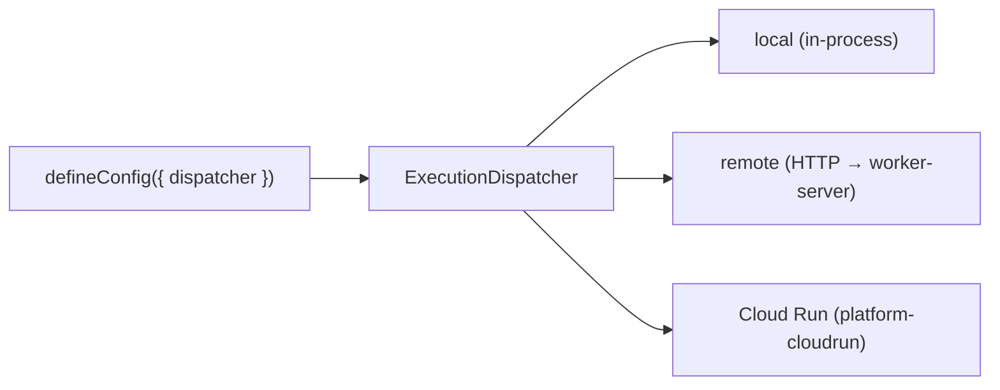

# Loom — User Guide

A **topic-by-topic reference** with runnable examples. Unlike the sequential [Usage](usage.md) tutorial, jump to any section. For the *why* behind these designs, see [Architecture](architecture.md).

> **Loom 2.0.** Sections 1–14 are the durable core (unchanged and always valid). Sections **15–20** cover the execution-kernel evolution — the Reasoning Runtime, tiered memory, the kernel-hardening rings (grants / quotas / supervision), event intelligence, AI-native codegen, and capability governance. Everything in 2.0 is **additive and opt-in**. Full data-structure/algorithm/diagram detail lives in [`loom-2.0/`](loom-2.0/00-overview.md).

## Contents

- [1. Flows, steps & handlers](#1-flows-steps--handlers)
- [2. The ExecutionContext (`ctx.execute` / `ctx.decide`)](#2-the-executioncontext)
- [3. Effects & middleware](#3-effects--middleware)
- [4. Suspend & resume](#4-suspend--resume)
- [5. Branching: fork / simulate / promote](#5-branching-fork--simulate--promote)
- [6. Projections & A2UI surfaces](#6-projections--a2ui-surfaces)
- [7. Agents, tools & A2A](#7-agents-tools--a2a)
- [8. Intent, planner & memory](#8-intent-planner--memory)
- [9. Configuration reference](#9-configuration-reference)
- [10. Testing](#10-testing)
- [11. The `loom` CLI](#11-the-loom-cli)
- [12. Evals & deploy simulation](#12-evals--deploy-simulation)
- [13. Where executions run (compute)](#13-where-executions-run-compute)
- [14. Determinism rules & pitfalls](#14-determinism-rules--pitfalls)
- **Loom 2.0:**
- [15. Reasoning Runtime — routing & elevation](#15-reasoning-runtime--routing--elevation)
- [16. Tiered memory](#16-tiered-memory)
- [17. Kernel: grants, quotas & supervision](#17-kernel-grants-quotas--supervision)
- [18. Event intelligence & self-optimization](#18-event-intelligence--self-optimization)
- [19. AI-native codegen (`appgen`)](#19-ai-native-codegen-appgen)
- [20. Capabilities: versioning, dependencies & authorization](#20-capabilities-versioning-dependencies--authorization)

---

## 1. Flows, steps & handlers

### `step$` — a unit of work

```ts
import { step$, handler$ } from "@loom/core";
import { z } from "zod";

const step = step$({
  id: "restart-pool",              // unique within the flow
  name: "Restart connection pool",
  inputSchema: z.object({ target: z.string() }),
  outputSchema: z.object({ ok: z.boolean() }),
  handler: handler$(async (input, ctx) => ({ ok: true })), // co-located logic
  toolId: "restart-pool",          // OR resolve to a registered Effect by id
  retry: { maxAttempts: 3 },       // optional
  timeoutMs: 30_000,               // optional
});
```

A step either carries an inline `handler` **or** names a `toolId` that resolves to an Effect registered in the `EffectRuntime` (§3). Use inline handlers for logic that lives with the flow; use `toolId` for shared or externally-provided effects.

### `flow$` + runner — a `RegisteredFlow`

The `flow$` **definition** is declarative metadata (schemas, version, the step list). The **runner** is the imperative orchestration function. A `RegisteredFlow` bundles them:

```ts
import { flow$ } from "@loom/core";
import type { FlowRunner, RegisteredFlow } from "@loom/workflow-runtime";

const runner: FlowRunner<In, Out> = async (ctx, input) => {
  const a = await ctx.run(stepA, { target: input.target });
  const b = await ctx.run(stepB, { from: a });
  return { result: b };
};

export const myFlow: RegisteredFlow<In, Out> = {
  definition: flow$({ id: "my-flow", name: "My Flow", version: "1.0.0", inputSchema, outputSchema, steps: [stepA, stepB] }),
  runner,
};
```

Register and run:

```ts
runtime.registerFlow(myFlow.definition, myFlow.runner);
const handle = await runtime.start(myFlow, input, { executionId: "opt-custom-id" });
```

> **Versioning.** `version` is part of the flow identity and is recorded. Deploy-sim (§12) uses the log to check whether new definitions can still resume old executions.

---

<a id="2-the-executioncontext"></a>
## 2. The ExecutionContext

The `ctx` passed to a runner is the only durability touch-point. Everything else is plain code. In Loom 2.0 the interface is named `ExecutionContext` (`WorkflowContext` remains an alias) and its methods are the **kernel's versioned syscall surface** (K1).

```ts
interface ExecutionContext {
  readonly executionId: string;
  readonly workflowId: string;

  // Loom 2.0: the generalized durable primitive. A step is one task kind; `run` is a thin alias.
  execute<TIn, TOut>(task: ExecutableTask<TIn, TOut>, input: TIn): Promise<TOut>;
  run<TIn, TOut>(step: StepDefinition<TIn, TOut>, input: TIn): Promise<TOut>;

  // Loom 2.0 (P9): record an advisory/optimizer choice durably; served on replay.
  decide<T>(id: string, decider: () => T | Promise<T>, opts?: { rationale?: unknown; source?: string }): Promise<T>;

  parallel<T extends unknown[]>(
    pairs: { [K in keyof T]: [StepDefinition<unknown, T[K]>, unknown] },
    options?: { limit?: number }
  ): Promise<T>;
  suspend(config: { on: string; timeout?: number; correlationKey?: string }): Promise<never>;
  emit(eventType: string, payload: unknown): void;
  stream(eventType: string, delta: string, done?: boolean): void;
  readonly ui: A2UIEmitter; // .set / .merge / .append
}
```

**`ctx.execute` — the generalized primitive.** A `StepDefinition` is a valid task (the `'step'` kind), so `ctx.run(step, input)` *is* `ctx.execute(step, input)`. Other task kinds (`llm` / `agent` / `tool` / `ui` / `memory` / `human` / `plan`) route through the same effect resolution and record the same `STEP_*` events, so existing logs replay byte-identically.

**`ctx.decide` — log an optimizer's choice (P9).** Wrap any non-deterministic decision (a model route, a memory recall, a learned ranking). On the first run the `decider` is consulted and its choice recorded as `DECISION_RECORDED`; on replay/resume the recorded choice is returned and the decider is **never called** — the twin of how a completed step is served from the log.

```ts
const model = await ctx.decide("route:triage", () =>
  reasoning.route(task, { budget }), { source: "triage-flow" });
// replay serves "model" from the log — no re-routing, deterministic run
```

**Parallel steps**, order-preserving and concurrency-bounded:

```ts
const [metrics, logs] = await ctx.parallel(
  [ [fetchMetrics, { target }], [fetchLogs, { target }] ],
  { limit: 2 }
);
```

**Emit domain events** into the log for projections/telemetry:

```ts
ctx.emit("assessment_complete", { riskLevel: "high" });
```

**Stream** incremental output (e.g. LLM tokens) — deltas surface live but the final result is what's recorded:

```ts
ctx.stream("triage_tokens", token);        // …deltas…
ctx.stream("triage_tokens", "", true);     // done
```

---

## 3. Effects & middleware

### Effects isolate side effects

All I/O flows through the `EffectRuntime`, keyed by `toolId`. During replay, a completed effect is served from the log — **never re-executed** — which is what makes resumes and forks exactly-once.

```ts
import { EffectRuntime, ToolEffect, LlmEffect } from "@loom/effect-runtime";

runtime.register("fetch-metrics", new ToolEffect(async (input: { target: string }, ctx) => {
  return await api.metrics(input.target);
}));

runtime.register("triage-llm", new LlmEffect(async (input, ctx) => {
  ctx.emit("llm_call", { model });
  return await provider.complete(input);
}));
```

Effect kinds: `"tool" | "llm" | "human" | "a2a"`. The `EffectContext` gives handlers `executionId`, `stepId`, `attempt`, `emit()`, and an optional `signal` (AbortSignal) for cancellation.

### Middleware wraps effects

Middleware is a composable chain `(ctx, input, next) => Promise`, applied outermost-first — identical in spirit to HTTP middleware.

```ts
import { retryMiddleware } from "@loom/middleware";
import type { EffectMiddleware } from "@loom/effect-runtime";

const logging: EffectMiddleware = async (ctx, input, next) => {
  const t = performance.now();
  try { return await next(); }
  finally { console.log(`${ctx.stepId} took ${(performance.now() - t).toFixed(1)}ms`); }
};

const app = defineConfig({
  storage: { kind: "memory" },
  flows: [myFlow],
  effectMiddleware: [
    logging,
    retryMiddleware({ maxRetries: 3, baseDelayMs: 200, factor: 2, jitter: true }),
  ],
});
```

`retryMiddleware` options: `maxRetries`, `baseDelayMs`, `factor`, `maxDelayMs`, `jitter` (deterministic FNV-1a jitter — no `Math.random`), `isRetryable`, `onRetry`, and an injectable `sleep`. It **never** retries a `SuspendError` or an aborted signal.

---

## 4. Suspend & resume

`ctx.suspend()` writes a durable checkpoint and returns control to the caller. The execution now lives entirely in storage — the process can restart, and another machine can resume it.

```ts
const decision = (await ctx.suspend({
  on: "ApprovalGranted",           // logical event you'll resume with
  correlationKey: input.target,     // used to route the resume to this execution
  timeout: 24 * 60 * 60 * 1000,     // optional; drives a timeout condition
})) as { approved: boolean; approvedBy: string };
```

Resume from anywhere:

```ts
await runtime.resume(executionId, {
  eventType: "ApprovalGranted",
  payload: { approved: true, approvedBy: "operator" },
});
```

**Mechanics.** On resume the runner re-runs from the top. Every step that already completed is replayed from its logged `STEP_COMPLETED` (the effect does not run again); when execution reaches the original `suspend()`, that call *returns the resume payload* and the flow proceeds. This is deterministic replay (see [Architecture §4.3](architecture.md#43-suspend--resume)).

**Recovery.** A crash mid-flight is just a resume: on redispatch the runtime folds durable state and, if still `running`, resumes; if already terminal, returns as-is. No step re-runs. `loadState(id)` folds state without running.

**Bounding replay.** For long executions, set `snapshotEvery` so a resume folds only the tail after the latest snapshot:

```ts
new WorkflowRuntime({ eventStore, snapshotStore, effectRuntime, snapshotEvery: 100 });
```

---

## 5. Branching: fork / simulate / promote

Branching is nearly free because state is `fold(events)` — a fork copies the event prefix into a new execution and resumes it differently. Enable it with `storage: { branching: true }` (or pass a `BranchRegistry`).

```ts
// Fork the prefix [0..sequence] into a new branch.
const fork = await runtime.fork(parentId, atSequence, { branchName: "spec/scale" });
// fork.executionId is a new, independent execution seeded at the fork point.

// Resume the branch differently (e.g. a "simulate" flag your flow reads).
const resumed = await runtime.resume(fork.executionId, {
  eventType: "RemediationDecision",
  payload: { approved: true, strategy: "scale", simulate: true },
});
const outcome = (await resumed.waitForCompletion()).variables._output;
```

The `BranchRegistry` provides git-style refs — `putRef`, `moveTip`, `promote(from, to)`, `children`, `getLineage`:

```ts
await branchRegistry.putRef({ name: "main", executionId: parentId, tip: forkPoint });
await branchRegistry.promote("commit", "main"); // pointer move, no merge
```

**Pattern (fork → simulate → compare → promote).** Fork per strategy, run concurrently with `parallelLimit`, compare the projected outcomes, then commit the winner via a fresh fork resumed with `simulate:false`. Losing branches stay immutable — a full audit trail. Full worked example: [`examples/incident-war-room`](../examples/incident-war-room) and the [Usage tutorial §10](usage.md#step-10--branch-fork--simulate--promote).

---

## 6. Projections & A2UI surfaces

A **projection** is a read model folded from events, independent of durability. Flows emit UI patches via `ctx.ui`; they fold into named **surfaces**.

```ts
ctx.ui.set("phase", "investigating");                 // overwrite path
ctx.ui.merge("metrics", { cpu: 87, memMb: 14000 });   // shallow-merge object
ctx.ui.append("timeline", "collected metrics");        // push to array (amortized O(1) in a batch)
```

Read a surface (server, client, or test):

```ts
const view = app.projectionRuntime.getState<MyView>("mission", executionId);
```

Register surfaces via `defineConfig({ surfaces: ["mission", "telemetry"] })`, or a custom projection with `projection$({ id, name, initialState, handlers })` for domain-specific read models. Render with any renderer — `@loom/renderer-react`, `@loom/renderer-terminal`, `@loom/a2ui` for Web Components, or your own. **The durable log never depends on the renderer.**

For streamed progress independent of surfaces, use a pub/sub hub (`progressHub`) — handlers call `report(id, line)` / `reportProgress(id, pct)` and orchestrators subscribe (`onReport` / `onProgress`). See [`examples/schema-migration-planner`](../examples/schema-migration-planner).

---

## 7. Agents, tools & A2A

### Tools & agents

```ts
import { tool$, agent$ } from "@loom/core";

const queryTool = tool$({
  id: "query-db", name: "Query DB", description: "Run a read-only query",
  inputSchema: z.object({ sql: z.string() }), outputSchema: z.object({ rows: z.array(z.unknown()) }),
});

const dbaAgent = agent$({
  id: "dba", name: "DBA Agent", description: "Owns database operations",
  tools: [queryTool],
});
```

`@loom/agent` runs a ReAct-style reason→act loop over an agent's tools; `@loom/mcp` discovers external tools via the Model Context Protocol.

### A2A — agent-to-agent

Expose a Loom flow as an A2A task, and call *external* agents (Google ADK, LangGraph, CrewAI) as steps. Locally, the `InProcessA2ABus` dispatches a capability to its owning agent with streaming callbacks:

```ts
const result = await app.bus.dispatch(capabilityId, input, prompt, {
  executionId: taskId,
  onProgress: (line) => report(taskId, line),
  onStatus: (status) => setStatus(taskId, status),
  onApproval: mutating ? () => gate(taskId) : undefined, // human gate for mutating steps
});
```

Register the mapping in config: `defineConfig({ agents: [card…], capabilityAgents: { "assess-cpu": "sre", … } })`. The `LoomAgentExecutor` adapts any registered flow into a stateless A2A task (folds state from stores per request) — see [ADR 0007](adr/0007-manifest-and-a2a-adapter.md).

---

## 8. Intent, planner & memory

Compose "type a goal, do the right thing":

```ts
const route = await intent.route(goal);   // @loom/intent → primary capability + rationale
const plan  = await planner.plan(goal);   // @loom/planner → ordered capability steps

for (const s of plan.steps) {
  await app.bus.dispatch(s.capabilityId, inputFor(s), prompt);
}
```

`@loom/memory` gives agents scoped, TTL/size-bounded stores via `memory$({ id, name, ttlMs, maxEntries })`. `@loom/orchestrator` packages the recurring route→plan→dispatch→gate loop as composable functions (`dispatchPlan`, `decideApproval`) — use them where they fit; drop to primitives where they don't ([ADR 0013](adr/0013-orchestrator-primitives.md)).

The full stack in action: [`examples/db-command-center`](../examples/db-command-center).

---

## 9. Configuration reference

`defineConfig(config: LoomConfig): LoomApp`.

```ts
interface LoomConfig {
  storage:
    | { kind: "memory" }
    | { kind: "sqlite"; dir?: string; branching?: boolean }
    // Bring your own backend — Postgres/Redis/DynamoDB, used verbatim:
    | { kind: "custom"; eventStore; snapshotStore; branchRegistry? };
  surfaces?: string[];
  flows?: RegisteredFlow[];
  flowModules?: FlowModule[];          // from `loom gen` (static discovery)
  effectMiddleware?: EffectMiddleware[];
  validate?: boolean | "warn" | "error";
  agents?: AgentCard[];
  capabilityAgents?: Record<string, string>;
  telemetry?: TelemetryAdapter[];
  dispatcher?: ExecutionDispatcher;    // where executions run
  onEvent?: (event: EventEnvelope) => void;
  onWarn?: (message: string) => void;
  projectionRuntime?: ProjectionRuntime;
  catalog?: CatalogLike;
  manifest?: ManifestView;
}

interface LoomApp {
  runtime: WorkflowRuntime;
  effectRuntime: EffectRuntime;
  projectionRuntime: ProjectionRuntime;
  bus: InProcessA2ABus;
  stores: { eventStore: EventStore; snapshotStore: SnapshotStore; branchRegistry?: BranchRegistry };
  close(): Promise<void>;
}
```

`validate` runs the boot-time flow-graph check (missing effect for a step's `toolId`, dangling capability→agent) — `"warn"` logs, `"error"` throws. Same engine as `loom check` ([ADR 0012](adr/0012-flow-graph-validation.md)).

**Manual wiring** (no `defineConfig`) is fully supported — everything above is sugar over `new WorkflowRuntime({...})`, `new EffectRuntime([...middleware])`, and a projection runtime.

---

## 10. Testing

`@loom/testing`:

| Helper | Purpose |
|---|---|
| `createTestApp(config?)` | in-memory `LoomApp` (storage defaults to memory) |
| `waitFor(pred, { timeoutMs, intervalMs })` | poll until a predicate holds |
| `waitForPhase(pr, surface, id, phase)` | wait until a surface reaches a phase |
| `getSurfaceState(pr, surface, id)` | read a surface |
| `driveToSuspend(handle)` | start→first suspend |
| `resumeWith(runtime, id, event?)` | resume sugar |
| `captureGolden(eventStore, id)` | grab the event log as a fixture |
| `recordingProvider` / `replayingProvider` | VCR LLM: record once, replay deterministically |

```ts
import { createTestApp, waitForPhase, captureGolden } from "@loom/testing";

const app = createTestApp({ surfaces: ["mission"], flows: [myFlow] });
const handle = await app.runtime.start(myFlow, input);
await handle.waitForCompletion();
await waitForPhase(app.projectionRuntime, "mission", handle.executionId, "done");
const golden = await captureGolden(app.stores.eventStore, handle.executionId);
await app.close();
```

VCR keeps LLM tests offline and deterministic (lookup is O(1) by request hash):

```ts
import { recordingProvider, replayingProvider, emptyCassette } from "@loom/testing";
const cassette = emptyCassette();
const provider = process.env.RECORD ? recordingProvider(realLlm, cassette) : replayingProvider(cassette);
```

---

## 11. The `loom` CLI

```
loom gen   [--dir app]                          regenerate loom.gen.ts from app/flows
loom new   <flow|agent|tool> <name> [--dir app] scaffold a file (folder convention)
loom check --manifest <path>                    static flow-graph checks
loom logs  --db <path> <executionId>            print the event timeline
loom debug --db <path> <executionId> [--at N]   time-travel: state at sequence N
loom eval  --dir <path>                         replay golden logs vs expectations
loom deploy check --logs <dir> --config <mod>   simulate deploy vs new flow defs
loom inspect --db <path> [--port N]             web inspector (timeline + slider)
```

- **`logs` / `debug` / `inspect`** operate directly on a SQLite event DB — no app load needed. `debug --at N` folds the exact state at sequence *N* (time-travel); `inspect` serves a web timeline with a slider using the same fold.
- **`gen` / `new`** implement the folder convention via **build-time codegen** (a static `loom.gen.ts`), not runtime globbing ([ADR 0011](adr/0011-folder-convention-codegen.md)).
- **`eval` / `deploy check` / `check`** are CI gates (§12).

---

## 12. Evals & deploy simulation

Both replay the durable log — the log *is* the fixture.

**Evals** (`@loom/eval`, `loom eval`): store an execution's event log as a golden fixture (`captureGolden`) plus expectations; `loom eval --dir evals/` replays each and reports pass/fail, exiting non-zero for CI.

```jsonc
// evals/happy.json
{ "name": "happy path", "log": [ /* EventEnvelope[] */ ], "expect": { "status": "completed", "stepsCompleted": ["investigate", "apply"] } }
```

**Deploy simulation** (`@loom/deploy-sim`, `loom deploy check`): replay historical logs against your **new** flow definitions to catch resume-incompatibility *before* promoting — a removed step or missing flow is flagged breaking; a suspended carry-over is a warning. This catches what type-checking can't: whether in-flight executions can still finish after a deploy ([ADR 0008](adr/0008-evals-and-deploy-simulation.md)).

---

## 13. Where executions run (compute)

By default, `start`/`resume` run in-process. A **dispatcher** decides placement; the same flows run anywhere because an `ExecutionPackage` carries resume coordinates (identity + sequence), never code.



- **Local:** `@loom/worker-runtime-local` — same process.
- **Remote:** `@loom/worker-runtime-remote` posts an `ExecutionPackage` to `@loom/worker-server`'s `POST /execute`; the stateless worker rebuilds all state from shared stores.
- **Cloud Run:** `@loom/platform-cloudrun` maps dispatch metadata to sizing; see [`packages/platform-cloudrun/deploy.md`](../packages/platform-cloudrun/deploy.md).
- **Fan-out:** `@loom/graph-executor` runs graph nodes as per-node executions (one writer each), joined via lineage.

Workers reference flows/effects **by id** from a statically-wired registry — so a worker must be booted with the same registrations (P5). Suspension is a normal result across the network boundary.

---

## 14. Determinism rules & pitfalls

Determinism is what makes resume, fork, and replay trustworthy. Keep these in mind:

- **Put non-determinism inside effects, not orchestration.** Wall-clock reads, randomness, and I/O belong in a `handler`/Effect (whose result is logged), *not* in the runner's control flow. A runner must reach the same suspend/step sequence on replay.
- **For advisory/orchestration-level non-determinism, use `ctx.decide` (P9).** A model route, a memory recall, or a learned ranking that affects *what runs* should be wrapped in `ctx.decide(id, …)` so the choice is recorded and served on replay. This is the 2.0 escape hatch: the runtime may improve run-to-run, but any single run stays reproducible. Memory recall that affects outcomes: pass `ctx.decide` to `TieredMemory.recall({ decide })` (§16).
- **Don't branch orchestration on unlogged external state.** If the runner does `if (Date.now() % 2)` it may diverge on replay. Fetch the value in a step, then branch on the step's (logged) output.
- **Effects run once; replays serve from the log.** Don't rely on a side effect happening again during resume — it won't.
- **Keep wiring static.** Register flows/effects explicitly (or via `loom gen`). No runtime globbing or env-conditional registration, or a remote worker/replay can't reconstruct the same graph (P5).
- **Middleware must be replay-safe too.** Retries/jitter use deterministic hashing, not `Math.random`. Follow suit in custom middleware on replayable paths.
- **Snapshots are an optimization, not truth.** The log is authoritative; snapshots only shorten the fold. Never store data *only* in a snapshot.

---

## 15. Reasoning Runtime — routing & elevation

*(Loom 2.0, M3 — `@loom/reasoning`.)* Instead of a single `LlmProvider.complete()`, the Reasoning Runtime routes across a registry of models and **elevates** to a stronger one when confidence is low.

```ts
import { ReasoningRuntime, validatorConfidence } from "@loom/reasoning";

const reasoning = new ReasoningRuntime({
  routes: [
    { id: "gemma", provider: gemma, tier: 0 },          // cheap-first
    { id: "flash", provider: flash, tier: 1 },
    { id: "opus",  provider: opus,  tier: 2 },
  ],
  // Confidence is a pluggable signal — NOT a magic number. Default: stop-reason.
  confidence: validatorConfidence((c) => c.trim().startsWith("{")), // e.g. "did it produce JSON?"
  elevateThreshold: 0.5,
});

const res = await reasoning.reason(
  { messages: [{ role: "user", content: prompt }], strategy: "planning", maxTier: 2 },
  { decide: ctx.decide },   // ← routes/elevations logged (P9), replay-safe & auditable
);
res.modelId;   // which model finally answered
res.elevated;  // did it climb the ladder?
res.trace;     // [{ modelId, tier, confidence, elevated }, …]
```

- **Cheap-first + elevation ladder.** `tagRouter` (default) picks the lowest-tier route whose tags match the `strategy`, then elevation climbs tiers while `confidence < threshold` and `tier ≤ maxTier`.
- **Confidence signals.** `stopReasonConfidence` (default), `validatorConfidence(fn)`, `constantConfidence(n)`, or your own.
- **Logged routes.** Pass `ctx.decide` and each route/elevation becomes a durable `DECISION_RECORDED` fact — observable and replay-safe.
- **`intent`/`planner` re-based.** Give `IntentRuntime`/`PlannerRuntime` a `reasoning` and they route through it; the offline keyword/heuristic fallback stays deterministic.

See [`loom-2.0/02-reasoning-and-memory.md`](loom-2.0/02-reasoning-and-memory.md) for the full pipeline and diagrams.

---

## 16. Tiered memory

*(Loom 2.0, M5 — `@loom/memory`.)* `TieredMemory` composes named tiers over the scoped `MemoryRuntime`, each with an eviction *or* summarization policy, plus promotion between tiers.

```ts
import { TieredMemory, DEFAULT_TIERS } from "@loom/memory";

const mem = new TieredMemory({ tiers: DEFAULT_TIERS }); // working / episodic / semantic / procedural

await mem.remember("working", scope, { role: "note", content: "primary is CPU-saturated" });
await mem.promote("working", "semantic", scope, { filter: (e) => e.role === "note", move: true });

// Outcome-affecting recall MUST be logged, or replay diverges:
const context = await mem.recall("semantic", scope, { limit: 10, decide: ctx.decide });
```

- **Tiers + policies.** `TierPolicy` = `{ ttlMs?, maxEntries? }` (eviction) **or** `{ summarizeAfter? }` (summarization — folds the oldest entries into a summary, auto-run on `remember`, with a pluggable `Summarizer`).
- **Logged recall (the determinism fix).** Passing `ctx.decide` records the recalled set so replay serves the **same** entries even if the store later changed — non-deterministic recall can no longer break P2.
- **Promotion.** Lift salient entries between tiers (`copy` or `move`).

---

## 17. Kernel: grants, quotas & supervision

*(Loom 2.0 kernel-hardening — K2 / K3 / K4 / K8 / K9.)* All opt-in; omit them and behavior is unchanged.

### Capability grants (protection ring, K2)

The `EffectRuntime` is the authority boundary. Give it a least-privilege `GrantTable` and an ungranted effect is **denied** (the denial is logged as `EFFECT_DENIED`; the step fails).

```ts
import { EffectRuntime, GrantTable } from "@loom/effect-runtime";

const effectRuntime = new EffectRuntime([], {
  authorizer: new GrantTable({ "incident-flow": ["metrics-tool", "logs-tool"] }), // grant only these
});
// …or via defineConfig({ authorizer: new GrantTable({ … }) }).
// Any other toolId this flow invokes → CapabilityDeniedError, EFFECT_DENIED logged.
```

### Resource accounting & quotas (K3)

`meteringMiddleware` meters each effect (tokens/$/latency) onto the log and enforces a budget by admission control.

```ts
import { meteringMiddleware, llmUsageTokens } from "@loom/middleware";

const metering = meteringMiddleware({
  pricing: ({ result, ms }) => ({ tokens: llmUsageTokens(result), costUsd: llmUsageTokens(result) * 3e-6, ms }),
  budget: { maxCostUsd: 5 },   // once spent, the next effect is denied (QUOTA_EXCEEDED)
});
const effectRuntime = new EffectRuntime([metering]);
// Running totals live in state.variables._resources (tokens / costUsd / ms / count / exceeded).
```

### Fault supervision (K4)

Wrap any dispatcher with `SupervisingDispatcher` for restart/backoff + a **circuit breaker** that fails fast when a target is consistently down.

```ts
import { SupervisingDispatcher } from "@loom/dispatcher";

const dispatcher = new SupervisingDispatcher(childDispatcher, {
  policy: { maxRestarts: 2, backoffMs: 200, circuit: { threshold: 5, cooldownMs: 30_000 } },
});
```

### Cancellation & deadlines (K8)

The kernel can reclaim running work — cooperatively where effects honor the signal, and by
durable settlement everywhere else (the guarantee is the logged fact, not physical
termination of third-party I/O).

```ts
// Kill an execution BY ID, wherever it stands:
await runtime.cancel(executionId, "operator kill");
// - live in this runtime → aborts the in-flight effect + durable EXECUTION_CANCELLED
// - suspended / on a presumed-dead node → FENCE-THEN-CANCEL: acquires a newer fence
//   token first (K9.4), so a zombie worker can no longer write, then appends the fact.
// Cancelled is terminal: resume() refuses, a second cancel returns false.

// Declarative deadlines — enforced by the kernel, anchored to LOGGED timestamps
// (a crash/recovery never resets the clock):
step$({ id: "call-api", …, timeoutMs: 30_000 });       // per step, anchored to its first STEP_STARTED
flow$({ id: "audit", …, deadlineMs: 10 * 60_000 });    // per run, anchored to EXECUTION_STARTED
await runtime.start(flow, input, { deadlineMs: 5_000 }); // per-dispatch override
```

A step timeout fails the step (`STEP_FAILED`, retriable by your flow logic); an execution
deadline cancels the run (`EXECUTION_CANCELLED`). Effects receive the abort via `ctx.signal`
(LLM effects forward it to the provider's HTTP call automatically); effects that ignore it
are settled durably anyway. Aborted effects are still **metered** (wall-time at minimum), so
cancel-before-completion cannot evade a K3 budget, and the retry middleware treats abort as
terminally non-retryable. Deadlines fire while a process is actively running the execution;
durable firing across idle suspension arrives with T1's timer service.

**Across the compute seam (K8.5):** cancellation follows the execution wherever it runs —
`dispatcher.cancel(executionId)` forwards the kill through the placement seam, and a remote
HTTP worker exposes `POST /cancel` (`RemoteWorkerRuntime.cancel`). Delivery is best-effort by
contract (an unreachable worker returns `false`, never throws); the *settlement* is durable
either way — the orchestrator's own `runtime.cancel()` fences-then-appends on the shared
store, so even an undeliverable zombie ends fenced out with `EXECUTION_CANCELLED` on the log.
A cancelled dispatch settles as a normal terminal result, never a retryable transport error.

### Effect delivery: at-least-once & idempotency (K9)

**The contract:** *effects are at-least-once; steps are exactly-once only with respect to the
log.* If a worker crashes after performing a side effect but before its `STEP_COMPLETED`
reaches the log, recovery re-executes the in-flight step — completed steps never re-run, but
the one in-flight effect can. (Metered `RESOURCE_METERED` facts are at-least-once too: budgets
may over-count after a crash — they never under-count.)

Two opt-in tools manage this window:

**1. Idempotency key (K9.2).** Every effect invocation receives a deterministic
`ctx.idempotencyKey` — `executionId:stepId` — that is **stable across crash-recovery re-runs
of the same logical attempt**. Pass it to your provider so a re-run deduplicates:

```ts
const charge = new ToolEffect(async (input, ctx) => {
  return stripe.charges.create({ amount: input.amountUsd }, { idempotencyKey: ctx.idempotencyKey });
});
```

**2. In-doubt parking (K9.3).** A mutating tool that **cannot** be made idempotent declares
it, and recovery refuses to silently re-run an attempt in an unknown state — it records a
durable `EFFECT_INDOUBT` fact and suspends for an operator verdict:

```ts
const wireTransfer = new ToolEffect(sendWire, { idempotent: false }); // park, never silently re-run
// (declare the same on the definition: tool$({ id: "wire", …, idempotent: false }))

// The execution suspends with { on: "EffectInDoubtResolved", correlationKey: stepId }.
// An operator checks the provider, then settles it with a standard resume:
await runtime.resume(executionId, {
  eventType: EFFECT_INDOUBT_RESOLVED, // from @loom/workflow-runtime
  payload: { stepId: "wire", resolution: "completed-with-result", output: { txId: "…" } },
  // or { stepId: "wire", resolution: "retry-fresh" }   → re-run as a NEW logical attempt (fresh key `…:r1`)
  // or { stepId: "wire", resolution: "fail", error: "…" } → settle the step as failed
});
```

Undeclared tools keep the legacy automatic re-run byte-identically. Prove your tools' semantics
in CI with the crash-injection harness — `crashingEventStore` in `@loom/testing` kills the
execution exactly between the effect and its completion append.

**3. Fencing tokens (K9.4).** On a multi-node store, a re-dispatched execution must be safe
from its *zombie* predecessor — a partitioned worker that wakes up and writes after the
execution moved elsewhere. Fencing stores (in-memory, Postgres) expose
`acquireFence(executionId)` — a monotonic token the worker's lease carries and every appended
event is stamped with; the **store append rejects** a stale or missing token
(`StaleFenceError`), so exactly one version of history can land. `LocalWorkerRuntime.allocate`
acquires it automatically; hand-driven runs pass `{ fence }` via `RunOptions`. Executions that
never fence — and single-node SQLite, where the process is the failure domain — are entirely
untouched (G2).

---

## 18. Event intelligence & self-optimization

*(Loom 2.0, M9–M11 — `@loom/analytics`.)* Pure, **read-only** analyzers over the durable log — never a writer.

```ts
import { analyze, runtimeIntelligence } from "@loom/analytics";
import { rankModels } from "@loom/analytics";
import { rankedRouter } from "@loom/reasoning";

const events = await eventStore.read(executionId);
const a = analyze(events);   // { execution, cost, reasoning, failure }
a.cost.costUsd;              // total metered spend
a.reasoning.routes;         // { gemma: 3, opus: 1, … } model-route frequency
a.failure.failedSteps;      // which steps failed

// Self-optimization (opt-in, LOGGED, auditable): rank models from history, feed a learned router.
const rankings = rankModels(historicalEvents);
const reasoning = new ReasoningRuntime({ routes, router: rankedRouter(rankings) });
// …its choices still flow through ctx.decide → DECISION_RECORDED, so nothing is silently autonomous.

// Runtime intelligence: an advisory report (never mutates the fold).
const report = runtimeIntelligence(events);
report.recommendations; // { modelRankings, hotFailures, suggestedBudgetUsd }
```

---

## 19. AI-native codegen (`appgen`)

*(Loom 2.0, P11 — `@loom/appgen`.)* Turn a natural-language intent into a structured spec, then emit **plain, static, inspectable TypeScript you own** — there is no runtime interpretation of NL.

```ts
import { parseIntent, generateApp } from "@loom/appgen";

const spec = parseIntent(
  "Create a planner. Use Gemma first. Elevate to Gemini. Pause for approval. Generate UI."
);
// spec: { name: "planner", capabilities: [{ id, reasoning:{baseModel,elevateTo}, approval, ui, … }], … }

const files = generateApp(spec); // GeneratedFile[] — src/planner.ts (flow$/step$/capability$ + ctx.suspend gate + ctx.ui) + src/app.ts (defineConfig)
// A CLI/editor writes them; the output is ordinary Loom code with TODO handlers to fill in.
```

The only "understanding" is the deterministic, offline directive parser producing the `AppSpec`; codegen is pure and template-based (P4/P5 preserved).

---

## 20. Capabilities: versioning, dependencies & authorization

*(Loom 2.0, M7 — `@loom/capability`.)* Capabilities gain governance metadata and access control.

```ts
import { capability$, CapabilityCatalog } from "@loom/capability";

const triage = capability$({ id: "triage", intent: "Triage an incident", inputSchema, flow,
  version: "2.1.0", dependencies: ["fetch-metrics", "fetch-logs"] });

const catalog = new CapabilityCatalog({
  authorizer: { authorize: (req) => req.principal === "oncall" ? { allowed: true } : { allowed: false, reason: "oncall only" } },
});
catalog.register(triage)/* … */;

catalog.resolve("triage");          // transitive deps, dependency-first order; throws on missing dep or cycle
await catalog.invoke(runtime, "triage", input, { principal: "oncall" }); // denied → CapabilityInvokeDeniedError
```

> `CapabilityInvokeAuthorizer` governs who may *invoke* a capability — distinct from the K2 effect **protection ring** (§17), which governs which *effects* a running execution may perform.

---

### See also

- **[Getting Started](getting-started.md)** · **[Usage tutorial](usage.md)** · **[Architecture](architecture.md)** · **[ADRs](adr/)**
- **Loom 2.0 deep-dives:** [`loom-2.0/`](loom-2.0/00-overview.md) — data structures, algorithms, and diagrams for every subsystem, plus the [event-schema reference](loom-2.0/10-event-schema-reference.md).
- Runnable apps: [`examples/`](../examples) — `agent-network`, `db-command-center`, `incident-war-room`, `schema-migration-planner`.
